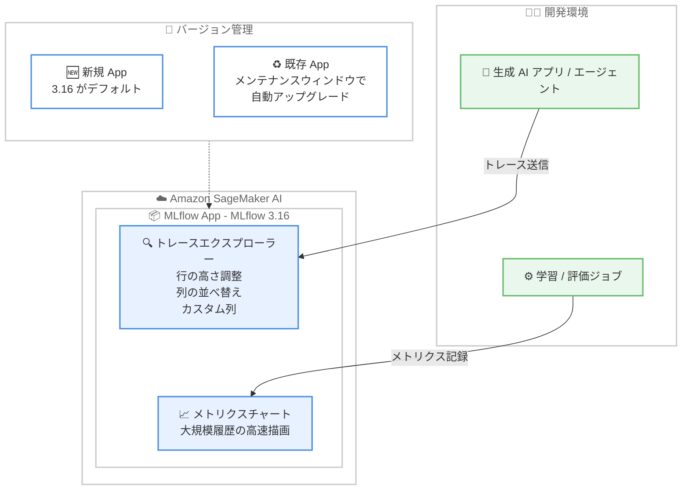

# Amazon SageMaker AI - MLflow Apps の MLflow 3.16 サポート

**リリース日**: 2026 年 10 月 27 日
**サービス**: Amazon SageMaker AI
**機能**: SageMaker AI MLflow Apps における MLflow 3.16 サポート

📊 [このアップデートのインフォグラフィックを見る](https://takech9203.github.io/aws-news-summary/20261027-mflow-version-3-16.html)

## 概要

Amazon SageMaker AI の MLflow Apps が MLflow 3.16 をサポートしました。MLflow 3.16 では、再設計されたトレーシング体験と、より高速な実験トラッキングが提供され、生成 AI アプリケーションやエージェントのデバッグ・分析の効率が向上します。

今回のアップデートの中心は、デフォルトになった新しいトレースエクスプローラーです。行の高さの調整、列の並べ替え、トレースのタグやメタデータフィールドからのカスタム列の作成が可能になり、大量のトレースの中から目的の情報に素早くたどり着けるようになりました。また、大規模なメトリクス履歴を持つ実験でのメトリクスチャートの描画が高速化され、長時間の学習ジョブや大量の評価メトリクスを扱うケースでの操作性が改善されています。

新規に作成する MLflow App は、デフォルトで MLflow 3.16 を使用します。既存の MLflow Apps は、今後のメンテナンスウィンドウで自動的にアップグレードされるため、ユーザー側での対応は不要です。マネージドサービスとしてバージョン管理を AWS に任せられる点が、OSS 版 MLflow をセルフホストする場合との大きな違いです。

**アップデート前の課題**

- 以前のトレースエクスプローラーでは表示のカスタマイズ性が限られており、トレースのタグやメタデータに基づいて一覧をカスタマイズして分析することが難しかった
- 大規模なメトリクス履歴を持つ実験では、メトリクスチャートの描画に時間がかかり、実験比較の操作性が低下していた
- 生成 AI エージェントのように大量のトレースを生成するワークロードでは、トレース一覧から目的のトレースを特定するのに手間がかかっていた

**アップデート後の改善**

- 再設計されたトレースエクスプローラーがデフォルトとなり、行の高さ調整、列の並べ替え、トレースタグ / メタデータからのカスタム列作成が可能になった
- 大規模なメトリクス履歴を持つ実験でも、メトリクスチャートが高速に描画されるようになった
- 既存の MLflow Apps はメンテナンスウィンドウで自動アップグレードされるため、ユーザーの作業なしで最新機能・セキュリティパッチ・バグ修正を利用できる

## アーキテクチャ図



生成 AI アプリケーションや学習ジョブから送信されたトレース・メトリクスを、MLflow 3.16 の新しいトレースエクスプローラーと高速化されたメトリクスチャートで分析できます。バージョンアップグレードは AWS が自動的に実施します。

## サービスアップデートの詳細

### 主要機能

1. **再設計されたトレースエクスプローラー (デフォルト化)**
   - 行の高さを調整でき、トレース一覧の情報密度を用途に応じて変更可能
   - 列の並べ替えに対応し、重要な情報を見やすい位置に配置可能
   - 任意のトレースタグやメタデータフィールドからカスタム列を作成でき、独自の属性 (例: モデル名、セッション ID、環境名) で一覧を整理可能
   - 生成 AI アプリケーションやエージェントのデバッグ・分析を想定した設計

2. **メトリクスチャートの高速化**
   - 大規模なメトリクス履歴を持つ実験において、チャートの描画が高速化
   - 多数のステップでメトリクスを記録する長時間の学習や、大量の評価メトリクスを扱う実験で効果が大きい

3. **自動バージョンアップグレード**
   - 新規作成する MLflow App は MLflow 3.16 をデフォルトで使用
   - 既存の MLflow Apps は、今後のメンテナンスウィンドウ中に自動的にアップグレードされ、ユーザー側の対応は不要
   - 最新バージョンには最新機能に加えて、セキュリティパッチとバグ修正が含まれる

### MLflow 3.16 (OSS) の主な変更点

AWS の発表ではトレースエクスプローラーとチャート高速化が中心ですが、OSS 版 MLflow 3.16 のリリースノートでは以下のような変更も含まれています (SageMaker AI MLflow Apps での利用可否は公式ドキュメントで確認してください)。

- トレース V4 体験のデフォルト化 (行密度の改善、スパンツリービューの刷新、セッショングルーピングの統合)
- スパンリンクのサポート (関連するスパン間のナビゲーション)
- チャートカードグリッドの仮想化によるチャートビューの応答性改善、実験比較ページでの Run 取得のバッチ化

## 技術仕様

### MLflow Apps のバージョン情報

| 項目 | 詳細 |
|------|------|
| サポートバージョン | MLflow 3.16 (最新バージョン) |
| Python バージョン | Python 3.10 以降 |
| バージョニング方式 | セマンティックバージョニング (major.minor.patch) |
| 新規 App のデフォルト | MLflow 3.16 |
| 既存 App の扱い | メンテナンスウィンドウで自動アップグレード (対応不要) |

### MLflow Apps と MLflow Tracking Servers の違い

| 項目 | MLflow Apps | MLflow Tracking Servers |
|------|-------------|-------------------------|
| 最新サポートバージョン | MLflow 3.16 | MLflow 3.0 |
| バージョン更新 | 自動アップグレード | ユーザーによる管理 |
| CloudTrail データプレーン | `CallMlflowApp` イベントとして記録 | 個別の MLflow API イベントとして記録 |

## 設定方法

### 前提条件

1. MLflow Apps が利用可能なリージョンの AWS アカウント
2. SageMaker AI の MLflow App を作成・利用するための IAM 権限 (`sagemaker-mlflow` サービスプレフィックスの IAM アクションを含む)
3. アーティファクトストア用の Amazon S3 バケット

### 手順

#### ステップ 1: 新規 MLflow App の作成

SageMaker Studio または AWS CLI から MLflow App を作成します。新規作成時には自動的に最新バージョン (MLflow 3.16) が使用されます。詳細な作成手順は [MLflow App Setup](https://docs.aws.amazon.com/sagemaker/latest/dg/mlflow-app-setup.html) を参照してください。

#### ステップ 2: 既存 MLflow Apps の確認

```bash
aws sagemaker list-mlflow-apps
```

既存の MLflow Apps の一覧を表示します。既存 Apps は今後のメンテナンスウィンドウで自動的に MLflow 3.16 にアップグレードされるため、ユーザー側での操作は不要です。

#### ステップ 3: 新しいトレースエクスプローラーの利用

MLflow UI にアクセスし、Traces タブを開きます。再設計されたトレースエクスプローラーがデフォルトで表示され、行の高さ調整、列の並べ替え、トレースタグ / メタデータからのカスタム列作成を UI 上で設定できます。

## メリット

### ビジネス面

- **運用負荷ゼロのアップグレード**: 既存 Apps はメンテナンスウィンドウで自動アップグレードされ、バージョン管理の運用コストが発生しない
- **生成 AI 開発の生産性向上**: トレース分析の効率化により、生成 AI アプリケーションの問題特定・解決にかかる時間を短縮できる
- **最新のセキュリティ対応**: 最新バージョンへの自動更新により、セキュリティパッチとバグ修正が継続的に適用される

### 技術面

- **柔軟なトレース分析**: トレースタグやメタデータからカスタム列を作成でき、エージェントのセッション ID やモデル名など独自の軸でトレースを整理・比較できる
- **大規模実験への対応**: 大規模なメトリクス履歴でもチャートが高速に描画され、長時間学習や大量評価のワークロードでも快適に分析できる
- **OSS MLflow との互換性**: OSS の MLflow SDK をそのまま利用でき、既存のトラッキングコードを変更せずに新しい UI の恩恵を受けられる

## デメリット・制約事項

### 制限事項

- MLflow Apps は一部のリージョンでのみ利用可能 (下記「利用可能リージョン」参照)
- MLflow 3.16 の利用には Python 3.10 以降が必要
- SageMaker AI MLflow にはダウンロードサイズ 200 MB の制限がある

### 考慮すべき点

- 既存 Apps の自動アップグレードはメンテナンスウィンドウ中に実施されるため、UI の見た目や操作感が変わるタイミングをチーム内で共有しておくとよい
- トレースエクスプローラーの再設計により既定の表示が変わるため、従来の UI に慣れたユーザーへの周知が望ましい
- MLflow Tracking Servers (最新 3.0) と MLflow Apps (最新 3.16) ではサポートバージョンが異なるため、最新のトレーシング機能を使う場合は MLflow Apps の利用を検討する

## ユースケース

### ユースケース 1: 生成 AI エージェントのデバッグ

**シナリオ**: 複数のツール呼び出しを行う生成 AI エージェントで、特定の条件下でのみ発生する不正な応答の原因を特定したい。

**実装例**:
```python
import mlflow

mlflow.set_tracking_uri("arn:aws:sagemaker:ap-northeast-1:123456789012:mlflow-app/app-xxxx")
mlflow.set_experiment("agent-debugging")

# トレースにタグを付与して後からカスタム列で分析
with mlflow.start_span(name="agent-run") as span:
    span.set_attributes({"model": "claude-sonnet", "env": "staging"})
    # エージェント処理
```

**効果**: トレースタグからカスタム列を作成し、モデル名や環境ごとにトレースを並べ替えて比較することで、問題のあるトレースを素早く特定できる。

### ユースケース 2: 大規模ファインチューニングの実験管理

**シナリオ**: 数万ステップに及ぶファインチューニングジョブを多数実行し、損失や評価メトリクスの推移を比較したい。

**実装例**:
```python
import mlflow

with mlflow.start_run():
    for step in range(50000):
        mlflow.log_metric("loss", loss_value, step=step)
```

**効果**: 大規模なメトリクス履歴でもチャートが高速に描画され、複数 Run の学習曲線をストレスなく比較できる。

### ユースケース 3: マルチターン会話アプリケーションの品質分析

**シナリオ**: チャットアプリケーションのユーザーセッションごとに応答品質を分析し、改善ポイントを洗い出したい。

**実装例**:
```python
import mlflow

with mlflow.start_span(name="chat-turn") as span:
    span.set_attributes({
        "session_id": session_id,
        "turn_number": turn,
    })
    # 応答生成処理
```

**効果**: セッション ID をカスタム列として表示し、行の高さを調整して会話内容を確認しながら、セッション単位で品質を分析できる。

## 料金

MLflow 3.16 へのアップグレード自体に追加料金は発生しません。SageMaker AI MLflow の利用料金は、通常どおり Amazon SageMaker AI の料金体系に従います。詳細は [Amazon SageMaker AI の料金ページ](https://aws.amazon.com/sagemaker-ai/pricing/) を参照してください。

## 利用可能リージョン

MLflow Apps が利用可能なすべての AWS リージョンで利用できます。公式ドキュメントによると、MLflow Apps は以下のリージョンで利用可能です。

- 米国東部 (バージニア北部、オハイオ)
- 米国西部 (北カリフォルニア、オレゴン)
- アジアパシフィック (ムンバイ、ソウル、シンガポール、シドニー、東京)
- カナダ (中部)
- 欧州 (フランクフルト、アイルランド、ロンドン、パリ、ストックホルム)
- 南米 (サンパウロ)

## 関連サービス・機能

- **Amazon SageMaker Studio**: MLflow App の作成・管理や MLflow UI へのアクセスを Studio から実行できる
- **SageMaker Model Registry**: MLflow Model Registry のモデルを SageMaker Model Registry に自動登録できる
- **AWS CloudTrail**: MLflow App のコントロールプレーン API はマネジメントイベントとして、データプレーンは `CallMlflowApp` データイベントとして記録できる
- **AWS IAM**: `sagemaker-mlflow` サービスプレフィックスの IAM アクションにより、MLflow API へのロールベースアクセス制御が可能

## 参考リンク

- 📊 [インフォグラフィック](https://takech9203.github.io/aws-news-summary/20261027-mflow-version-3-16.html)
- [公式発表 (What's New)](https://aws.amazon.com/about-aws/whats-new/2026/10/mflow-version-3-16/)
- [ドキュメント: Managed MLflow on Amazon SageMaker AI](https://docs.aws.amazon.com/sagemaker/latest/dg/mlflow.html)
- [MLflow 3.16.0 リリースノート (GitHub)](https://github.com/mlflow/mlflow/releases/tag/v3.16.0)
- [料金ページ](https://aws.amazon.com/sagemaker-ai/pricing/)

## まとめ

SageMaker AI MLflow Apps が MLflow 3.16 に対応し、生成 AI アプリケーションのトレース分析と大規模実験のメトリクス可視化が大きく改善されました。既存 Apps は自動アップグレードされるため対応は不要ですが、新しいトレースエクスプローラーのカスタム列機能を活用するために、トレースへのタグ付け戦略を見直すことをおすすめします。
