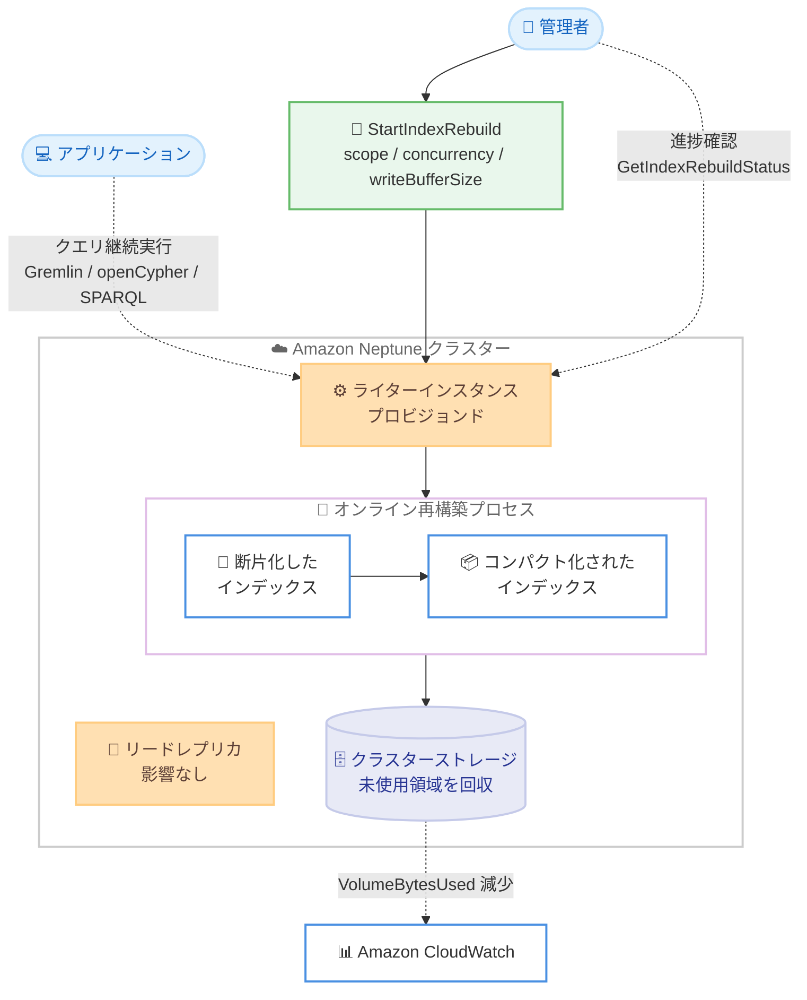

# Amazon Neptune - オンラインインデックス再構築によるストレージ回収

**リリース日**: 2026 年 10 月 27 日
**サービス**: Amazon Neptune
**機能**: オンラインインデックス再構築 (Online Index Rebuild)

📊 [このアップデートのインフォグラフィックを見る](https://takech9203.github.io/aws-news-summary/20261027-neptune-online-index-rebuild.html)

## 概要

Amazon Neptune Database が、データベースを稼働させたままインデックスのデフラグと未使用ストレージ領域の回収を実行できる「オンラインインデックス再構築」をサポートしました。グラフデータベースでは、挿入・更新・削除操作を繰り返すことでデータページ内に未使用領域の断片 (フラグメンテーション) が蓄積し、データを削除しても `VolumeBytesUsed` メトリクスが高止まりしたり、同じ論理データがより多くの物理ページに分散することで I/O コストが増加したりする課題がありました。

今回のアップデートにより、Gremlin、openCypher、SPARQL の読み取り・書き込みクエリを継続実行しながら、インデックスをコンパクト化してストレージを回収し、クエリパフォーマンスを改善できます。再構築の対象は、すべてのインデックス、クアッドインデックスのみ、ディクショナリインデックスのみから選択でき、並列度 (concurrency) や書き込みバッファサイズも調整可能です。

本機能は Neptune エンジンリリース 1.5.0.0 以降で利用可能で、プロビジョンドのライターインスタンスで実行します。大規模なデータ削除後のクリーンアップ、定期メンテナンス、ストレージ上限への対処、パフォーマンスチューニングなど、Neptune を長期運用するすべてのユーザーにとって重要なアップデートです。

**アップデート前の課題**

- データ削除後もフラグメンテーションにより `VolumeBytesUsed` が高止まりし、ストレージコストを削減できなかった
- 断片化したインデックスにより同じ論理データが多くの物理ページに分散し、I/O コストとクエリレイテンシが増加していた
- ストレージを回収するには、データのエクスポートと再ロード、またはクラスターの再作成といったダウンタイムや運用負荷を伴う方法が必要だった

**アップデート後の改善**

- データベースをオンラインに保ったまま、インデックスのデフラグとストレージ回収が可能になった
- ライターインスタンスとリードレプリカの両方で、再構築中も読み取り・書き込みクエリを継続できるようになった
- 再構築のスコープ (ALL / QUADS / DICTIONARIES)、並列度、書き込みバッファサイズを調整して、ワークロードへの影響と再構築速度のバランスを取れるようになった
- ストレージ枯渇を防ぐ安全機構 (80% の安全マージン、適応型スケジューリング、フェイルファスト) が組み込まれている

## アーキテクチャ図



管理者がライターインスタンスに対して再構築を開始すると、データベースをオンラインに保ったまま断片化したインデックスがコンパクト化され、未使用ストレージが回収されます。アプリケーションのクエリは再構築中も継続実行でき、リードレプリカは影響を受けません。

## サービスアップデートの詳細

### 主要機能

1. **無停止でのインデックス再構築**
   - 再構築中もデータベースは完全に稼働し、Gremlin、openCypher、SPARQL の読み取り・書き込みクエリを継続実行できる
   - リードレプリカは再構築の影響を受けず、通常どおり読み取りクエリを処理する
   - データ損失は発生せず、再構築中の同時書き込みも通常どおりコミットされる

2. **柔軟なスコープ指定**
   - `ALL`: クアッドインデックスとディクショナリインデックスの両方を再構築 (デフォルト)
   - `QUADS`: クアッドインデックスのみを再構築 (OSGP、PZSOG インデックスが有効な場合はそれらも対象)
   - `DICTIONARIES`: ディクショナリインデックスのみを再構築
   - `GetStorageInfo` で回収可能な領域が多いコンポーネントを特定し、スコープを絞ることで高速かつ低影響な再構築が可能

3. **チューニング可能なパラメータ**
   - `concurrency`: 並列ワーカー数 (1 からライターインスタンスの最大 vCPU 数まで、デフォルトは 1)
   - `writeBufferSize`: 再構築中の同時書き込みを追跡するバッファサイズ (`LOW` / `MEDIUM` / `HIGH`、デフォルトは `LOW`)
   - 本番トラフィックと並行する場合は低い並列度、メンテナンスウィンドウでは高い並列度といった使い分けが可能

4. **ストレージ安全機構**
   - 利用可能なボリューム領域に対して 80% の安全マージンを適用したストレージバジェットを設定
   - 空き容量に応じて並列度を自動調整する適応型スケジューリング
   - ストレージが不足した場合は作業をサイレントにスキップせず即座に失敗させるフェイルファスト設計
   - `VolumeBytesUsed` が 100 TB を超えるクラスターでは、安全のためデフォルトで再構築リクエストが失敗する (AWS サポート経由で対応可能)

5. **ライフサイクル管理 API**
   - `StartIndexRebuild`: 再構築の開始
   - `GetIndexRebuildStatus`: 進捗率 (`progressPercentage`) と推定完了時刻 (`estimatedEndTime`) の取得
   - `ListIndexRebuilds`: 再構築 ID の一覧取得
   - `CancelIndexRebuild`: 実行中の再構築のベストエフォートでのキャンセル

## 技術仕様

### 前提条件と仕様

| 項目 | 詳細 |
|------|------|
| エンジンバージョン | Neptune エンジンリリース 1.5.0.0 以降 |
| 実行対象インスタンス | プロビジョンドのライターインスタンス (Neptune Serverless のライターは非対応) |
| リードレプリカ | 影響なし。サーバーレス・プロビジョンドのどちらでも可 |
| エンドポイント | `POST /storage/indexes/rebuilds` (データプレーン API) |
| 同時実行数 | クラスターあたり 1 つの再構築のみ (重複開始は `409 ConflictException`) |
| スクラッチ領域 | 最大並列度で再構築対象データの約 25% まで必要 (並列度に比例して減少) |
| サイズ上限 | `VolumeBytesUsed` 100 TB 超のクラスターはデフォルトで拒否 (AWS サポートに相談) |

### 再構築のステータスライフサイクル

| ステータス | 説明 |
|------|------|
| `PREPARING` | 再構築の初期化中 |
| `REBUILDING` | インデックステーブルを再構築中 (データベースは稼働継続) |
| `COMPLETED` | 再構築が正常に完了 |
| `FAILED` | エラーが発生 (`failureReason` で原因を確認) |
| `CANCELLING` | キャンセルが要求され、実行中の作業を排出中 (数分から数時間) |
| `CANCELLED` | 再構築がキャンセルされた |

### API 変更履歴

| 日付 | サービス | 変更内容 |
|------|----------|----------|
| 2026/10/28 | [neptune-db](https://awsapichanges.com/archive/changes/bdcc3b-neptune-db.html) | 5 new api methods - ストレージ使用状況を分析する Get Storage API と、オンデマンドでインデックスを再構築する Index Rebuild API を追加 |

### IAM 権限 (IAM 認証を使用する場合)

```json
{
  "Effect": "Allow",
  "Action": [
    "neptune-db:StartIndexRebuild",
    "neptune-db:GetIndexRebuildStatus",
    "neptune-db:ListIndexRebuilds",
    "neptune-db:CancelIndexRebuild"
  ],
  "Resource": "arn:aws:neptune-db:<region>:<account-id>:<cluster-resource-id>/*"
}
```

## 設定方法

### 前提条件

1. Neptune エンジンリリース 1.5.0.0 以降を使用していること
2. ライターインスタンスがプロビジョンドインスタンスであること
3. IAM 認証を使用する場合、上記のインデックス再構築アクションが許可されていること

### 手順

#### ステップ 1: ストレージ使用状況の確認

```bash
aws neptunedata get-storage-info \
  --endpoint-url https://your-neptune-endpoint:8182
```

`GetStorageInfo` API でストレージの内訳を確認します。エントリ数に対してインデックスサイズが大きい場合はフラグメンテーションの兆候です。再構築前の `VolumeBytesUsed` をベースラインとして記録しておきます。

#### ステップ 2: インデックス再構築の開始

```bash
# すべてのインデックスを再構築 (デフォルト)
aws neptunedata start-index-rebuild \
  --endpoint-url https://your-neptune-endpoint:8182

# クアッドインデックスのみ、並列度 4、書き込みバッファ HIGH で再構築
aws neptunedata start-index-rebuild \
  --endpoint-url https://your-neptune-endpoint:8182 \
  --scope QUADS \
  --concurrency 4 \
  --write-buffer-size HIGH
```

ライターインスタンスのエンドポイントに対して再構築を開始します。レスポンスに含まれる `rebuildId` は、進捗確認やキャンセルに使用するため保存しておきます。

#### ステップ 3: 進捗のモニタリング

```bash
aws neptunedata get-index-rebuild-status \
  --endpoint-url https://your-neptune-endpoint:8182 \
  --rebuild-id a1b2c3d4-e5f6-7890-abcd-ef1234567890
```

再構築の進捗率 (`progressPercentage`) と推定完了時刻 (`estimatedEndTime`) を定期的にポーリングして確認します。

#### ステップ 4: 結果の確認

```bash
aws neptunedata get-storage-info \
  --endpoint-url https://your-neptune-endpoint:8182
```

再構築完了後に `GetStorageInfo` を再実行し、ストレージサイズが減少したことを確認します。CloudWatch の `VolumeBytesUsed` および `VolumeBytesLeftTotal` メトリクスでも推移を追跡できます。

## メリット

### ビジネス面

- **ストレージコストの削減**: データ削除後に高止まりしていたストレージ使用量を回収し、ストレージ課金と I/O コストを削減できる
- **ダウンタイムの排除**: 従来はエクスポート・再ロードなどダウンタイムを伴う方法が必要だったストレージ最適化を、サービスを停止せずに実行できる
- **運用の計画性向上**: 四半期ごとなどの定期メンテナンスとして組み込みやすく、ストレージ上限への到達を予防できる

### 技術面

- **クエリパフォーマンスの改善**: インデックスのコンパクト化により、同じ論理データへのアクセスに必要な物理ページ数が減り、I/O 効率が向上する
- **きめ細かな制御**: スコープ・並列度・書き込みバッファサイズを調整して、本番ワークロードへの影響を最小化できる
- **安全性の高い設計**: ストレージバジェット、適応型スケジューリング、フェイルファストにより、再構築中のストレージ枯渇を防止できる

## デメリット・制約事項

### 制限事項

- クラスターあたり同時に実行できる再構築は 1 つのみ
- Neptune Serverless のライターインスタンスでは実行不可 (リードレプリカはサーバーレスでも可)
- 再構築中はバルクロード API (`POST /loader`) と高速リセット API (`ExecuteFastReset`) が `CancelledByMaintenanceException` で拒否される
- 再構築履歴は直近の 1 件のみメモリ上に保持され、エンジンの再起動やフェイルオーバーで失われる (永続的な履歴は将来のリリースで対応予定)
- `VolumeBytesUsed` が 100 TB を超えるクラスターでは、AWS サポートへの相談が必要
- 再構築中、一部のクエリが一時的に `CancelledByMaintenanceException` で失敗する可能性がある (指数バックオフでのリトライが必要)

### 考慮すべき点

- 再構築はバッファキャッシュと I/O をクエリと奪い合うため、クエリパフォーマンスに小さな影響が出る可能性がある。`BufferCacheHitRatio` が 99.9% を下回る場合はインスタンスタイプのスケールアップや並列度の低減を検討する
- 非常に重い同時ワークロードは再構築自体を失敗させる可能性がある。その場合はスコープや並列度を下げ、`writeBufferSize` を上げるか、トラフィックの少ない時間帯に実行する
- キャンセルはベストエフォートであり、実行中の作業が完了するまで `CANCELLED` に到達しない (数分から数時間かかる場合がある)
- フェイルオーバーやエンジン再起動が発生すると実行中の再構築は失われるが、データベースは正常に復旧し、再度開始できる
- 再構築には最大で対象データの約 25% のスクラッチ領域が必要なため、空き容量に余裕を持って実行する

## ユースケース

### ユースケース 1: 大規模データ削除後のストレージ回収

**シナリオ**: 古いグラフデータを大量に削除したが、`VolumeBytesUsed` が削除前とほぼ変わらず、ストレージコストが下がらない。

**実装例**:
```bash
# ストレージ内訳を確認し、回収可能な領域を特定
aws neptunedata get-storage-info --endpoint-url https://your-neptune-endpoint:8182

# クアッドインデックスに絞って再構築
aws neptunedata start-index-rebuild \
  --endpoint-url https://your-neptune-endpoint:8182 \
  --scope QUADS
```

**効果**: 削除済みデータが占有していた断片化領域を回収し、`VolumeBytesUsed` とストレージ課金を実データ量に見合った水準まで削減できる。

### ユースケース 2: ストレージ上限接近時の対処

**シナリオ**: クラスターのストレージ使用量が上限に近づいており、容量を確保する必要があるが、サービス停止は許容できない。

**実装例**:
```bash
# 本番トラフィックへの影響を抑えるため低い並列度で実行
aws neptunedata start-index-rebuild \
  --endpoint-url https://your-neptune-endpoint:8182 \
  --scope ALL \
  --concurrency 1 \
  --write-buffer-size MEDIUM
```

**効果**: サービスを稼働させたままストレージの空き容量を確保し、ストレージ上限到達による障害を未然に防げる。

### ユースケース 3: 定期メンテナンスによるパフォーマンス維持

**シナリオ**: 更新頻度の高いグラフワークロードで、時間の経過とともにクエリレイテンシが悪化している。メンテナンスウィンドウ内で短時間に最適化したい。

**実装例**:
```bash
# メンテナンスウィンドウ中に高い並列度で高速に再構築
aws neptunedata start-index-rebuild \
  --endpoint-url https://your-neptune-endpoint:8182 \
  --scope ALL \
  --concurrency 8 \
  --write-buffer-size LOW
```

**効果**: 四半期ごとなどの定期実行によりインデックスを最適な状態に保ち、I/O 効率とクエリパフォーマンスを安定的に維持できる。ライターインスタンスを一時的にスケールアップすることで再構築時間をさらに短縮できる。

## 料金

オンラインインデックス再構築機能自体の追加料金に関する記載は、公式発表にはありません。再構築によりフラグメンテーションが解消されることで、ストレージ使用量と I/O コストの削減が期待できます。再構築中は一時的にスクラッチ領域 (最大で対象データの約 25%) を使用する点に注意してください。詳細は [Amazon Neptune の料金ページ](https://aws.amazon.com/neptune/pricing/)を参照してください。

## 利用可能リージョン

Amazon Neptune Database が利用可能なすべての AWS リージョンで利用できます。Neptune エンジンリリース 1.5.0.0 以降が必要です。

## 関連サービス・機能

- **GetStorageInfo API**: ストレージ使用状況の内訳を分析し、フラグメンテーションや回収可能な領域を特定する。再構築の前後で実行して効果を定量化する
- **Amazon CloudWatch**: `VolumeBytesUsed`、`VolumeBytesLeftTotal`、`BufferCacheHitRatio` メトリクスで再構築の効果と影響をモニタリングする
- **Neptune 高速クローン**: 書き込みを完全に停止できるワークロードでは、クローン上で再構築を実行してエンドポイントを切り替える代替手法も選択できる

## 参考リンク

- 📊 [インフォグラフィック](https://takech9203.github.io/aws-news-summary/20261027-neptune-online-index-rebuild.html)
- [公式発表 (What's New)](https://aws.amazon.com/about-aws/whats-new/2026/10/neptune-online-index-rebuild/)
- [ドキュメント: Neptune online index rebuild](https://docs.aws.amazon.com/neptune/latest/userguide/storage-index-rebuild.html)
- [Amazon Neptune 製品ページ](https://aws.amazon.com/neptune/)
- [料金ページ](https://aws.amazon.com/neptune/pricing/)

## まとめ

オンラインインデックス再構築により、Amazon Neptune のストレージ最適化がダウンタイムなしで実行可能になりました。データ削除後に `VolumeBytesUsed` が高止まりしているクラスターや、長期運用でクエリパフォーマンスが低下しているクラスターでは、まず `GetStorageInfo` でフラグメンテーションの状況を確認し、エンジンリリース 1.5.0.0 以降へのアップグレードと再構築の実施を検討することを推奨します。アプリケーション側では `CancelledByMaintenanceException` に対する指数バックオフのリトライ実装を事前に組み込んでおくことが重要です。
