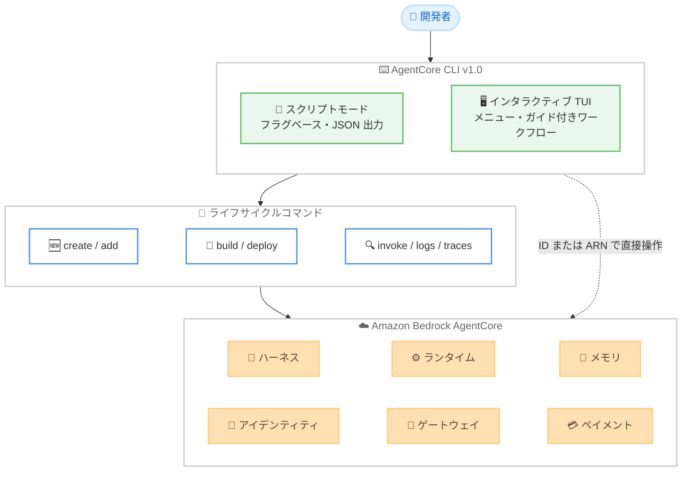

# Amazon Bedrock AgentCore - AgentCore CLI バージョン 1.0 の一般提供開始

**リリース日**: 2026 年 10 月 28 日
**サービス**: Amazon Bedrock AgentCore
**機能**: Amazon Bedrock AgentCore CLI バージョン 1.0

📊 [このアップデートのインフォグラフィックを見る](https://takech9203.github.io/aws-news-summary/20261028-amazon-bedrock-agentcore-cli-version-1-0-available.html)

## 概要

Amazon Bedrock AgentCore CLI のバージョン 1.0 が一般提供開始されました。AgentCore CLI は、ターミナルから AI エージェントと関連リソースの作成、開発、デプロイ、運用を行うためのコマンドラインツールです。npm パッケージ `@aws/agentcore` 1.0.0 として公開されており、`npm install -g @aws/agentcore` でインストールできます。

バージョン 1.0 では CLI が再構築され、起動の高速化と一貫性のあるコマンド体系が実現されました。プロジェクトベースのワークフローに加えて、ハーネス、ランタイム、メモリ、アイデンティティ、ゲートウェイ、ペイメントといった AgentCore リソースをプロジェクトに追加することなく直接操作できるようになっています。また、スクリプトや CI パイプラインに適したフラグベースの CLI モードと、ガイド付きワークフローを提供するインタラクティブな TUI (ターミナル UI) モードの 2 つの利用形態をサポートします。

このアップデートは、AgentCore 上で AI エージェントを開発・運用する開発者、および CI/CD パイプラインやコーディングエージェントからエージェントのデプロイを自動化したいチームを対象としています。

**アップデート前の課題**

- 複数の AWS サービスの API 呼び出し、実行ロールの設定、ストリーミングレスポンスの処理などを個別に行う必要があり、エージェント開発の導入障壁が高かった
- プロジェクトを作成しなければ各リソースを操作できず、デプロイ済みリソースへのアドホックな操作が煩雑だった
- コマンド体系や出力形式が統一されておらず、自動化やスクリプト化がしにくかった

**アップデート後の改善**

- バージョン 1.0 への再構築により、起動が高速化され、コマンド構造の一貫性が向上した
- ハーネス、ランタイム、メモリ、アイデンティティ、ゲートウェイ、ペイメントをプロジェクトに追加せずに直接操作できるようになり、ID または ARN を指定したリソースの呼び出しも可能になった
- インタラクティブシェル、ハーネスのエクスポート、検索可能なメニュー、リソースピッカー、ガイド付きワークフローが追加された
- リージョン選択、JSON 出力、デバッグ、バージョン情報の表示が、全コマンド共通のグローバルフラグとして統一された
- 既存プロジェクトは `agentcore migrate` コマンドでバージョン 1 に移行できる

## アーキテクチャ図



AgentCore CLI v1.0 は、スクリプトモードとインタラクティブ TUI の 2 つの利用形態を提供し、プロジェクトワークフローまたはリソースへの直接操作を通じて Amazon Bedrock AgentCore の各リソースを管理します。

## サービスアップデートの詳細

### 主要機能

1. **バージョン 1.0 への再構築**
   - 起動時間が短縮され、より高速に CLI を利用可能
   - コマンド構造の一貫性が向上し、学習コストと自動化コストを削減
   - 既存プロジェクトは `agentcore migrate` コマンドでバージョン 1 へ移行可能

2. **幅広いリソースの直接操作**
   - ハーネス、ランタイム、メモリ、アイデンティティ、ゲートウェイ、ペイメントを、プロジェクトに追加することなく直接操作可能
   - ID または ARN を指定してリソースを呼び出し可能
   - プロジェクトワークフローと直接操作の両方をサポート

3. **インタラクティブな操作体験**
   - インタラクティブシェル、検索可能なメニュー、リソースピッカー、ガイド付きワークフローを提供
   - ハーネスのエクスポート機能に対応
   - フラグなしでコマンドを実行すると TUI モードが起動し、ガイド付きで操作可能

4. **一貫したグローバルフラグ**
   - `--region` によるリージョン選択
   - `--json` による JSON 形式の出力 (CI パイプラインやコーディングエージェントとの連携に有用)
   - `--debug` によるデバッグ出力、バージョン情報の表示

## 技術仕様

### CLI の基本情報

| 項目 | 詳細 |
|------|------|
| パッケージ名 | `@aws/agentcore` (npm) |
| バージョン | 1.0.0 |
| インストール | `npm install -g @aws/agentcore` |
| 必要環境 | Node.js 20.12 以降、AWS 認証情報 (AWS CLI と同様の設定)、Python テンプレート利用時は uv |
| ライセンス | Apache-2.0 (GitHub でソースコード公開) |
| 利用形態 | スクリプタブル CLI (フラグベース) とインタラクティブ TUI の 2 モード |

### 主なコマンドグループ

| コマンドグループ | 用途 |
|------|------|
| `create` / `add` / `remove` / `export` / `migrate` | プロジェクトとリソースのライフサイクル管理 |
| `dev` / `build` / `deploy` / `status` | ローカル開発、ビルド、デプロイ、状態確認 |
| `invoke` / `logs` / `traces` | デプロイ済みエージェントの呼び出しと可観測性データの確認 |
| `runtime` / `harness` / `gateway` / `memory` / `identity` / `payment` | デプロイ済みリソースの直接管理 |
| `eval` | エージェントの評価、データセット、実験の管理 |
| `feedback` / `config` / `update` | CLI の設定とメンテナンス |

### 注意事項

Python ベースの AgentCore Starter Toolkit をインストール済みの場合、両者が同じ `agentcore` コマンドを登録するため、先に Starter Toolkit をアンインストールする必要があります。

## 設定方法

### 前提条件

1. Node.js 20.12 以降がインストールされていること
2. AWS 認証情報が設定されていること (AWS CLI と同様の設定)
3. Python テンプレートを利用する場合は uv がインストールされていること

### 手順

#### ステップ 1: CLI のインストール

```bash
npm install -g @aws/agentcore
```

npm から AgentCore CLI をグローバルインストールします。インストール後は `agentcore` コマンドが利用可能になります。

#### ステップ 2: プロジェクトの作成とハーネスの追加

```bash
agentcore create --name MyProject
cd MyProject
agentcore add harness --name MyAssistant
```

新しいプロジェクトを作成し、マネージドエージェントであるハーネスを追加します。ハーネスはモデル、システムプロンプト、ツール、スキルを YAML で定義し、AgentCore 側で実行されます。

#### ステップ 3: デプロイと呼び出し

```bash
agentcore deploy
agentcore invoke --harness MyAssistant --prompt "Hey, what can you do for me?"
```

プロジェクトのリソースを AWS にデプロイし、デプロイしたハーネスにプロンプトを送信して動作を確認します。

#### ステップ 4: 既存プロジェクトの移行

```bash
agentcore migrate
```

旧バージョンの CLI で作成した既存プロジェクトをバージョン 1 の形式に移行します。

## メリット

### ビジネス面

- **開発スピードの向上**: プロジェクト作成からデプロイ、呼び出しまでを数コマンドで完結でき、AI エージェントの市場投入までの時間を短縮できる
- **導入障壁の低減**: ガイド付きワークフローと TUI により、AgentCore に不慣れな開発者でも迷わずエージェントを構築できる
- **運用の標準化**: 一貫したコマンド体系とグローバルフラグにより、チーム内での運用手順を統一しやすい

### 技術面

- **自動化との親和性**: `--json` フラグによる構造化出力で、CI/CD パイプラインやコーディングエージェントからの利用が容易
- **リソースへの直接アクセス**: プロジェクトを経由せずに ID または ARN でリソースを操作でき、アドホックな運用作業が効率化される
- **複雑さの抽象化**: 複数の AWS サービスの呼び出し、実行ロールの設定、ストリーミングレスポンスの処理を CLI が肩代わりする

## デメリット・制約事項

### 制限事項

- Node.js 20.12 以降が必要
- Python ベースの AgentCore Starter Toolkit と `agentcore` コマンド名が競合するため、併用する場合は事前にアンインストールが必要
- Python テンプレートの利用には uv のインストールが必要

### 考慮すべき点

- 既存プロジェクトをバージョン 1 で利用するには `agentcore migrate` による移行作業が必要
- CLI 自体は無料だが、デプロイした AgentCore リソース (ランタイム、メモリ、ゲートウェイなど) には利用料金が発生する

## ユースケース

### ユースケース 1: ターミナルからの迅速なエージェントプロトタイピング

**シナリオ**: 新しい AI エージェントのアイデアを検証するため、最小限の手順でエージェントを構築して動作確認を行いたい。

**実装例**:
```bash
agentcore create --name PrototypeAgent
cd PrototypeAgent
agentcore add harness --name Assistant
agentcore deploy
agentcore invoke --harness Assistant --prompt "こんにちは"
```

**効果**: コンソール操作や複数サービスの個別設定を行うことなく、数分でエージェントのプロトタイプをデプロイして検証できる。

### ユースケース 2: CI/CD パイプラインによるエージェントの自動デプロイ

**シナリオ**: エージェントのコードやハーネス定義を Git で管理し、変更をマージしたら自動でビルド・デプロイしたい。

**実装例**:
```bash
# CI パイプライン内で実行
agentcore build --json
agentcore deploy --json
agentcore status --json
```

**効果**: JSON 出力により結果をパイプラインでパースでき、エージェントのデプロイを完全に自動化できる。

### ユースケース 3: デプロイ済みリソースの運用・トラブルシューティング

**シナリオ**: 本番環境で稼働中のエージェントの動作を確認し、問題発生時にログやトレースを調査したい。

**実装例**:
```bash
# ARN を指定してプロジェクト外からリソースを直接操作
agentcore invoke --harness <ハーネスの ARN> --prompt "テストメッセージ"
agentcore logs
agentcore traces
```

**効果**: プロジェクトディレクトリに依存せず、ID または ARN を指定してデプロイ済みリソースを直接操作・調査できる。

## 料金

AgentCore CLI 自体は無料で利用できるオープンソースツール (Apache-2.0 ライセンス) です。CLI からデプロイ・利用する Amazon Bedrock AgentCore の各リソース (ランタイム、メモリ、ゲートウェイ、アイデンティティなど) には、AgentCore の料金体系に基づく利用料金が発生します。詳細は [Amazon Bedrock AgentCore 料金ページ](https://aws.amazon.com/bedrock/agentcore/pricing/) を参照してください。

## 利用可能リージョン

公式発表ではリージョンの明示的な記載はありません。CLI はグローバルフラグ `--region` で操作対象のリージョンを選択でき、Amazon Bedrock AgentCore が利用可能なリージョンで使用できます。

## 関連サービス・機能

- **Amazon Bedrock AgentCore**: 本 CLI の操作対象となる、本番環境向け AI エージェントの構築・運用プラットフォーム
- **AWS CDK**: CLI が生成するプロジェクトには CDK アプリが含まれ、カスタムリソースや IAM 権限、環境変数の追加など拡張が可能
- **AgentCore Starter Toolkit**: 従来の Python ベースのツールキット。本 CLI と `agentcore` コマンド名が競合するため併用時は注意が必要

## 参考リンク

- 📊 [インフォグラフィック](https://takech9203.github.io/aws-news-summary/20261028-amazon-bedrock-agentcore-cli-version-1-0-available.html)
- [公式発表 (What's New)](https://aws.amazon.com/about-aws/whats-new/2026/10/amazon-bedrock-agentcore-cli-version-1-0-available/)
- [npm パッケージ: @aws/agentcore](https://www.npmjs.com/package/@aws/agentcore)
- [GitHub リポジトリ: aws/agentcore-cli](https://github.com/aws/agentcore-cli)
- [Amazon Bedrock AgentCore 製品ページ](https://aws.amazon.com/bedrock/agentcore/)
- [Amazon Bedrock AgentCore 料金ページ](https://aws.amazon.com/bedrock/agentcore/pricing/)

## まとめ

AgentCore CLI バージョン 1.0 の一般提供により、ターミナルから AI エージェントの作成、デプロイ、運用までを一貫して行える環境が整いました。高速な起動、一貫したコマンド体系、リソースへの直接操作、JSON 出力による自動化対応など、開発から本番運用までをカバーする実用的なツールです。AgentCore を利用中または検討中の場合は、`npm install -g @aws/agentcore` でインストールし、既存プロジェクトは `agentcore migrate` での移行を検討することを推奨します。
