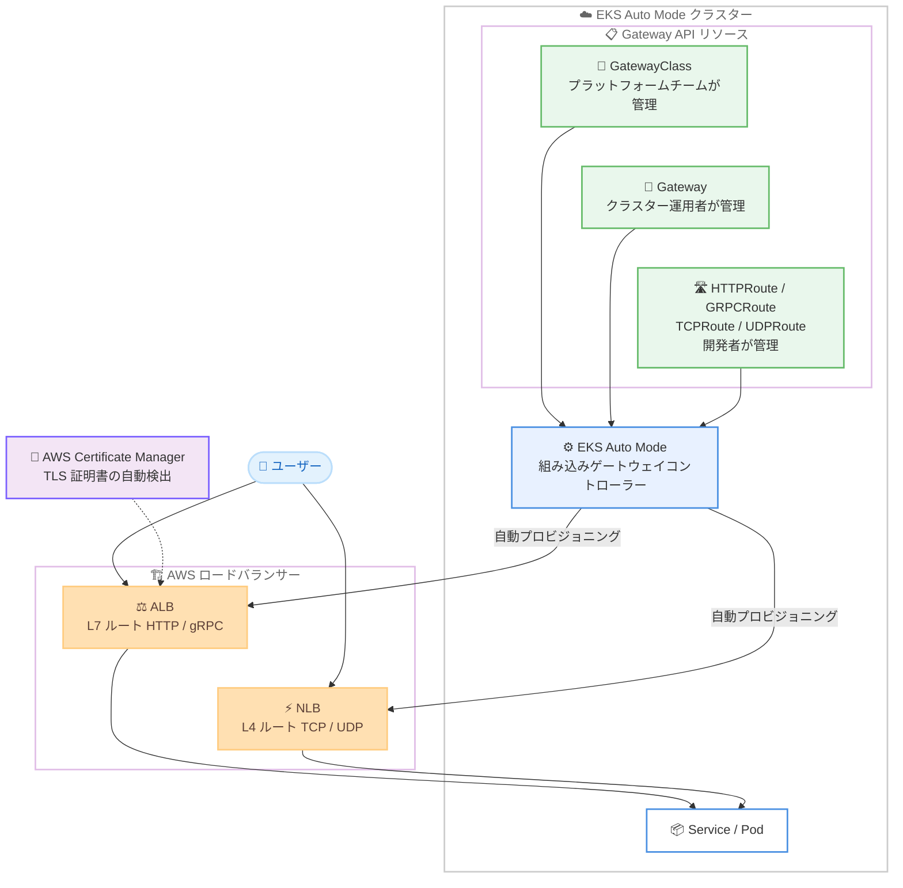

# Amazon EKS - EKS Auto Mode が Kubernetes Gateway API をサポート

**リリース日**: 2026 年 10 月 28 日
**サービス**: Amazon Elastic Kubernetes Service (Amazon EKS)
**機能**: EKS Auto Mode における Kubernetes Gateway API サポート

📊 [このアップデートのインフォグラフィックを見る](https://takech9203.github.io/aws-news-summary/20261028-amazon-eks-auto-mode-kubernetes-gateway-api.html)

## 概要

Amazon EKS Auto Mode が Kubernetes Gateway API をサポートしました。Gateway API は、アプリケーションへのトラフィックの到達方法を定義するための標準的でポータブルな次世代 Kubernetes 標準であり、従来の Ingress API の制限を解消するロール指向で表現力の高いモデルを提供します。

お客様は Gateway や HTTPRoute などの標準 Gateway API リソースを使用してルーティングの意図を定義するだけで、EKS Auto Mode が基盤となる AWS ロードバランサー (ALB / NLB) を自動的にプロビジョニングおよび管理します。別途コントローラーをインストール・運用する必要はありません。既存の Ingress ベースのワークロードは、新しい Gateway API リソースと並行してそのまま動作するため、段階的な移行が可能です。

本アップデートは、EKS Auto Mode を利用するすべてのユーザー、特にプラットフォームチーム・クラスター運用者・アプリケーション開発者の責務を分離したマルチチーム環境でトラフィック管理を標準化したい組織に有用です。

**アップデート前の課題**

- EKS Auto Mode では、アプリケーションロードバランシングの設定に Ingress リソースまたは Service (type LoadBalancer) を使用する必要があり、Gateway API を利用できなかった
- Gateway API を使用するには、AWS Load Balancer Controller などのコントローラーを自分でインストール・運用する必要があった
- Ingress API はロール分離や高度なルーティング (重み付けトラフィック分割、クロスネームスペースルーティングなど) の表現力に制限があった

**アップデート後の改善**

- 標準の Gateway API リソース (GatewayClass、Gateway、HTTPRoute など) を定義するだけで、EKS Auto Mode が AWS ロードバランサーを自動プロビジョニング・管理するようになった
- コントローラーのインストールや運用が不要になり、次世代トラフィック管理標準をすぐに採用できるようになった
- HTTP / gRPC ルーティング、クロスネームスペースルーティング、重み付けトラフィック分割、ヘッダーベースルーティング、AWS Certificate Manager による TLS 証明書の自動検出が利用可能になった

## アーキテクチャ図



Gateway API リソースを定義すると、EKS Auto Mode の組み込みコントローラーが L7 ルート用の ALB または L4 ルート用の NLB を自動的にプロビジョニングし、Gateway とルート定義に同期させます。

## サービスアップデートの詳細

### 主要機能

1. **コントローラー不要の Gateway API サポート**
   - EKS Auto Mode に ALB 用 (`eks.amazonaws.com/gateway-alb`) と NLB 用 (`eks.amazonaws.com/gateway-nlb`) の 2 つの組み込みゲートウェイコントローラーを提供
   - L7 ルート (HTTPRoute、GRPCRoute) は ALB、L4 ルート (TCPRoute、UDPRoute) は NLB によって処理される
   - Gateway とルート定義の変更は、プロビジョニングされたロードバランサーに自動的に同期される
   - 独自のコントローラー名を使用するため、Envoy Gateway や Istio などのサードパーティ製 Gateway 実装と同一クラスター内で共存可能

2. **高度なルーティング機能**
   - HTTP および gRPC ルーティング
   - クロスネームスペーストラフィックルーティング (マルチチーム環境に有用)
   - 重み付けトラフィック分割 (カナリアリリースなどに活用可能)
   - ヘッダーベースルーティング
   - AWS Certificate Manager (ACM) による TLS 証明書の自動検出

3. **Gateway API CRD のライフサイクル管理の選択**
   - クラスターの `elasticLoadBalancing` ネットワーク設定の `gatewayApi.crds.managed` フィールドで Gateway API を有効化
   - **Managed** (`true`): AWS が Gateway API v1 の CRD のインストールとライフサイクル管理を代行
   - **Unmanaged** (`false`): ユーザーが CRD の所有権を保持し、自身でインストール・アップグレードを実施。既に Gateway API を運用中のクラスターや段階的な移行に適する

4. **AWS 拡張リソースによるきめ細かな制御**
   - AWS Load Balancer Controller と同じ拡張リソース (`gateway.k8s.aws/v1`) をサポート
   - **TargetGroupConfiguration**: ヘルスチェック、登録解除遅延、スティッキネスなどターゲットグループのプロパティを Service レベルで設定
   - **LoadBalancerConfiguration**: サブネット配置、セキュリティグループ、アクセスログなどを Gateway または GatewayClass レベルで設定
   - **ListenerRuleConfiguration**: Amazon Cognito や OIDC プロバイダーによる認証など、AWS 固有のルーティング動作で HTTPRoute / GRPCRoute を拡張

## 技術仕様

### Gateway API のリソースモデル

| リソース | 役割 | 主な管理者 |
|------|------|------|
| GatewayClass | Gateway 作成のテンプレート。管理するコントローラーとロードバランサータイプを定義 | プラットフォームチーム |
| Gateway | ロードバランサーをインスタンス化し、リスナー (プロトコルとポート)、ホスト名、TLS 設定を定義 | クラスター運用者 |
| HTTPRoute / GRPCRoute / TCPRoute / UDPRoute | リスナーとバックエンド Service をマッピングするルールを定義 | アプリケーション開発者 |

### ルートタイプとロードバランサーの対応

| ルートタイプ | レイヤー | プロビジョニングされるロードバランサー |
|------|------|------|
| HTTPRoute | L7 | Application Load Balancer (ALB) |
| GRPCRoute | L7 | Application Load Balancer (ALB) |
| TCPRoute | L4 | Network Load Balancer (NLB) |
| UDPRoute | L4 | Network Load Balancer (NLB) |

### Gateway API の有効化設定

```json
{
    "kubernetesNetworkConfig": {
        "elasticLoadBalancing": {
            "enabled": true,
            "gatewayApi": {
                "crds": {
                    "managed": true
                }
            }
        }
    }
}
```

- `elasticLoadBalancing.enabled` を `true` に設定する (Gateway API サポートは EKS Auto Mode のロードバランシング機能上に構築されている)
- `gatewayApi.crds.managed` で AWS が CRD ライフサイクルを管理するかを指定する。`gatewayApi` ブロックを省略した場合、設定は変更されない

## 設定方法

### 前提条件

1. EKS Auto Mode が有効な Amazon EKS クラスター
2. クラスターで Gateway API が有効化されていること (`gatewayApi.crds.managed` の設定)
3. kubectl がクラスターに接続できるように設定されていること
4. サブネットにパブリック / プライベートを識別するタグが付与されていること (eksctl で作成したクラスターにはタグが付与済み)

### 手順

#### ステップ 1: Gateway API の有効化

```bash
aws eks update-cluster-config \
 --name $CLUSTER_NAME \
 --kubernetes-network-config '{"elasticLoadBalancing":{"enabled":true,"gatewayApi":{"crds":{"managed":true}}}}'
```

既存の EKS Auto Mode クラスターで Gateway API を有効化し、AWS に Gateway API CRD のライフサイクル管理を委任しています。新規クラスターの場合は `create-cluster` の `--kubernetes-network-config` に同じ設定を含めます。

#### ステップ 2: GatewayClass の作成

```yaml
apiVersion: gateway.networking.k8s.io/v1
kind: GatewayClass
metadata:
  name: eks-auto-alb
spec:
  controllerName: eks.amazonaws.com/gateway-alb
```

EKS Auto Mode の ALB 用ゲートウェイコントローラーを参照する GatewayClass を作成しています。新しい GatewayClass が他のリソースから参照可能になるまで短い遅延があるため、最初に作成します。`kubectl apply -f gatewayclass.yaml` で適用します。

#### ステップ 3: Gateway の作成

```yaml
apiVersion: gateway.networking.k8s.io/v1
kind: Gateway
metadata:
  name: my-gateway
  namespace: default
spec:
  gatewayClassName: eks-auto-alb
  listeners:
    - name: http
      protocol: HTTP
      port: 80
```

GatewayClass を参照し、ポート 80 の HTTP リスナーを定義する Gateway を作成しています。この Gateway の作成をトリガーとして、EKS Auto Mode が ALB をプロビジョニングします。

#### ステップ 4: HTTPRoute の作成

```yaml
apiVersion: gateway.networking.k8s.io/v1
kind: HTTPRoute
metadata:
  name: my-route
  namespace: default
spec:
  parentRefs:
    - name: my-gateway
      sectionName: http
  rules:
    - matches:
        - path:
            type: PathPrefix
            value: /
      backendRefs:
        - name: service-2048
          port: 80
```

Gateway の `http` リスナーに届いたすべてのトラフィックを、バックエンドの Service (この例では `service-2048` のポート 80) にルーティングする HTTPRoute を作成しています。

#### ステップ 5: 動作確認

```bash
kubectl wait --for=condition=Programmed gateway/my-gateway

ADDRESS=$(kubectl get gateway my-gateway -o jsonpath='{.status.addresses[0].value}')
curl http://$ADDRESS
```

Gateway が Programmed 状態になるのを待ち、プロビジョニングされたロードバランサーのアドレスを取得して疎通確認を行っています。ロードバランサーが利用可能になるまで数分かかる場合があります。なお、Gateway API リソースを削除すると、EKS Auto Mode は関連するロードバランサーを AWS アカウントから自動的に削除します。

## メリット

### ビジネス面

- **運用負荷の削減**: コントローラーのインストール・アップグレード・運用が不要になり、プラットフォームチームの管理コストを削減できる
- **チーム間の責務分離**: ロール指向のリソースモデルにより、プラットフォームチーム・クラスター運用者・開発者がそれぞれの責務範囲でトラフィック管理を行える
- **ベンダーポータビリティ**: Kubernetes 標準 API を採用することで、特定ベンダーへの依存を減らし、スキルや設定の移植性を高められる

### 技術面

- **宣言的なロードバランサー管理**: Gateway とルート定義に基づき、ALB / NLB のプロビジョニングから削除までが自動化される
- **高度なルーティングの標準化**: 重み付けトラフィック分割やヘッダーベースルーティングなど、Ingress では拡張アノテーションが必要だった機能を標準 API で表現できる
- **段階的な移行が可能**: 既存の Ingress や Service (type LoadBalancer) と並行して動作するため、ワークロードごとに段階的に Gateway API へ移行できる
- **サードパーティ実装との共存**: EKS Auto Mode のコントローラーは独自のコントローラー名を使用するため、Envoy Gateway や Istio と同一クラスターで併用できる

## デメリット・制約事項

### 制限事項

- Gateway API 仕様のすべてのフィールドが AWS ロードバランサーの機能にマッピングされるわけではない (サポート対象フィールドは AWS Load Balancer Controller ドキュメントの機能比較を参照)
- EKS Auto Mode が有効なクラスターでのみ利用可能 (通常の EKS クラスターでは引き続き AWS Load Balancer Controller の導入が必要)
- Managed モードを選択する場合、クラスター上の既存 Gateway API CRD が v1 である必要がある。古いバージョンの CRD が存在する場合、操作は拒否される

### 考慮すべき点

- Gateway API CRD はクラスター全体のリソースであり、所有者は AWS またはユーザーのいずれか一方のみとなる。既に別のコントローラーが CRD を管理している場合は Unmanaged を選択する
- GatewayClass の作成直後は、他のリソースから参照可能になるまで短い遅延がある
- ロードバランサーのプロビジョニングには数分かかる場合がある
- サブネットにパブリック / プライベートを識別するタグが必要

## ユースケース

### ユースケース 1: カナリアリリースのための重み付けトラフィック分割

**シナリオ**: 新バージョンのアプリケーションを本番環境に展開する際、トラフィックの一部のみを新バージョンに流して安全性を検証したい。

**実装例**:
```yaml
apiVersion: gateway.networking.k8s.io/v1
kind: HTTPRoute
metadata:
  name: canary-route
spec:
  parentRefs:
    - name: my-gateway
  rules:
    - backendRefs:
        - name: app-v1
          port: 80
          weight: 90
        - name: app-v2
          port: 80
          weight: 10
```

**効果**: 標準 API のみでトラフィックの 90% を既存バージョン、10% を新バージョンに分割でき、追加ツールなしで安全なカナリアリリースを実現できる。

### ユースケース 2: マルチチーム環境でのクロスネームスペースルーティング

**シナリオ**: プラットフォームチームが共有の Gateway を管理し、各アプリケーションチームが自分のネームスペース内でルートを管理するマルチテナント構成を実現したい。

**実装例**:
```yaml
apiVersion: gateway.networking.k8s.io/v1
kind: Gateway
metadata:
  name: shared-gateway
  namespace: infra
spec:
  gatewayClassName: eks-auto-alb
  listeners:
    - name: http
      protocol: HTTP
      port: 80
      allowedRoutes:
        namespaces:
          from: Selector
          selector:
            matchLabels:
              shared-gateway-access: "true"
```

**効果**: 1 つの ALB を複数チームで共有しながら、各チームは自分のネームスペースのルートのみを管理でき、責務分離とコスト効率を両立できる。

### ユースケース 3: L4 ワークロードの NLB 自動プロビジョニング

**シナリオ**: ゲームサーバーや IoT ブローカーなど、TCP / UDP ベースのワークロードを Kubernetes 標準 API で公開したい。

**実装例**:
```yaml
apiVersion: gateway.networking.k8s.io/v1
kind: GatewayClass
metadata:
  name: eks-auto-nlb
spec:
  controllerName: eks.amazonaws.com/gateway-nlb
```

**効果**: TCPRoute / UDPRoute を定義するだけで NLB が自動プロビジョニングされ、L4 トラフィックも Ingress ではカバーできなかった標準 API で宣言的に管理できる。

## 料金

Gateway API サポート自体は EKS Auto Mode の一部として追加料金なしで利用できます。ただし、プロビジョニングされる AWS ロードバランシングリソース (ALB / NLB) には標準料金が適用されます。また、EKS Auto Mode 自体の料金 (管理対象インスタンスに対する料金) は別途発生します。

## 利用可能リージョン

EKS Auto Mode が利用可能なすべての AWS リージョンで利用できます。

## 関連サービス・機能

- **Amazon EKS Auto Mode**: コンピューティング、ストレージ、ネットワーキングの管理を自動化する EKS の動作モード。本機能はそのロードバランシング機能上に構築されている
- **AWS Load Balancer Controller**: 通常の EKS クラスターで Gateway API を利用する場合に使用するコントローラー。EKS Auto Mode は同じ AWS 拡張リソース (`gateway.k8s.aws/v1`) をサポートする
- **Elastic Load Balancing (ALB / NLB)**: Gateway API リソースに基づいて自動プロビジョニングされるロードバランサー
- **AWS Certificate Manager (ACM)**: TLS 証明書の自動検出により、Gateway の TLS 設定と連携する

## 参考リンク

- 📊 [インフォグラフィック](https://takech9203.github.io/aws-news-summary/20261028-amazon-eks-auto-mode-kubernetes-gateway-api.html)
- [公式発表 (What's New)](https://aws.amazon.com/about-aws/whats-new/2026/10/amazon-eks-auto-mode-kubernetes-gateway-api/)
- [ドキュメント: Configure the Kubernetes Gateway API in EKS Auto Mode](https://docs.aws.amazon.com/eks/latest/userguide/auto-configure-gateway-api.html)
- [AWS Load Balancer Controller L7 Gateway API ガイド](https://kubernetes-sigs.github.io/aws-load-balancer-controller/v3.5/guide/gateway/l7gateway/)
- [AWS Load Balancer Controller L4 Gateway API ガイド](https://kubernetes-sigs.github.io/aws-load-balancer-controller/v3.5/guide/gateway/l4gateway/)
- [Amazon EKS 料金ページ](https://aws.amazon.com/eks/pricing/)

## まとめ

EKS Auto Mode が Kubernetes Gateway API をネイティブサポートしたことで、コントローラーの運用なしに次世代のトラフィック管理標準を採用できるようになりました。既存の Ingress ワークロードと並行動作するため、まずは新規ワークロードや重み付けトラフィック分割が必要なワークロードから段階的に Gateway API への移行を検討することを推奨します。EKS Auto Mode を利用中の場合は、`gatewayApi.crds.managed` 設定で Gateway API を有効化するところから始められます。
