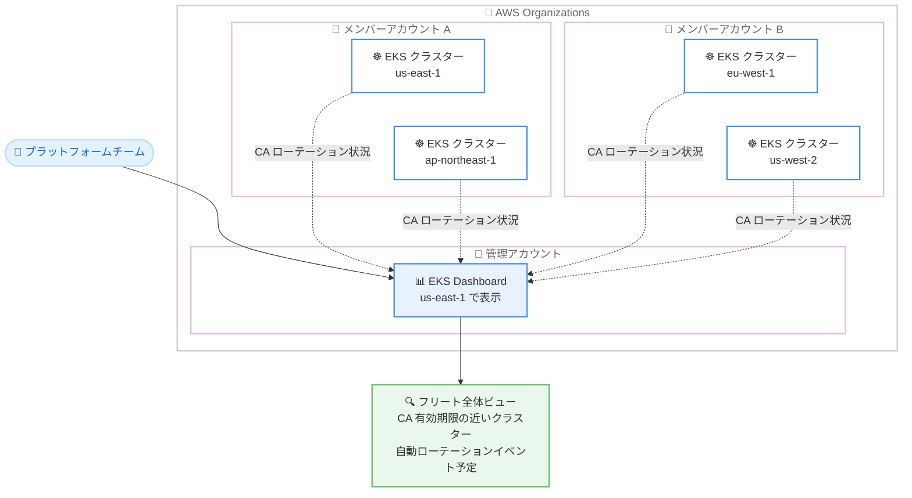

# Amazon EKS - EKS Dashboard によるフリート全体の証明書認証局 (CA) ローテーション可視化

**リリース日**: 2026 年 10 月 28 日
**サービス**: Amazon Elastic Kubernetes Service (Amazon EKS)
**機能**: EKS Dashboard でのフリート全体にわたる証明書認証局 (CA) ローテーション状況の可視化

📊 [このアップデートのインフォグラフィックを見る](https://takech9203.github.io/aws-news-summary/20261028-amazon-eks-dashboard-fleet-wide-visibility-certificate-authority-ca-rotation.html)

## 概要

Amazon EKS は、EKS Dashboard において証明書認証局 (CA) ローテーション状況の可視化機能を発表しました。EKS Dashboard は、複数の AWS アカウントとリージョンにまたがる EKS クラスターを一元的に可視化するダッシュボードであり、今回のアップデートにより、フリート全体の CA ローテーション状況を単一のビューで確認できるようになりました。

Amazon EKS では、クラスター作成時にクラスターごとに固有の CA が作成されます。この CA が API サーバーの証明書に署名することで、コントロールプレーンコンポーネント、ワーカーノード、外部クライアントが API サーバーに対して認証し、暗号化された通信を確立できます。2018 年以降に作成されたクラスターの CA は 10 年間の有効期間を持っており、有効期限が近づきつつあるため、ローテーション作業の計画を開始すべき時期に差し掛かっています。

本機能は、多数のクラスターを管理するプラットフォームチームを主な対象としており、どのクラスターで対応が必要かを 1 か所から把握できます。ダッシュボードのデータは AWS Organizations を通じてアカウントとリージョンをまたいで集約され、追加料金なしで利用できます。

**アップデート前の課題**

このアップデート以前は、CA ローテーションの状況確認に以下の課題がありました。

- CA のローテーション状況や有効期限は、クラスターごとに個別に確認する必要があった
- 複数アカウント・複数リージョンにクラスターが分散している環境では、フリート全体の CA 有効期限を把握するために独自の集計スクリプトや運用プロセスが必要だった
- 自動ローテーションイベントの予定を横断的に把握する手段がなく、計画的な対応が難しかった

**アップデート後の改善**

今回のアップデートにより、以下が可能になりました。

- EKS Dashboard の単一ビューで、全アカウント・全リージョンのクラスターの CA ローテーション状況を確認できるようになった
- CA の有効期限が近づいているクラスターを特定し、優先順位をつけて対応できるようになった
- 今後予定されている自動ローテーションイベントを事前に把握し、計画的にローテーション作業を進められるようになった

## アーキテクチャ図



EKS Dashboard は AWS Organizations の信頼されたアクセスを利用して、組織内の全アカウント・全リージョンの EKS クラスターから CA ローテーション状況を集約し、us-east-1 の単一ビューで表示します。

## サービスアップデートの詳細

### 主要機能

1. **フリート全体の CA ローテーション状況の一覧表示**
   - 全リージョン・全アカウントのクラスターと、それぞれの CA ローテーション状況を単一ビューで表示
   - クラスターごとに個別確認する必要がなくなり、大規模フリートの管理負荷を削減
   - EKS コンソールのクラスター CA ダッシュボードとして提供

2. **有効期限が近い CA の特定**
   - CA の有効期限が近づいているクラスターをハイライト表示
   - 対応の優先順位付けが可能になり、期限切れリスクを低減

3. **自動ローテーションイベントの予定表示**
   - AWS による自動ローテーション (successor CA の自動追加・自動アクティベーション) の予定を事前に把握可能
   - ワーカーノードや外部クライアントの更新作業を計画的に実施できる

### CA ローテーションの仕組み (背景情報)

EKS の CA ローテーションは、クラスターの可用性を維持しながら段階的に実施される多段階プロセスです。

| ステージ | 内容 | 実施者 |
|---------|------|--------|
| ステージ 1: Append | successor CA をクラスターに追加。クラスターは新旧両方の CA を信頼する | ユーザーまたは AWS (自動) |
| ステージ 2: Distribute | コントロールプレーン、EKS Auto Mode ノード、Fargate ノードへ successor CA を配布 | AWS |
| ステージ 3: Activate | successor CA をアクティベートし、新 CA による証明書発行を開始 | ユーザーまたは AWS (自動) |

ステージ 1 からアウトゴーイング CA の廃止までの期間はデュアルトラスト期間と呼ばれ、クラスターが両方の CA を同時に信頼するため、ワーカーノードや外部クライアントを段階的に更新できます。

### 通知タイムライン (参考)

AWS Health、Cluster Insights、E メールを通じて、ローテーションの各段階で通知が送信されます。

| 通知 | タイミング |
|------|-----------|
| CA 有効期限リマインダー | 有効期限の 2.5 年前 |
| successor CA 追加 (自動追加の場合) | 有効期限の 2 年前 |
| アクティベーション警告 | 自動アクティベーションの 60 日前 |
| successor CA アクティベート (自動の場合) | 有効期限の 6 か月前 |
| 最終自動アクティベーション (ロールバック後) | 有効期限の 45 日前 |

なお、2018 年から 2019 年に作成されたクラスターは、調整されたスケジュールで通知が送信されます。

## 設定方法

### 前提条件

1. AWS Organizations が有効化されていること
2. 組織の管理アカウントで EKS Dashboard の信頼されたアクセスを有効化すること
3. ダッシュボードは米国東部 (バージニア北部、us-east-1) リージョンから表示すること

### 手順

#### ステップ 1: 信頼されたアクセスの有効化

組織の管理アカウントで EKS コンソールにアクセスし、EKS Dashboard の信頼されたアクセスを有効化します。これにより、組織内の全アカウントのクラスター情報をダッシュボードに集約できるようになります。委任管理者アカウントを登録すると、管理アカウントを直接使用せずにダッシュボードを閲覧できます。

#### ステップ 2: EKS Dashboard で CA ローテーション状況を確認

us-east-1 リージョンの EKS コンソールから EKS Dashboard を開き、クラスター CA ダッシュボードで以下を確認します。

- 全クラスターの CA ローテーション状況
- 有効期限が近づいている CA を持つクラスター
- 今後予定されている自動ローテーションイベント

#### ステップ 3: 個別クラスターの CA 状況を CLI で確認

```bash
# クラスターの CA 一覧を表示
aws eks list-certificate-authorities --cluster-name my-cluster --region us-west-2

# CA の詳細 (有効期限を含む) を表示
aws eks describe-certificate-authority --cluster-name my-cluster \
  --certificate-authority-id <ca-id> --region us-west-2
```

`list-certificate-authorities` はクラスターに関連付けられた CA の一覧と署名ステータス・配布ステータスを表示し、`describe-certificate-authority` は `validity` ブロックで CA の有効期限 (`notAfter`) を確認できます。ダッシュボードで優先対応が必要と判断したクラスターの詳細確認に使用します。

#### ステップ 4: 必要に応じて CA ローテーションを開始

```bash
# successor CA を追加
aws eks create-certificate-authority --cluster-name my-cluster --region us-west-2

# 配布完了後、ワーカーノードと外部クライアントを更新し、successor CA をアクティベート
aws eks activate-certificate-authority --cluster-name my-cluster \
  --certificate-authority-id <successor-ca-id> --region us-west-2
```

`create-certificate-authority` は successor CA をクラスターに追加し、AWS がマネージドコンポーネントへの配布を開始します。配布完了 (`distributionStatus: COMPLETE`) 後、管理するワーカーノードと外部クライアントを更新してから `activate-certificate-authority` で新 CA に切り替えます。

## メリット

### ビジネス面

- **運用コスト削減**: クラスターごとの個別確認や独自の集計スクリプトが不要になり、大規模フリートの CA 管理工数を削減
- **リスク低減**: 有効期限が近いクラスターを早期に特定でき、CA 期限切れによる接続障害リスクを未然に防止
- **追加コストなし**: EKS Dashboard の CA ローテーション可視化は追加料金なしで利用可能

### 技術面

- **一元的な可視性**: AWS Organizations 連携により、マルチアカウント・マルチリージョン環境のクラスターを単一ビューで把握
- **計画的なローテーション**: 自動ローテーションイベントの予定を事前に把握でき、ワーカーノードや外部クライアントの更新作業を余裕を持って計画可能
- **既存の通知との補完**: AWS Health、Cluster Insights、E メール通知と組み合わせることで、通知ベースとダッシュボードベースの両面から状況を把握可能

## デメリット・制約事項

### 制限事項

- ダッシュボードの表示は米国東部 (us-east-1) リージョンからのみ
- AWS Organizations の利用と、管理アカウントでの信頼されたアクセスの有効化が必要
- 組織を構成していない単一アカウント環境では、フリート全体ビューの恩恵は限定的

### 考慮すべき点

- ダッシュボードは可視化を提供するものであり、ローテーション作業自体 (ワーカーノードや外部クライアントのトラストバンドル更新、successor CA のアクティベーション) は引き続きユーザーの責任で実施する必要がある
- 外部クライアント (CI/CD パイプライン、監視ツール、開発者端末など) の洗い出しは時間がかかるため、有効期限の 2 年以上前からの早期着手が推奨される
- CA ピンニングや単一 CA の厳密な検証を行うアプリケーションは、デュアルトラスト期間に入る前に複数 CA を受け入れるよう更新が必要

## ユースケース

### ユースケース 1: 大規模マルチアカウント環境での CA 期限管理

**シナリオ**: 数十アカウント・数百クラスターを運用するエンタープライズのプラットフォームチームが、2018 年以降に作成されたクラスターの CA 有効期限を一元管理したい。

**実装例**:
```
1. 管理アカウントで EKS Dashboard の信頼されたアクセスを有効化
2. us-east-1 の EKS Dashboard で CA ローテーション状況を定期確認
3. 有効期限が近いクラスターから順に、各クラスター担当チームへローテーション作業を依頼
```

**効果**: クラスターごとの個別確認が不要になり、フリート全体の期限切れリスクを体系的に管理できる。

### ユースケース 2: 自動ローテーションイベント前の計画的な対応

**シナリオ**: AWS による successor CA の自動アクティベーションが近づいているクラスターを把握し、接続断を防ぐために事前にワーカーノードと外部クライアントを更新したい。

**実装例**:
```
1. ダッシュボードで今後の自動ローテーションイベント予定を確認
2. 対象クラスターのワーカーノード種別を Cluster Insights で特定
3. マネージドノードグループのバージョン更新、kubeconfig の更新、
   CI/CD パイプラインのトラストバンドル更新を計画的に実施
4. 準備完了後、自動アクティベーションを待たず自らアクティベート
```

**効果**: 自動アクティベーションによる想定外の接続断を回避し、自社のメンテナンスウィンドウ内でローテーションを完了できる。

### ユースケース 3: ガバナンスレポートへの活用

**シナリオ**: セキュリティチームが、組織全体の証明書ライフサイクル管理の状況を定期的に経営層へ報告する必要がある。

**実装例**:
```
1. EKS Dashboard の CA ローテーションビューを月次レビューで確認
2. ローテーション未着手のクラスター数、有効期限までの残期間を集計
3. 対応状況をガバナンスレポートに反映
```

**効果**: 証明書管理のコンプライアンス状況を客観的なデータに基づいて報告でき、監査対応も容易になる。

## 料金

EKS Dashboard の CA ローテーション可視化機能は、追加料金なしで利用できます。EKS クラスター自体の料金は通常どおり発生します。

## 利用可能リージョン

- **CA ローテーション機能**: Amazon EKS がサポートされるすべての AWS 商用リージョンで利用可能
- **EKS Dashboard**: 米国東部 (バージニア北部、us-east-1) から表示し、全商用リージョンのクラスター状況を集約

## 関連サービス・機能

- **AWS Organizations**: 信頼されたアクセスを有効化することで、組織内の全アカウントのクラスター情報をダッシュボードに集約
- **AWS Health / Cluster Insights**: CA ローテーションの各段階における通知を提供し、ダッシュボードと補完的に機能
- **Amazon EventBridge**: CA ローテーションイベントを既存の監視・アラートワークフローに統合可能
- **EKS Auto Mode / AWS Fargate**: これらのマネージドノードは AWS が自動的に successor CA を信頼するよう更新するため、ユーザー側の作業が不要

## 参考リンク

- 📊 [インフォグラフィック](https://takech9203.github.io/aws-news-summary/20261028-amazon-eks-dashboard-fleet-wide-visibility-certificate-authority-ca-rotation.html)
- [公式発表 (What's New)](https://aws.amazon.com/about-aws/whats-new/2026/10/amazon-eks-dashboard-fleet-wide-visibility-certificate-authority-ca-rotation/)
- [ドキュメント: EKS クラスター証明書認証局のローテーション](https://docs.aws.amazon.com/eks/latest/userguide/certificate-authority-rotation.html)
- [ドキュメント: EKS Dashboard](https://docs.aws.amazon.com/eks/latest/userguide/eks-dashboard.html)

## まとめ

EKS Dashboard に CA ローテーションの可視化機能が追加され、マルチアカウント・マルチリージョン環境のクラスターの CA 有効期限と自動ローテーションイベントを単一ビューで把握できるようになりました。2018 年以降に作成されたクラスターの CA (有効期間 10 年) は期限が近づきつつあるため、多数のクラスターを運用する組織は、管理アカウントで信頼されたアクセスを有効化してダッシュボードを確認し、ワーカーノードと外部クライアントの更新計画を早期に開始することを推奨します。
