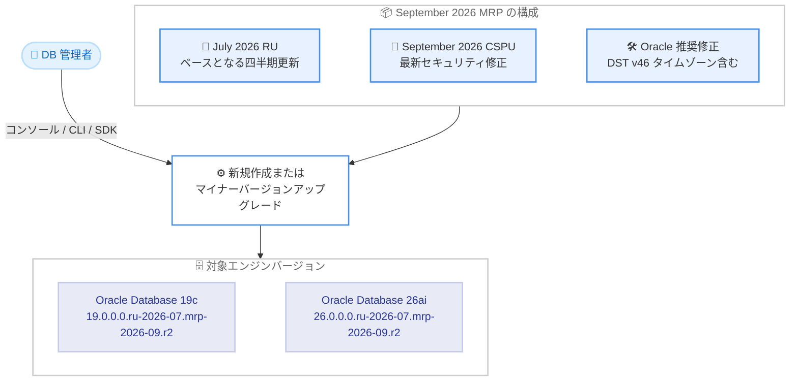

# Amazon RDS for Oracle - 2026 年 9 月 Monthly Recommended Patch サポート

**リリース日**: 2026 年 10 月 28 日
**サービス**: Amazon RDS for Oracle
**機能**: September 2026 Monthly Recommended Patch (MRP)

📊 [このアップデートのインフォグラフィックを見る](https://takech9203.github.io/aws-news-summary/20261028-amazon-rds-oracle-september-mrp.html)

## 概要

Amazon RDS for Oracle が、Oracle Database 19c および 26ai 向けの 2026 年 9 月 Monthly Recommended Patch (MRP) をサポートしました。MRP は、四半期ごとの Release Update (RU) の上に構築されるマイナーエンジンバージョンであり、Oracle の Critical Security Patch Update (CSPU) とその他の Oracle 推奨修正をまとめたパッチです。

今回の MRP は 2026 年 7 月の RU の上に適用され、Oracle の 2026 年 9 月 CSPU を含んでいます。AWS は、Oracle Database の最新のセキュリティアップデートが含まれるため、このパッチへのアップグレードを推奨しています。

また、本リリースには Oracle タイムゾーンファイル DST バージョン 46 が含まれており、2026 年に施行される新しい夏時間 (DST) ルールに対応します。タイムゾーン付きタイムスタンプデータを扱うデータベースにとって、正確な時刻管理を維持するための重要なアップデートです。

**アップデート前の課題**

- 2026 年 9 月の CSPU に含まれる最新のセキュリティ修正を、RDS for Oracle のマネージド環境で適用できなかった
- カナダのブリティッシュコロンビア州・アルバータ州、モロッコ・西サハラにおける新しい夏時間ルールに対応したタイムゾーンデータが利用できず、タイムゾーン付きタイムスタンプの計算に不整合が生じるリスクがあった
- 最新のセキュリティ要件を満たすには、次の四半期 RU のリリースを待つ必要があった

**アップデート後の改善**

- 2026 年 7 月 RU をベースに、2026 年 9 月 CSPU を含む最新のセキュリティパッチをマネージドな方法で適用できるようになった
- DST バージョン 46 のタイムゾーンファイルにより、2026 年 11 月 1 日施行のカナダ (ブリティッシュコロンビア州・アルバータ州) および 2026 年 9 月 20 日施行のモロッコ・西サハラの新ルールに対応できるようになった
- RDS マネジメントコンソール、AWS SDK、CLI から新規インスタンスの作成または既存インスタンスのアップグレードが可能になった

## アーキテクチャ図



September 2026 MRP は、July 2026 RU の上にセキュリティ修正と推奨修正を積み重ねたマイナーエンジンバージョンとして提供され、19c と 26ai の両方に適用できます。

## サービスアップデートの詳細

### 主要機能

1. **September 2026 MRP のサポート**
   - Oracle Database 19c および 26ai 向けのマイナーエンジンバージョンとして提供
   - 2026 年 7 月の Release Update (RU) の上に適用される
   - Oracle の 2026 年 9 月 Critical Security Patch Update (CSPU) を含む
   - その他の Oracle 推奨修正もバンドルされている

2. **タイムゾーンファイル DST バージョン 46 の収録**
   - カナダのブリティッシュコロンビア州・アルバータ州の新しい夏時間ルール (2026 年 11 月 1 日施行) に対応
   - モロッコ・西サハラの新ルール (2026 年 9 月 20 日施行) に対応し、両地域の恒久的な UTC オフセットへの移行を反映
   - タイムゾーン付きで保存されたタイムスタンプデータを新ルールと整合した状態に保つ

3. **複数の適用方法**
   - 新規 DB インスタンス作成時に MRP バージョンを指定可能
   - 既存インスタンスをマイナーバージョンアップグレードで移行可能
   - Amazon RDS マネジメントコンソール、AWS SDK、AWS CLI のいずれからも操作可能

## 技術仕様

### 対象エンジンバージョン

| 項目 | 詳細 |
|------|------|
| Oracle Database 19c | `19.0.0.0.ru-2026-07.mrp-2026-09.r2` |
| Oracle Database 26ai | `26.0.0.0.ru-2026-07.mrp-2026-09.r2` |
| ベース RU | July 2026 Release Update |
| 含まれるセキュリティ修正 | Oracle September 2026 CSPU |
| タイムゾーンファイル | DST バージョン 46 |

### MRP と RU の関係

| パッチ種別 | 提供頻度 | 内容 |
|------------|----------|------|
| Release Update (RU) | 四半期ごと | 機能修正・セキュリティ修正を含む包括的な更新 |
| Monthly Recommended Patch (MRP) | 月次 | 直近の RU の上に CSPU と推奨修正をバンドルしたマイナーバージョン |

## 設定方法

### 前提条件

1. Amazon RDS for Oracle の DB インスタンス (Oracle Database 19c または 26ai) を利用していること
2. 対象インスタンスが July 2026 RU 系のバージョンへアップグレード可能であること
3. アップグレード操作に必要な IAM 権限 (`rds:ModifyDBInstance` など) を保有していること

### 手順

#### ステップ 1: 利用可能なエンジンバージョンの確認

```bash
aws rds describe-db-engine-versions \
    --engine oracle-ee \
    --query "DBEngineVersions[?contains(EngineVersion, 'mrp-2026-09')].EngineVersion"
```

Oracle 用の利用可能なエンジンバージョンの一覧から、September 2026 MRP (`mrp-2026-09`) を含むバージョンを検索して表示します。

#### ステップ 2: 既存インスタンスのアップグレード

```bash
aws rds modify-db-instance \
    --db-instance-identifier my-oracle-instance \
    --engine-version 19.0.0.0.ru-2026-07.mrp-2026-09.r2 \
    --apply-immediately
```

既存の DB インスタンスのエンジンバージョンを September 2026 MRP に変更します。`--apply-immediately` を指定すると即時適用され、指定しない場合は次のメンテナンスウィンドウで適用されます。

#### ステップ 3: アップグレード状態の確認

```bash
aws rds describe-db-instances \
    --db-instance-identifier my-oracle-instance \
    --query "DBInstances[0].[DBInstanceStatus,EngineVersion]"
```

インスタンスのステータスとエンジンバージョンを確認し、アップグレードが完了したことを検証します。

## メリット

### ビジネス面

- **セキュリティコンプライアンスの維持**: 最新の CSPU を適用することで、セキュリティ基準や監査要件への準拠を四半期 RU を待たずに維持できる
- **業務データの正確性確保**: 新しい夏時間ルールに対応したタイムゾーンデータにより、グローバルに展開する業務システムの時刻計算の正確性を確保できる
- **運用負荷の軽減**: マネージドサービスとしてパッチが提供されるため、オンプレミスのようなパッチ適用作業の計画・検証負担を軽減できる

### 技術面

- **月次のセキュリティ更新サイクル**: MRP により、四半期 RU の間でも最新のセキュリティ修正を取り込める
- **19c と 26ai の両方に対応**: 長期サポート版の 19c と最新の 26ai のどちらを利用していても同じタイミングでパッチを適用できる
- **柔軟な適用方法**: コンソール、SDK、CLI のいずれからも適用でき、既存の運用自動化に組み込みやすい

## デメリット・制約事項

### 制限事項

- MRP は July 2026 RU をベースとするため、それより古い RU 系バージョンからは段階的なアップグレード計画が必要になる場合がある
- マイナーバージョンアップグレードの適用時にはダウンタイムが発生する (Multi-AZ 構成ではフェイルオーバーにより短縮可能)

### 考慮すべき点

- 本番環境への適用前に、ステージング環境でアプリケーションの動作検証を行うことを推奨
- 自動マイナーバージョンアップグレードを有効にしている場合、メンテナンスウィンドウでの適用タイミングを確認しておく
- タイムゾーン付きタイムスタンプを多用するシステムでは、DST バージョン 46 への更新による影響範囲を事前に確認する

## ユースケース

### ユースケース 1: セキュリティ要件の厳しい金融システム

**シナリオ**: 金融機関の勘定系データベースで、既知の脆弱性に対するパッチを可能な限り早期に適用するポリシーを運用している。

**実装例**:
```bash
aws rds modify-db-instance \
    --db-instance-identifier prod-banking-db \
    --engine-version 19.0.0.0.ru-2026-07.mrp-2026-09.r2
```

**効果**: 四半期 RU を待たずに 2026 年 9 月 CSPU のセキュリティ修正を適用し、脆弱性対応の SLA を満たすことができる。

### ユースケース 2: グローバル展開するスケジュール管理システム

**シナリオ**: カナダやモロッコにユーザーを持つ予約・スケジュール管理システムで、タイムゾーン付きタイムスタンプを使用している。2026 年施行の新しい夏時間ルールへの対応が必要。

**実装例**:
```bash
# メンテナンスウィンドウでの適用を予約
aws rds modify-db-instance \
    --db-instance-identifier global-scheduler-db \
    --engine-version 26.0.0.0.ru-2026-07.mrp-2026-09.r2 \
    --no-apply-immediately
```

**効果**: DST バージョン 46 により、ブリティッシュコロンビア州・アルバータ州およびモロッコ・西サハラの新ルール施行後も予約時刻の計算が正確に保たれる。

### ユースケース 3: 26ai への移行後も最新パッチを維持する開発基盤

**シナリオ**: Oracle Database 26ai へ移行済みの開発・検証環境で、本番と同等のパッチレベルを維持したい。

**実装例**:
```bash
aws rds create-db-instance \
    --db-instance-identifier dev-oracle-26ai \
    --engine oracle-ee \
    --engine-version 26.0.0.0.ru-2026-07.mrp-2026-09.r2 \
    --db-instance-class db.m8i.large \
    --allocated-storage 100 \
    --master-username admin \
    --manage-master-user-password
```

**効果**: 新規インスタンスを最初から最新の MRP で作成し、本番環境とのパッチレベルの差異をなくすことで検証精度を高められる。

## 料金

MRP の適用自体に追加料金はかかりません。Amazon RDS for Oracle の通常料金 (インスタンス料金、ストレージ料金、ライセンス形態に応じた料金) が引き続き適用されます。

## 利用可能リージョン

公式発表にはリージョンの明記はありませんが、Amazon RDS マネジメントコンソール、AWS SDK、AWS CLI を通じて利用できます。利用予定のリージョンで対象エンジンバージョンが提供されているかは、`describe-db-engine-versions` で確認してください。

## 関連サービス・機能

- **Amazon RDS for Oracle Release Update (RU)**: MRP のベースとなる四半期ごとの包括的なパッチ。2026 年 8 月に July 2026 RU のサポートが発表されている
- **RDS 自動マイナーバージョンアップグレード**: 有効にすると、メンテナンスウィンドウで推奨マイナーバージョンへ自動的にアップグレードされる
- **RDS マイナーバージョンアップグレード事前チェック**: 2026 年 10 月に発表された機能で、アップグレード前の事前検証と新しい RDS イベントによる通知が可能

## 参考リンク

- 📊 [インフォグラフィック](https://takech9203.github.io/aws-news-summary/20261028-amazon-rds-oracle-september-mrp.html)
- [公式発表 (What's New)](https://aws.amazon.com/about-aws/whats-new/2026/10/amazon-rds-oracle-september-mrp)
- [Amazon RDS for Oracle 製品ページ](https://aws.amazon.com/rds/oracle/)
- [Amazon RDS for Oracle リリースノート](https://docs.aws.amazon.com/AmazonRDS/latest/OracleReleaseNotes/Welcome.html)
- [Oracle Security Alerts (CSPU)](https://www.oracle.com/security-alerts/)

## まとめ

Amazon RDS for Oracle の September 2026 MRP は、最新のセキュリティ修正 (September 2026 CSPU) と DST バージョン 46 のタイムゾーン更新を含む重要なパッチです。特にセキュリティ要件の厳しいシステムや、カナダ・モロッコなどの新しい夏時間ルールの影響を受けるシステムでは、早期の適用を推奨します。まずは検証環境でアップグレードを実施し、動作確認のうえ本番環境のメンテナンスウィンドウで適用する計画を立てましょう。
