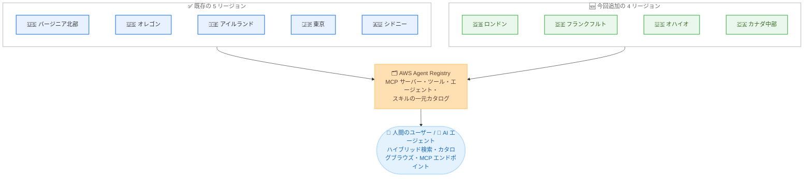

# AWS Agent Registry - 4 つの追加リージョンで利用可能に

**リリース日**: 2026 年 10 月 28 日
**サービス**: AWS Agent Registry (Amazon Bedrock AgentCore)
**機能**: 欧州 (ロンドン)、欧州 (フランクフルト)、米国東部 (オハイオ)、カナダ (中部) へのリージョン拡大

📊 [このアップデートのインフォグラフィックを見る](https://takech9203.github.io/aws-news-summary/20261028-aws-agent-registry-four-regions.html)

## 概要

AWS Agent Registry が、欧州 (ロンドン)、欧州 (フランクフルト)、米国東部 (オハイオ)、カナダ (中部) の 4 リージョンで新たに利用可能になりました。今回の拡大により、利用可能リージョンは合計 9 リージョンになります。

AWS Agent Registry は Amazon Bedrock AgentCore を通じて提供されるフルマネージドな検出サービスで、組織内のリソースを整理・キュレーション・検出するための一元的なカタログを提供します。MCP サーバー、ツール、エージェント、エージェントスキル、カスタムリソースを検索可能なレジストリに公開し、承認ワークフローによるアクセス制御を行い、人間と AI エージェントの双方がハイブリッド検索、カタログブラウズ、ネイティブ MCP エンドポイントを通じて適切なリソースを発見できます。

今回のリージョン拡大は、欧州やカナダにデータレジデンシー要件を持つ組織、および米国東部でマルチリージョン構成を採用する組織にとって重要なアップデートです。

**アップデート前の課題**

- AWS Agent Registry は 5 リージョン (バージニア北部、オレゴン、アイルランド、東京、シドニー) に限定されており、英国、ドイツ、カナダにデータレジデンシー要件を持つ組織は利用が困難だった
- 欧州ではアイルランドのみの提供だったため、ロンドンやフランクフルトを主要リージョンとするワークロードでは、レジストリへのアクセスにリージョン間通信が必要だった
- 米国東部ではバージニア北部のみの提供で、オハイオを利用するマルチリージョン構成ではレジストリを同一リージョンに配置できなかった

**アップデート後の改善**

- 欧州 (ロンドン)、欧州 (フランクフルト)、米国東部 (オハイオ)、カナダ (中部) でレジストリを作成し、エージェントやツールのカタログを同一リージョン内で運用できるようになった
- 英国、ドイツ、カナダのデータレジデンシーやコンプライアンス要件に対応しながら、エージェント資産の一元管理とガバナンスを実現できるようになった
- エージェントワークロードと同一リージョンにレジストリを配置することで、検索や MCP エンドポイント呼び出しのレイテンシーを低減できるようになった

## アーキテクチャ図



今回の拡大により、既存の 5 リージョンに新規 4 リージョンが加わり、合計 9 リージョンで AWS Agent Registry を利用できます。各リージョンでレジストリを作成し、人間と AI エージェントの双方がリソースを検出できます。

## サービスアップデートの詳細

### 主要機能

1. **4 リージョンへの提供拡大**
   - 欧州 (ロンドン / eu-west-2)、欧州 (フランクフルト / eu-central-1)、米国東部 (オハイオ / us-east-2)、カナダ (中部 / ca-central-1) で新たに利用可能
   - 既存の 5 リージョンと合わせて合計 9 リージョンでの提供となる
   - 最新のリージョン別提供状況は AWS Regional Services List で確認できる

2. **新リージョンでも利用できる主要機能**
   - MCP サーバー、ツール、エージェント、エージェントスキル、カスタムリソースの検索可能なレジストリへの公開
   - 承認ワークフローによるアクセス制御と、キュレーターによるレコードのライフサイクル管理
   - セマンティック検索とキーワード検索を組み合わせたハイブリッド検索、カタログブラウズ、ネイティブ MCP エンドポイントによる検出

3. **エンタープライズ機能への対応**
   - AWS RAM によるクロスアカウント共有、AWS Organizations 連携、Amazon EventBridge 通知、AWS CloudTrail による監査、AWS PrivateLink 対応などの既存機能を新リージョンでも活用できる
   - IAM 認証または corporate IdP の JWT 認証を選択してレジストリの MCP エンドポイントへのアクセスを制御できる

## 技術仕様

### 利用可能リージョン一覧

| リージョン | リージョンコード | 提供状況 |
|------|------|------|
| 米国東部 (バージニア北部) | us-east-1 | 既存 |
| 米国東部 (オハイオ) | us-east-2 | **今回追加** |
| 米国西部 (オレゴン) | us-west-2 | 既存 |
| カナダ (中部) | ca-central-1 | **今回追加** |
| 欧州 (アイルランド) | eu-west-1 | 既存 |
| 欧州 (ロンドン) | eu-west-2 | **今回追加** |
| 欧州 (フランクフルト) | eu-central-1 | **今回追加** |
| アジアパシフィック (東京) | ap-northeast-1 | 既存 |
| アジアパシフィック (シドニー) | ap-southeast-2 | 既存 |

## 設定方法

### 前提条件

1. AWS アカウントと、AWS Agent Registry を操作できる IAM 権限
2. 新リージョン (ロンドン、フランクフルト、オハイオ、カナダ中部) のいずれかを利用する場合は、該当リージョンを指定して操作すること
3. クロスアカウント共有を利用する場合は AWS RAM の利用権限

### 手順

#### ステップ1: 新リージョンでレジストリを作成

```bash
aws agent-registry create-registry \
  --region eu-west-2 \
  --name "uk-agent-registry" \
  --description "UK workloads agent registry"
```

`--region` に新しく利用可能になったリージョン (例: eu-west-2) を指定してレジストリを作成します。データレジデンシー要件に応じて、ワークロードと同一リージョンにレジストリを配置します。

#### ステップ2: レコードの登録と承認

```bash
aws agent-registry create-registry-record \
  --region eu-west-2 \
  --registry-id <registry-id> \
  --name "customer-support-agent" \
  --record-type AGENT
```

MCP サーバー、エージェント、スキルなどのレコードを登録します。登録されたレコードは承認ワークフローを経て検出可能になります。

#### ステップ3: リソースの検索

```bash
aws agent-registry search-discoverable-registry-records \
  --region eu-west-2 \
  --registry-id <registry-id> \
  --query-text "customer support automation"
```

承認済みレコードをハイブリッド検索で検索します。MCP 互換クライアントからレジストリの MCP エンドポイントに接続して検索することも可能です。

**注意**: 上記の CLI コマンドはパラメータ構造を示すための例です。正確なコマンド体系は [AWS Agent Registry ドキュメント](https://docs.aws.amazon.com/bedrock-agentcore/latest/devguide/registry.html) を参照してください。

## メリット

### ビジネス面

- **データレジデンシー対応**: 英国、ドイツ、カナダにデータ所在地要件を持つ組織が、要件を満たしながらエージェント資産の一元管理を導入できる
- **ガバナンス適用範囲の拡大**: より多くのリージョンでエージェントやツールのカタログ化と承認ワークフローを適用でき、組織全体の AI ガバナンスを強化できる
- **導入障壁の低減**: これまでリージョン制約で導入を見送っていた組織が、既存ワークロードのリージョン内で利用を開始できる

### 技術面

- **レイテンシー低減**: エージェントワークロードと同一リージョンにレジストリを配置することで、検索や MCP エンドポイント呼び出しのリージョン間通信を排除できる
- **マルチリージョン構成との整合**: オハイオなどを利用するマルチリージョン構成において、レジストリを各リージョンに配置する設計が可能になる
- **既存機能をそのまま利用可能**: ハイブリッド検索、承認ワークフロー、MCP ネイティブアクセスなどの機能を新リージョンでも同様に利用できる

## デメリット・制約事項

### 制限事項

- 利用可能リージョンは 9 リージョンであり、大阪リージョンなどその他のリージョンでは引き続き利用できない
- 最新の提供状況は AWS Regional Services List での確認が必要

### 考慮すべき点

- レジストリはリージョナルリソースであるため、複数リージョンで運用する場合はレジストリの配置戦略 (リージョンごとに分けるか、単一リージョンに集約するか) の設計判断が必要
- クロスアカウント・クロスリージョンでの利用形態に応じて、AWS RAM 共有や認証設定 (IAM / JWT) の構成を検討する必要がある

## ユースケース

### ユースケース1: 英国・ドイツのデータレジデンシー要件下でのエージェントカタログ構築

**シナリオ**: 英国の金融機関がエージェントや MCP ツールの社内カタログを構築したいが、データを英国内に保持する要件があり、これまでアイルランドリージョンの利用が難しかった。

**実装例**:
```bash
aws agent-registry create-registry \
  --region eu-west-2 \
  --name "uk-financial-agent-registry"
```

**効果**: ロンドンリージョン内でレジストリを完結させ、データレジデンシー要件を満たしながら、承認ワークフローとハイブリッド検索によるガバナンス付きのエージェント検出を実現できる。

### ユースケース2: カナダのワークロードと同一リージョンでの低レイテンシー検出

**シナリオ**: カナダ (中部) で AgentCore 上のエージェントを運用しており、エージェントが実行時にレジストリの MCP エンドポイントからツールを検出する構成を取りたい。

**実装例**:
```bash
aws agent-registry create-registry \
  --region ca-central-1 \
  --name "ca-agent-registry"
```

**効果**: エージェントとレジストリが同一リージョンに配置され、リージョン間通信なしで低レイテンシーなツール検出が可能になる。

### ユースケース3: 米国東部でのマルチリージョン構成への組み込み

**シナリオ**: バージニア北部とオハイオの 2 リージョンでワークロードを展開しており、各リージョンでエージェント資産のカタログを運用したい。

**実装例**:
```bash
# 各リージョンにレジストリを作成
aws agent-registry create-registry --region us-east-1 --name "use1-registry"
aws agent-registry create-registry --region us-east-2 --name "use2-registry"
```

**効果**: 両リージョンでレジストリを運用でき、リージョン単位の独立性を保ちながらエージェント資産を管理できる。

## 料金

AWS Agent Registry は Amazon Bedrock AgentCore を通じて提供される従量課金制のサービスです。今回のリージョン拡大による料金体系の変更はアナウンスされていません。料金の詳細は Amazon Bedrock AgentCore の料金ページで確認してください。

## 利用可能リージョン

今回の拡大により、以下の 9 リージョンで利用可能です。

- 米国東部 (バージニア北部)
- 米国東部 (オハイオ) ← 今回追加
- 米国西部 (オレゴン)
- カナダ (中部) ← 今回追加
- 欧州 (アイルランド)
- 欧州 (ロンドン) ← 今回追加
- 欧州 (フランクフルト) ← 今回追加
- アジアパシフィック (東京)
- アジアパシフィック (シドニー)

最新の提供状況は AWS Regional Services List を参照してください。

## 関連サービス・機能

- **Amazon Bedrock AgentCore**: AWS Agent Registry は AgentCore を通じて提供される。AgentCore Runtime および Gateway 上のエージェント・MCP サーバーの自動検出にも対応
- **AWS Resource Access Manager**: レジストリのクロスアカウント共有による組織全体レジストリの構築に使用
- **Amazon EventBridge**: レコードの承認ワークフローのイベント駆動連携に使用
- **AWS CloudTrail**: レジストリに対する全操作の監査証跡を記録
- **AWS PrivateLink**: クローズドなネットワーク環境からのレジストリアクセスに対応

## 参考リンク

- 📊 [インフォグラフィック](https://takech9203.github.io/aws-news-summary/20261028-aws-agent-registry-four-regions.html)
- [公式発表 (What's New)](https://aws.amazon.com/about-aws/whats-new/2026/10/aws-agent-registry-four-regions/)
- [AWS Blog: Manage agents, tools, and skills at scale with AWS Agent Registry](https://aws.amazon.com/blogs/machine-learning/manage-agents-tools-and-skills-at-scale-with-aws-agent-registry/)
- [AWS Agent Registry ドキュメント](https://docs.aws.amazon.com/bedrock-agentcore/latest/devguide/registry.html)
- [Amazon Bedrock AgentCore 料金ページ](https://aws.amazon.com/bedrock/agentcore/pricing/)

## まとめ

AWS Agent Registry が欧州 (ロンドン)、欧州 (フランクフルト)、米国東部 (オハイオ)、カナダ (中部) に拡大し、合計 9 リージョンで利用可能になりました。英国、ドイツ、カナダにデータレジデンシー要件を持つ組織や、米国東部でマルチリージョン構成を採用する組織は、ワークロードと同一リージョンでエージェント資産の一元管理とガバナンスを導入できます。該当リージョンでエージェントや MCP サーバーを運用している場合は、レジストリの作成と既存資産のカタログ化から始めることを推奨します。
