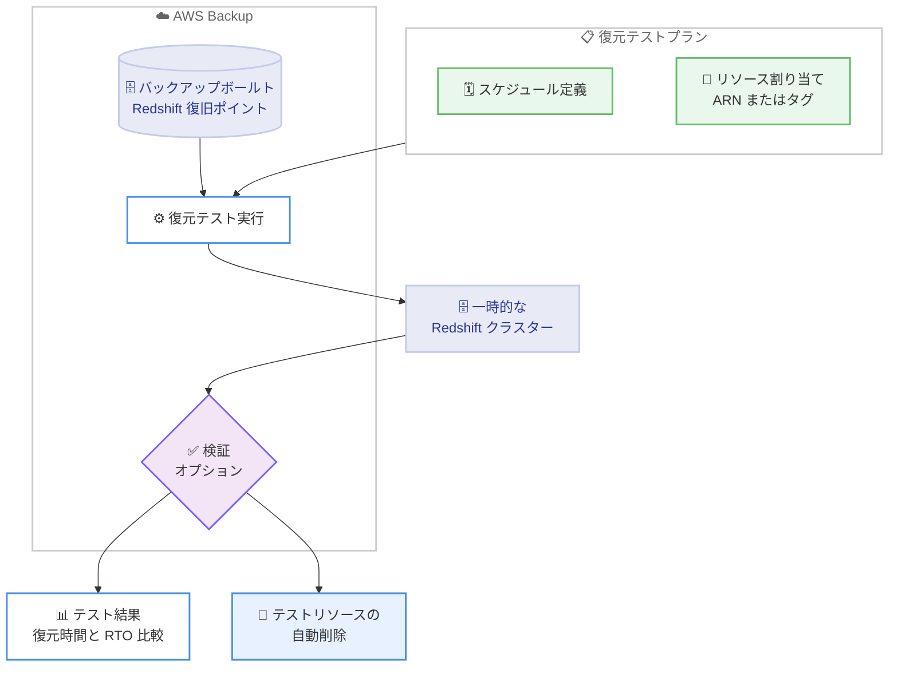

# AWS Backup - Amazon Redshift の復元テストサポート

**リリース日**: 2026 年 10 月 28 日
**サービス**: AWS Backup / Amazon Redshift
**機能**: 復元テスト (Restore Testing) の Amazon Redshift 対応

📊 [このアップデートのインフォグラフィックを見る](https://takech9203.github.io/aws-news-summary/20261028-aws-backup-adds-redshift-restore-testing.html)

## 概要

AWS Backup の復元テスト (Restore Testing) 機能が Amazon Redshift に対応しました。これにより、Redshift のバックアップが正常に復元できることを自動的かつ定期的に検証し、復元にかかる時間を測定できるようになります。

復元テストプランは、復旧ポイントの自動選択、スケジュールに基づく復元の実行、復元完了時間と目標復旧時間 (RTO) との比較を自動化します。ストレージ、コンピューティング、データベースなど、既に復元テストに対応している他の AWS リソースと合わせて、Redshift を単一の復元テストプランで管理できます。

災害対策 (DR) や事業継続計画 (BCP) に関するコンプライアンス要件・規制要件を持つ組織にとって、復旧準備状況を客観的に評価する手段が強化されるアップデートです。

**アップデート前の課題**

- Redshift のバックアップが実際に復元可能かどうかは、手動で復元を実行して確認する必要があった
- 復元時間の計測や RTO との比較を手動で行う必要があり、運用負荷が高かった
- 復元テストの実施記録を監査やコンプライアンス対応のために手作業で管理する必要があった

**アップデート後の改善**

- 復元テストプランに Redshift リソースを追加するだけで、復元テストを自動的かつ定期的に実行できるようになった
- 復元の所要時間が自動的に記録され、RTO との比較による復旧準備状況の評価が可能になった
- 検証完了後にテスト用リソースが自動削除されるため、テスト後のクリーンアップ作業が不要になった

## アーキテクチャ図



復元テストプランがスケジュールに従って Redshift の復旧ポイントを自動選択し、一時的なクラスターへの復元・検証・結果記録・クリーンアップまでを自動実行する流れを示しています。

## サービスアップデートの詳細

### 主要機能

1. **復元テストの自動実行**
   - 復元テストプランに Redshift リソースを ARN またはタグで割り当て可能
   - スケジュールに基づいて復旧ポイントを自動選択し、復元を自動実行
   - 復元完了時間を記録し、目標復旧時間 (RTO) と比較して復旧準備状況を評価

2. **復旧ポイントの選択オプション**
   - 最新の復旧ポイントを使用するか、対象期間内からランダムに選択するかを指定可能
   - ランダム選択により、特定の時点に偏らない網羅的な復元検証が可能

3. **復元後の検証とクリーンアップ**
   - 復元テスト検証 (Restore Testing Validation) を適用し、復元されたリソースの整合性をチェック可能
   - 検証完了後、AWS Backup がテスト用の一時リソースを自動削除
   - AWS Backup コンソール、CLI、SDK から利用可能

## 技術仕様

### 復元テストの構成要素

| 項目 | 詳細 |
|------|------|
| 対象リソース | Amazon Redshift (今回追加)。ストレージ、コンピューティング、データベース系の対応リソースと同一プランで管理可能 |
| リソース割り当て | ARN 指定またはタグベースの選択 |
| 復旧ポイント選択 | 最新の復旧ポイント、または対象期間内のランダム選択 |
| 検証 | 復元テスト検証 (オプション) で復元結果をチェック |
| テスト後の処理 | テスト用一時リソースを AWS Backup が自動削除 |
| 操作インターフェース | AWS Backup コンソール、AWS CLI、SDK |

## 設定方法

### 前提条件

1. AWS Backup で Amazon Redshift のバックアップ (復旧ポイント) が作成されていること
2. AWS Backup が復元テストと Amazon Redshift の両方をサポートするリージョンであること
3. 復元テストの実行に必要な IAM ロール・権限が設定されていること

### 手順

#### ステップ 1: 復元テストプランの作成

```bash
aws backup create-restore-testing-plan \
  --restore-testing-plan '{
    "RestoreTestingPlanName": "RedshiftRestoreTest",
    "ScheduleExpression": "cron(0 2 ? * MON *)",
    "RecoveryPointSelection": {
      "Algorithm": "LATEST_WITHIN_WINDOW",
      "IncludeVaults": ["*"],
      "RecoveryPointTypes": ["SNAPSHOT"]
    }
  }'
```

毎週月曜 2 時に実行される復元テストプランを作成し、対象期間内の最新の復旧ポイントを選択するよう設定しています。ランダム選択にする場合は `Algorithm` に `RANDOM_WITHIN_WINDOW` を指定します。

#### ステップ 2: Redshift リソースの割り当て

```bash
aws backup create-restore-testing-selection \
  --restore-testing-plan-name "RedshiftRestoreTest" \
  --restore-testing-selection '{
    "RestoreTestingSelectionName": "RedshiftSelection",
    "ProtectedResourceType": "Redshift",
    "IamRoleArn": "arn:aws:iam::123456789012:role/AWSBackupRestoreTestRole",
    "ProtectedResourceArns": ["*"]
  }'
```

復元テストプランに Redshift リソースを割り当てています。`ProtectedResourceArns` で特定のクラスターの ARN を指定するか、タグ条件 (`ProtectedResourceConditions`) でリソースを選択できます。

#### ステップ 3: テスト結果の確認

```bash
aws backup list-restore-jobs-by-protected-resource \
  --resource-arn "arn:aws:redshift:ap-northeast-1:123456789012:cluster:my-cluster"
```

対象リソースの復元ジョブ一覧を取得し、復元テストの実行結果と所要時間を確認しています。結果は AWS Backup コンソールのダッシュボードでも確認できます。

## メリット

### ビジネス面

- **コンプライアンス対応**: 災害対策・事業継続に関する規制要件に対し、定期的な復元テストの実施記録を自動的に蓄積できる
- **復旧準備状況の可視化**: 復元時間と RTO の比較により、復旧目標を実際に達成できるかを客観的に評価できる
- **運用コスト削減**: 手動での復元テストの計画・実行・クリーンアップ作業が不要になる

### 技術面

- **自動化された検証**: 復旧ポイントの選択から復元、検証、リソース削除までを完全に自動化できる
- **一元管理**: Redshift を含む複数のリソースタイプを単一の復元テストプランで管理できる
- **検証ロジックのカスタマイズ**: 復元テスト検証により、復元されたクラスターに対する独自の整合性チェックを組み込める

## デメリット・制約事項

### 制限事項

- AWS Backup が復元テストと Amazon Redshift の両方をサポートするリージョンでのみ利用可能
- 復元テストの対象は AWS Backup で管理されている Redshift の復旧ポイントに限られる

### 考慮すべき点

- 復元テストの実行ごとに料金が発生するほか、テスト中に起動する一時的な Redshift クラスターのリソース料金も発生するため、テスト頻度とコストのバランスを検討する必要がある
- 復元テスト検証を利用する場合は、検証ロジック (Lambda 関数など) の設計・運用が別途必要になる

## ユースケース

### ユースケース 1: 金融機関の DR コンプライアンス対応

**シナリオ**: 金融規制により、データウェアハウスのバックアップが定期的に復元可能であることを証明する必要がある。

**実装例**:
```
1. 週次スケジュールの復元テストプランを作成
2. 本番 Redshift クラスターをタグ (Environment=Production) で割り当て
3. ランダム選択アルゴリズムで対象期間内の復旧ポイントを検証
4. テスト結果レポートを監査証跡として保管
```

**効果**: 監査対応に必要な復元テストの実施記録を自動的に蓄積し、監査準備工数を大幅に削減できる。

### ユースケース 2: RTO 達成可能性の継続的モニタリング

**シナリオ**: BCP で定めた RTO (例: 4 時間) を、データ量が増加し続ける Redshift クラスターで達成できるか継続的に確認したい。

**実装例**:
```
1. 月次の復元テストプランを作成し、最新の復旧ポイントを選択
2. 復元完了時間の推移をモニタリング
3. 復元時間が RTO に近づいた場合、スナップショット戦略やクラスター構成を見直す
```

**効果**: データ増加に伴う復元時間の変化を早期に検知し、RTO 未達リスクを事前に回避できる。

### ユースケース 3: 復元データの整合性検証の自動化

**シナリオ**: バックアップからの復元が成功するだけでなく、復元されたデータが業務上有効であることまで自動検証したい。

**実装例**:
```
1. 復元テストプランに Redshift クラスターを割り当て
2. 復元テスト検証として Lambda 関数を設定し、
   復元されたクラスターに対して主要テーブルの行数チェックや
   サンプルクエリの実行結果を検証
3. 検証完了後、一時クラスターは自動削除
```

**効果**: バックアップの論理的な整合性まで含めた検証を自動化し、復旧の信頼性を高められる。

## 料金

復元テストの実行に対する AWS Backup の料金に加え、テスト中に復元される一時的な Redshift リソースの料金が発生します。詳細は [AWS Backup 料金ページ](https://aws.amazon.com/backup/pricing/) を参照してください。

## 利用可能リージョン

AWS Backup が復元テストと Amazon Redshift の両方をサポートするすべての AWS リージョンで利用可能です。最新の対応状況は [リージョン別の機能可用性ドキュメント](https://docs.aws.amazon.com/aws-backup/latest/devguide/backup-feature-availability.html#features-by-region) を参照してください。

## 関連サービス・機能

- **Amazon Redshift**: 今回復元テストの対象として追加されたクラウドデータウェアハウスサービス
- **AWS Backup 復元テスト検証**: 復元されたリソースに対する検証ロジックを実行する機能。Lambda 関数などで整合性チェックを自動化できる
- **AWS Backup Audit Manager**: バックアップポリシーの準拠状況を監査する機能。復元テストと組み合わせることでコンプライアンス対応を強化できる

## 参考リンク

- 📊 [インフォグラフィック](https://takech9203.github.io/aws-news-summary/20261028-aws-backup-adds-redshift-restore-testing.html)
- [公式発表 (What's New)](https://aws.amazon.com/about-aws/whats-new/2026/10/aws-backup-adds-redshift-restore-testing/)
- [ドキュメント: AWS Backup 復元テスト](https://docs.aws.amazon.com/aws-backup/latest/devguide/restore-testing.html)
- [ドキュメント: リージョン別の機能可用性](https://docs.aws.amazon.com/aws-backup/latest/devguide/backup-feature-availability.html#features-by-region)
- [料金ページ](https://aws.amazon.com/backup/pricing/)

## まとめ

AWS Backup の復元テストが Amazon Redshift に対応し、データウェアハウスのバックアップが実際に復元可能であることを自動的かつ定期的に検証できるようになりました。DR・BCP のコンプライアンス要件を持つ組織や、RTO の達成可能性を継続的に確認したい組織は、既存の Redshift バックアップに対して復元テストプランの導入を検討することを推奨します。
