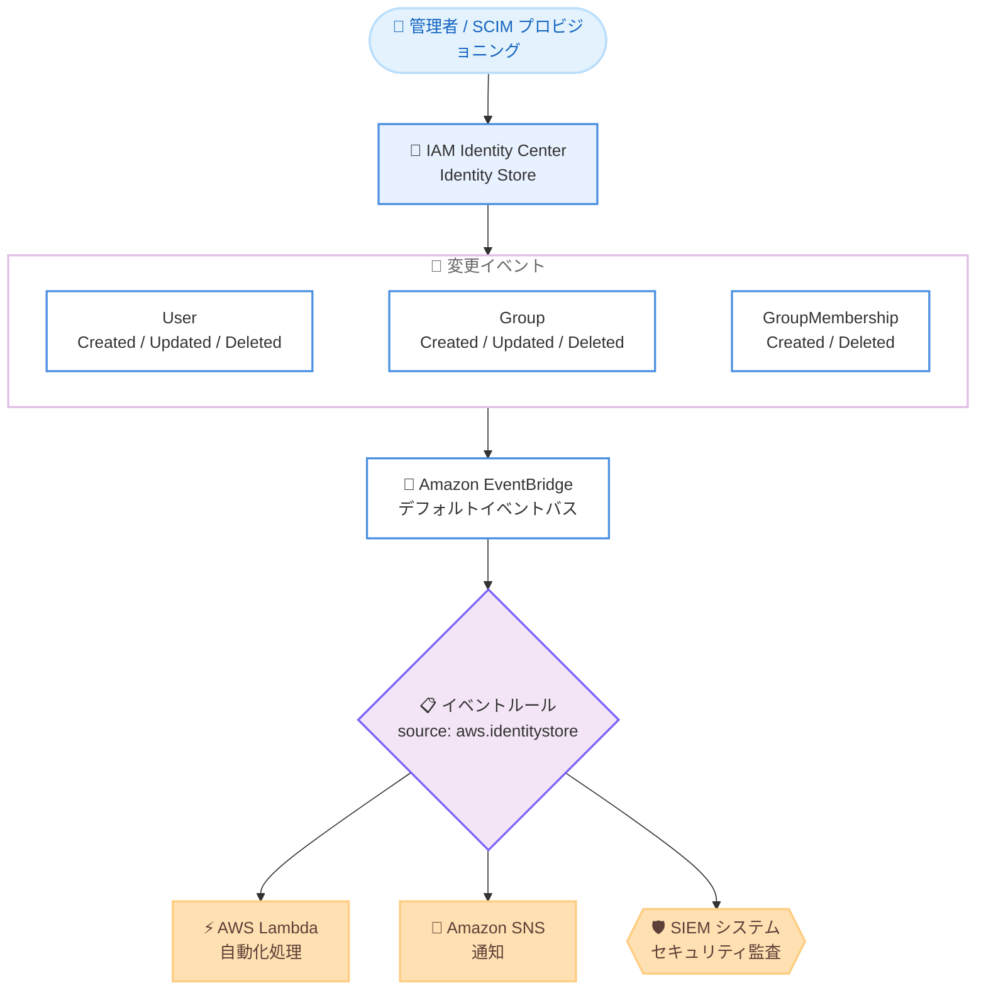

# AWS IAM Identity Center - Identity Store の変更通知 (Amazon EventBridge 対応)

**リリース日**: 2026 年 10 月 28 日
**サービス**: AWS IAM Identity Center / Amazon EventBridge
**機能**: Identity Store change notifications through Amazon EventBridge

📊 [このアップデートのインフォグラフィックを見る](https://takech9203.github.io/aws-news-summary/20261028-aws-identity-store-change-notifications.html)

## 概要

AWS IAM Identity Center の Identity Store が、ユーザー、グループ、グループメンバーシップ、および Identity Store 自体の作成・更新・削除時に、Amazon EventBridge へリアルタイムイベントを配信する機能をサポートしました。Identity Store は、AWS アカウントとアプリケーション全体の ID とアクセスを一元管理する中央リポジトリであり、IAM Identity Center の ID ソースとして機能します。

この新機能により、ID のライフサイクルイベントに自動的に対応し、変更の発生をリアルタイムに検知することで、セキュリティおよびコンプライアンスプロセスを支援できます。セキュリティチームは、EventBridge ルールを作成して AWS Lambda 関数をトリガーし、ユーザープロビジョニングアクティビティの監査、SIEM システムへのアラート送信、ユーザーやグループの変更時における下流アプリケーションのアクセス更新などを自動化できます。

**アップデート前の課題**

このアップデート以前は、Identity Store の変更を検知する手段が限られていました。

- Identity Store の変更を検知するには、Identity Store API を定期的にポーリングして差分を比較する必要があった
- CloudTrail ログの解析で API 呼び出しを追跡できたものの、「ID データに何が起きたか」をイベント単位で把握する直接的な手段がなかった
- オンボーディングやオフボーディングなどの ID ライフサイクル処理をリアルタイムに自動化することが困難だった

**アップデート後の改善**

今回のアップデートにより、イベント駆動型の ID 管理が可能になりました。

- ユーザー、グループ、グループメンバーシップ、Identity Store の作成・更新・削除がリアルタイムイベントとして EventBridge のデフォルトイベントバスに配信される
- EventBridge ルールで Lambda、Amazon SNS、Amazon SQS などのターゲットを指定し、ID 変更への自動対応ワークフローを構築できる
- ポーリングによる差分検出が不要になり、変更発生と同時に処理を開始できる

## アーキテクチャ図



Identity Store で発生した ID の変更が EventBridge のデフォルトイベントバスにリアルタイム配信され、ルールにマッチしたイベントが Lambda や SNS などのターゲットに送信される流れを示しています。

## サービスアップデートの詳細

### 主要機能

1. **リアルタイム変更イベントの配信**
   - ユーザー、グループ、グループメンバーシップ、Identity Store 自体の作成・更新・削除時にイベントを配信
   - イベントは IAM Identity Center インスタンスが有効化されている AWS アカウントのデフォルトイベントバスに自動配信される (組織インスタンスの場合は管理アカウント、アカウントインスタンスの場合は有効化したメンバーアカウント)
   - イベントソースはすべて `aws.identitystore`、イベント名は `detail-type` フィールドに格納される

2. **11 種類のイベントタイプ**
   - User Created / User Updated / User Deleted: ユーザーの作成・属性更新・削除
   - Group Created / Group Updated / Group Deleted: グループの作成・属性更新・削除
   - GroupMembership Created / GroupMembership Deleted: グループへのユーザー追加・削除
   - IdentityStore Created / IdentityStore Updated / IdentityStore Deleted: Identity Store 自体の作成・設定更新・削除

3. **マルチリージョンレプリケーション対応**
   - IAM Identity Center インスタンスを追加リージョンにレプリケートしている場合、各追加リージョンのデフォルトイベントバスでもイベントを受信できる
   - インスタンスの各有効化リージョンでイベントが送信される

## 技術仕様

### イベントの内容

| 項目 | 詳細 |
|------|------|
| イベントソース | `aws.identitystore` |
| 配信先 | IAM Identity Center インスタンスが有効なアカウント・リージョンのデフォルトイベントバス |
| 含まれる情報 | Identity Store の ID、IAM Identity Center インスタンスの ARN、変更されたユーザー / グループ / メンバーシップの ID と ARN、変更リクエストの ID、変更時刻、送信リージョン |
| 含まれない情報 | ユーザー名やメールアドレスなどの属性値、Updated イベントにおける変更内容の詳細 |
| 配信保証 | 少なくとも 1 回 (at-least-once)。重複受信や順序の入れ替わりの可能性あり |
| 遡及配信 | なし (ルール作成後の変更のみが対象。バックフィルやリプレイは行われない) |

属性の現在値が必要な場合は、`DescribeUser`、`DescribeGroup`、`DescribeGroupMembership` の各 Identity Store API を呼び出して取得します。

### イベントパターンの例

すべての Identity Store 変更イベントにマッチするイベントパターンは以下のとおりです。

```json
{
  "source": ["aws.identitystore"],
  "detail-type": [
    "User Created", "User Updated", "User Deleted",
    "Group Created", "Group Updated", "Group Deleted",
    "GroupMembership Created", "GroupMembership Deleted",
    "IdentityStore Created", "IdentityStore Updated", "IdentityStore Deleted"
  ]
}
```

CloudTrail 経由の API 呼び出しイベントも同じイベントソース `aws.identitystore` で配信されるため、`detail-type` にイベント名を明示的に指定することで変更通知イベントのみを受信できます。

### イベント構造の例 (User Updated)

```json
{
  "version": "0",
  "id": "c22ba61f-32ac-42f1-a59b-f7f667b428ab",
  "detail-type": "User Updated",
  "source": "aws.identitystore",
  "account": "111122223333",
  "time": "2026-01-02T11:59:59Z",
  "region": "us-west-2",
  "resources": ["arn:aws:identitystore::111122223333:..."]
}
```

## 設定方法

### 前提条件

1. IAM Identity Center インスタンスが有効化されている AWS アカウントとリージョンを確認していること (ルールはそこに作成する)
2. `events:PutRule` や `events:PutTargets` など、EventBridge ルールとターゲットを作成する権限があること
3. イベントの受信先となるターゲット (AWS Lambda 関数、Amazon SNS トピック、Amazon SQS キューなど) が用意されていること

### 手順

#### ステップ 1: イベントパターンの作成

```bash
cat > identity-events.json << 'EOF'
{
  "source": ["aws.identitystore"],
  "detail-type": ["User Deleted", "GroupMembership Deleted"]
}
EOF
```

受信したいイベントを選択するイベントパターンをファイルに保存します。この例では、下流アプリケーションのアクセス削除を想定し、ユーザー削除とグループからのユーザー削除のイベントのみにマッチさせています。

#### ステップ 2: EventBridge ルールの作成

```bash
aws events put-rule \
  --name identity-change-events \
  --event-pattern file://identity-events.json \
  --region us-east-1
```

デフォルトイベントバス上にルールを作成します。リージョンには IAM Identity Center インスタンスが有効化されているリージョンを指定します。

#### ステップ 3: ターゲットの追加

```bash
aws events put-targets \
  --rule identity-change-events \
  --targets "Id"="1","Arn"="arn:aws:sns:us-east-1:111122223333:identity-change-topic" \
  --region us-east-1
```

ルールにターゲットを追加します。この例では Amazon SNS トピックにイベントを送信します。CLI でルールを作成する場合は、ターゲットのリソースベースポリシーなどで EventBridge からの送信を許可する必要があります。

#### ステップ 4: ルールのテスト

ルール作成後約 1 分待ってから、IAM Identity Center でユーザーをグループに追加するなどの変更を行い、ターゲットが `GroupMembership Created` イベントを受信することを確認します。テスト中のイベント確認には、Amazon CloudWatch Logs ロググループを 2 つ目のターゲットとして追加すると便利です。

## メリット

### ビジネス面

- **オンボーディング / オフボーディングの自動化**: ユーザーが特定のグループに追加・削除されたタイミングで、アプリケーションのリソース作成やアクセス削除を自動実行でき、大規模な従業員管理の運用負荷を削減できる
- **コンプライアンス対応の強化**: ID の変更をリアルタイムに検知して SIEM に連携することで、監査証跡の即時性と網羅性が向上する
- **追加コストなし**: 標準の Amazon EventBridge 利用料金以外の追加料金なしで利用できる

### 技術面

- **イベント駆動アーキテクチャへの統合**: ポーリング方式から脱却し、Lambda、SNS、SQS などと組み合わせたイベント駆動の ID 管理ワークフローを構築できる
- **変更単位のイベント**: CloudTrail の API 呼び出し記録とは異なり、「ID データへの変更」そのものがイベントとして記録されるため、変更対応ロジックをシンプルに実装できる
- **マルチリージョン対応**: レプリケートした各リージョンでもイベントを受信でき、リージョン分散したワークロードに対応できる

## デメリット・制約事項

### 制限事項

- イベントの配信は少なくとも 1 回 (at-least-once) であり、同一イベントを複数回受信したり、変更発生順とは異なる順序で受信したりする可能性がある
- 配信は前方のみ (forward-looking) であり、ルール作成以前の変更のバックフィルやリプレイは行われない。ルールにマッチしないイベントも保存されない
- イベントにはユーザーやグループの属性 (名前、メールアドレスなど) は含まれず、Updated イベントにも変更内容の詳細は含まれない

### 考慮すべき点

- 同じイベントを 2 回処理しても副作用がないよう、冪等性を考慮したワークフロー設計が必要
- 配信時間は保証されないため、下流システムの正確性を保つには、イベント処理に加えて Identity Store API との定期的な突合を推奨
- IAM Identity Center インスタンスを削除した場合、`IdentityStore Deleted` イベントの後、内部のユーザー・グループ・メンバーシップの削除イベントが時間差で順次届く
- イベント通知と CloudTrail イベントは 1 対 1 に対応しない。変更への対応にはイベント通知を、API 呼び出し元の監査には CloudTrail を使い分ける

## ユースケース

### ユースケース 1: オフボーディング時のアクセス自動削除

**シナリオ**: 退職者や異動者がグループから削除された際に、下流の SaaS アプリケーションや社内システムのアクセス権を即座に削除したい。

**実装例**:
```json
{
  "source": ["aws.identitystore"],
  "detail-type": ["User Deleted", "GroupMembership Deleted"]
}
```
このパターンのルールから Lambda 関数をトリガーし、イベントに含まれるユーザー ID をもとに下流アプリケーションのアクセスを削除する。

**効果**: アクセス削除の遅延による不正アクセスリスクを低減し、オフボーディングプロセスを完全自動化できる。

### ユースケース 2: SIEM へのリアルタイム連携によるセキュリティ監査

**シナリオ**: セキュリティチームが、ユーザープロビジョニングやグループ変更のアクティビティをリアルタイムに監視し、不審な変更を即座に検知したい。

**実装例**:
```json
{
  "source": ["aws.identitystore"],
  "detail-type": [
    "User Created", "Group Updated", "GroupMembership Created"
  ]
}
```
ルールのターゲットに Amazon Data Firehose や Lambda を指定し、SIEM システムにイベントを転送する。

**効果**: 特権グループへの予期しないメンバー追加などを即時に検知し、インシデント対応までの時間を短縮できる。

### ユースケース 3: 新入社員オンボーディングの自動化

**シナリオ**: 新入社員が特定の部門グループに追加されたタイミングで、業務アプリケーションのアカウント作成や初期リソースのプロビジョニングを自動実行したい。

**実装例**:
```json
{
  "source": ["aws.identitystore"],
  "detail-type": ["GroupMembership Created"]
}
```
イベント受信後、Lambda 関数で `DescribeGroupMembership` と `DescribeUser` を呼び出してユーザー属性を取得し、Step Functions でオンボーディングワークフローを起動する。

**効果**: 手動のアカウント発行作業が不要になり、入社初日から必要なリソースを利用可能な状態にできる。

## 料金

変更通知自体に追加料金はありません。標準の Amazon EventBridge 利用料金のみが適用されます。

## 利用可能リージョン

IAM Identity Center が利用可能なすべての AWS リージョンで利用できます。イベントはインスタンスの各有効化リージョンで送信されます。詳細は [AWS capabilities by Region](https://builder.aws.com/build/capabilities) を参照してください。

## 関連サービス・機能

- **Amazon EventBridge**: 変更イベントの受信基盤。ルールとターゲットを定義してイベント駆動ワークフローを構築する
- **AWS Lambda**: イベントをトリガーとした自動化処理の実行基盤
- **Amazon SNS / Amazon SQS**: 通知配信やイベントのキューイングに利用できるターゲット
- **AWS CloudTrail**: Identity Store API 呼び出しの監査ログ。変更対応はイベント通知、呼び出し元の監査は CloudTrail と使い分ける
- **Identity Store API**: `DescribeUser` / `DescribeGroup` / `DescribeGroupMembership` で変更後の現在の属性を取得する

## 参考リンク

- 📊 [インフォグラフィック](https://takech9203.github.io/aws-news-summary/20261028-aws-identity-store-change-notifications.html)
- [公式発表 (What's New)](https://aws.amazon.com/about-aws/whats-new/2026/10/aws-identity-store-change-notifications/)
- [ドキュメント: IAM Identity Center event notifications](https://docs.aws.amazon.com/singlesignon/latest/userguide/event-notifications.html)
- [ドキュメント: Set up event notifications](https://docs.aws.amazon.com/singlesignon/latest/userguide/setup-event-notifications.html)
- [ドキュメント: Identity Store events (EventBridge Events Reference)](https://docs.aws.amazon.com/eventbridge/latest/ref/events-ref-identitystore.html)
- [料金ページ (Amazon EventBridge)](https://aws.amazon.com/eventbridge/pricing/)

## まとめ

IAM Identity Center の Identity Store が EventBridge への変更通知に対応したことで、ポーリング不要のイベント駆動型 ID 管理が実現できるようになりました。オンボーディング / オフボーディングの自動化や SIEM 連携によるセキュリティ監視を強化したい組織は、まず `aws.identitystore` をソースとする EventBridge ルールを作成し、重要なイベント (特に User Deleted や GroupMembership の変更) への自動対応から導入を始めることを推奨します。
