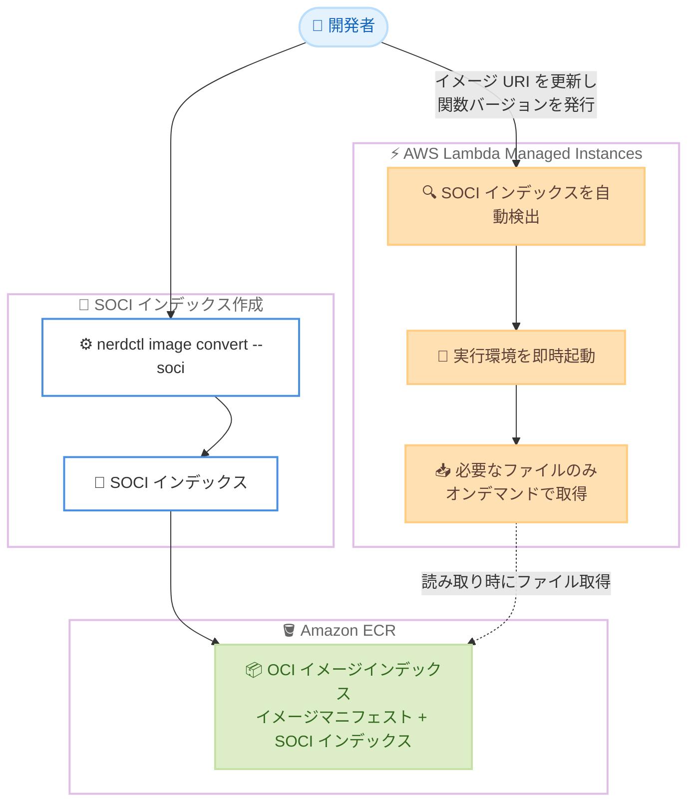

# AWS Lambda - Lambda Managed Instances での Seekable OCI (SOCI) レイジーローディングサポート

**リリース日**: 2026 年 10 月 28 日
**サービス**: AWS Lambda
**機能**: Seekable OCI (SOCI) lazy loading for Lambda Managed Instances

📊 [このアップデートのインフォグラフィックを見る](https://takech9203.github.io/aws-news-summary/20261028-aws-lambda-seekable-oci-soci.html)

## 概要

AWS Lambda は、Lambda Managed Instances 上で動作する OCI コンテナイメージ形式の Event Functions に対して、Seekable OCI (SOCI) によるレイジーローディング (遅延読み込み) のサポートを発表しました。これにより、コンテナの起動時間を最大 70% 短縮できます。

SOCI は AWS が開発したオープンソース技術で、イメージレイヤー内の各ファイルの位置を示す「目次」のようなインデックスを使用します。Lambda はこのインデックスを利用して、イメージ全体を事前にダウンロードするのではなく、実行環境の起動の各段階で実際に必要なファイルだけをオンデマンドで取得します。

データ処理パイプライン、高スループットな API バックエンド、バッチ計算などのコンピューティング集約型ワークロードでは、コンテナイメージが数 GB に達することがあります。今回のアップデートは、特に機械学習フレームワークを同梱した大容量イメージなど、呼び出しごとにイメージ内容の一部しか読み込まないワークロードで大きな効果を発揮します。

**アップデート前の課題**

- 以前は、新しい実行環境をプロビジョニングする際、イメージ全体のダウンロードと展開が完了するまで実行環境を起動できなかった
- 数 GB 規模の大容量イメージでは、ダウンロードと準備に数分かかることがあった
- 関数バージョンの発行時やスケールアウト時に、イメージのプルが初回呼び出しまでの時間の大部分を占めていた

**アップデート後の改善**

- 今回のアップデートにより、イメージ全体のダウンロード完了を待たずに実行環境を起動できるようになった
- コンテナの起動時間が最大 70% 短縮され、起動時間がイメージの合計サイズに左右されにくくなった
- SOCI インデックス付きのイメージ URI を指定するだけで、Lambda が自動的に SOCI インデックスを検出してレイジーローディングを有効化するため、追加の設定が不要

## アーキテクチャ図



SOCI インデックスをイメージと共に Amazon ECR にプッシュすると、Lambda がインデックスを自動検出し、イメージ全体のダウンロードを待たずに実行環境を起動して、関数が読み取るファイルだけをオンデマンドで取得します。

## サービスアップデートの詳細

### 主要機能

1. **SOCI によるレイジーローディング**
   - SOCI インデックスは、イメージレイヤー内の各ファイルとその位置をマッピングする「目次」の役割を果たす
   - Lambda はイメージ全体を事前にダウンロード・展開するのではなく、関数が読み取るファイルをオンデマンドで取得する
   - 初期化コードが読み取るファイルは初期化中に、ハンドラーが初めて読み取るファイルはその呼び出し中に取得される
   - Lambda はバックグラウンドでイメージの残りの部分をダウンロードしない

2. **自動検出による簡単な有効化**
   - SOCI インデックス付きのタグ (例: `my-function:v1-soci`) を関数のイメージ URI に設定して関数バージョンを発行するだけで利用可能
   - Lambda が SOCI インデックスを自動検出してレイジーローディングを有効化するため、追加の設定変更は不要

3. **起動時間の大幅な短縮**
   - コンテナの起動時間を最大 70% 短縮
   - 起動時間がイメージの合計サイズに左右されにくくなり、スケーリングイベント時の関数起動も高速化
   - 数 GB 規模のイメージで、呼び出しごとに内容の一部しか読み込まない場合 (機械学習フレームワークを同梱したイメージなど) に効果が最大となる

4. **AI コーディングエージェントとの連携**
   - Kiro、Claude Code、Codex などのコーディングアシスタントを利用している場合、Agent Toolkit for AWS の Lambda Managed Instances スキルをインストールしてエージェント経由で関数をデプロイできる

## 技術仕様

### 要件と制限

| 項目 | 詳細 |
|------|------|
| 対象 | Lambda Managed Instances 上で動作するコンテナイメージ形式の Event Functions のみ |
| SOCI インデックスバージョン | SOCI Index Manifest v2 のみサポート (メディアタイプ `application/vnd.amazon.soci.index.v2+json`)。v1 は非サポート |
| イメージインデックス形式 | SOCI インデックスと 1 つの OCI イメージマニフェストの計 2 エントリのみを含む必要がある |
| イメージ URI | 元のイメージタグではなく、SOCI インデックス付きタグを指定する |
| アーキテクチャ | Lambda はシングルアーキテクチャのコンテナイメージのみをサポート。イメージは関数のアーキテクチャと一致する単一の命令セットを対象とする必要がある |
| イメージ更新 | イメージまたはインデックスを変更する場合は、新しい SOCI インデックス付きタグをプッシュし、関数のイメージ URI を更新する |

## 設定方法

### 前提条件

1. Lambda Managed Instances 上で動作するコンテナイメージ形式の Event Function
2. Amazon ECR リポジトリに格納されたコンテナイメージ
3. SOCI インデックス作成用の環境 (以下の例は Amazon Linux 2023 を使用)

### 手順

#### ステップ 1: SOCI スナップショッターのインストール

```bash
sudo yum install -y soci-snapshotter containerd nerdctl
sudo systemctl start soci-snapshotter
sudo systemctl restart containerd
```

SOCI snapshotter、containerd、nerdctl をインストールし、SOCI snapshotter を起動して containerd を再起動します。

#### ステップ 2: SOCI インデックスの作成とプッシュ

```bash
ACCOUNT_ID="111122223333"
REGION="us-east-2"
REPOSITORY_NAME="my-function"
ORIGINAL_IMAGE_TAG="v1"
SOCI_IMAGE_TAG="v1-soci"
REGISTRY="$ACCOUNT_ID.dkr.ecr.$REGION.amazonaws.com"

aws ecr get-login-password --region $REGION | sudo nerdctl login -u AWS --password-stdin $REGISTRY

sudo nerdctl pull $REGISTRY/$REPOSITORY_NAME:$ORIGINAL_IMAGE_TAG
sudo nerdctl image convert --soci $REGISTRY/$REPOSITORY_NAME:$ORIGINAL_IMAGE_TAG $REGISTRY/$REPOSITORY_NAME:$SOCI_IMAGE_TAG
sudo nerdctl push --platform linux/arm64 $REGISTRY/$REPOSITORY_NAME:$SOCI_IMAGE_TAG
```

Amazon ECR にログインし、既存のイメージをプルして `nerdctl image convert --soci` で SOCI インデックス付きイメージ (v2 インデックス) に変換し、ECR にプッシュします。この例は arm64 (AWS Graviton) イメージを対象としており、`--platform` の値は関数のアーキテクチャと一致させる必要があります。

#### ステップ 3: 関数のイメージ URI を更新して関数バージョンを発行

関数のイメージ URI を SOCI インデックス付きタグ (例: `$REGISTRY/$REPOSITORY_NAME:$SOCI_IMAGE_TAG`) に設定し、関数バージョンを発行します。Lambda が関数バージョンをイメージインデックスに解決し、SOCI インデックスを自動検出してレイジーローディングを有効化します。追加の設定は不要です。

## メリット

### ビジネス面

- **スケーリングの俊敏性向上**: スケールアウト時の実行環境の起動が高速化し、トラフィック急増時の応答性が向上する
- **大容量イメージの実用性向上**: 数分かかっていたイメージの準備時間がボトルネックでなくなり、機械学習フレームワークなどを含む大容量イメージを現実的に運用できる
- **移行・導入の容易さ**: 既存のイメージに SOCI インデックスを追加するだけで、コードやその他の設定を変更せずに効果を得られる

### 技術面

- **起動時間を最大 70% 短縮**: イメージ全体のダウンロードを待たずに実行環境を起動できる
- **イメージサイズへの依存低減**: 起動時間が実際に読み取られるファイル量に依存するため、イメージの合計サイズの影響を受けにくい
- **自動検出による設定レス**: Lambda が SOCI インデックスを自動検出するため、追加の関数設定が不要

## デメリット・制約事項

### 制限事項

- Lambda Managed Instances 上のコンテナイメージ関数でのみ利用可能 (通常の Lambda 実行モデルでは利用不可)
- SOCI Index Manifest v2 のみサポートされ、v1 インデックスは利用できない
- イメージインデックスは SOCI インデックスと 1 つの OCI イメージマニフェストの計 2 エントリのみを含む必要がある
- シングルアーキテクチャのイメージのみサポートされる

### 考慮すべき点

- ハンドラー内で初めてファイルを読み取ると、その呼び出し中にファイル取得が発生し、呼び出し時間が増加する。呼び出し時間を一定に保つには、必要なライブラリのインポートやファイルの読み取りをハンドラーではなく初期化コードで行うことが推奨される
- ワークロードごとに効果が異なるため、SOCI あり・なしの両方で起動時間と呼び出し時間を比較テストすることが推奨される
- イメージを更新するたびに SOCI インデックスを再作成し、新しいタグをプッシュして関数のイメージ URI を更新する必要があるため、CI/CD パイプラインへの組み込みを検討する

## ユースケース

### ユースケース 1: 機械学習フレームワークを含む推論関数の高速起動

**シナリオ**: PyTorch や TensorFlow などの機械学習フレームワークを同梱した数 GB のコンテナイメージで推論処理を行っており、スケールアウト時の起動遅延が課題となっている。

**実装例**:
```bash
# 推論用イメージに SOCI インデックスを作成してプッシュ
sudo nerdctl image convert --soci \
  $REGISTRY/ml-inference:v2 $REGISTRY/ml-inference:v2-soci
sudo nerdctl push --platform linux/arm64 $REGISTRY/ml-inference:v2-soci
```

**効果**: 推論時に実際に読み込まれるファイルのみが取得されるため、イメージ全体のダウンロードを待たずに実行環境が起動し、初回呼び出しまでの時間が大幅に短縮される。

### ユースケース 2: 高スループット API バックエンドのスケールアウト高速化

**シナリオ**: 多数の依存ライブラリを含むコンテナイメージで API バックエンドを運用しており、トラフィック急増時のスケールアウトで新しい実行環境の準備に時間がかかっている。

**実装例**:
```bash
# CI/CD パイプラインでイメージビルド後に SOCI インデックスを自動作成
sudo nerdctl image convert --soci \
  $REGISTRY/api-backend:$BUILD_TAG $REGISTRY/api-backend:$BUILD_TAG-soci
sudo nerdctl push --platform linux/arm64 $REGISTRY/api-backend:$BUILD_TAG-soci
```

**効果**: スケーリングイベント時の関数起動が高速化し、トラフィック急増時にも安定した応答性を維持できる。

### ユースケース 3: バッチ処理・データ処理パイプラインの起動時間短縮

**シナリオ**: データ処理用の大容量ツールチェーンを含むイメージでバッチ計算を実行しており、ジョブ開始のたびにイメージのダウンロードと展開で数分待たされている。

**実装例**:
```python
# 初期化コードで必要なライブラリをすべてインポートし、
# 呼び出し時のファイル取得による遅延を回避する
import pandas as pd
import numpy as np
import pyarrow.parquet as pq

def handler(event, context):
    # 初期化済みのライブラリを使用して処理を実行
    ...
```

**効果**: 必要なファイルのみがオンデマンドで取得されるため、ジョブ開始までの待ち時間が短縮される。初期化コードでライブラリを読み込むことで、呼び出し時間のばらつきも抑えられる。

## 料金

今回の発表では SOCI レイジーローディングに対する追加料金は言及されていません。Lambda Managed Instances の利用料金が適用されます。SOCI インデックスは Amazon ECR に保存されるため、ECR のストレージ料金の対象となります。詳細は [AWS Lambda 料金ページ](https://aws.amazon.com/lambda/pricing/) および [Amazon ECR 料金ページ](https://aws.amazon.com/ecr/pricing/) を参照してください。

## 利用可能リージョン

Lambda Managed Instances が利用可能なすべての AWS 商用リージョンで利用できます。

## 関連サービス・機能

- **AWS Lambda Managed Instances**: 今回のアップデートの対象となる実行モデル。コンピューティング集約型ワークロード向けに Lambda 関数をマネージドインスタンス上で実行する
- **Amazon ECR**: コンテナイメージと SOCI インデックスの保存先となるコンテナレジストリ
- **SOCI Snapshotter**: AWS が開発したオープンソースの SOCI 実装。Amazon ECS on AWS Fargate などでも利用されている
- **Agent Toolkit for AWS**: Kiro、Claude Code、Codex などのコーディングアシスタントから Lambda Managed Instances への関数デプロイを支援するツールキット

## 参考リンク

- 📊 [インフォグラフィック](https://takech9203.github.io/aws-news-summary/20261028-aws-lambda-seekable-oci-soci.html)
- [公式発表 (What's New)](https://aws.amazon.com/about-aws/whats-new/2026/10/aws-lambda-seekable-oci-soci/)
- [ドキュメント: Lazy-load container images with Seekable OCI](https://docs.aws.amazon.com/lambda/latest/dg/lambda-managed-instances-seekable-oci.html)
- [SOCI Snapshotter (GitHub)](https://github.com/awslabs/soci-snapshotter)
- [AWS Lambda Managed Instances](https://aws.amazon.com/lambda/lambda-managed-instances/)
- [Agent Toolkit for AWS セットアップガイド](https://docs.aws.amazon.com/lambda/latest/dg/agent-setup-guide.html)
- [料金ページ](https://aws.amazon.com/lambda/pricing/)

## まとめ

Lambda Managed Instances 上のコンテナイメージ関数で SOCI レイジーローディングがサポートされ、コンテナの起動時間を最大 70% 短縮できるようになりました。SOCI インデックスを作成して ECR にプッシュし、関数のイメージ URI を更新するだけで追加設定なしに有効化できるため、大容量イメージを利用するワークロードではまず効果を検証することを推奨します。導入時は、呼び出し時間を一定に保つためにライブラリのインポートやファイル読み取りを初期化コードで行う設計を併せて検討してください。
