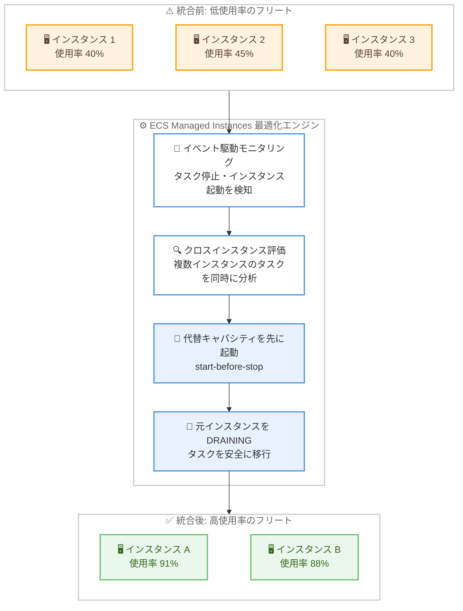

# Amazon ECS - Managed Instances のクロスインスタンス統合と Spot 統合

**リリース日**: 2026 年 10 月 28 日
**サービス**: Amazon Elastic Container Service (Amazon ECS)
**機能**: ECS Managed Instances のクロスインスタンス統合 (cross-instance consolidation) と Spot 統合 (Spot consolidation)

📊 [このアップデートのインフォグラフィックを見る](https://takech9203.github.io/aws-news-summary/20261028-ecs-managed-instances-consolidation.html)

## 概要

Amazon ECS Managed Instances に、インフラストラクチャ最適化を強化する 2 つの新機能が追加されました。1 つ目の「クロスインスタンス統合」は、複数の低使用率インスタンスで実行中のタスクをまとめて評価し、より少ないインスタンスに再配置 (パッキング) することで、使用率の向上とコスト削減を実現します。2 つ目の「Spot 統合」は、同じ統合アプローチを Spot キャパシティにも適用するもので、代替キャパシティの確保を確認してから元のインスタンスを回収します。

ECS Managed Instances は、適切なサイズの EC2 インスタンスを自動的にプロビジョニング・設定・運用するフルマネージドなコンピュートオプションです。フリートを継続的にモニタリングし、「start-before-stop」(先に起動してから停止する) 方式のグレースフルなタスク置換により、アプリケーションの可用性を維持しながらアイドルキャパシティを回収します。

AWS によるテストでは、c9g インスタンス (最小サイズ 4xlarge) のキャパシティプロバイダーで 261 タスク (各 1 vCPU、1.94 GiB) を実行した場合、統合前の 19 インスタンスが統合後に 13 インスタンスへ削減され、CPU 使用率は 42% から 91% へ、メモリ使用率は 41% から 88% へ向上しました。

**アップデート前の課題**

これまでの最適化はインスタンス単位で個別に評価されていたため、以下の制限がありました。

- 以前はインスタンスごとに個別に最適化を評価していたため、複数インスタンスにまたがるタスクの再配置機会を活用できなかった
- キャパシティプロバイダーで利用可能なインスタンスタイプの範囲が狭い場合、個別評価による最適化の効果が限定的だった
- Spot インスタンスについては、低使用率状態でも統合による回収が行われなかった

**アップデート後の改善**

今回のアップデートにより、以下が可能になりました。

- 複数のインスタンスにまたがるタスクを同時に評価し、より少ないインスタンスへパッキングすることで使用率を大幅に向上できるようになった
- Spot キャパシティについても、代替キャパシティの存在を確認したうえで安全に統合できるようになった
- 追加料金なしで、既存および新規のすべての ECS Managed Instances キャパシティプロバイダーに自動的に適用される

## アーキテクチャ図



複数の低使用率インスタンスにまたがるタスクを同時に評価し、代替キャパシティを先に起動してからタスクを移行する start-before-stop 方式で、可用性を維持しながらフリートをより少ないインスタンスへ統合する流れを示しています。

## サービスアップデートの詳細

### 主要機能

1. **クロスインスタンス統合 (cross-instance consolidation)**
   - 複数の低使用率インスタンスで実行中のタスクをまとめて評価し、より少ないインスタンスへパッキングする
   - 従来のインスタンス単位の評価と異なり、フリート全体を横断した再配置が可能
   - インスタンスタイプの選択範囲が狭いキャパシティプロバイダーでも高い統合効果を発揮する

2. **Spot 統合 (Spot consolidation)**
   - 低使用率の Spot インスタンスも統合の対象となる (2026 年 10 月 26 日以降)
   - Spot インスタンスをドレインする前に代替キャパシティを起動し、置換タスクが RUNNING 状態になるのを待ってから元のタスクを停止してインスタンスを回収する
   - サービスの最小・最大タスク数制限とタスク保護設定を尊重し、コスト最適化と可用性のバランスを維持する

3. **安全なタスク置換メカニズム**
   - 低使用率インスタンスを DRAINING 状態にし、タスクを既存または新規のより効率的なインスタンスへ移行する
   - すべてのタスクの移行完了後、インスタンスは DEREGISTERING 状態に遷移して EC2 インスタンスが安全に終了される
   - サービスタスクを実行するインスタンスが対象であり、スタンドアロンタスクを実行するインスタンスは統合の対象外

4. **自動適用**
   - 既存および新規のすべての ECS Managed Instances キャパシティプロバイダーに追加設定なしで自動適用される
   - 追加料金は発生しない

## 技術仕様

### インフラストラクチャ最適化の種類

| 最適化の種類 | 動作 |
|------|------|
| アイドルインスタンス検出 | 実行中タスクがないインスタンスを検出し、DEREGISTERING 状態にして EC2 インスタンスを終了 |
| 低使用率インスタンス検出 | タスク分散を分析し、複数インスタンスのタスクをより少ないインスタンスへ統合 (今回のアップデートでクロスインスタンス評価に強化) |
| Spot 統合 | 低使用率の Spot インスタンスを、代替キャパシティ確保後に回収 (2026 年 10 月 26 日以降) |

### AWS テストによる統合効果の例

| 項目 | 統合前 | 統合後 |
|------|------|------|
| インスタンス数 | 19 台 (4xlarge x 7、8xlarge x 7、12xlarge x 4、24xlarge x 1) | 13 台 (4xlarge x 8、8xlarge x 5) |
| CPU 使用率 | 42% | 91% |
| メモリ使用率 | 41% | 88% |

テスト条件: c9g インスタンス (最小サイズ 4xlarge) のキャパシティプロバイダーで、1 vCPU / 1.94 GiB のタスクを 261 個実行。

### ScaleInAfter 設定

最適化アクションのタイミングは、キャパシティプロバイダー設定の `ScaleInAfter` で制御できます。

| 設定値 | 動作 |
|------|------|
| 0〜3600 (秒) | インスタンスがアイドルまたは低使用率になってから最適化を開始するまでの遅延時間 |
| -1 | インフラストラクチャ最適化を無効化 |
| 未指定 | ECS Managed Instances がデフォルト設定に基づいて最適なタイミングを自動判断 |

待機期間中に新しいタスクが起動した場合、アイドルインスタンスの終了はキャンセルされます。低使用率インスタンスについては、待機期間中のタスク起動・停止によりタイマーがリセットされ、新しい待機期間の満了後に再評価されます。

## 設定方法

### 前提条件

1. Amazon ECS クラスターで Managed Instances キャパシティプロバイダーを使用していること
2. 統合の対象はサービスタスクを実行するインスタンスであること (スタンドアロンタスクは対象外)
3. 特別な有効化手順は不要 (既存・新規のキャパシティプロバイダーに自動適用)

### 手順

#### ステップ1: キャパシティプロバイダーの確認

```bash
aws ecs describe-capacity-providers \
  --capacity-providers my-managed-instances-cp \
  --region ap-northeast-1
```

既存の Managed Instances キャパシティプロバイダーの設定内容を確認します。クロスインスタンス統合と Spot 統合は自動的に適用されるため、追加の有効化操作は不要です。

#### ステップ2: ScaleInAfter による最適化タイミングの調整 (オプション)

```bash
aws ecs update-capacity-provider \
  --name my-managed-instances-cp \
  --managed-instances-provider '{
    "infrastructureOptimization": {
      "scaleInAfter": 600
    }
  }' \
  --region ap-northeast-1
```

インスタンスがアイドルまたは低使用率と判定されてから最適化が開始されるまでの待機時間を 600 秒に設定します。ワークロードの変動が大きい場合は長めに設定することで、不要な統合と再スケールアウトの繰り返しを抑制できます。`-1` を指定すると最適化を無効化できます。

#### ステップ3: 統合動作のモニタリング

```bash
aws ecs list-container-instances \
  --cluster my-cluster \
  --status DRAINING \
  --region ap-northeast-1
```

統合処理中のインスタンスは DRAINING 状態となります。タスク移行完了後に DEREGISTERING 状態へ遷移し、EC2 インスタンスが終了されます。CloudWatch の使用率メトリクスとあわせて、統合によるフリートの変化を確認できます。

## メリット

### ビジネス面

- **インフラコストの削減**: 低使用率インスタンスの統合により、フリート全体のインスタンス数を削減できる (AWS テストでは 19 台から 13 台へ約 32% 削減)
- **追加コストなし**: 両機能とも追加料金なしで利用でき、既存環境にも自動適用される
- **運用負荷の軽減**: ビンパッキングやインスタンス入れ替えといった複雑な最適化判断を AWS に委任できる

### 技術面

- **使用率の大幅な向上**: クロスインスタンス評価により、CPU / メモリ使用率を 90% 近くまで高められる (AWS テスト結果)
- **可用性を維持した統合**: start-before-stop 方式により、置換タスクの起動を確認してから元のタスクを停止するため、サービス断が発生しにくい
- **Spot でも安全な最適化**: 代替キャパシティの存在を確認してから Spot インスタンスを回収するため、Spot 特有のキャパシティリスクを考慮した統合が行われる

## デメリット・制約事項

### 制限事項

- 統合の対象はサービスタスクを実行するインスタンスのみであり、スタンドアロンタスクを実行するインスタンスは対象外
- ECS Managed Instances キャパシティプロバイダー専用の機能であり、自己管理の EC2 キャパシティプロバイダーや Fargate には適用されない
- `ScaleInAfter` の設定範囲は 0〜3600 秒 (または -1 で無効化)

### 考慮すべき点

- 統合時にタスクの再配置 (置換) が発生するため、起動に時間がかかるタスクや状態を持つタスクでは置換の影響を考慮する必要がある
- タスク保護設定やサービスの最小・最大タスク数制限は尊重されるが、デプロイ設定が適切でない場合は統合の効果が限定される可能性がある
- 統合を避けたいワークロードでは `ScaleInAfter` に -1 を設定して最適化を無効化できる

## ユースケース

### ユースケース1: インスタンスタイプを限定したキャパシティプロバイダーのコスト最適化

**シナリオ**: ライセンスや性能要件により特定のインスタンスファミリー (例: c9g) のみを使用しており、従来のインスタンス単位の最適化では効果が限定的だった。

**実装例**:
```
キャパシティプロバイダー設定で c9g ファミリーに限定
→ クロスインスタンス統合が自動適用され、
  複数の低使用率インスタンスのタスクを少数のインスタンスへ再配置
```

**効果**: インスタンスタイプの選択範囲が狭くても、フリート横断の評価により高い使用率とコスト削減を実現できる。

### ユースケース2: Spot キャパシティを活用したバッチ・開発環境のコスト削減

**シナリオ**: 開発環境や中断耐性のあるサービスを Spot インスタンスで運用しており、低使用率の Spot インスタンスが残り続けてコストが無駄になっていた。

**実装例**:
```
Managed Instances キャパシティプロバイダーで Spot を使用
→ Spot 統合が代替キャパシティを先に起動し、
  置換タスクの RUNNING 確認後に元の Spot インスタンスを回収
```

**効果**: Spot の割引メリットを享受しながら、低使用率インスタンスの自動回収でさらにコストを削減できる。可用性は start-before-stop 方式で維持される。

### ユースケース3: トラフィック変動の大きい Web サービスのフリート効率化

**シナリオ**: 日中のピーク後にタスク数が減少し、夜間に低使用率のインスタンスが多数残る Web サービスを運用している。

**実装例**:
```
ScaleInAfter を 600 秒に設定
→ タスク減少後 10 分間の安定を確認してから統合を開始し、
  夜間のフリートを自動的に縮小
```

**効果**: スケールインの繰り返しによるタスク置換の頻発を抑えつつ、オフピーク時間帯のインフラコストを自動的に削減できる。

## 料金

クロスインスタンス統合および Spot 統合は追加料金なしで利用できます。ECS Managed Instances の通常料金 (使用する EC2 インスタンスの料金および Managed Instances の管理料金) のみが適用されます。統合によりインスタンス数が削減されるため、実質的なコスト削減効果が期待できます。

## 利用可能リージョン

ECS Managed Instances が利用可能なすべての AWS リージョンで利用できます (公式発表では「all AWS Regions」と記載)。既存および新規のすべての ECS Managed Instances キャパシティプロバイダーに自動的に適用されます。

## 関連サービス・機能

- **Amazon ECS Managed Instances**: 本機能の基盤となるフルマネージドなコンピュートオプション。EC2 インスタンスのプロビジョニング・設定・運用を AWS が代行する
- **Amazon EC2 Spot インスタンス**: Spot 統合の対象となる割引キャパシティ。中断耐性のあるワークロードのコスト削減に有効
- **ECS キャパシティプロバイダー**: 統合動作のタイミングを制御する `ScaleInAfter` などの設定を保持する
- **ECS タスク保護 (Task Protection)**: 統合時のドレイン処理で尊重される設定。重要な処理中のタスクを置換から保護できる

## 参考リンク

- 📊 [インフォグラフィック](https://takech9203.github.io/aws-news-summary/20261028-ecs-managed-instances-consolidation.html)
- [公式発表 (What's New)](https://aws.amazon.com/about-aws/whats-new/2026/10/ecs-managed-instances-consolidation/)
- [ドキュメント: Amazon ECS Managed Instances infrastructure optimization](https://docs.aws.amazon.com/AmazonECS/latest/developerguide/managed-instances-infrastructure-optimization.html)
- [製品ページ: Amazon ECS Managed Instances](https://aws.amazon.com/ecs/managed-instances/)

## まとめ

ECS Managed Instances のクロスインスタンス統合と Spot 統合により、フリート全体を横断したタスクの再配置が自動化され、追加料金なしで大幅な使用率向上とコスト削減が期待できます。既存のキャパシティプロバイダーにも自動適用されるため、まずは CloudWatch メトリクスでフリートの使用率変化を確認し、必要に応じて `ScaleInAfter` でタイミングを調整することを推奨します。
