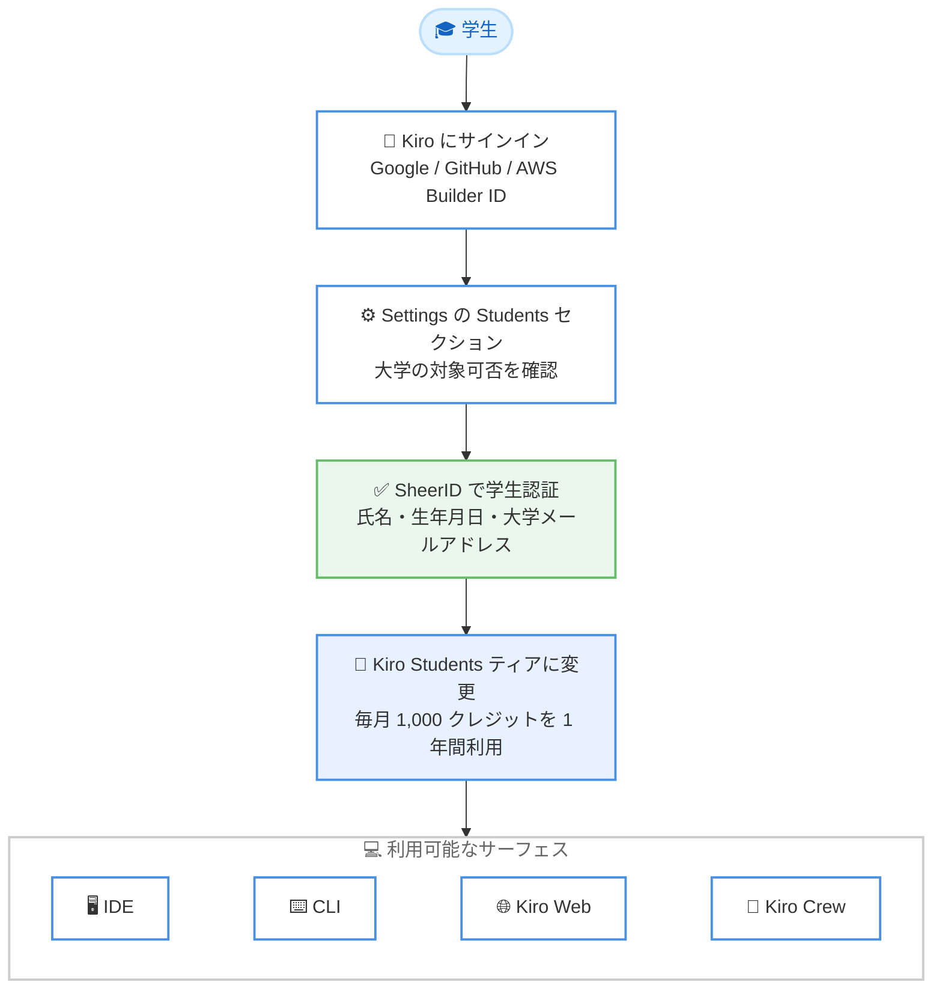

# Kiro - Kiro for Students が新たに 41 大学へ拡大

**リリース日**: 2026年10月28日
**サービス**: Kiro
**機能**: Kiro for Students の対象大学拡大

📊 [このアップデートのインフォグラフィックを見る](https://takech9203.github.io/aws-news-summary/20261028-kiro-41-more-universities.html)

## 概要

Kiro は、学生向けプログラム「Kiro for Students」の対象を世界の 41 大学に新たに拡大したことを発表しました。対象大学の学生は、1 年間無料で Kiro を利用でき、毎月 1,000 クレジットとプレミアムモデルへのアクセスなどの有料機能が含まれます。対象大学の一覧は [kiro.dev/students](https://kiro.dev/students/#schools) で確認できます。

2026 年 9 月に学生プログラムを 133 大学へ拡大して以降、多数の大学追加リクエストが寄せられたことを受けての今回の拡大です。Kiro チームは「AI エージェントが標準的なエンジニアリングツールキットの一部になりつつある今、すべての学生がプロフェッショナルグレードのツールに本格的にアクセスできるようにしたい」としています。

あわせて、ユーザーフィードバックに基づきサインアップフローが改善され、よりスムーズに学生認証を完了できるようになりました。

**アップデート前の課題**

- 対象大学が限られており (2026 年 9 月時点で 133 大学)、多くの大学の学生はプログラムを利用できなかった
- 対象外の大学の学生は、無料プラン (50 クレジット) の範囲でしか Kiro を試せなかった
- サインアップフローが煩雑であるというフィードバックがあった

**アップデート後の改善**

- 新たに世界の 41 大学が対象に追加され、より多くの学生が 1 年間無料で Kiro を利用可能になった
- 対象大学の学生は毎月 1,000 クレジットと有料プラン相当のプレミアムモデルを利用可能になった
- サインアップフローが刷新され、Settings ページから学生認証をシームレスに完了できるようになった
- 対象外の大学の学生も、リクエストフォームから自分の大学の追加を申請できる

## アーキテクチャ図



学生が Kiro にサインインし、SheerID による学生認証を経て Kiro Students ティアに移行するまでの流れを示しています。認証後は IDE、CLI、Kiro Web、Kiro Crew の 4 つのサーフェスで利用できます。

## サービスアップデートの詳細

### 主要機能

1. **対象大学の拡大**
   - 世界の 41 大学が新たに Kiro for Students の対象に追加
   - 2026 年 9 月の 133 大学への拡大に続く追加対応
   - 対象大学の一覧は [kiro.dev/students](https://kiro.dev/students/#schools) に掲載
   - 対象外の大学は[リクエストフォーム](https://kiro.dev/students/#request)から追加を申請可能

2. **Kiro Students プランの内容**
   - 1 年間の無料アクセス
   - 毎月 1,000 クレジット
   - 有料プランで提供されるプレミアムモデルへのアクセス
   - IDE、CLI、Kiro Web、Kiro Crew の 4 つのサーフェスすべてで利用可能

3. **改善されたサインアップフロー**
   - ユーザーフィードバックに基づきサインアップ体験を刷新
   - Settings ページの Students セクションから大学の対象可否をドロップダウンで確認
   - SheerID による学生認証 (氏名、生年月日、大学のメールアドレスを提出)
   - 認証完了後、即座に Kiro Students ティアへ移行し 1,000 クレジットが利用可能

4. **キャンパスでの活動展開**
   - 世界各国の大学でのキャンパス訪問、ワークショップ、ハッカソンを計画
   - [Kiro Student Discord コミュニティ](https://discord.gg/kirodotdev)で日程や詳細を先行告知
   - 学生が自分の大学で Kiro とハッカソンを共催するための[申請窓口](https://kiro.dev/events/submit/)も用意

## 技術仕様

### Kiro Students プランの概要

| 項目 | 詳細 |
|------|------|
| 利用期間 | 1 年間 |
| 月間クレジット | 1,000 クレジット |
| モデルアクセス | 有料プランと同等のプレミアムモデル |
| 対象サーフェス | IDE、CLI、Kiro Web、Kiro Crew |
| 認証方法 | SheerID による学生認証 |
| サインイン方法 | Google、GitHub、AWS Builder ID |
| 期間終了後 | Kiro 無料プランへ自動的にダウングレード |

## 設定方法

### 前提条件

1. 対象大学に在籍していること (対象一覧は [kiro.dev/students](https://kiro.dev/students/#schools) を確認)
2. 大学発行のメールアドレスを保有していること
3. Google、GitHub、AWS Builder ID のいずれかのアカウントを保有していること

### 手順

#### ステップ1: Kiro にサインイン

IDE、CLI、Kiro Web、Kiro Crew のいずれかから、Google、GitHub、または AWS Builder ID を使用してサインアップまたはサインインします。

#### ステップ2: 大学の対象可否を確認

サインイン後、Settings ページに移動して Students セクションをクリックします。ドロップダウンから自分の大学が対象かどうかを確認し、verify をクリックして学生認証を開始します。

#### ステップ3: SheerID で学生認証を完了

SheerID の認証プロセスで氏名、生年月日、大学のメールアドレスを提出します。正当性確認のために追加書類の提出を求められる場合があります。認証で問題が発生した場合は、SheerID の[問い合わせフォーム](https://support.sheerid.com/en-US/69a8b67049b85d7b53b4cadb/help-center/contact-form)から連絡できます。

#### ステップ4: Kiro Students ティアの確認

認証が完了すると、Settings ページのティア名が Kiro Students に変わり、即座に毎月 1,000 クレジットを 1 年間利用できるようになります。

## メリット

### ビジネス面

- **学習コストの削減**: 学生は月額 20 USD 相当の Kiro Pro プランと同規模の 1,000 クレジットを 1 年間無料で利用できる
- **キャリア形成支援**: 卒業後も通用する「問題を分解し、適切なツールを選び、作業をディレクションする」スキルを在学中に習得できる
- **コミュニティ参加機会**: Discord コミュニティ、キャンパスワークショップ、ハッカソンを通じて実践的な経験を積める

### 技術面

- **プレミアムモデルへのアクセス**: 有料プランで提供されるモデルを課題や個人プロジェクトで利用できる
- **マルチサーフェス対応**: IDE、CLI、Kiro Web、Kiro Crew の 4 つのサーフェスを用途に応じて使い分けられる
- **スペック駆動開発の習得**: プロトタイプから本番品質までを見据えた開発手法を学生のうちから実践できる

## デメリット・制約事項

### 制限事項

- 学生認証は 1 回のみ実行可能なため、提出する情報に誤りがないか事前確認が必要
- 月間 1,000 クレジットを使い切った場合、翌月のサイクルまで待つ必要がある
- 未使用クレジットは翌月に繰り越されない
- Kiro Students プランでは追加クレジットを購入できない
- 1 年間の利用期間終了後は、Kiro 無料プランへ自動的にダウングレードされる

### 考慮すべき点

- 対象は指定された大学の学生のみで、対象外の大学はリクエストフォームからの申請が必要
- SheerID の認証過程で追加書類の提出を求められる場合がある
- Kiro for Students には[追加の利用規約](https://kiro.dev/students/terms/)が適用される

## ユースケース

### ユースケース1: 授業課題・卒業研究での活用

**シナリオ**: 情報系学部の学生が、卒業研究のプロトタイプ開発に AI エージェントを活用したい。

**実装例**:
```
1. 大学メールアドレスで学生認証を完了し Kiro Students ティアを取得
2. Kiro IDE でスペック駆動開発により研究プロトタイプの要件を整理
3. 毎月 1,000 クレジットの範囲でプレミアムモデルを活用して実装を進める
```

**効果**: 費用負担なしでプロフェッショナルグレードの AI エージェント開発環境を研究に活用できる。

### ユースケース2: ハッカソンへの参加・共催

**シナリオ**: 大学のプログラミングサークルが、学内ハッカソンで Kiro を活用したい。

**実装例**:
```
1. Kiro Student Discord コミュニティに参加して開催情報を入手
2. kiro.dev/events/submit からハッカソン共催を申請
3. 参加メンバーが各自 Kiro Students プランで開発環境を準備
```

**効果**: Kiro チームとの共催によりワークショップやハッカソンを開催し、短期間での実践的なスキル習得につなげられる。

### ユースケース3: 就職活動に向けたポートフォリオ開発

**シナリオ**: 就職活動を控えた学生が、ポートフォリオ用の Web アプリケーションを個人開発したい。

**実装例**:
```
1. Kiro Web でアイデアを素早くプロトタイピング
2. Kiro IDE に移行してスペック駆動開発で本格的に実装
3. Kiro CLI で CI/CD やデプロイ作業を自動化
```

**効果**: 複数のサーフェスを使い分けながら、企業の開発現場に近いワークフローを経験し、ポートフォリオの品質を高められる。

## 料金

Kiro for Students は対象大学の学生であれば無料で利用できます。

| プラン | 月額料金 | 月間クレジット |
|--------|----------|----------------|
| Kiro Students | 無料 (1 年間) | 1,000 クレジット |
| Kiro Free | 無料 | 50 クレジット |
| Kiro Pro | 20 USD | 1,000 クレジット |

Kiro Students プランでは追加クレジットの購入はできません。1 年間の期間終了後は無料プランへ自動的にダウングレードされます。

## 利用可能リージョン

グローバル (対象は指定された大学の学生のみ)

## 関連サービス・機能

- **Kiro IDE**: スペック駆動開発に対応したエージェント型 IDE。学生プランの主要な利用サーフェス
- **Kiro CLI**: ターミナルから Kiro のエージェント機能を利用できるコマンドラインツール
- **Kiro Web / Kiro Crew**: ブラウザベースの Kiro とチーム向けのエージェント管理サーフェス
- **AWS Builder ID**: Kiro へのサインインに利用できる AWS の個人認証基盤

## 参考リンク

- 📊 [インフォグラフィック](https://takech9203.github.io/aws-news-summary/20261028-kiro-41-more-universities.html)
- [公式発表 (Kiro Blog)](https://kiro.dev/blog/41-more-universities/)
- [Kiro for Students (対象大学一覧・サインアップ)](https://kiro.dev/students/)
- [Kiro for Students 利用規約](https://kiro.dev/students/terms/)
- [Kiro 料金ページ](https://kiro.dev/pricing/)
- [どの Kiro アプリを選ぶべきか (Kiro Blog)](https://kiro.dev/blog/which-kiro-app-should-i-pick/)

## まとめ

Kiro for Students の対象が新たに 41 大学へ拡大され、より多くの学生が 1 年間無料で毎月 1,000 クレジットとプレミアムモデルを利用できるようになりました。AI エージェントが標準的な開発ツールになりつつある中、在学中からプロフェッショナルグレードのツールに触れられる貴重な機会です。対象大学の学生は [kiro.dev/students](https://kiro.dev/students/) で自分の大学の対象可否を確認し、学生認証を進めることを推奨します。
