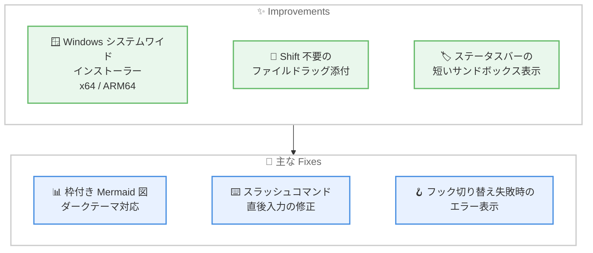

# Kiro - Windows システムワイドインストーラー、Shift 不要のファイルドラッグ、枠付き Mermaid 図

**リリース日**: 2026 年 10 月 28 日
**サービス**: Kiro
**機能**: Kiro IDE 1.4.62 - Windows システムワイドインストーラー、Shift キー不要のチャットへのファイルドラッグ、ダークテーマでも見やすい枠付き Mermaid 図の描画

📊 [このアップデートのインフォグラフィックを見る](https://takech9203.github.io/aws-news-summary/20261028-kiro-changelog-2026-10-28.html)

## 概要

2026 年 10 月 28 日、**Kiro IDE 1.4.62** がリリースされました。本リリースでは、**Windows 向けのシステムワイドインストーラー (x64 / ARM64)** が追加され、1 台のコンピューター上のすべてのユーザーが Kiro を利用できるインストール方式が選択可能になりました。インストールには管理者権限が必要です。

また、チャットへのファイル添付が改善され、デスクトップやファイルマネージャーから **Shift キーを押さずにファイルをドラッグ & ドロップ**して添付できるようになりました。サポートされていないファイル形式をドロップした場合は、ファイル名 (複数の場合は件数) とともにエラーが表示されます。あわせて、ステータスバーのサンドボックス表示が **Sandbox: Active** / **Sandbox: Off** のような短いラベルに変更されました。

修正面では、**チャット内の Mermaid 図がテーマに合わせた枠付きブロックで表示**されるようになり、ダークテーマでも矢印が見やすくなりました。図の上でスクロールするとチャットがスクロールし、ズームは Ctrl + スクロールまたはトラックパッドのピンチ操作で行います。このほか、スラッシュコマンドの直後に文字を入力するとコマンドが実行されない問題や、フックの切り替えがエラー表示なしに失敗する問題などが修正されています。

**アップデート前の課題**

- Windows 向けインストーラーはユーザー単位のインストールのみで、共有端末や管理された環境で全ユーザー向けに Kiro を展開する手段がなかった
- チャットにファイルをドラッグ & ドロップで添付するには Shift キーを押し続ける必要があった
- ダークテーマでは Mermaid 図の矢印などが背景に溶け込み、視認しづらい場合があった
- スラッシュコマンドの直後に続けて文字を入力・貼り付け・音声入力すると、テキストがコマンド名と結合してコマンドが実行されなかった
- Hooks ビューでフックの切り替えに失敗しても (ファイルが読み取り専用・削除済みなどの場合)、エラーが表示されず原因が分からなかった
- 別のリポジトリに同名のメモリがあると、チャットの **Memory created** 行から目的のメモリを開けなかった

**アップデート後の改善**

- x64 / ARM64 向けの Windows システムワイドインストーラーにより、コンピューター上のすべてのユーザーが Kiro を利用できるようになった
- Shift キーを押さずにファイルをドラッグ & ドロップしてチャットに添付できるようになった
- Mermaid 図がテーマに合わせた枠付きブロックで描画され、ダークテーマでも矢印が見やすくなった
- スラッシュコマンド直後の入力がコマンド名と結合しなくなり、コマンドが確実に実行されるようになった
- フックの切り替えに失敗した場合にエラーが表示され、原因を把握できるようになった
- 同名のメモリが複数ある場合も個別の行として表示され、正しいメモリを開けるようになった

## アーキテクチャ図



Kiro IDE 1.4.62 の主な改善点と修正点の全体像を示しています。

## サービスアップデートの詳細

### 主要機能

1. **Windows システムワイドインストーラー**
   - x64 または ARM64 向けのインストーラーをダウンロードし、コンピューター上のすべてのユーザーが Kiro を利用できる形でインストール可能
   - インストールには管理者権限が必要
   - 共有端末や、IT 部門が管理する環境への展開に適した方式

2. **Shift キー不要のファイルドラッグ添付**
   - デスクトップやファイルマネージャーからファイルを Kiro のチャットにドラッグするだけで添付できる
   - 従来必要だった Shift キーの長押しが不要になった
   - サポートされていないファイル形式の場合、チャットにファイル名付きのエラーが表示される (複数の非対応ファイルをドロップした場合は件数を表示)

3. **ステータスバーのサンドボックス表示の簡潔化**
   - ステータスバーのサンドボックス項目が **Command sandbox** ではなく **Sandbox** で始まる表記に変更 (例: **Sandbox: Active**、**Sandbox: Off**)
   - 項目を選択するとサンドボックス設定を開ける

4. **枠付き Mermaid 図の描画 (Fix)**
   - チャット内の Mermaid 図が、テーマに合わせた枠付きブロック内に表示される
   - ダークテーマでも矢印が見やすくなった
   - 図の上でスクロールするとチャットがスクロールし、ズームは Ctrl + スクロールまたはトラックパッドのピンチ操作で実行

5. **スラッシュコマンドとチャット UI の修正 (Fix)**
   - スラッシュコマンドの直後に入力・貼り付け・音声入力したテキストがコマンド名と結合しなくなり、コマンドが確実に実行される
   - 失敗が繰り返された後に Kiro が表示する質問が、チャット履歴に未回答カードとして残らず、チャット入力欄の上にのみ表示される
   - **Select model** や **Select agent** などのツールチップが、Kiro ウィンドウに戻った際に勝手に開かなくなった (ホバーまたはキーボード操作では従来どおり開く)

6. **フック・メモリ・MCP パネルの修正 (Fix)**
   - Hooks ビューでフックを切り替えた際、フックファイルを変更できない場合 (読み取り専用・削除済みなど) にエラーが表示されるようになった
   - チャットの **Memory created** 行を選択すると、別のリポジトリに同名のメモリがある場合でも正しいメモリが開く。同名のメモリは個別の行として表示される
   - Powers 由来の MCP サーバー名が `power-` で始まる場合に、MCP パネルで `power-power-` と二重のプレフィックスが表示される問題を修正

## 技術仕様

### Kiro IDE 1.4.62 の変更点サマリー

| 分類 | 内容 |
|------|------|
| バージョン | IDE 1.4.62 |
| Improvements | Windows システムワイドインストーラー (x64 / ARM64)、Shift 不要のファイルドラッグ添付、ステータスバーのサンドボックス表示簡潔化の 3 件 |
| Fixes | 枠付き Mermaid 図、スラッシュコマンド直後入力、失敗後の質問表示、ツールチップの自動表示、フック切り替えのエラー表示、同名メモリの取り扱い、MCP パネルのプレフィックス表示の 7 件 |

### Windows システムワイドインストーラーの仕様

| 項目 | 詳細 |
|------|------|
| 対象アーキテクチャ | x64、ARM64 |
| インストール範囲 | コンピューター上のすべてのユーザー |
| 必要権限 | 管理者権限 |
| 入手先 | [Kiro ダウンロードページ](https://kiro.dev/downloads/) |

## 設定方法

### 前提条件

1. Kiro IDE を利用していること
2. システムワイドインストーラーを利用する場合は Windows (x64 または ARM64) と管理者権限
3. 各修正を利用するには Kiro IDE 1.4.62 以降へのアップデート

### 手順

#### ステップ 1: Kiro IDE を 1.4.62 に更新する

Kiro IDE は自動アップデートに対応しています。手動で確認する場合は、IDE のアップデート確認メニューから最新バージョンを適用します。新規に Windows へ全ユーザー向けインストールを行う場合は、[ダウンロードページ](https://kiro.dev/downloads/) から x64 または ARM64 のシステムワイドインストーラーを取得し、管理者権限で実行します。

#### ステップ 2: ファイルをチャットにドラッグ & ドロップする

デスクトップまたはファイルマネージャーからファイルを Kiro のチャットにドラッグします。Shift キーを押す必要はありません。非対応のファイル形式の場合は、ファイル名または件数付きのエラーがチャットに表示されます。

#### ステップ 3: サンドボックス設定と Mermaid 図の表示を確認する

ステータスバーの **Sandbox: Active** / **Sandbox: Off** 表示を選択すると、サンドボックス設定を開けます。詳細は [サンドボックスドキュメント](https://kiro.dev/docs/sandbox/#use-the-sandbox) を参照してください。チャットで Mermaid 図を生成すると、テーマに合わせた枠付きブロックで表示されます。ズームは Ctrl + スクロールまたはピンチ操作で行います。

## メリット

### ビジネス面

- **組織展開の容易化**: システムワイドインストーラーにより、共有端末や IT 管理された Windows 環境へ全ユーザー向けに Kiro を展開できる
- **日常操作の効率化**: Shift キー不要のドラッグ & ドロップにより、ファイル添付の操作ミスや手間が減り、チャット中心のワークフローが円滑になる
- **トラブルシューティング時間の短縮**: フック切り替え失敗時のエラー表示により、設定が反映されない原因を即座に把握できる

### 技術面

- **ARM64 Windows への対応**: x64 に加えて ARM64 デバイス向けのシステムワイドインストーラーが提供され、幅広い Windows 環境をカバーできる
- **図の可読性向上**: Mermaid 図が枠付きブロックとテーマ連動の配色で描画され、ダークテーマでもアーキテクチャ図やフロー図を確認しやすい
- **コマンド実行の信頼性向上**: スラッシュコマンド直後の入力がコマンド名と結合しなくなり、入力・貼り付け・音声入力のいずれでもコマンドが確実に実行される

## デメリット・制約事項

### 制限事項

- システムワイドインストーラーは Windows (x64 / ARM64) 向けであり、インストールには管理者権限が必要
- 本リリースは Kiro IDE のアップデートであり、CLI / Web / Crew は対象外
- 非対応のファイル形式はドラッグ & ドロップしてもチャットに添付できない (エラーが表示される)

### 考慮すべき点

- 既存のユーザー単位インストールから全ユーザー向けインストールへ切り替える場合は、組織のソフトウェア配布ポリシーに沿った展開計画が必要
- Mermaid 図の上でのスクロール操作はチャットのスクロールに割り当てられたため、図のズームには Ctrl + スクロールまたはピンチ操作を使用する点に注意

## ユースケース

### ユースケース 1: 共有端末・管理環境への Kiro 一括展開

**シナリオ**: IT 部門が、複数の開発者が共用する Windows 端末や管理されたデバイスに Kiro を展開したい。

**実装例**:
```text
1. ダウンロードページから x64 または ARM64 のシステムワイドインストーラーを取得
2. 管理者権限でインストーラーを実行し、全ユーザー向けにインストール
3. 各ユーザーが自分のアカウントでサインインして利用開始
```

**効果**: ユーザーごとの個別インストールが不要になり、管理された Windows 環境への展開と運用が容易になる。

### ユースケース 2: 設計資料やログファイルを使ったチャット駆動開発

**シナリオ**: 開発者が、エラーログや仕様書などのファイルを Kiro チャットに添付しながら調査・実装を進めたい。

**実装例**:
```text
1. ファイルマネージャーから対象ファイルをチャットへそのままドラッグ (Shift 不要)
2. 非対応形式の場合はエラー表示を確認し、対応形式に変換して再添付
3. 添付ファイルを参照しながらエージェントに調査・修正を依頼
```

**効果**: ファイル添付の操作が簡単になり、資料を参照したチャット駆動の開発がスムーズになる。

### ユースケース 3: ダークテーマでのアーキテクチャ図レビュー

**シナリオ**: ダークテーマを利用する開発者が、エージェントが生成した Mermaid のアーキテクチャ図をチャット上でレビューしたい。

**実装例**:
```text
1. チャットでエージェントにアーキテクチャ図の生成を依頼
2. テーマに合わせた枠付きブロックで描画された図を確認
3. 細部は Ctrl + スクロールまたはピンチ操作でズームして確認
```

**効果**: ダークテーマでも矢印やラベルが見やすく、チャット内で図のレビューが完結する。

## 料金

本アップデートによる追加料金はありません。Kiro IDE の機能改善・修正として、既存プランの範囲内で利用できます。最新の料金は [料金ページ](https://kiro.dev/pricing/) を参照してください。

## 利用可能リージョン

グローバル (Kiro はグローバルサービス)。Windows システムワイドインストーラーは x64 / ARM64 デバイス向けです。

## 関連サービス・機能

- **Kiro IDE**: 本アップデートの対象。AI エージェントを統合した Kiro のデスクトップ IDE
- **Kiro Sandbox**: エージェントが実行するコマンドを隔離する機能。今回ステータスバーの表示が簡潔になった
- **Kiro Hooks**: イベントに応じてエージェントの動作を自動化する機能。今回切り替え失敗時のエラー表示が追加された
- **Kiro Memory**: エージェントがセッションをまたいで情報を記憶する機能。今回同名メモリの表示と選択が改善された
- **Kiro Powers / MCP**: 外部ツール統合の仕組み。今回 MCP パネルのサーバー名表示が修正された

## 参考リンク

- 📊 [インフォグラフィック](https://takech9203.github.io/aws-news-summary/20261028-kiro-changelog-2026-10-28.html)
- [Kiro Changelog](https://kiro.dev/changelog/)
- [Changelog: Windows System-Wide Installer, Drag Files Into Chat Without Shift, Framed Mermaid Diagrams (IDE 1.4.62)](https://kiro.dev/changelog/ide/1-4-62/)
- [Kiro ダウンロードページ](https://kiro.dev/downloads/)
- [ドキュメント: Sandbox - Use the Sandbox](https://kiro.dev/docs/sandbox/#use-the-sandbox)
- [料金ページ](https://kiro.dev/pricing/)

## まとめ

Kiro IDE 1.4.62 では、Windows システムワイドインストーラー (x64 / ARM64) により管理された環境への全ユーザー向け展開が可能になり、Shift キー不要のファイルドラッグ添付や枠付き Mermaid 図など、日常の操作性と可読性が着実に向上しました。スラッシュコマンドやフック切り替えなどの不具合修正も含まれるため、IDE を最新バージョンへ更新することを推奨します。組織で Windows 端末を共有している場合は、システムワイドインストーラーによる展開を検討してください。
