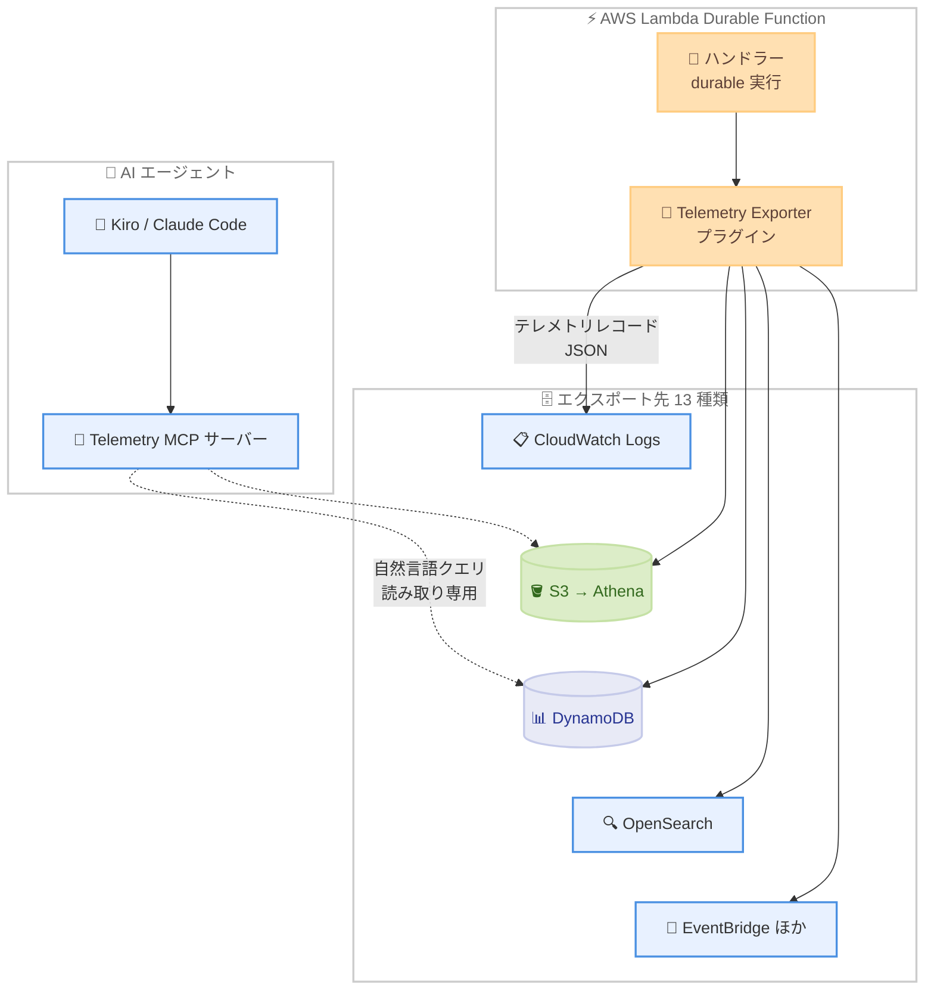

# AWS Lambda - Durable Functions のライブテレメトリエクスポート

**リリース日**: 2026 年 10 月 28 日
**サービス**: AWS Lambda
**機能**: Durable Execution Telemetry Exporter プラグインおよび Telemetry MCP サーバー

📊 [このアップデートのインフォグラフィックを見る](https://takech9203.github.io/aws-news-summary/20261028-lambda-durable-telemetry.html)

## 概要

AWS Lambda durable functions に、実行履歴をライブでエクスポートできる Durable Execution Telemetry Exporter プラグインが追加されました。このプラグインは、durable 実行のステップごとの履歴 (実行ステータス、各オペレーションの所要時間、ステップの入出力、エラー情報) を記録し、ユーザーが選択した送信先にエクスポートします。Amazon CloudWatch Logs、Amazon S3 (Amazon Athena 連携)、Amazon DynamoDB、Amazon Aurora、Amazon OpenSearch Service など 13 種類の組み込みエクスポーターが用意されており、TypeScript、Python、Java、Go の 4 言語に対応します。

あわせて、エクスポートしたテレメトリデータを自然言語で照会できる MCP (Model Context Protocol) サーバーもリリースされました。Kiro や Claude Code などの MCP 対応 AI エージェントから「最近失敗した実行を一覧して原因を調べて」といった問い合わせが可能になり、オンコールエンジニアの障害調査や、アナリストによる特定顧客のトランザクション検索を支援します。

Lambda durable functions は最長 1 年間実行できる回復力の高いマルチステップアプリケーションや AI ワークフローを構築するための機能であり、1 つの durable 実行が多数の Lambda 呼び出しにまたがります。本アップデートにより、呼び出し単位のログでは把握しにくかった実行全体の可観測性が大きく向上します。

**アップデート前の課題**

- 1 つの durable 実行が複数の Lambda 呼び出しに分散するため、従来の呼び出し単位のログでは実行全体の流れを追跡しにくかった
- 実行履歴は標準の保持期間を超えて保存できず、長期的な運用分析やビジネス分析への活用が困難だった
- 実行履歴を外部データストアに保存するには、独自の計装コードや収集基盤を実装する必要があった

**アップデート後の改善**

- プラグインを 1 行追加するだけで、実行ごとに完全な JSON レコードが生成され、選択した送信先に自動エクスポートされる
- 標準の保持期間を超えた履歴の長期保存と、運用・ビジネスインサイトの抽出が可能になった
- 機密フィールドのマスキング (redaction) とサンプリングレートの設定により、データ量とプライバシーを制御できる
- MCP サーバーを通じて、AI エージェントが自然言語でテレメトリデータを照会できるようになった

## アーキテクチャ図



Telemetry Exporter プラグインはハンドラーと同一プロセス内で動作し、durable 実行のライフサイクルを購読して実行ごとの累積スナップショットを構築します。レコードは設定したすべてのエクスポーターに並列で送信され、MCP サーバー経由で AI エージェントから読み取り専用で照会できます。

## サービスアップデートの詳細

### 主要機能

1. **Durable Execution Telemetry Exporter プラグイン**
   - durable 実行ごとに 1 つの完全な JSON レコード (`DurableExecutionTelemetryRecord`) を生成
   - 実行 ARN、実行名、関数名、ステータス、開始・終了時刻、所要時間、入出力、各オペレーションの履歴を含む
   - ハンドラーと同一プロセスで動作し、チェックポイントされた状態から呼び出しごとに累積スナップショットを再構築
   - TypeScript、Python、Java、Go 向けにオープンソースで提供

2. **13 種類の組み込みエクスポーター**
   - LambdaLogExporter: 関数自身のロググループに出力 (追加 IAM 不要、デフォルト)
   - CloudWatchLogsExporter / S3Exporter / DynamoDBExporter / AuroraExporter / RedshiftExporter / OpenSearchExporter
   - EventBridgeExporter / FirehoseExporter / SQSExporter / OTelExporter / HttpExporter / FileExporter
   - S3Exporter は Hive 形式のパーティション `year=YYYY/month=MM/day=DD/` で書き込み、AWS Glue / Amazon Athena での分析に最適化

3. **データ量とプライバシーの制御**
   - `emitMode`: `on-complete` (完了時に 1 回、デフォルト)、`on-failure` (失敗時のみ、最小オーバーヘッド)、`on-change` (準リアルタイム)
   - `samplingRate`: 実行 ARN のハッシュに基づく決定的サンプリングで、実行単位の一貫性を保証
   - `content` トランスフォームによる入出力の機密フィールドのマスキング
   - エクスポーターごとの `maxRecordSizeBytes` によるレコードサイズ制御 (超過時は `truncated: true` フラグ付きで切り詰め)

4. **Durable Execution Telemetry MCP サーバー**
   - ローカル stdio サーバーとして動作し、Kiro、Claude Code、Cursor などの MCP 対応エージェントからテレメトリデータを照会可能
   - 5 つのツールを提供: `test_destination`、`describe_schema`、`list_executions`、`get_execution`、`query`
   - SQL 系の送信先では `SELECT` / `WITH ... SELECT` のみ許可され、書き込み操作は AWS 呼び出し前に拒否される読み取り専用設計
   - 設定は環境変数のみで行い、認証情報は標準の AWS SDK プロバイダーチェーンを使用

## 技術仕様

### テレメトリレコードの構造

| フィールド | 詳細 |
|------|------|
| recordType / schemaVersion | `DurableExecutionTelemetry` / `1.0` |
| executionArn / executionName / functionName | 実行の識別情報 |
| status | SUCCEEDED、FAILED などの実行ステータス |
| startTime / endTime / durationMs | 実行の開始・終了時刻と所要時間 |
| input / output | 実行の入出力 (トランスフォームでマスキング可能) |
| operations | 各オペレーションの名前、タイプ (STEP / WAIT)、ステータス、所要時間の配列 |

### テレメトリレコードの例

```json
{
  "recordType": "DurableExecutionTelemetry",
  "schemaVersion": "1.0",
  "executionName": "abc123",
  "functionName": "order-processor",
  "status": "SUCCEEDED",
  "durationMs": 5414,
  "operations": [
    { "name": "validate-order", "type": "STEP", "status": "SUCCEEDED", "durationMs": 250 },
    { "name": "check-inventory", "type": "STEP", "status": "SUCCEEDED", "durationMs": 350 },
    { "name": "cool-down", "type": "WAIT", "status": "SUCCEEDED", "durationMs": 5000 },
    { "name": "charge-payment", "type": "STEP", "status": "SUCCEEDED", "durationMs": 80 }
  ]
}
```

## 設定方法

### 前提条件

1. AWS Lambda durable functions を利用していること
2. Durable Execution SDK (TypeScript、Python、Java、Go のいずれか) で関数を実装していること
3. エクスポート先リソース (S3 バケット、DynamoDB テーブルなど) への書き込み権限 (LambdaLogExporter の場合は不要)

### 手順

#### ステップ 1: プラグインのインストール

```bash
npm install @aws/durable-execution-sdk-js-telemetry-exporter
```

TypeScript の場合、npm でテレメトリエクスポータープラグインのパッケージをインストールします。

#### ステップ 2: ハンドラーへのプラグイン追加

```typescript
import { withDurableExecution } from "@aws/durable-execution-sdk-js";
import { durableExecutionTelemetry } from "@aws/durable-execution-sdk-js-telemetry-exporter";

export const lambdaHandler = withDurableExecution(handler, {
  plugins: [durableExecutionTelemetry({})],
});
```

`withDurableExecution` の `plugins` オプションにテレメトリプラグインを追加します。設定なしの場合、デフォルトの LambdaLogExporter が関数自身の CloudWatch ロググループに JSON を出力します (追加の IAM 設定は不要)。

#### ステップ 3: エクスポート先とサンプリングの設定

```typescript
const telemetry = durableExecutionTelemetry({
  emitMode: "on-complete",
  samplingRate: 0.1,
  content: {
    input: (event) => ({ orderId: event.orderId }),
    output: (result) => ({ status: result.status }),
  },
  exporters: [
    new S3Exporter({ bucket: "my-telemetry-bucket" }),
    new DynamoDBExporter({ tableName: "durable-execution-telemetry-live" }),
  ],
});
```

複数のエクスポーターを設定するとレコードが並列に送信されます。`samplingRate` でデータ量を制御し、`content` トランスフォームで機密フィールドをマスキングします。

#### ステップ 4: MCP サーバーのセットアップ

```bash
kiro-cli mcp add \
  --name durable-telemetry \
  --command npx \
  --args "-y,@aws/durable-execution-sdk-js-telemetry-mcp" \
  --env DURABLE_TELEMETRY_DESTINATION_TYPE=dynamodb \
  --env DURABLE_TELEMETRY_DYNAMODB_TABLE_NAME=durable-execution-telemetry-live \
  --env DURABLE_TELEMETRY_REGION=us-east-1 \
  --scope workspace
```

Kiro などの MCP 対応エージェントにテレメトリ MCP サーバーを登録します。送信先の種類やテーブル名は環境変数で指定し、認証情報は標準の AWS SDK プロバイダーチェーンから取得されます。

## メリット

### ビジネス面

- **追加費用なし**: プラグインと MCP サーバーは追加料金なしで利用可能 (送信先リソースの費用のみ発生)
- **ビジネスインサイトの抽出**: 実行履歴を Athena や Redshift で分析し、注文処理時間や失敗率などの業務指標を把握できる
- **障害対応の迅速化**: オンコールエンジニアが AI エージェント経由で失敗した実行を自然言語で調査でき、MTTR を短縮できる

### 技術面

- **1 行の設定で導入可能**: カスタム計装コードや別エージェントが不要で、既存の durable functions にすぐ適用できる
- **決定的サンプリング**: 実行 ARN のハッシュに基づくため、サンプリング対象の実行はすべてのレコードが揃い、中途半端な記録が発生しない
- **読み取り専用の安全な AI 連携**: MCP サーバーは SELECT 系クエリのみを許可し、書き込み操作を事前に拒否する

## デメリット・制約事項

### 制限事項

- デフォルトでは入出力がそのまま記録されるため、本番環境では `content` トランスフォームによるマスキング設定が実質必須
- 呼び出しを伴わずに発生する `STOPPED` や `TIMED_OUT` 状態はプラグインから観測できず、EventBridge のライフサイクルイベントで補完する必要がある
- `operationDetail` の `full-tree` モードは `pluginsConfig.childOperationsDepth` の設定が必要で、リプレイコストが増加する

### 考慮すべき点

- テレメトリ自体は無料だが、送信先のコスト (CloudWatch Logs のインジェスト、DynamoDB の書き込みなど) が発生するため、`samplingRate` と `emitMode` で制御する
- オペレーション名はそのままフィールドとして使用されるため、`.` を避け、英数字と `-`、`_` のみを使用することが推奨される
- レコードサイズが `maxRecordSizeBytes` を超えると送信先ごとに切り詰めが発生する (オペレーション結果、古いオペレーション、入出力の順)

## ユースケース

### ユースケース 1: オンコールエンジニアの障害調査

**シナリオ**: 深夜に注文処理ワークフローの失敗アラートが発生し、オンコールエンジニアが迅速に原因を特定したい。

**実装例**:
```
# Kiro に MCP サーバーを登録済みの状態で自然言語で問い合わせ
「過去 1 時間で失敗した order-processor の実行を一覧して、
最も多い失敗ステップと原因を教えて」
```

**効果**: 各データストアのクエリ言語を知らなくても、AI エージェントが `list_executions` と `get_execution` ツールで失敗実行を特定し、エラー内容まで提示するため、調査時間を大幅に短縮できる。

### ユースケース 2: CloudWatch Logs Insights による失敗分析

**シナリオ**: 追加インフラなしで、失敗した durable 実行を定常的にモニタリングしたい。

**実装例**:
```
fields executionName, status, durationMs
| filter recordType = "DurableExecutionTelemetry" and status = "FAILED"
| sort durationMs desc
```

**効果**: デフォルトの LambdaLogExporter のみで、IAM 追加設定なしに失敗実行の一覧と所要時間を即座に分析できる。

### ユースケース 3: Athena による長期的なビジネス分析

**シナリオ**: アナリストが特定顧客のトランザクション履歴や月次の処理傾向を SQL で分析したい。

**実装例**:
```typescript
const telemetry = durableExecutionTelemetry({
  exporters: [new S3Exporter({ bucket: "order-telemetry-archive" })],
});
// S3 には year=YYYY/month=MM/day=DD/ 形式のパーティションで保存され、
// Glue / Athena からそのまま SQL でクエリ可能
```

**効果**: 標準の実行履歴保持期間を超えてデータを保持し、パーティション化されたデータに対する低コストな SQL 分析が可能になる。

## 料金

Durable Execution Telemetry Exporter プラグインおよび MCP サーバーは、Lambda durable functions をサポートするすべての AWS リージョンで追加料金なしで利用できます。

ただし、エクスポート先リソースの利用料金 (CloudWatch Logs のインジェスト料金、DynamoDB の書き込み料金、S3 のストレージ料金など) は別途発生します。`samplingRate` と `emitMode` の設定によりコストを制御できます。

## 利用可能リージョン

Lambda durable functions をサポートするすべての AWS リージョンで利用可能です。

## 関連サービス・機能

- **AWS Lambda durable functions**: 本プラグインの対象機能。最長 1 年間実行できる回復力の高いマルチステップアプリケーションや AI ワークフローを構築できる
- **Amazon CloudWatch Logs**: デフォルトのエクスポート先。Logs Insights で即座にクエリ可能
- **Amazon Athena / Amazon S3**: 長期保存と SQL 分析のためのエクスポート先。Hive 形式パーティションに対応
- **Amazon EventBridge**: テレメトリ連携によるアラートや自動修復のほか、プラグインが観測できない STOPPED / TIMED_OUT 状態の補完にも使用
- **Kiro**: MCP サーバー経由でテレメトリデータを自然言語で照会できる AWS の AI 搭載 IDE

## 参考リンク

- 📊 [インフォグラフィック](https://takech9203.github.io/aws-news-summary/20261028-lambda-durable-telemetry.html)
- [公式発表 (What's New)](https://aws.amazon.com/about-aws/whats-new/2026/10/lambda-durable-telemetry/)
- [AWS Blog: Observing AWS Lambda durable functions with the Durable Execution Telemetry Exporter](https://aws.amazon.com/blogs/compute/observing-aws-lambda-durable-functions-with-the-durable-execution-telemetry-exporter/)
- [ドキュメント: Telemetry Exporter のインストール](https://docs.aws.amazon.com/durable-execution/sdk-reference/observability/telemetry/exporter/)
- [ドキュメント: MCP サーバーのセットアップ](https://docs.aws.amazon.com/durable-execution/sdk-reference/observability/telemetry/mcp/)
- [ドキュメント: Durable Execution SDK テレメトリ](https://docs.aws.amazon.com/durable-execution/sdk-reference/observability/telemetry/)

## まとめ

Lambda durable functions の実行履歴を 1 行の設定で 13 種類の送信先にエクスポートできるようになり、長期保存・分析・AI エージェントによる自然言語での照会まで一気通貫で実現できるようになりました。durable functions を本番運用しているチームは、まずデフォルトの LambdaLogExporter で導入し、`content` トランスフォームによる機密情報のマスキングと `samplingRate` の設定を行った上で、用途に応じた送信先の追加を検討することを推奨します。
