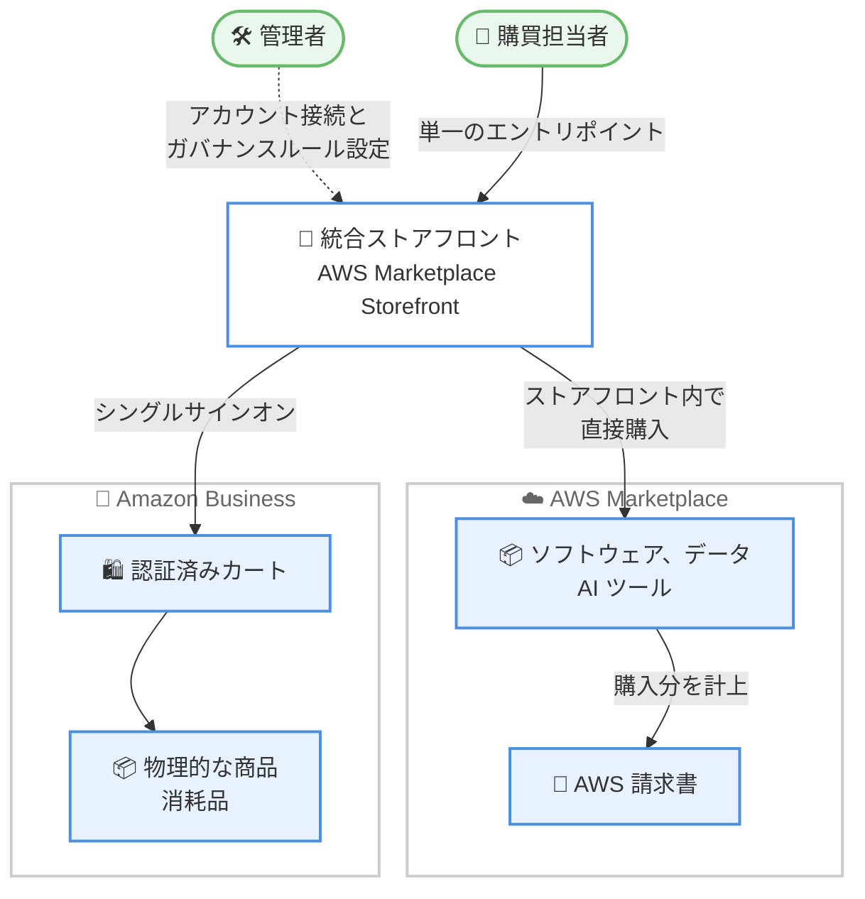

# AWS Marketplace - Amazon Business 統合ストアフロント

**リリース日**: 2026 年 10 月 28 日
**サービス**: AWS Marketplace / Amazon Business
**機能**: AWS Marketplace and Amazon Business unified storefront

📊 [このアップデートのインフォグラフィックを見る](https://takech9203.github.io/aws-news-summary/20261028-marketplace-business-storefront.html)

## 概要

AWS Marketplace と Amazon Business は、これまで別々だった 2 つの購買体験を統合する「統合ストアフロント」を発表しました。組織は、AWS Marketplace のソフトウェア、データ、AI ツールと、Amazon Business の物理的な商品や消耗品を、単一のキュレーションされたカタログとしてチームに提供できるようになります。

本機能は AWS Marketplace Storefront を基盤として構築されています。管理者は組織の Amazon Business アカウントを接続し、Amazon Business の商品を自社ブランドのストアフロントにインポートできます。ガバナンスルールは一度設定するだけで両方のカタログに適用され、購買担当者は 1 つの場所で両方のカタログを閲覧できます。

AWS Marketplace の購入はストアフロント内で直接完結し、AWS の請求書に反映されます。Amazon Business の商品を選択すると、シングルサインオンにより認証済みの Amazon Business カートへ遷移するため、2 回目のログインは不要です。

**アップデート前の課題**

多くの企業は AWS Marketplace と Amazon Business の両方から購買を行っていましたが、以下の課題がありました。

- 2 つの別々のカタログを維持する必要があった
- 承認ルールが重複して管理されていた
- レポーティングがプラットフォームごとに分かれていた

**アップデート後の改善**

今回のアップデートにより、以下が可能になりました。

- 調達チームは両プラットフォームへの単一のエントリポイントを利用できるようになった
- ガバナンスルールを一度設定するだけで両方のカタログに適用できるようになった
- シングルサインオンにより、Amazon Business 商品の購入時に再ログインが不要になった

## アーキテクチャ図



購買担当者は統合ストアフロントから AWS Marketplace の商品をストアフロント内で直接購入でき、Amazon Business の商品はシングルサインオンで認証済みカートへシームレスに遷移して購入できます。

## サービスアップデートの詳細

### 主要機能

1. **単一のキュレーションされたカタログ**
   - AWS Marketplace のソフトウェア、データ、AI ツールと Amazon Business の物理的な商品を 1 つのストアフロントで提供
   - 管理者が組織の Amazon Business アカウントを接続し、Amazon Business の商品を自社ブランドのストアフロントにインポート
   - 購買担当者は 1 つの場所で両方のカタログを閲覧可能

2. **統一されたガバナンス**
   - ガバナンスルールを一度設定するだけで、AWS Marketplace と Amazon Business の両方のカタログに適用
   - 承認ルールの重複管理が不要
   - 各ストアフロントは管理者が設定したアカウントにのみ接続されるため、意図しないアカウントへのアクセスを防止

3. **シームレスな購買体験**
   - AWS Marketplace の購入はストアフロント内で直接完結し、AWS の請求書に反映
   - Amazon Business の商品選択時はシングルサインオンで認証済みカートへ遷移し、再ログインが不要

## 技術仕様

### 統合ストアフロントの構成要素

| 項目 | 詳細 |
|------|------|
| 基盤 | AWS Marketplace Storefront |
| AWS Marketplace 商品 | ソフトウェア、データ、AI ツール。ストアフロント内で直接購入し、AWS 請求書に計上 |
| Amazon Business 商品 | 物理的な商品や消耗品。シングルサインオンで認証済みカートへ遷移 |
| ガバナンス | ルールを一度設定し、両カタログに適用 |
| アカウント接続 | 各ストアフロントは管理者が設定したアカウントにのみ接続 |

## 設定方法

### 前提条件

1. AWS Marketplace Storefront の利用者であること
2. AWS Marketplace API と Amazon Business API の両方へのアクセス権があること
3. 組織の Amazon Business アカウントを保有していること

### 手順

#### ステップ 1: Amazon Business アカウントの接続

管理者が AWS Marketplace Storefront に組織の Amazon Business アカウントを接続します。各ストアフロントは管理者が設定したアカウントにのみ接続されます。

#### ステップ 2: Amazon Business 商品のインポート

接続した Amazon Business アカウントから、商品を自社ブランドのストアフロントにインポートします。

#### ステップ 3: ガバナンスルールの設定

ガバナンスルールを一度設定します。設定したルールは AWS Marketplace と Amazon Business の両方のカタログに適用されます。

詳細な手順は [AWS Marketplace Storefront User Guide](https://docs.aws.amazon.com/marketplace/latest/storefrontguide/what-is-marketplace-storefront.html) を参照してください。

## メリット

### ビジネス面

- **調達の一元化**: ソフトウェアと物理的な商品の購買を単一のエントリポイントに集約し、調達プロセスを簡素化
- **ガバナンスの統一**: 承認ルールの重複管理を解消し、コンプライアンス管理の負荷を軽減
- **可視性の向上**: 分散していた購買活動を 1 つのストアフロントに集約することで、組織全体の購買を把握しやすくなる

### 技術面

- **シングルサインオン**: Amazon Business への再ログインが不要となり、購買体験が向上
- **請求の明確化**: AWS Marketplace の購入は AWS 請求書に反映され、既存の支払いフローを活用可能
- **アクセス制御**: 各ストアフロントは管理者が設定したアカウントにのみ接続され、セキュアな構成を維持

## デメリット・制約事項

### 制限事項

- AWS Marketplace Storefront の利用者であることが前提となる
- AWS Marketplace API と Amazon Business API の両方へのアクセスが必要
- Amazon Business の購入はストアフロント内では完結せず、認証済みカートへの遷移が必要

### 考慮すべき点

- Amazon Business アカウントの接続設定は管理者が行う必要がある
- 既存の購買ワークフローや承認フローを統合ストアフロントのガバナンスルールに合わせて見直す必要がある

## ユースケース

### ユースケース 1: 全社調達ポータルの構築

**シナリオ**: 大企業の調達部門が、SaaS ライセンスとオフィス用品の購買を部門ごとにバラバラに管理しており、承認ルールとレポートが二重化している。

**実装例**:
```
1. AWS Marketplace Storefront に自社ブランドのストアフロントを構築
2. 組織の Amazon Business アカウントを接続し、承認済みのオフィス用品をインポート
3. 全社共通のガバナンスルールを一度設定し、両カタログに適用
```

**効果**: 従業員は単一のポータルからソフトウェアと物品を購買でき、調達部門は承認ルールを一元管理できる。

### ユースケース 2: 開発チーム向けのキュレーションカタログ

**シナリオ**: IT 部門が開発チームに対し、承認済みの開発ツール、AI ツール、周辺機器のみを提供したい。

**実装例**:
```
1. ストアフロントに承認済みの AWS Marketplace 製品を掲載
2. Amazon Business から開発用の周辺機器をインポート
3. チームは 1 つのカタログから必要なツールと機器を購入
```

**効果**: シャドー IT を抑制しつつ、開発チームが必要なツールと機器を迅速に入手できる。

### ユースケース 3: 請求とレポートの整理

**シナリオ**: 財務部門が、ソフトウェア購買と物品購買の請求経路を明確に分離しつつ、購買の入口は統一したい。

**実装例**:
```
1. 統合ストアフロントを購買の単一エントリポイントとして展開
2. AWS Marketplace の購入は AWS 請求書に計上
3. Amazon Business の購入は認証済みカート経由で Amazon Business 側の既存フローで処理
```

**効果**: 購買体験を統一しながら、各プラットフォームの既存の請求、支払いフローをそのまま活用できる。

## 料金

公式発表では、本機能に関する追加料金の記載はありません。AWS Marketplace Storefront の利用条件や料金の詳細は、[AWS Marketplace Storefront 製品ページ](https://aws.amazon.com/marketplace/partners/storefront)を参照してください。

## 利用可能リージョン

Amazon Business コネクタは、AWS Marketplace が運営されているすべての AWS リージョンで利用可能です。AWS Marketplace API と Amazon Business API の両方にアクセスできる AWS Marketplace Storefront の利用者が対象です。

## 関連サービス・機能

- **AWS Marketplace Storefront**: 本機能の基盤となる、組織向けのブランド化されたキュレーションカタログ機能
- **AWS Marketplace**: ソフトウェア、データ、AI ツールを提供するデジタルカタログ
- **Amazon Business**: 法人向けの物品購買プラットフォーム。シングルサインオンで連携
- **AWS Billing and Cost Management**: AWS Marketplace の購入が AWS 請求書に反映されるため、コスト管理と連携

## 参考リンク

- 📊 [インフォグラフィック](https://takech9203.github.io/aws-news-summary/20261028-marketplace-business-storefront.html)
- [公式発表 (What's New)](https://aws.amazon.com/about-aws/whats-new/2026/10/marketplace-business-storefront/)
- [AWS Marketplace Storefront 製品ページ](https://aws.amazon.com/marketplace/partners/storefront)
- [AWS Marketplace Storefront User Guide](https://docs.aws.amazon.com/marketplace/latest/storefrontguide/what-is-marketplace-storefront.html)

## まとめ

AWS Marketplace と Amazon Business の統合ストアフロントにより、組織はソフトウェアと物理的な商品の購買を単一のカタログに集約し、ガバナンスルールを一元管理できるようになりました。両プラットフォームを併用している組織は、AWS Marketplace Storefront への Amazon Business アカウント接続を検討し、重複していた承認ルールとレポーティングの統合から着手することを推奨します。
