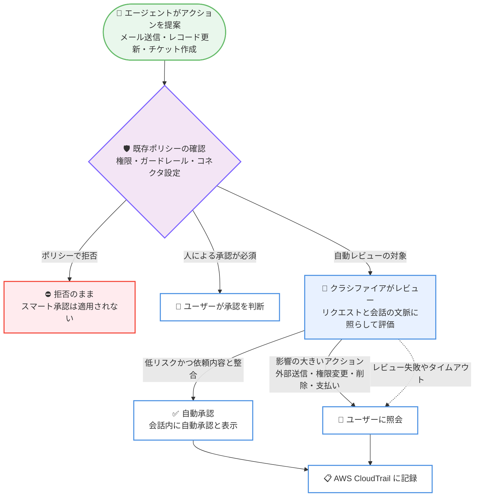

# Amazon Quick - エージェントアクション向けスマート承認 (Smart Approvals)

**リリース日**: 2026 年 10 月 28 日
**サービス**: Amazon Quick
**機能**: Smart Approvals (エージェントアクションの自動レビュー・承認)

📊 [このアップデートのインフォグラフィックを見る](https://takech9203.github.io/aws-news-summary/20261028-quick-smart-approvals-agentic-actions.html)

## 概要

Amazon Quick が、エージェントによるアクション (エージェンティックアクション) に対する「スマート承認 (Smart Approvals)」をサポートしました。スマート承認は、人間による監督を維持しながら、不要な承認プロンプトを削減するレビューレイヤーです。メール送信、レコード更新、チケット作成といったエージェントのアクションごとに毎回ユーザー承認を求めると、承認疲れ (approval fatigue) が発生し、時間の経過とともに監督が形骸化するという課題に対応します。

スマート承認では、クラシファイアと呼ばれる独立したレビューモデルが、承認対象となる各アクションをユーザーのリクエストと会話の文脈に照らして評価します。低リスクでユーザーの依頼内容と整合する定型的なアクションは自動承認され、影響の大きいアクションはユーザーに照会されます。既存のポリシーが常に優先され、拒否されたアクションは拒否されたままとなり、スマート承認が新しいアクセス権を付与することはありません。

本機能はすべてのユーザーに対してデフォルトで有効化されており、管理者はカスタム権限プロファイルで利用可否を制御できます。また、すべてのアクションレビューと設定変更は AWS CloudTrail に記録されるため、監査証跡も確保されます。

**アップデート前の課題**

- エージェントが提案するすべてのアクションについて、ユーザーが毎回手動で承認する必要があった
- 承認プロンプトが頻発することで承認疲れが発生し、内容を確認せずに承認する習慣がつき、実質的な監督が弱まるリスクがあった
- 定型的で低リスクなアクションと、影響の大きいアクションが同じ承認フローで扱われ、効率と安全性の両立が難しかった

**アップデート後の改善**

- クラシファイアによる自動レビューにより、低リスクな定型アクションは自動承認され、承認プロンプトが削減された
- 組織外へのコンテンツ送信、権限変更、コンテンツ削除、支払いの実行など、影響の大きいアクションは常にユーザーに照会されるため、重要な判断への集中が可能になった
- レビューの失敗やタイムアウト時はユーザーに照会されるフェイルセーフ設計により、安全性を維持したまま効率化できるようになった

## アーキテクチャ図



スマート承認の評価フローです。既存ポリシーのチェックが常に先に適用され、自動レビューの対象となったアクションのみクラシファイアが評価します。影響の大きいアクションとレビュー失敗時は必ずユーザーに照会され、すべての結果が CloudTrail に記録されます。

## サービスアップデートの詳細

### 主要機能

1. **クラシファイアによる自動レビュー**
   - 独立したレビューモデル (クラシファイア) が、承認対象の各アクションをユーザーのリクエストと会話の文脈に照らして評価する
   - 低リスクで依頼内容と整合する定型的なアクションは自動承認され、Quick が会話内で自動承認であることをラベル表示する
   - 承認のスコープは厳密に限定され、レビューされたまさにそのアクションのみを対象とする

2. **既存ポリシーの優先**
   - スマート承認が適用されるのは、コネクタ作成者がアクションを「Let user choose」に設定し、かつユーザーの権限設定が「Ask each time」の場合のみ
   - ポリシーで拒否されたアクションは拒否のままとなり、スマート承認が新しいアクセス権を付与することはない
   - 「Always Allow」のアクションはレビューなしで実行され、「Always Ask」のアクションは常にユーザー承認となる

3. **影響の大きいアクションの保護**
   - 以下のアクションは常にユーザーに照会される。
     - 組織外へのコンテンツ送信
     - 権限の変更
     - コンテンツの削除・上書き
     - 支払いの開始
     - ユーザーのリクエスト範囲を超えるアクション
   - レビューの失敗やタイムアウトが発生した場合も、フェイルセーフとしてアクションはユーザーに照会される

4. **管理者・ユーザーによる制御**
   - デフォルトですべてのユーザーに対して有効
   - 管理者はカスタム権限プロファイルの「AI capabilities」でスマート承認の利用可否を制御できる
   - ユーザーはチャットメニューからスマート承認のオン・オフを切り替えられる (会話とスケジュール実行の両方に適用されるグローバル設定)

5. **CloudTrail による監査**
   - スマート承認が承認した各アクションと、ユーザーによる設定変更がすべて AWS CloudTrail に記録される
   - 各レビューイベントには、ユーザー、エージェント、コネクタとアクション、時刻が含まれる

## 技術仕様

### スマート承認の適用条件

| 項目 | 詳細 |
|------|------|
| 適用条件 | コネクタのアクション設定が「Let user choose」かつユーザー設定が「Ask each time」の場合のみレビュー対象 |
| ポリシーとの関係 | 既存の権限、カスタム権限、ガードレール、コネクタアクション権限が常に優先される |
| 承認スコープ | レビューされた個別のアクションのみ。包括的な承認は行わない |
| フェイルセーフ | レビューの失敗・タイムアウト時はユーザーに照会 |
| デフォルト状態 | すべてのユーザーで有効 |
| 対応アプリ | Amazon Quick デスクトップアプリおよびモバイルアプリ (Web 版は現時点で非対応) |

### CloudTrail イベント

| イベント | 内容 |
|----------|------|
| `BatchUpdatePreferencesInternal` | ユーザーがスマート承認設定を変更した際に記録。`preferenceKeys` が `UseSmartApprovals`、`updatedValues` が `ON` または `OFF` |
| `BatchUpdatePermissionsInternal` | スマート承認がアクションを承認した際に記録。`connectorId` と `actionId` がコネクタとアクションを識別し、`approvalSource` が `SMART_APPROVALS` |

イベントソースはいずれも `quicksight.amazonaws.com` です。なお、`approvalSource` が `SMART_APPROVALS` のイベントは承認の事実を示すものであり、アクションが実行されたことの確認にはならない点に注意が必要です。

## 設定方法

### 前提条件

1. Amazon Quick のエージェンティック機能が利用可能なリージョンで Amazon Quick を利用していること
2. 管理者設定を変更する場合は、Amazon Quick の管理者権限を持っていること
3. スマート承認を利用する場合は、Amazon Quick のデスクトップアプリまたはモバイルアプリを使用していること

### 手順

#### ステップ 1: 管理者によるカスタム権限プロファイルの設定

1. Quick コンソールを開き、[Manage Quick] を選択する
2. 左側のナビゲーションで [Permissions]、[Custom permissions] の順に選択する
3. 新しいプロファイルを作成するか、既存のプロファイルの [Edit] を選択する
4. [Capabilities & features] セクションで [AI capabilities] を展開する
5. [Smart Approvals] 機能を設定する (制限すると無効化、未制限のままにすると有効化)
6. プロファイルを保存し、ユーザー、ロール、またはアカウントに割り当てる

カスタム権限プロファイルでスマート承認を制限されたユーザーのアクションは、自動承認されずに人によるレビューに回されます。

#### ステップ 2: ユーザーによるオン・オフの切り替え

1. チャットで [+] アイコンを選択してチャットメニューを開く
2. [Smart Approvals] をオンまたはオフに切り替える

この設定はグローバル設定であり、すべての会話と、スケジュール実行がユーザーに代わって行うアクションの両方に適用されます。オフにすると、対象アクションは自動承認されず、ユーザーのレビュー待ちとなります。

#### ステップ 3: CloudTrail での監査

CloudTrail コンソールまたは API でイベントソース `quicksight.amazonaws.com` のイベントを確認し、`approvalSource` が `SMART_APPROVALS` のイベントや `UseSmartApprovals` の設定変更イベントを監査します。

## メリット

### ビジネス面

- **承認疲れの解消**: 定型的なアクションの承認プロンプトが削減され、ユーザーは本当に判断が必要なアクションに集中できる
- **監督の実効性向上**: 承認が形骸化するリスクを減らし、影響の大きいアクションに対する人間の監督を実質的に強化できる
- **エージェント活用の促進**: 承認の手間が減ることで、スケジュール実行を含むエージェンティック機能を業務で活用しやすくなる

### 技術面

- **既存ポリシーとの整合性**: 権限、ガードレール、コネクタアクション権限が常に優先され、スマート承認が新しいアクセス権を付与しない安全な設計
- **フェイルセーフ設計**: レビューの失敗やタイムアウト時はユーザー照会にフォールバックするため、自動化による見落としを防げる
- **完全な監査証跡**: すべての自動承認と設定変更が CloudTrail に記録され、コンプライアンス要件に対応できる

## デメリット・制約事項

### 制限事項

- Web 版の Amazon Quick では利用できない (デスクトップアプリとモバイルアプリのみ)
- スマート承認の対象は、コネクタ設定が「Let user choose」かつユーザー設定が「Ask each time」のアクションに限定される
- CloudTrail の承認イベントはアクションの承認を示すものであり、実行の成否までは確認できない

### 考慮すべき点

- 自動レビューはポリシーの代替ではない。常に人間の承認が必要なアクションは、自動レビューに頼らず、コネクタのアクション権限設定で承認必須にすることが推奨される
- デフォルトで有効のため、組織のガバナンス要件によっては、カスタム権限プロファイルで対象ユーザーを制限する検討が必要
- ユーザー設定はグローバルであり、会話単位・コネクタ単位での細かい切り替えはできない

## ユースケース

### ユースケース 1: カスタマーサポートのチケット運用

**シナリオ**: サポートチームが Amazon Quick のエージェントを使って Jira チケットの作成や更新を日常的に行っており、毎回の承認が負担になっている。

**実装例**:
```text
1. Jira コネクタのアクション権限を「Let user choose」に設定
2. ユーザーの権限設定を「Ask each time」のままにする
3. スマート承認を有効のまま運用する
```

**効果**: 依頼内容と整合する定型的なチケット作成 (例: `jira_create_issue`) は自動承認され、チケットの削除や外部共有などの影響が大きい操作のみユーザーが判断する運用が実現する。

### ユースケース 2: スケジュール実行による定期レポート業務

**シナリオ**: 毎朝のスケジュール実行で、エージェントが社内レコードを更新しサマリーを作成しているが、承認待ちで処理が止まってしまう。

**実装例**:
```text
1. ユーザーがチャットメニューからスマート承認をオンにする
2. スケジュール実行のアクションも自動レビューの対象となる
3. 影響の大きいアクションのみ通知を受けて承認する
```

**効果**: 低リスクな定型アクションは自動承認されてスケジュール実行が止まらず、組織外への送信などの重要なアクションのみ人間が確認するため、自動化と統制を両立できる。

### ユースケース 3: ガバナンス要件の厳しい部門での段階的導入

**シナリオ**: 財務部門ではすべてのアクションに人間の承認を必須としたいが、他部門ではスマート承認を活用したい。

**実装例**:
```text
1. 財務部門向けのカスタム権限プロファイルで Smart Approvals を制限
2. 支払いに関わるコネクタアクションは「Always Ask」に設定
3. 他部門のプロファイルでは Smart Approvals を未制限のままにする
4. CloudTrail で SMART_APPROVALS イベントを定期監査
```

**効果**: 部門ごとのリスク許容度に応じた承認ポリシーを適用しつつ、CloudTrail による監査証跡で全社のガバナンス要件を満たせる。

## 料金

本アップデートに関する追加料金の記載はありません。スマート承認は Amazon Quick のエージェンティック機能の一部として提供されます。Amazon Quick の料金詳細は料金ページを参照してください。

## 利用可能リージョン

Amazon Quick のエージェンティック機能がサポートされているすべての AWS リージョンで利用可能です。最新のリージョン情報は [AWS リージョン別サービス一覧](https://aws.amazon.com/about-aws/global-infrastructure/regional-product-services/) を参照してください。

## 関連サービス・機能

- **Amazon Quick**: AI を活用した業務アシスタント。エージェントがメール送信、レコード更新、チケット作成などのアクションをユーザーに代わって実行する
- **AWS CloudTrail**: スマート承認によるアクション承認と設定変更をイベントとして記録し、監査を可能にする
- **Amazon Quick カスタム権限 (Custom permissions)**: 管理者がユーザーごとにスマート承認を含む AI 機能の利用可否を制御する仕組み

## 参考リンク

- 📊 [インフォグラフィック](https://takech9203.github.io/aws-news-summary/20261028-quick-smart-approvals-agentic-actions.html)
- [公式発表 (What's New)](https://aws.amazon.com/about-aws/whats-new/2026/10/quick-smart-approvals-agentic-actions/)
- [Smart Approvals ドキュメント (Amazon Quick User Guide)](https://docs.aws.amazon.com/quicksuite/latest/userguide/smart-approvals.html)
- [Amazon Quick 製品ページ](https://aws.amazon.com/quick/)

## まとめ

Amazon Quick のスマート承認は、クラシファイアによる自動レビューで承認疲れを解消しつつ、影響の大きいアクションには必ず人間の判断を介在させる、安全性と効率を両立した機能です。既存ポリシーが常に優先され CloudTrail で完全に監査できるため、エージェンティック機能を業務に展開している組織はまず有効のまま運用を試し、常に人間の承認が必要なアクションについてはコネクタのアクション権限設定で承認必須とすることを推奨します。
