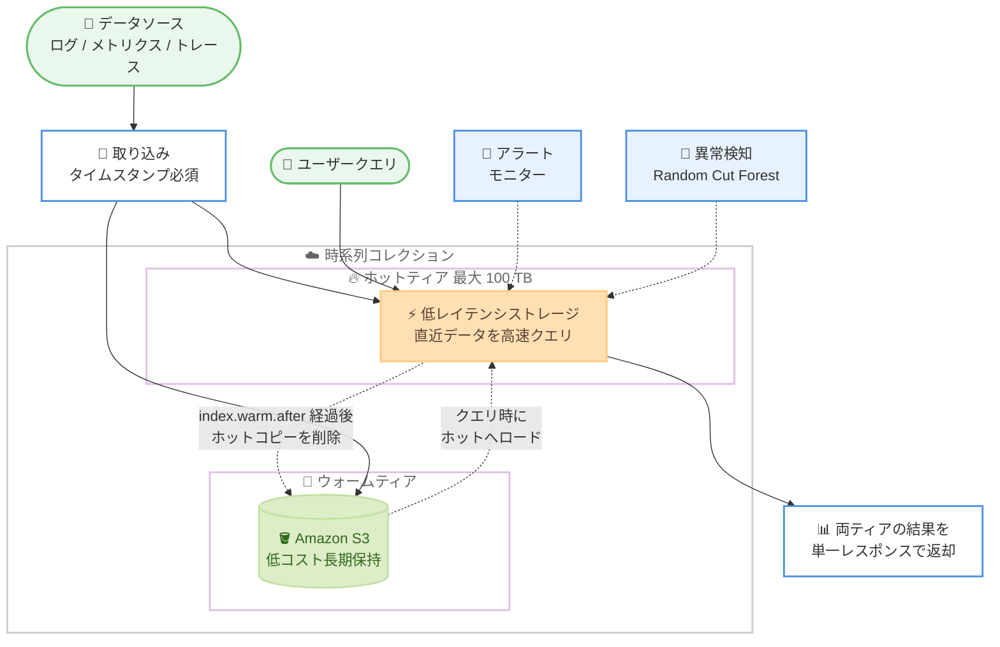

# Amazon OpenSearch Serverless - 次世代 OpenSearch Serverless における時系列コレクションの提供開始

**リリース日**: 2026 年 10 月 28 日
**サービス**: Amazon OpenSearch Serverless
**機能**: 時系列コレクション (Time series collections)

📊 [このアップデートのインフォグラフィックを見る](https://takech9203.github.io/aws-news-summary/20261028-time-series-collection-next-generation-opensearch-serverless.html)

## 概要

次世代の Amazon OpenSearch Serverless で、時系列コレクション (Time series collections) がサポートされました。ログ、メトリクス、トレース、イベントデータといった時系列データを、クラスターのプロビジョニングや管理なしで取り込み、保存、分析できる新しいコレクションタイプです。

時系列コレクションは、取り込みスパイクを自動的に吸収しながら直近のデータを高速にクエリできるように設計されており、1 コレクションあたり最大 100 TB のホットストレージをサポートします。さらに、既存のホットティアに加えて低コストのウォームストレージティアが新たに追加され、アクセス頻度の低いデータを低コストで保持できます。データをホットティアに保持する期間はユーザーが制御でき、数か月から数年に及ぶ長期の履歴データも同一コレクション内で検索可能です。

また、アラート機能と異常検知機能が組み込みで提供されるようになり、別のツールを用意することなく、問題の通知や異常なパターンの検出が可能になりました。アプリケーションモニタリング、セキュリティ分析、IoT テレメトリなど、大量データを扱うオブザーバビリティワークロードに適しています。

**アップデート前の課題**

- 従来の OpenSearch Serverless コレクションでは、ホット/ウォームのティアリングをインデックス単位で柔軟に制御できず、長期履歴データの低コスト保持が難しかった
- Serverless コレクションにはアラートや異常検知が組み込まれておらず、問題検知には別のツールや仕組みが必要だった
- アイドル時にもコンピューティングが稼働し続けるため、間欠的なワークロードではコスト効率が低かった

**アップデート後の改善**

- ホットティアとウォームティア (Amazon S3) の 2 層構成により、直近データの高速クエリと長期データの低コスト保持を同一コレクション内で両立できるようになった
- インデックス設定 (`index.warm.after`、`index.data.retention`) だけでティアリングと保持期間を制御でき、別途ライフサイクルポリシーが不要になった
- アラートモニター (per-query、per-bucket、PPL) と Random Cut Forest による異常検知が組み込みで利用可能になった
- コンピューティングは取り込みスパイク時に数秒でスケールし、アイドル時はゼロまでスケールダウンできるようになった

## アーキテクチャ図



ドキュメントは取り込み時にホットティアと Amazon S3 の両方へ書き込まれ、設定した期間を過ぎるとホットコピーが削除されてウォームティアのみに残ります。ウォームデータへのクエリ時はデータがホットティアへロードされ、2 回目以降はホットティアの速度でクエリできます。

## サービスアップデートの詳細

### 主要機能

1. **時系列コレクションタイプ**
   - 次世代 OpenSearch Serverless の新しいコレクションタイプ (`TIMESERIES`)
   - ログ、メトリクス、トレース、イベントデータの取り込み、保存、分析に最適化
   - 1 コレクションあたり最大 100 TB のホットストレージをサポート
   - すべてのドキュメントにタイムスタンプが必須 (デフォルトは `@timestamp`、`index.timestamp_field` で変更可能)

2. **ホット/ウォームの 2 層ストレージティア**
   - 取り込み時にホットティアと Amazon S3 の両方へ書き込み
   - `index.warm.after` でホットティアの保持期間をインデックス単位で設定 (最小 1 日から最大 10 年、デフォルト 1 日)
   - ウォームデータへの初回クエリはホットティアへのロードが発生するため遅くなるが、2 回目以降はホットティアの速度で実行
   - 両ティアにまたがるクエリも単一のレスポンスで結果を返却

3. **インデックスレベルのデータ保持設定**
   - `index.data.retention` で保持期間を日数で指定 (1 日から 3,650 日)
   - インデックスまたはインデックステンプレートに直接設定でき、別途ライフサイクルポリシーが不要
   - ティアリング (速度とコストの制御) と保持期間 (削除の制御) は独立して設定可能

4. **自動スケーリングとスケールトゥゼロ**
   - 取り込みスパイク時に数秒でコンピューティングがスケール
   - アイドル時はゼロまでスケールダウン
   - コレクショングループで共有コンピューティング上限を OCU (OpenSearch Compute Unit) 単位で定義

5. **組み込みのアラートと異常検知**
   - per-query モニター: 単一値のしきい値監視 (例: 平均レイテンシ)
   - per-bucket モニター: グループごとの個別評価 (例: ホストごとのエラー率)
   - PPL モニター: Piped Processing Language による複雑な条件定義
   - 異常検知: Random Cut Forest (RCF) が正常パターンを学習し、固定しきい値なしでほぼリアルタイムに逸脱を検出

## 技術仕様

### 主要パラメータ

| 項目 | 詳細 |
|------|------|
| コレクションタイプ | `TIMESERIES` |
| ホットストレージ上限 | 1 コレクションあたり最大 100 TB |
| `index.warm.after` | ホット保持期間。`24h`/`1d` から `3650d`。デフォルト 1 日。保持期間を超えない範囲で設定 |
| `index.data.retention` | データ保持期間。1 から 3,650 の整数 (日数) |
| `index.timestamp_field` | タイムスタンプフィールド。デフォルト `@timestamp`。トップレベルの date フィールドのみ指定可能 |
| タイムスタンプ制約 | 欠落、null、不正な値は拒否。インデックス後は変更不可。`_bulk` ではドキュメント単位で拒否 |
| コンピューティング | OCU 単位。最小 0 でスケールトゥゼロ、最大値でコスト上限を制御 |

### インデックステンプレートの設定例

```json
PUT /_index_template/app-logs
{
  "index_patterns": ["app-logs*"],
  "template": {
    "settings": {
      "index.timestamp_field": "event_time",
      "index.warm.after": "7d",
      "index.data.retention": "30"
    }
  }
}
```

## 設定方法

### 前提条件

1. 次世代 OpenSearch Serverless が利用可能なリージョンであること
2. OpenSearch Serverless の操作権限を持つ IAM プリンシパルがあること
3. AWS CLI を使用する場合は最新バージョンへ更新しておくこと

### 手順

#### ステップ 1: コレクショングループの作成

```bash
aws opensearchserverless create-collection-group \
    --name app-logs-group \
    --generation NEXTGEN \
    --standby-replicas ENABLED \
    --capacity-limits '{
        "minIndexingCapacityInOCU": 0,
        "minSearchCapacityInOCU": 0,
        "maxIndexingCapacityInOCU": 96,
        "maxSearchCapacityInOCU": 96
    }'
```

次世代 (`NEXTGEN`) のコレクショングループを作成し、共有コンピューティングの上限と下限を OCU 単位で定義します。最小値を 0 に設定することで、アイドル時のスケールトゥゼロが有効になります。

#### ステップ 2: ネットワークポリシーとデータアクセスポリシーの作成

コレクションへのネットワークアクセス (パブリックまたは VPC) を定義するネットワークポリシーと、IAM プリンシパルに対する操作権限を定義するデータアクセスポリシーを作成します。コンソールの「Express Create」を使用すると、コレクショングループ、暗号化、ネットワークアクセス、データアクセスをワンクリックでまとめてセットアップできます。

#### ステップ 3: 時系列コレクションの作成

```bash
aws opensearchserverless create-collection \
    --name app-logs \
    --type TIMESERIES \
    --collection-group-name app-logs-group \
    --encryption-config aWSOwnedKey=true
```

コレクションタイプに `TIMESERIES` を指定して時系列コレクションを作成します。この例では AWS 所有キーによる暗号化を使用しています。

#### ステップ 4: インデックステンプレートの作成とデータ取り込み

タイムスタンプフィールド、ホット保持期間 (`index.warm.after`)、データ保持期間 (`index.data.retention`) を定義したインデックステンプレートを作成し、データを取り込みます。取り込み後は Observability ワークスペースでダッシュボード、モニター、異常検知ディテクターを設定できます。

## メリット

### ビジネス面

- **ストレージコストの削減**: アクセス頻度の低いデータを低コストのウォームティアへ自動移行し、数か月から数年の長期履歴を低コストで検索可能な状態に保てる
- **運用負荷の軽減**: クラスターのプロビジョニングや管理、ライフサイクルポリシーの運用が不要になり、インデックス設定のみでデータ管理が完結する
- **コンピューティングコストの最適化**: スケールトゥゼロにより、間欠的なワークロードではアイドル時のコンピューティングコストが発生しない

### 技術面

- **取り込みスパイクへの自動対応**: 数秒でスケールするコンピューティングにより、急激なログ量の増加にも自動的に対応できる
- **ツール統合の簡素化**: アラートと異常検知が組み込まれたため、別の監視ツールとの連携や運用が不要になる
- **透過的なティア間クエリ**: ホットとウォームにまたがるクエリも単一レスポンスで返却されるため、アプリケーション側でティアを意識する必要がない

## デメリット・制約事項

### 制限事項

- すべてのドキュメントにタイムスタンプが必須であり、欠落、null、不正な値を持つドキュメントは拒否される
- タイムスタンプはインデックス後に変更できない
- ホット保持期間 (`index.warm.after`) は最小 1 日であり、保持期間 (`index.data.retention`) を超える値は設定できない
- データ保持期間は最大 3,650 日 (10 年)

### 考慮すべき点

- ウォームティアのデータへの初回クエリは、ホットティアへのロードが発生するため遅くなる。頻繁にアクセスするデータはホット保持期間を長めに設定する検討が必要
- コレクショングループの最大 OCU 設定はコスト上限と性能上限の両方に影響するため、ワークロードに応じた調整が必要
- 次世代 OpenSearch Serverless を前提とした機能であり、従来 (Classic) のコレクションとは挙動が異なる

## ユースケース

### ユースケース 1: アプリケーションモニタリング

**シナリオ**: マイクロサービスのアプリケーションログを集約し、直近 1 週間は高速に分析しつつ、監査やトレンド分析のために 1 年間保持したい。

**実装例**:
```json
PUT /_index_template/app-logs
{
  "index_patterns": ["app-logs*"],
  "template": {
    "settings": {
      "index.warm.after": "7d",
      "index.data.retention": "365"
    }
  }
}
```

**効果**: 直近 7 日間のログはホットティアで高速にクエリでき、それ以降はウォームティアで低コストに保持。per-bucket モニターでホストごとのエラー率を監視し、問題発生時に通知を受け取れる。

### ユースケース 2: セキュリティ分析

**シナリオ**: VPC フローログや認証ログなどのセキュリティログを長期間保持し、インシデント調査時に過去データまで遡って検索したい。

**実装例**:
```json
PUT /_index_template/security-logs
{
  "index_patterns": ["security-logs*"],
  "template": {
    "settings": {
      "index.warm.after": "30d",
      "index.data.retention": "1095"
    }
  }
}
```

**効果**: 3 年分のセキュリティログを同一コレクション内で検索可能に保ちつつ、ストレージコストを抑制。異常検知 (RCF) により、固定しきい値では捉えにくい不審なアクセスパターンを自動検出できる。

### ユースケース 3: IoT テレメトリ

**シナリオ**: 大量の IoT デバイスから送信されるテレメトリデータを取り込み、送信量の急増にも自動で対応しながらコストを最適化したい。

**実装例**:
```bash
aws opensearchserverless create-collection-group \
    --name iot-telemetry-group \
    --generation NEXTGEN \
    --capacity-limits '{
        "minIndexingCapacityInOCU": 0,
        "minSearchCapacityInOCU": 0,
        "maxIndexingCapacityInOCU": 48,
        "maxSearchCapacityInOCU": 48
    }'
```

**効果**: デバイスからの取り込みスパイクを自動的に吸収し、夜間などアイドル時はコンピューティングがゼロまでスケールダウンしてコストを削減できる。

## 料金

消費したコンピューティング (OCU 単位) に加え、ホットストレージとウォームストレージがそれぞれ GB-月単位で課金されます。ホットティアの料金は、現在ホットティアに存在するデータに対してのみ適用されます。新しいウォームストレージティアの料金詳細は、[Amazon OpenSearch Service の料金ページ](https://aws.amazon.com/opensearch-service/pricing/)を参照してください。

## 利用可能リージョン

次世代 Amazon OpenSearch Serverless が提供されているすべての AWS 商用リージョンで利用可能です。リージョンの一覧は [AWS General Reference のサービスエンドポイント](https://docs.aws.amazon.com/general/latest/gr/opensearch-service.html)を参照してください。

## 関連サービス・機能

- **Amazon OpenSearch Service**: マネージド型の OpenSearch クラスターを提供するサービス。Serverless はそのサーバーレスオプション
- **Amazon S3**: ウォームティアのストレージ基盤として使用され、低コストの長期保持を実現
- **Amazon CloudWatch**: メトリクスやログの収集元として、OpenSearch Serverless への取り込みパイプラインと組み合わせて利用可能
- **Amazon OpenSearch Ingestion**: 各種ソースから OpenSearch Serverless コレクションへデータを取り込むためのマネージドパイプライン

## 参考リンク

- 📊 [インフォグラフィック](https://takech9203.github.io/aws-news-summary/20261028-time-series-collection-next-generation-opensearch-serverless.html)
- [公式発表 (What's New)](https://aws.amazon.com/about-aws/whats-new/2026/10/time-series-collection-next-generation-opensearch-serverless/)
- [AWS Blog: Introducing the next generation of serverless time series for Amazon OpenSearch Service](https://aws.amazon.com/blogs/big-data/introducing-the-next-generation-of-serverless-time-series-for-amazon-opensearch-service/)
- [Amazon OpenSearch Serverless 機能ページ](https://aws.amazon.com/opensearch-service/features/serverless/)
- [ドキュメント: Amazon OpenSearch Serverless](https://docs.aws.amazon.com/opensearch-service/latest/developerguide/serverless.html)
- [料金ページ](https://aws.amazon.com/opensearch-service/pricing/)

## まとめ

次世代 Amazon OpenSearch Serverless の時系列コレクションは、ホット/ウォームの 2 層ティアリング、インデックスレベルの保持設定、スケールトゥゼロ、組み込みのアラートと異常検知により、オブザーバビリティワークロードの運用とコストを大きく改善するアップデートです。ログ分析やセキュリティ分析で OpenSearch Serverless を利用中、または検討中の場合は、ワークロードのアクセスパターンに応じた `index.warm.after` と `index.data.retention` の設計から検証を始めることを推奨します。
