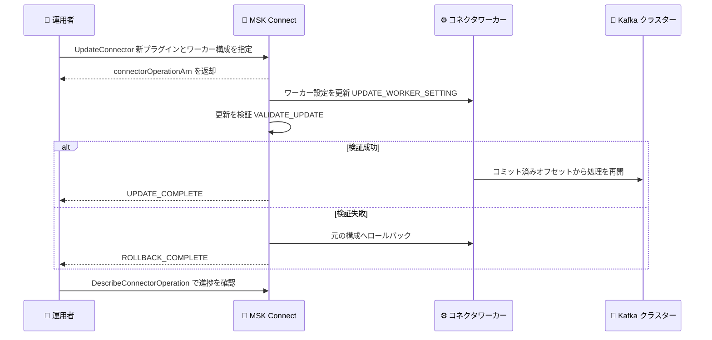

# Amazon MSK Connect - コネクタプラグインおよびワーカー構成の更新サポート

**リリース日**: 2026 年 10 月 29 日
**サービス**: Amazon MSK Connect
**機能**: 既存コネクタのカスタムプラグインとワーカー構成の更新

📊 [このアップデートのインフォグラフィックを見る](https://takech9203.github.io/aws-news-summary/20261029-amazon-msk-connect-update-plugin-worker-configurations.html)

## 概要

Amazon MSK Connect は、既存コネクタのカスタムプラグインとワーカー構成を更新できる機能をサポートしました。Amazon MSK Connect は、Apache Kafka Connect コネクタのデプロイ、モニタリング、スケーリングを行うフルマネージドサービスであり、Amazon MSK (Managed Streaming for Apache Kafka) と組み合わせてストリーミングデータの取り込みや配信に広く利用されています。

これまで、稼働中のコネクタのプラグイン (コネクタコード) やワーカー構成を変更するには、コネクタを削除して再作成する必要がありました。今回のアップデートにより、`UpdateConnector` API を通じてインプレースで更新できるようになり、コネクタはコミット済みオフセットを保持したまま、更新完了後に停止した位置から処理を再開します。依存関係を更新した新バージョンのコネクタコードへの入れ替えや、キー/バリューコンバーターの切り替え、スループットやレイテンシーを調整するプロデューサー/コンシューマープロパティのチューニングを、運用中のパイプラインを削除・再作成することなく実施できます。

**アップデート前の課題**

このアップデート以前には、以下の課題がありました。

- 以前はコネクタのプラグインやワーカー構成を変更するには、コネクタの削除と再作成が必要だった
- 削除と再作成は破壊的なオペレーションであり、設定ミスやダウンタイムのリスク、運用負荷が高かった
- プラグインの依存ライブラリ更新 (脆弱性対応など) やコンバーター変更のたびに、移行手順の計画と検証が必要だった

**アップデート後の改善**

今回のアップデートにより、以下が可能になりました。

- 既存コネクタのカスタムプラグインを新しいプラグイン/リビジョンへインプレースで更新できるようになった
- ワーカー構成 (キー/バリューコンバーターの切り替え、プロデューサー/コンシューマープロパティの調整など) を更新できるようになった
- コネクタはコミット済みオフセットを保持し、更新完了後に停止した位置からタスクが処理を再開するため、データの再処理や欠損を心配せずに更新できるようになった
- 更新後にコネクタとタスクのヘルスチェックが実行され、失敗時には自動的にロールバックされるようになった

## アーキテクチャ図



`UpdateConnector` API によるインプレース更新のフローを示しています。更新後にヘルスチェックが実行され、失敗時には元の構成へ自動的にロールバックされます。

## サービスアップデートの詳細

### 主要機能

1. **カスタムプラグインの更新**
   - 既存コネクタに関連付けられたカスタムプラグイン (ARN とリビジョン) を変更可能
   - 依存関係を更新した新バージョンのコネクタコードの適用に有効
   - コネクタの削除・再作成が不要になり、インプレースで入れ替え可能

2. **ワーカー構成の更新**
   - ワーカー構成 (ARN とリビジョン) を変更可能
   - キーコンバーターやバリューコンバーターの切り替えに対応
   - スループットやレイテンシーを最適化するためのプロデューサー/コンシューマープロパティのチューニングに対応
   - `useDefaultWorkerConfiguration` によりデフォルトのワーカー構成への切り替えも指定可能

3. **オフセットを保持した継続処理**
   - 更新中もコネクタはコミット済みオフセットを保持
   - 更新完了後、タスクは停止した位置から処理を再開
   - データの重複処理や欠損のリスクを最小化

4. **ヘルスチェックと自動ロールバック**
   - 更新後に MSK Connect がコネクタとタスクのヘルスを検証
   - 検証に失敗した場合は元の構成へ自動的にロールバック
   - `UpdateConnector` は操作 ARN を返却し、`DescribeConnectorOperation` で進捗と各ステップの状態を追跡可能

## 技術仕様

### 更新オペレーションの追跡

| 項目 | 詳細 |
|------|------|
| 更新 API | `UpdateConnector` (`plugins`、`workerConfiguration`、`useDefaultWorkerConfiguration` パラメータが追加) |
| 追跡 API | `DescribeConnectorOperation` (`originWorkerSetting`/`targetWorkerSetting` にプラグインとワーカー構成が追加) |
| オペレーションタイプ | `UPDATE_WORKER_SETTING`、`UPDATE_CONNECTOR_CONFIGURATION` など |
| オペレーション状態 | `PENDING`、`UPDATE_IN_PROGRESS`、`UPDATE_COMPLETE`、`UPDATE_FAILED`、`ROLLBACK_IN_PROGRESS`、`ROLLBACK_COMPLETE`、`ROLLBACK_FAILED` など |
| ステップタイプ | `INITIALIZE_UPDATE`、`UPDATE_WORKER_SETTING`、`VALIDATE_UPDATE`、`FINALIZE_UPDATE` など |

### API 変更履歴

| 日付 | サービス | 変更内容 |
|------|----------|----------|
| 2026/10/28 | [kafkaconnect](https://awsapichanges.com/archive/changes/bdcc3b-kafkaconnect.html) | 2 updated api methods - `UpdateConnector` に `plugins`、`workerConfiguration`、`useDefaultWorkerConfiguration` パラメータを追加。`DescribeConnectorOperation` のレスポンスにプラグインとワーカー構成の origin/target 情報を追加 |

### UpdateConnector のリクエスト例

```json
{
  "connectorArn": "arn:aws:kafkaconnect:us-east-1:123456789012:connector/my-connector/...",
  "currentVersion": "1",
  "plugins": [
    {
      "customPlugin": {
        "customPluginArn": "arn:aws:kafkaconnect:us-east-1:123456789012:custom-plugin/my-plugin/...",
        "revision": 2
      }
    }
  ],
  "workerConfiguration": {
    "workerConfigurationArn": "arn:aws:kafkaconnect:us-east-1:123456789012:worker-configuration/my-config/...",
    "revision": 3
  }
}
```

## 設定方法

### 前提条件

1. Amazon MSK Connect で稼働中のコネクタが存在すること
2. 更新先のカスタムプラグイン (新しいリビジョン) またはワーカー構成が作成済みであること
3. `kafkaconnect:UpdateConnector` および `kafkaconnect:DescribeConnectorOperation` を実行できる IAM 権限があること

### 手順

#### ステップ 1: 現在のコネクタ情報を確認

```bash
aws kafkaconnect describe-connector \
  --connector-arn <コネクタの ARN>
```

コネクタの現在の構成と `currentVersion` を確認します。`UpdateConnector` の呼び出しには `currentVersion` の指定が必要です。

#### ステップ 2: プラグインとワーカー構成を更新

```bash
aws kafkaconnect update-connector \
  --connector-arn <コネクタの ARN> \
  --current-version <現在のバージョン> \
  --plugins '[{"customPlugin":{"customPluginArn":"<新しいプラグインの ARN>","revision":2}}]' \
  --worker-configuration '{"workerConfigurationArn":"<ワーカー構成の ARN>","revision":3}'
```

既存コネクタのカスタムプラグインとワーカー構成をインプレースで更新します。レスポンスに含まれる `connectorOperationArn` を控えておきます。

#### ステップ 3: 更新オペレーションの進捗を確認

```bash
aws kafkaconnect describe-connector-operation \
  --connector-operation-arn <オペレーションの ARN>
```

更新オペレーションの状態 (`UPDATE_IN_PROGRESS`、`UPDATE_COMPLETE` など) と各ステップの進捗を確認します。検証に失敗した場合は `ROLLBACK_IN_PROGRESS` を経て元の構成に戻ります。

## メリット

### ビジネス面

- **運用リスクの低減**: コネクタの削除・再作成という破壊的オペレーションが不要になり、更新時の障害リスクが低減される
- **運用コストの削減**: 移行手順の計画や再作成時の設定再入力が不要になり、運用工数を削減できる
- **追加費用なし**: 本機能は追加料金なしで利用可能

### 技術面

- **処理の継続性**: コミット済みオフセットが保持されるため、更新後に停止位置から処理を再開でき、データの再処理や欠損を回避できる
- **安全な更新**: 更新後のヘルスチェックと失敗時の自動ロールバックにより、不正な構成変更から保護される
- **可観測性**: 操作 ARN により `DescribeConnectorOperation` でステップ単位の進捗を追跡でき、自動化パイプラインにも組み込みやすい

## デメリット・制約事項

### 制限事項

- 更新対象として指定するカスタムプラグインやワーカー構成は、事前に MSK Connect 上に作成しておく必要がある
- `UpdateConnector` には `currentVersion` の指定が必要であり、並行更新時は競合に注意が必要

### 考慮すべき点

- 新しいプラグインのコネクタ設定互換性 (設定キーやコンバーターの互換性) は事前に検証環境で確認することが望ましい
- ヘルスチェックによる自動ロールバックがあるとはいえ、更新中はタスクの一時停止が発生するため、レイテンシー要件が厳しいワークロードでは更新タイミングを計画すべき
- `skipHealthValidation` パラメータでヘルス検証をスキップできるが、自動ロールバックによる保護が働かなくなるため通常は推奨されない

## ユースケース

### ユースケース 1: プラグインの脆弱性対応・バージョンアップ

**シナリオ**: 利用中のサードパーティコネクタ (例: JDBC Sink Connector) の依存ライブラリに脆弱性が見つかり、修正版へ早急に入れ替えたい。

**実装例**:
```bash
# 修正版 JAR をアップロードして新しいカスタムプラグインを作成した後
aws kafkaconnect update-connector \
  --connector-arn <コネクタの ARN> \
  --current-version <現在のバージョン> \
  --plugins '[{"customPlugin":{"customPluginArn":"<修正版プラグインの ARN>","revision":1}}]'
```

**効果**: コネクタを削除・再作成せずに修正版プラグインへ入れ替えられ、オフセットを保持したまま処理を継続できるため、セキュリティ対応のリードタイムを短縮できる。

### ユースケース 2: コンバーターの切り替え

**シナリオ**: データ基盤の標準化に伴い、バリューコンバーターを JSON から Avro (Schema Registry 連携) へ切り替えたい。

**実装例**:
```bash
# Avro コンバーターを設定した新しいワーカー構成を作成した後
aws kafkaconnect update-connector \
  --connector-arn <コネクタの ARN> \
  --current-version <現在のバージョン> \
  --worker-configuration '{"workerConfigurationArn":"<Avro 用ワーカー構成の ARN>","revision":1}'
```

**効果**: パイプラインを再構築することなくシリアライゼーション形式を移行でき、切り替えに失敗した場合も自動ロールバックで元の構成に復帰できる。

### ユースケース 3: スループット・レイテンシーのチューニング

**シナリオ**: データ量の増加に伴い、プロデューサー/コンシューマープロパティ (バッチサイズ、`fetch.min.bytes` など) を調整してスループットを改善したい。

**実装例**:
```bash
# チューニング済みプロパティを含むワーカー構成を作成した後
aws kafkaconnect update-connector \
  --connector-arn <コネクタの ARN> \
  --current-version <現在のバージョン> \
  --worker-configuration '{"workerConfigurationArn":"<チューニング済み構成の ARN>","revision":2}'

# 更新の進捗を確認
aws kafkaconnect describe-connector-operation \
  --connector-operation-arn <オペレーションの ARN>
```

**効果**: 本番トラフィックを流しながら段階的にパラメータを調整でき、性能改善のイテレーションを高速化できる。

## 料金

本機能は追加料金なしで利用できます。Amazon MSK Connect の利用料金 (コネクタワーカーの MCU 時間に基づく課金) は従来どおり適用されます。

## 利用可能リージョン

Amazon MSK Connect が利用可能なすべての AWS リージョンで利用できます。

## 関連サービス・機能

- **Amazon MSK**: MSK Connect が接続する Apache Kafka 互換のフルマネージドストリーミングサービス
- **Apache Kafka Connect**: MSK Connect の基盤となるオープンソースのコネクタフレームワーク。ソース/シンクコネクタによるデータ連携を実現
- **MSK Connect の一時停止・再開機能**: 2026 年 10 月に追加された `PauseConnector`/`ResumeConnector` API。本機能と同様に操作 ARN で進捗を追跡でき、オフセットを保持したまま再開可能

## 参考リンク

- 📊 [インフォグラフィック](https://takech9203.github.io/aws-news-summary/20261029-amazon-msk-connect-update-plugin-worker-configurations.html)
- [公式発表 (What's New)](https://aws.amazon.com/about-aws/whats-new/2026/10/amazon-msk-connect-update-plugin-worker-configurations)
- [Amazon MSK Connect 機能ページ](https://aws.amazon.com/msk/features/msk-connect/)
- [Amazon MSK Connect 開発者ガイド](https://docs.aws.amazon.com/msk/latest/developerguide/msk-connect.html)
- [Amazon MSK 料金ページ](https://aws.amazon.com/msk/pricing/)

## まとめ

Amazon MSK Connect の既存コネクタに対して、カスタムプラグインとワーカー構成をインプレースで更新できるようになり、従来必要だった削除・再作成の運用負荷とリスクが解消されました。オフセット保持による処理の継続性と、ヘルスチェック・自動ロールバックによる安全性を備えているため、プラグインのバージョンアップやコンバーター変更を予定している場合は、`UpdateConnector` API を利用した更新フローへの移行を推奨します。
