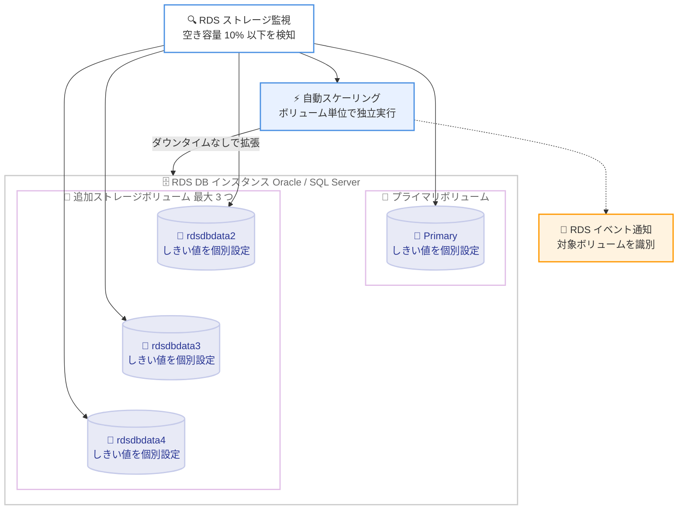

# Amazon RDS for Oracle / SQL Server - 追加ストレージボリュームのストレージ自動スケーリング対応

**リリース日**: 2026 年 10 月 29 日
**サービス**: Amazon RDS for Oracle、Amazon RDS for SQL Server
**機能**: 追加ストレージボリュームに対するストレージ自動スケーリング (Storage Autoscaling on Additional Storage Volumes)

📊 [このアップデートのインフォグラフィックを見る](https://takech9203.github.io/aws-news-summary/20261029-amazon-rds-oracle-sqlserver-autoscaling-additional-storage-volumes.html)

## 概要

Amazon RDS for Oracle および Amazon RDS for SQL Server において、追加ストレージボリューム (Additional Storage Volumes) に対するストレージ自動スケーリングがサポートされました。これまでプライマリストレージボリュームのみで利用可能だったストレージ自動スケーリングが、最大 3 つまでアタッチできる追加ストレージボリュームにも拡張され、各ボリュームを独立して自動拡張できるようになります。

RDS for Oracle と RDS for SQL Server では、追加ストレージボリュームを使用することでインスタンスあたり合計 256 TiB までストレージ容量を拡張できます。今回のアップデートにより、各追加ストレージボリュームに最大ストレージしきい値 (Maximum Storage Threshold) を設定するだけで、RDS が実際のストレージ使用量を継続的に監視し、使用量がプロビジョニング容量に近づくとダウンタイムなしで自動的に容量を拡張します。

本機能は新規および既存の DB インスタンスの両方で利用でき、AWS Management Console、AWS CLI、RDS API から設定できます。大規模なデータベースワークロードを運用し、ストレージ容量の計画や手動拡張に運用負荷を感じていたデータベース管理者にとって価値のあるアップデートです。

**アップデート前の課題**

- ストレージ自動スケーリングはプライマリストレージボリュームのみが対象で、追加ストレージボリュームには適用できなかった
- 追加ストレージボリュームの容量は、将来の需要を予測して手動でプロビジョニングする必要があった
- 容量を過小に見積もるとストレージ枯渇によるダウンタイムのリスクがあり、過大に見積もると未使用容量に対する不要なコストが発生していた

**アップデート後の改善**

- 追加ストレージボリュームごとに最大ストレージしきい値を設定し、ストレージ自動スケーリングを個別に有効化できるようになった
- RDS が各ボリュームのストレージ使用量を継続的に監視し、空き容量が少なくなるとダウンタイムなしで自動的に拡張するようになった
- 容量計画の手間と、過小 / 過大プロビジョニングのリスクを軽減できるようになった

## アーキテクチャ図



プライマリボリュームと最大 3 つの追加ストレージボリュームそれぞれに最大ストレージしきい値を設定でき、RDS が各ボリュームを独立して監視・自動拡張します。

## サービスアップデートの詳細

### 主要機能

1. **ボリューム単位の独立した自動スケーリング**
   - プライマリボリュームに加え、各追加ストレージボリューム (Oracle: rdsdbdata2 / rdsdbdata3 / rdsdbdata4、SQL Server: H: / I: / J: ドライブ) ごとにストレージ自動スケーリングを有効化できる
   - 各ボリュームが独自の最大ストレージしきい値を持ち、RDS はボリュームごとに独立して評価・スケーリングを実行する
   - 自動スケーリングのトリガー条件、拡張増分、しきい値の制約はプライマリボリュームと同一

2. **ダウンタイムなしの自動拡張**
   - 空き容量が割り当てストレージの 10% 以下の状態が 5 分以上継続すると、ストレージ変更が自動的に開始される
   - 拡張増分は「10 GiB」「現在の割り当てストレージの 10%」「過去 1 時間の FreeStorageSpace メトリクスに基づく今後 7 時間の予測増加量」のうち最大の値
   - 自動スケーリングの有効化・設定変更に DB の再起動は不要で、ダウンタイムは発生しない

3. **ボリュームを識別できるイベント通知**
   - 自動スケーリングによる変更の開始・完了時に RDS-EVENT-0541 / RDS-EVENT-0542 が発行される
   - ボリュームが最大ストレージしきい値に到達・接近した場合や、スケーリングできない場合には RDS-EVENT-0594 / RDS-EVENT-0595 / RDS-EVENT-0593 が発行され、対象ボリュームを識別できる
   - しきい値接近の通知を避けるには、各ボリュームのしきい値を割り当てストレージの 26% 以上大きい値に設定することが推奨される

4. **新規・既存インスタンスの両方に対応**
   - 新規 DB インスタンス作成時、および既存 DB インスタンスの変更時のどちらでも設定可能
   - AWS Management Console、AWS CLI、RDS API から設定できる

## 技術仕様

### 追加ストレージボリュームの仕様

| 項目 | 詳細 |
|------|------|
| 対象エンジン | RDS for Oracle、RDS for SQL Server |
| 追加可能なボリューム数 | 最大 3 つ |
| 合計ストレージ容量 | インスタンスあたり最大 256 TiB |
| ボリューム名 (Oracle) | rdsdbdata2、rdsdbdata3、rdsdbdata4 |
| ボリューム名 (SQL Server) | H:、I:、J: |
| 対応ストレージタイプ | gp3、io2 Block Express |
| 最小ストレージサイズ | 200 GiB |
| 自動スケーリングのトリガー | 空き容量が割り当てストレージの 10% 以下の状態が 5 分以上継続 |
| 拡張増分 | 10 GiB、割り当てストレージの 10%、7 時間先の予測増加量のうち最大値 |
| 変更回数の制限 | 24 時間以内に最大 4 回まで |

### 設定パラメータ

`modify-db-instance` の `--additional-storage-volumes` JSON 配列内で、ボリュームごとに `MaxAllocatedStorage` フィールドを設定します。

```json
[
  {
    "VolumeName": "rdsdbdata2",
    "StorageType": "gp3",
    "AllocatedStorage": 5000,
    "MaxAllocatedStorage": 10000
  }
]
```

- `MaxAllocatedStorage` が `AllocatedStorage` より大きい場合: 当該ボリュームのストレージ自動スケーリングが有効になる
- `MaxAllocatedStorage` が `AllocatedStorage` と同じ値の場合: 当該ボリュームのストレージ自動スケーリングが無効になる

## 設定方法

### 前提条件

1. RDS for Oracle または RDS for SQL Server の DB インスタンスを使用していること
2. 追加ストレージボリュームが gp3 または io2 ストレージタイプであること (マグネティックストレージは自動スケーリング非対応)
3. 最大ストレージしきい値は現在の割り当てストレージより 10% 以上大きい値に設定すること (推奨は 26% 以上)

### 手順

#### ステップ 1: 追加ストレージボリュームの自動スケーリングを有効化

```bash
aws rds modify-db-instance \
    --db-instance-identifier mydbinstance \
    --additional-storage-volumes '[
        {
            "VolumeName": "rdsdbdata2",
            "StorageType": "gp3",
            "AllocatedStorage": 5000,
            "MaxAllocatedStorage": 10000
        }
    ]'
```

追加ストレージボリューム rdsdbdata2 の最大ストレージしきい値を 10,000 GiB に設定し、ストレージ自動スケーリングを有効化します。`MaxAllocatedStorage` に `AllocatedStorage` より大きい値を指定することで自動スケーリングが有効になります。

#### ステップ 2: 新しい追加ストレージボリュームを自動スケーリング付きで追加

```bash
aws rds modify-db-instance \
    --db-instance-identifier mydbinstance \
    --additional-storage-volumes '[
        {
            "VolumeName": "rdsdbdata3",
            "StorageType": "gp3",
            "AllocatedStorage": 1000,
            "StorageThroughput": 725,
            "MaxAllocatedStorage": 5000
        }
    ]'
```

1,000 GiB の gp3 ボリューム rdsdbdata3 を新規追加し、同時に最大 5,000 GiB までの自動スケーリングを有効化します。追加ストレージボリュームの追加は `--no-apply-immediately` の指定に関係なく即時適用される点に注意してください。

#### ステップ 3: 設定の確認

```bash
aws rds describe-db-instances \
    --db-instance-identifier mydbinstance \
    --query "DBInstances[0].AdditionalStorageVolumes"
```

DB インスタンスの追加ストレージボリューム設定を取得し、各ボリュームの `AllocatedStorage` と `MaxAllocatedStorage` の値を確認します。

コンソールから設定する場合は、DB インスタンスの [設定] タブで [Add storage volume] を選択し、ボリュームの追加・変更ダイアログで [Maximum storage threshold] を設定します。

## メリット

### ビジネス面

- **運用コストの削減**: 追加ストレージボリュームの容量計画と手動拡張作業が不要になり、データベース管理者の運用負荷を軽減できる
- **コスト最適化**: 将来の需要を見越した過大なプロビジョニングが不要になり、実際に使用するストレージに応じた支払いが可能になる
- **可用性の向上**: ストレージ枯渇による計画外ダウンタイムのリスクを低減できる

### 技術面

- **ボリューム単位の細かな制御**: プライマリと追加ボリュームのそれぞれに個別のしきい値を設定でき、データ特性に応じた拡張ポリシーを適用できる
- **ダウンタイムなしの拡張**: 自動スケーリングの有効化および拡張処理は DB の再起動を必要とせず、稼働中のワークロードに影響を与えない
- **可観測性**: 対象ボリュームを識別できる RDS イベントが発行されるため、Amazon SNS などと組み合わせた通知・監視の自動化が容易

## デメリット・制約事項

### 制限事項

- 自動スケーリングでストレージを縮小することはできない (一度拡張した割り当てストレージは減らせない)
- ストレージ変更は 24 時間以内に最大 4 回までで、前回のストレージ最適化が完了するまで次の変更は実行されない
- 大規模なデータロードでは自動スケーリングが追いつかず、ストレージフル状態が数時間継続する可能性がある
- マグネティックストレージでは自動スケーリングを使用できない
- 自動スケーリング操作は AWS CloudTrail に記録されない

### 考慮すべき点

- 最大ストレージしきい値は現在の割り当てストレージの 10% 以上大きい値が必須で、イベント通知を避けるには 26% 以上が推奨される
- io1 / io2 Block Express または gp3 ボリュームでは、IOPS と最大ストレージしきい値の比率が許容範囲内である必要がある
- 手動のストレージ変更と自動スケーリングが同時に開始された場合、手動の変更が優先され自動スケーリングはキャンセルされる
- 使用パターンに異常がある場合に意図せず大きな容量まで拡張されないよう、しきい値は実際の利用傾向に基づいて慎重に設定する

## ユースケース

### ユースケース 1: SQL Server のデータとログを分離した構成での自動容量管理

**シナリオ**: RDS for SQL Server でデータファイルをプライマリボリューム、インデックスや tempdb 関連のデータを追加ボリューム (H: ドライブ) に分離している。データ増加のペースがドライブごとに異なり、個別の容量管理が負担になっている。

**実装例**:
```bash
aws rds modify-db-instance \
    --db-instance-identifier sqlserver-prod \
    --max-allocated-storage 8000 \
    --additional-storage-volumes '[
        {
            "VolumeName": "H:",
            "StorageType": "gp3",
            "AllocatedStorage": 2000,
            "MaxAllocatedStorage": 6000
        }
    ]'
```

**効果**: プライマリと H: ドライブそれぞれが使用状況に応じて独立して自動拡張されるため、ドライブごとの容量監視と手動拡張作業が不要になる。

### ユースケース 2: Oracle のホットデータとヒストリカルデータの階層化

**シナリオ**: RDS for Oracle で高パフォーマンスが必要なデータを io2 のプライマリボリュームに、増加し続けるヒストリカルデータを低コストな gp3 の追加ボリュームに配置している。ヒストリカルデータの増加量が予測しにくい。

**実装例**:
```bash
aws rds modify-db-instance \
    --db-instance-identifier oracle-prod \
    --additional-storage-volumes '[
        {
            "VolumeName": "rdsdbdata2",
            "StorageType": "gp3",
            "AllocatedStorage": 10000,
            "MaxAllocatedStorage": 30000
        }
    ]'
```

**効果**: ヒストリカルデータ用ボリュームが需要に応じて最大 30,000 GiB まで自動拡張され、過大プロビジョニングによるコストと枯渇リスクの両方を回避できる。

### ユースケース 3: 急成長するワークロードでの 256 TiB までの段階的拡張

**シナリオ**: 急成長中の SaaS アプリケーションで、単一ボリュームの上限を超えるストレージが必要になる見込みがある。複数の追加ボリュームを段階的に追加しながら、それぞれの容量管理を自動化したい。

**実装例**:
```bash
aws rds modify-db-instance \
    --db-instance-identifier saas-prod \
    --additional-storage-volumes '[
        {
            "VolumeName": "rdsdbdata2",
            "StorageType": "gp3",
            "AllocatedStorage": 5000,
            "MaxAllocatedStorage": 20000
        },
        {
            "VolumeName": "rdsdbdata3",
            "StorageType": "gp3",
            "AllocatedStorage": 5000,
            "MaxAllocatedStorage": 20000
        }
    ]'
```

**効果**: 複数ボリュームを組み合わせてインスタンスあたり最大 256 TiB まで拡張可能な構成を取りつつ、各ボリュームの拡張を自動化し運用負荷を最小限に抑えられる。

## 料金

本機能の利用自体に追加料金はかかりません。プロビジョニングされたストレージリソースに対してのみ料金が発生します。自動スケーリングによってストレージが拡張された場合、拡張後の割り当てストレージ容量に応じた標準の RDS ストレージ料金が適用されます。

料金の詳細は [Amazon RDS for Oracle の料金](https://aws.amazon.com/rds/oracle/pricing/) および [Amazon RDS for SQL Server の料金](https://aws.amazon.com/rds/sqlserver/pricing/) を参照してください。

## 利用可能リージョン

すべての AWS 商用リージョンおよび AWS GovCloud (US) リージョンで利用可能です。

## 関連サービス・機能

- **Amazon RDS ストレージ自動スケーリング**: プライマリボリュームに対する既存の自動スケーリング機能。今回のアップデートで追加ボリュームにも拡張された
- **Amazon CloudWatch**: FreeStorageSpace メトリクスによるストレージ使用量の監視。自動スケーリングの予測増分の算出にも利用される
- **Amazon RDS イベント通知**: 自動スケーリングの開始・完了やしきい値接近を Amazon SNS 経由で通知可能

## 参考リンク

- 📊 [インフォグラフィック](https://takech9203.github.io/aws-news-summary/20261029-amazon-rds-oracle-sqlserver-autoscaling-additional-storage-volumes.html)
- [公式発表 (What's New)](https://aws.amazon.com/about-aws/whats-new/2026/10/amazon-rds-oracle-sqlserver-autoscaling-additional-storage-volumes)
- [ドキュメント: Managing capacity automatically with Amazon RDS storage autoscaling](https://docs.aws.amazon.com/AmazonRDS/latest/UserGuide/USER_PIOPS.Autoscaling.html)
- [ドキュメント: Adding storage volumes](https://docs.aws.amazon.com/AmazonRDS/latest/UserGuide/USER_PIOPS.ModifyingExisting.AdditionalVolumes.html)
- [Amazon RDS for Oracle 製品ページ](https://aws.amazon.com/rds/oracle/)
- [Amazon RDS for SQL Server 製品ページ](https://aws.amazon.com/rds/sqlserver/)

## まとめ

RDS for Oracle および RDS for SQL Server の追加ストレージボリュームがストレージ自動スケーリングに対応し、最大 256 TiB 構成の大規模データベースでもボリューム単位の容量管理を自動化できるようになりました。追加ストレージボリュームを使用している場合は、各ボリュームに適切な最大ストレージしきい値 (割り当てストレージの 26% 以上大きい値を推奨) を設定し、ストレージ枯渇リスクと手動運用の負荷を低減することを推奨します。
