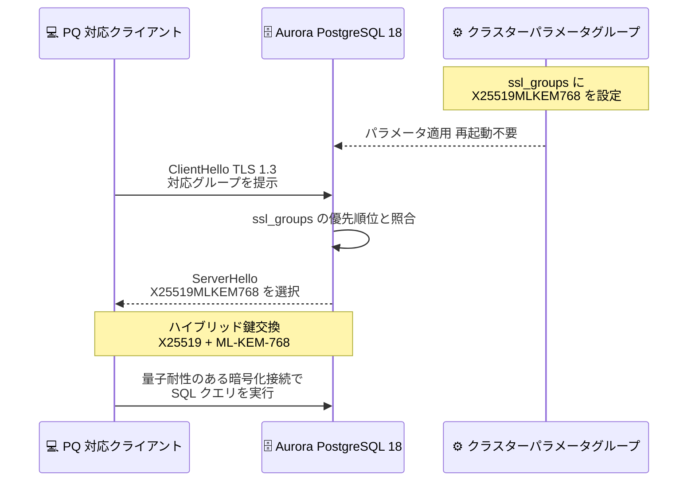

# Amazon Aurora - ポスト量子 TLS 鍵交換のサポート

**リリース日**: 2026 年 10 月 29 日
**サービス**: Amazon Aurora (PostgreSQL 互換エディション)
**機能**: ポスト量子 TLS (PQ-TLS) 鍵交換のサポート

📊 [このアップデートのインフォグラフィックを見る](https://takech9203.github.io/aws-news-summary/20261029-aurora-postgresql-post-quantum-tls-key-exchange.html)

## 概要

Amazon Aurora PostgreSQL 互換エディションが、ポスト量子 TLS (PQ-TLS) 鍵交換のサポートを発表しました。Aurora PostgreSQL 18 以降において、クラスターパラメータ `ssl_groups` を変更することで、NIST 標準化済みのポスト量子鍵カプセル化アルゴリズム ML-KEM を組み合わせたハイブリッド鍵交換グループ (`X25519MLKEM768`、`SecP256r1MLKEM768`) を選択できるようになります。

このアップデートは、将来の量子コンピュータによる解読に備えて現在の暗号化通信を記録しておく「Harvest Now, Decrypt Later (今収集して後で解読する)」攻撃への対策として重要です。金融、医療、公共機関など、長期間の機密性が求められるデータを扱うユーザーにとって、データベース接続の通信経路を量子耐性のある暗号で保護する選択肢が提供されます。

AWS は CloudFront、KMS、S3、Secrets Manager などのサービスエンドポイントで ML-KEM によるハイブリッド鍵交換を展開してきており、今回のアップデートにより、お客様が所有するデータベースリソースである Aurora PostgreSQL でもポスト量子暗号の採用が可能になりました。

**アップデート前の課題**

- Aurora PostgreSQL への TLS 接続では、鍵交換に古典的な楕円曲線アルゴリズム (X25519、prime256v1 など) のみが使用され、将来の量子コンピュータによる解読リスクに対応できなかった
- 暗号化された通信を現時点で記録し、将来量子コンピュータで解読する「Harvest Now, Decrypt Later」攻撃に対して、長期保存が必要な機密データの通信を保護する手段がなかった
- TLS 鍵交換に使用する名前付きグループをデータベース側で制御する手段が提供されていなかった

**アップデート後の改善**

- `ssl_groups` クラスターパラメータを変更することで、ML-KEM を組み合わせたハイブリッド鍵交換グループ (`X25519MLKEM768`、`SecP256r1MLKEM768`) を含む許可リストから暗号グループを選択できるようになった
- 組織のセキュリティ要件やコンプライアンス要件に合わせて、サーバーが受け入れる鍵交換グループとその優先順位を制御できるようになった
- `ssl_groups` は動的パラメータであり、DB クラスターの再起動なしで適用できるようになった

## アーキテクチャ図



クライアントと Aurora PostgreSQL の間の TLS 1.3 ハンドシェイクにおいて、`ssl_groups` パラメータで設定した優先順位に基づきハイブリッド鍵交換グループがネゴシエートされる流れを示しています。

## サービスアップデートの詳細

### 主要機能

1. **ポスト量子ハイブリッド鍵交換グループのサポート**
   - 古典的な楕円曲線暗号 (X25519 または P-256) と NIST FIPS 203 で標準化された ML-KEM-768 を組み合わせたハイブリッド方式
   - `X25519MLKEM768` と `SecP256r1MLKEM768` の 2 つのハイブリッドグループを許可リストから選択可能
   - ハイブリッド方式のため、ML-KEM に万一問題が見つかった場合でも古典暗号による安全性が維持される

2. **`ssl_groups` クラスターパラメータによる柔軟な制御**
   - TLS 鍵交換に使用する名前付きグループをコロン区切りのリストで指定
   - リストの順序がサーバー側の優先順位となり、クライアントも対応する最初のグループが接続に使用される
   - 動的パラメータのため、変更時に DB クラスターの再起動が不要

3. **セキュリティ要件に応じた構成の強制**
   - `ssl_groups` は名前付きグループを使用する鍵交換にのみ適用され、RSA 鍵交換を使用する TLS 1.2 暗号スイートでは無視される
   - 指定したグループのみを使用させるには、`rds.force_ssl` を有効化した上で、`ssl_min_protocol_version` を `TLSv1.3` に設定するか、TLS 1.2 接続向けに `ssl_ciphers` を ECDHE ベースのスイートに制限する
   - ML-KEM グループは TLS 1.3 が必須

## 技術仕様

### `ssl_groups` パラメータの仕様 (Aurora PostgreSQL 18)

| 項目 | 詳細 |
|------|------|
| 対象エンジン | Aurora PostgreSQL 互換エディション 18 以降 |
| パラメータ種別 | DB クラスターパラメータ (動的、再起動不要) |
| デフォルト値 | `prime256v1:X25519` |
| 許可リスト | `X25519MLKEM768`、`SecP256r1MLKEM768`、`X25519`、`prime256v1`、`secp384r1` |
| ML-KEM 利用時の要件 | TLS 1.3 (`ssl_min_protocol_version` を `TLSv1.3` に設定して強制可能) |
| 優先順位 | リストの記載順がサーバー側の優先順位 |

### ハイブリッド鍵交換グループの構成要素

| グループ名 | 古典アルゴリズム | ポスト量子アルゴリズム |
|------------|------------------|------------------------|
| `X25519MLKEM768` | X25519 (Curve25519 ECDH) | ML-KEM-768 (FIPS 203) |
| `SecP256r1MLKEM768` | P-256 ECDH | ML-KEM-768 (FIPS 203) |

### パラメータ設定例

```bash
# DB クラスターパラメータグループでの設定値の例
# ポスト量子グループを最優先にし、古典グループをフォールバックとして許可
ssl_groups = "X25519MLKEM768:SecP256r1MLKEM768:X25519:prime256v1"
```

## 設定方法

### 前提条件

1. Aurora PostgreSQL 18 以降の DB クラスターを使用していること
2. カスタム DB クラスターパラメータグループを作成し、DB クラスターに関連付けていること (デフォルトのパラメータグループは変更不可)
3. ML-KEM グループを使用する場合、クライアント側のライブラリ (OpenSSL など) が TLS 1.3 およびハイブリッドポスト量子鍵交換に対応していること

### 手順

#### ステップ 1: カスタム DB クラスターパラメータグループの作成

```bash
aws rds create-db-cluster-parameter-group \
    --db-cluster-parameter-group-name my-aurora-pg18-pqtls \
    --db-parameter-group-family aurora-postgresql18 \
    --description "Aurora PostgreSQL 18 with PQ-TLS key exchange"
```

Aurora PostgreSQL 18 ファミリー用のカスタム DB クラスターパラメータグループを作成しています。既存のカスタムパラメータグループがある場合、このステップは不要です。

#### ステップ 2: `ssl_groups` パラメータの変更

```bash
aws rds modify-db-cluster-parameter-group \
    --db-cluster-parameter-group-name my-aurora-pg18-pqtls \
    --parameters "ParameterName=ssl_groups,ParameterValue='X25519MLKEM768:X25519:prime256v1',ApplyMethod=immediate"
```

`ssl_groups` パラメータにハイブリッドポスト量子グループ `X25519MLKEM768` を最優先として設定しています。動的パラメータのため `ApplyMethod=immediate` で再起動なしに適用されます。

#### ステップ 3: ML-KEM の使用を強制する場合の追加設定

```bash
aws rds modify-db-cluster-parameter-group \
    --db-cluster-parameter-group-name my-aurora-pg18-pqtls \
    --parameters \
    "ParameterName=rds.force_ssl,ParameterValue=1,ApplyMethod=immediate" \
    "ParameterName=ssl_min_protocol_version,ParameterValue=TLSv1.3,ApplyMethod=immediate"
```

SSL/TLS 接続を必須化し、最小プロトコルバージョンを TLS 1.3 に設定しています。ML-KEM グループは TLS 1.3 が必須のため、この設定により指定したポスト量子グループの使用を確実にできます。TLS 1.3 に対応していないクライアントは接続できなくなる点に注意してください。

#### ステップ 4: 接続の確認

```sql
-- sslinfo 拡張機能で接続の暗号化状態を確認
CREATE EXTENSION IF NOT EXISTS sslinfo;
SELECT ssl_is_used(), ssl_cipher();
```

データベースに接続後、`sslinfo` 拡張機能を使用して SSL/TLS が使用されていることと、ネゴシエートされた暗号スイートを確認しています。

## メリット

### ビジネス面

- **長期的なデータ機密性の確保**: 「Harvest Now, Decrypt Later」攻撃への対策により、10 年以上の機密性が求められる金融・医療・個人情報などのデータ通信を将来の量子コンピュータの脅威から保護できる
- **コンプライアンス対応の先行**: 各国政府機関 (CISA、NIST など) が推奨するポスト量子暗号移行を早期に進めることで、将来の規制要件に先行して対応できる
- **追加コストなし**: パラメータ変更のみで利用でき、追加料金は発生しない

### 技術面

- **ハイブリッド方式による安全性**: 古典暗号 (X25519 / P-256) と ML-KEM の両方の鍵交換を組み合わせるため、どちらか一方が破られても接続の機密性が維持される
- **再起動不要の動的パラメータ**: `ssl_groups` は動的パラメータのため、本番環境でもダウンタイムなしで段階的に導入できる
- **柔軟な優先順位制御**: リストの順序でサーバー側の優先順位を制御でき、PQ 対応クライアントと非対応クライアントが混在する移行期間にも対応できる

## デメリット・制約事項

### 制限事項

- Aurora PostgreSQL 18 以降でのみ利用可能 (Aurora MySQL 互換エディションは今回の発表の対象外)
- ML-KEM グループの使用には TLS 1.3 が必須
- `ssl_groups` は名前付きグループを使用する鍵交換にのみ適用され、RSA 鍵交換を使用する TLS 1.2 暗号スイートでは無視される

### 考慮すべき点

- クライアント側のライブラリ (OpenSSL、libpq、JDBC ドライバーなど) がハイブリッドポスト量子鍵交換に対応している必要があり、未対応クライアントとの互換性を考慮したグループリストの設計が必要
- `ssl_min_protocol_version` を `TLSv1.3` に設定すると、TLS 1.3 非対応の既存クライアントが接続できなくなるため、事前のクライアント棚卸しが必要
- ML-KEM の公開鍵と暗号文は古典暗号より大きいため、ハンドシェイク時のデータ量がわずかに増加する (接続確立後のクエリ性能への影響はない)

## ユースケース

### ユースケース 1: 金融機関における長期機密データの通信保護

**シナリオ**: 金融機関が顧客の取引データを Aurora PostgreSQL で管理しており、規制により 10 年以上の機密性保持が求められている。将来の量子コンピュータによる解読リスクに今から備えたい。

**実装例**:
```bash
aws rds modify-db-cluster-parameter-group \
    --db-cluster-parameter-group-name finance-aurora-pg18 \
    --parameters \
    "ParameterName=ssl_groups,ParameterValue='X25519MLKEM768:SecP256r1MLKEM768',ApplyMethod=immediate" \
    "ParameterName=rds.force_ssl,ParameterValue=1,ApplyMethod=immediate" \
    "ParameterName=ssl_min_protocol_version,ParameterValue=TLSv1.3,ApplyMethod=immediate"
```

**効果**: ポスト量子ハイブリッドグループのみを許可することで、すべてのデータベース接続が量子耐性のある鍵交換で保護され、「Harvest Now, Decrypt Later」攻撃のリスクを低減できる。

### ユースケース 2: 段階的なポスト量子暗号への移行

**シナリオ**: PQ 対応クライアントと非対応クライアントが混在する環境で、接続互換性を維持しながらポスト量子暗号への移行を段階的に進めたい。

**実装例**:
```bash
aws rds modify-db-cluster-parameter-group \
    --db-cluster-parameter-group-name myapp-aurora-pg18 \
    --parameters "ParameterName=ssl_groups,ParameterValue='X25519MLKEM768:X25519:prime256v1',ApplyMethod=immediate"
```

**効果**: PQ 対応クライアントは自動的に `X25519MLKEM768` で接続し、未対応クライアントは従来の `X25519` などにフォールバックするため、ダウンタイムや接続断なしで移行を進められる。移行完了後に古典グループをリストから削除すれば完全移行できる。

### ユースケース 3: 公共機関におけるポスト量子暗号移行計画の実行

**シナリオ**: 政府機関のシステムで、CISA や NIST のガイダンスに沿った暗号インベントリの整備とポスト量子暗号移行計画を進めており、データベース層の対応を開始したい。

**実装例**:
```sql
-- 接続ごとの暗号利用状況を確認し、移行前のインベントリを作成
CREATE EXTENSION IF NOT EXISTS sslinfo;
SELECT ssl_is_used(), ssl_version(), ssl_cipher();
```

**効果**: 現状の TLS 利用状況を把握した上で `ssl_groups` によるポスト量子グループへの切り替えを計画的に実施でき、暗号移行計画のマイルストーンとしてデータベース層の量子耐性化を達成できる。

## 料金

ポスト量子 TLS 鍵交換の利用に追加料金は発生しません。Aurora PostgreSQL の標準料金 (インスタンス、ストレージ、I/O など) のみが適用されます。

## 利用可能リージョン

公式発表ではリージョンの明記はありません。Aurora PostgreSQL の SSL/TLS サポートはすべての AWS リージョンで利用可能であり、本機能は Aurora PostgreSQL 18 以降が利用可能なリージョンで使用できます。最新の対応状況は公式ドキュメントを確認してください。

## 関連サービス・機能

- **AWS KMS / Amazon S3 / AWS Secrets Manager**: サービスエンドポイントで ML-KEM によるハイブリッドポスト量子 TLS を既にサポートしており、今回のアップデートでデータベース層にも同様の保護が拡大
- **AWS-LC**: AWS のオープンソース暗号ライブラリで、ML-KEM を FIPS 140-3 検証に含めた初のオープンソース暗号モジュール
- **Elastic Load Balancing**: ロードバランサーで PQ 対応 TLS ポリシーを設定可能であり、アプリケーション層からデータベース層まで一貫したポスト量子対応を構成できる
- **DB クラスターパラメータグループ**: `ssl_groups`、`ssl_ciphers`、`ssl_tls13_ciphers`、`rds.force_ssl` など TLS 関連設定を一元管理する仕組み

## 参考リンク

- 📊 [インフォグラフィック](https://takech9203.github.io/aws-news-summary/20261029-aurora-postgresql-post-quantum-tls-key-exchange.html)
- [公式発表 (What's New)](https://aws.amazon.com/about-aws/whats-new/2026/10/aurora-postgresql-post-quantum-tls-key-exchange/)
- [ドキュメント: Aurora PostgreSQL の TLS 鍵交換グループ](https://docs.aws.amazon.com/AmazonRDS/latest/AuroraUserGuide/AuroraPostgreSQL.Security.html#PostgreSQL.Concepts.General.SSL.Groups)
- [AWS ポスト量子暗号への取り組み](https://aws.amazon.com/security/post-quantum-cryptography/)
- [Amazon Aurora 製品ページ](https://aws.amazon.com/rds/aurora/)
- [Amazon Aurora 料金ページ](https://aws.amazon.com/rds/aurora/pricing/)

## まとめ

Aurora PostgreSQL 18 以降でポスト量子 TLS 鍵交換がサポートされ、`ssl_groups` パラメータの変更のみで ML-KEM を組み合わせたハイブリッド鍵交換を利用できるようになりました。長期的な機密性が求められるデータを扱うシステムでは、「Harvest Now, Decrypt Later」攻撃への対策として早期の導入を検討する価値があります。まずはクライアントライブラリの PQ-TLS 対応状況を確認し、古典グループをフォールバックとして残した段階的な移行から始めることを推奨します。
