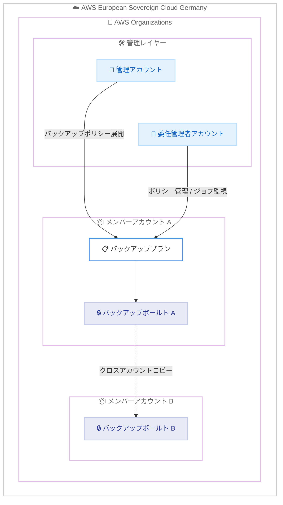

# AWS Backup - AWS European Sovereign Cloud でのクロスアカウント管理とクロスアカウントバックアップのサポート

**リリース日**: 2026 年 10 月 29 日
**サービス**: AWS Backup
**機能**: Cross-account management and cross-account backup in the AWS European Sovereign Cloud

📊 [このアップデートのインフォグラフィックを見る](https://takech9203.github.io/aws-news-summary/20261029-aws-backup-cross-account-esc.html)
<!-- INFOGRAPHIC_BASE_URL は環境変数から取得 -->

## 概要

AWS Backup のクロスアカウント管理 (cross-account management)、クロスアカウントバックアップ (cross-account backup)、および委任管理者 (delegated administrator) 機能が、AWS European Sovereign Cloud (Germany) リージョンで利用可能になりました。これらの機能により、AWS Organizations を利用する組織は、組織内の複数アカウントにわたるバックアップの一元的な管理、監視、コピーを実現できます。

クロスアカウント管理では、AWS Organizations の管理アカウントまたは委任管理者アカウントから組織全体にバックアップポリシーを展開し、すべてのメンバーアカウントのバックアップ、コピー、復元ジョブを単一の場所から監視できます。クロスアカウントバックアップでは、復旧ポイントを組織内の別アカウントのバックアップボールトへコピーでき、ソースアカウントでの偶発的または悪意のある削除に対する保護を強化できます。

データ主権に関する厳格な要件を持つ欧州の規制対象業界の組織は、AWS European Sovereign Cloud 内で完結する形で、マルチアカウント環境のデータ保護ガバナンスを強化できるようになります。

**アップデート前の課題**

- AWS European Sovereign Cloud (Germany) リージョンでは、AWS Backup のクロスアカウント管理機能が利用できず、アカウントごとに個別にバックアップポリシーを設定・運用する必要があった
- 復旧ポイントを組織内の別アカウントへコピーできず、ソースアカウントの侵害や誤操作による削除に対する保護が限定的だった
- 組織全体のバックアップ運用を担当するチームに管理アカウントへのアクセスを付与する必要があり、最小権限の原則に反する運用になりがちだった

**アップデート後の改善**

- 管理アカウントまたは委任管理者アカウントから、組織全体へバックアップポリシーを一括展開し、全メンバーアカウントのジョブを一元監視できるようになった
- 復旧ポイントを組織内の別アカウントのバックアップボールトへコピーできるようになり、削除や侵害に対する多層防御を実現できるようになった
- メンバーアカウントを委任管理者として登録することで、管理アカウントへのアクセスを付与せずに組織全体のバックアップ管理を委任できるようになった

## アーキテクチャ図



管理アカウントまたは委任管理者アカウントから組織全体にバックアップポリシーを展開し、メンバーアカウントの復旧ポイントを別アカウントのボールトへコピーする構成です。すべて AWS European Sovereign Cloud 内で完結します。

## サービスアップデートの詳細

### 主要機能

1. **クロスアカウント管理**
   - AWS Organizations の管理アカウントまたは委任管理者アカウントから、組織全体へバックアップポリシーを展開できる
   - 組織内のすべてのメンバーアカウントにおけるバックアップジョブ、コピージョブ、復元ジョブを単一の場所から監視できる
   - アカウントごとの個別設定が不要になり、組織全体で一貫したデータ保護基準を適用できる

2. **クロスアカウントバックアップ**
   - 復旧ポイントを、組織内の別アカウントにあるバックアップボールトへコピーできる
   - ソースアカウントでの偶発的または悪意のある削除に対する保護を追加できる
   - ランサムウェア対策やアカウント侵害時の復旧性向上に有効

3. **委任管理者**
   - メンバーアカウントを委任管理者として登録できる
   - バックアップ運用チームは、管理アカウントへのアクセスなしに組織全体のバックアップ管理を実行できる
   - 最小権限の原則に沿った運用体制を構築できる

## 技術仕様

### 機能の構成要素

| 項目 | 詳細 |
|------|------|
| 前提サービス | AWS Organizations (全機能が有効化されていること) |
| ポリシー展開元 | 管理アカウントまたは委任管理者アカウント |
| ポリシータイプ | AWS Organizations のバックアップポリシー |
| コピー先 | 組織内の別アカウントのバックアップボールト |
| 監視対象 | バックアップジョブ、コピージョブ、復元ジョブ |
| 対象リージョン | AWS European Sovereign Cloud (Germany) リージョン |

### バックアップボールトのアクセスポリシー例

クロスアカウントコピーを受け入れるには、コピー先アカウントのボールトでコピー操作を許可します。

```json
{
  "Version": "2012-10-17",
  "Statement": [
    {
      "Sid": "AllowCrossAccountCopy",
      "Effect": "Allow",
      "Principal": "*",
      "Action": "backup:CopyIntoBackupVault",
      "Resource": "*",
      "Condition": {
        "StringEquals": {
          "aws:PrincipalOrgID": "o-xxxxxxxxxx"
        }
      }
    }
  ]
}
```

## 設定方法

### 前提条件

1. AWS Organizations が全機能モードで有効化されていること
2. AWS European Sovereign Cloud (Germany) リージョンを利用できること
3. 管理アカウントで AWS Backup のクロスアカウント管理 (サービスオプトイン) を有効化できる権限があること

### 手順

#### ステップ1: クロスアカウント管理の有効化

```bash
aws organizations enable-aws-service-access \
  --service-principal backup.amazonaws.com
```

管理アカウントで AWS Backup と AWS Organizations の信頼されたアクセスを有効化します。これにより、組織全体へのバックアップポリシー展開が可能になります。

#### ステップ2: 委任管理者の登録 (オプション)

```bash
aws organizations register-delegated-administrator \
  --account-id 111122223333 \
  --service-principal backup.amazonaws.com
```

バックアップ運用を担当するメンバーアカウントを委任管理者として登録します。以降、このアカウントから組織全体のバックアップポリシー管理とジョブ監視が可能になります。

#### ステップ3: バックアップポリシーの作成と展開

```bash
aws organizations create-policy \
  --name "org-backup-policy" \
  --type BACKUP_POLICY \
  --content file://backup-policy.json \
  --description "Organization-wide backup policy"

aws organizations attach-policy \
  --policy-id p-xxxxxxxx \
  --target-id r-xxxx
```

組織全体に適用するバックアップポリシーを作成し、組織ルートまたは OU にアタッチします。ポリシーはメンバーアカウントに自動的に展開されます。

#### ステップ4: クロスアカウントコピーの設定

バックアッププランのコピーアクションで、コピー先として組織内の別アカウントのボールト ARN を指定します。コピー先ボールトには、前述のアクセスポリシーでコピー操作の許可を設定しておきます。

## メリット

### ビジネス面

- **ガバナンスの強化**: 組織全体で一貫したバックアップ基準を強制でき、コンプライアンス要件への対応が容易になる
- **データ主権要件との両立**: AWS European Sovereign Cloud 内で完結するマルチアカウントデータ保護により、欧州の規制対象業界の要件を満たしやすくなる
- **運用コストの削減**: アカウントごとの個別設定・監視が不要になり、バックアップ運用の工数を削減できる

### 技術面

- **多層防御の実現**: 別アカウントへの復旧ポイントコピーにより、ソースアカウント侵害時にもバックアップを保全できる
- **一元的な可視性**: 全メンバーアカウントのバックアップ、コピー、復元ジョブを単一の場所から監視できる
- **最小権限の運用**: 委任管理者により、管理アカウントへのアクセスを付与せずにバックアップ管理を委任できる

## デメリット・制約事項

### 制限事項

- AWS Organizations の利用が前提であり、スタンドアロンアカウントでは利用できない
- クロスアカウントバックアップのコピー先は組織内のアカウントに限られる
- 対象リージョンは AWS European Sovereign Cloud (Germany) リージョンであり、AWS European Sovereign Cloud は商用リージョンから独立したパーティションとして運用される

### 考慮すべき点

- コピー先ボールトのアクセスポリシーと KMS キーの共有設定を適切に構成する必要がある
- クロスアカウントコピーにはコピー先でのストレージ料金が発生するため、保持期間設計とコスト見積もりが必要
- 委任管理者アカウントの権限範囲を明確にし、運用ルールを整備することが望ましい

## ユースケース

### ユースケース1: 規制対象業界における組織全体のバックアップガバナンス

**シナリオ**: 欧州の金融機関が、データ主権要件を満たしつつ、数十のメンバーアカウントに一貫したバックアップ基準を適用したい。

**実装例**:
```
1. AWS European Sovereign Cloud 上の管理アカウントでクロスアカウント管理を有効化
2. 日次バックアップ + 35 日保持のバックアップポリシーを組織ルートにアタッチ
3. 全アカウントのジョブ状況を委任管理者アカウントから一元監視
```

**効果**: アカウントごとの設定漏れを防止し、監査対応に必要な証跡を一元的に確保できる。

### ユースケース2: ランサムウェア対策としての別アカウント保管

**シナリオ**: ソースアカウントが侵害された場合でも復旧ポイントを保全できる体制を構築したい。

**実装例**:
```
1. バックアップ専用のメンバーアカウントを用意し、コピー先ボールトを作成
2. ボールトアクセスポリシーで組織内からのコピーのみを許可
3. 各アカウントのバックアッププランにクロスアカウントコピーアクションを追加
```

**効果**: ソースアカウントでの偶発的または悪意のある削除からバックアップを保護し、復旧性を高められる。

### ユースケース3: バックアップ運用チームへの権限委任

**シナリオ**: セキュリティポリシー上、運用チームに Organizations 管理アカウントへのアクセスを付与できない。

**実装例**:
```
1. 運用チーム用のメンバーアカウントを委任管理者として登録
2. 運用チームは委任管理者アカウントからポリシー管理とジョブ監視を実施
3. 管理アカウントへのアクセスは組織管理者のみに限定
```

**効果**: 最小権限の原則を維持しながら、組織全体のバックアップ運用を効率的に委任できる。

## 料金

これらの機能の利用に追加料金はありません。バックアップストレージ、クロスアカウントコピー、復元などに対して、標準の AWS Backup 料金が適用されます。

## 利用可能リージョン

- AWS European Sovereign Cloud (Germany) リージョン

## 関連サービス・機能

- **AWS Organizations**: バックアップポリシーの展開と委任管理者登録の基盤となるマルチアカウント管理サービス
- **AWS KMS**: クロスアカウントコピー時の復旧ポイント暗号化に使用するキー管理サービス
- **AWS Backup Audit Manager**: バックアップポリシーへの準拠状況を監査する機能で、ガバナンス強化と組み合わせて活用可能

## 参考リンク

- 📊 [インフォグラフィック](https://takech9203.github.io/aws-news-summary/20261029-aws-backup-cross-account-esc.html)
- [公式発表 (What's New)](https://aws.amazon.com/about-aws/whats-new/2026/10/aws-backup-cross-account-esc/)
- [ドキュメント: AWS Backup Developer Guide](https://docs.aws.amazon.com/aws-backup/)
- [ドキュメント: Managing AWS Backup resources across multiple AWS accounts](https://docs.aws.amazon.com/aws-backup/latest/devguide/manage-cross-account.html)
- [ドキュメント: Creating backup copies across AWS accounts](https://docs.aws.amazon.com/aws-backup/latest/devguide/create-cross-account-backup.html)
- [料金ページ](https://aws.amazon.com/backup/pricing/)

## まとめ

AWS European Sovereign Cloud (Germany) リージョンで AWS Backup のクロスアカウント管理、クロスアカウントバックアップ、委任管理者が利用可能になり、データ主権要件を満たしながらマルチアカウント環境のデータ保護ガバナンスを強化できるようになりました。同リージョンで複数アカウントを運用している組織は、バックアップポリシーの一元展開と別アカウントへの復旧ポイントコピーの導入を検討することを推奨します。
