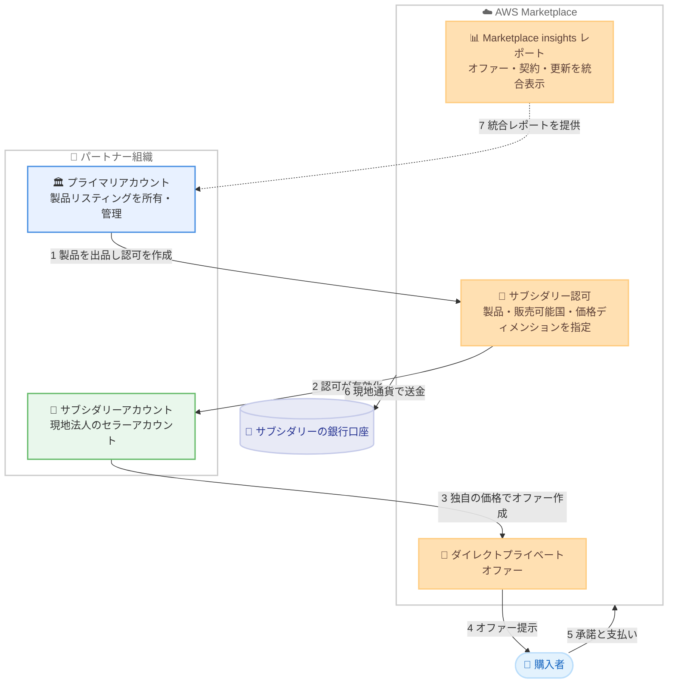

# AWS Marketplace - サブシダリーアカウント認可 (1 回の出品で複数子会社アカウントからの販売が可能に)

**リリース日**: 2026 年 10 月 29 日
**サービス**: AWS Marketplace
**機能**: サブシダリーアカウント認可 (Subsidiary Account Authorization)

📊 [このアップデートのインフォグラフィックを見る](https://takech9203.github.io/aws-news-summary/20261029-aws-marketplace-subsidiary-account-authorization.html)

## 概要

AWS Marketplace は、複数の法人 (リーガルエンティティ) を運営する AWS パートナー向けに、サブシダリーアカウント認可機能を発表しました。プライマリアカウントで製品を 1 回出品するだけで、接続された子会社のセラーアカウント (サブシダリーアカウント) がその製品のダイレクトプライベートオファーを作成して販売できるようになります。

国ごと、地域ごと、あるいは買収によって複数のセラーアカウントを持つパートナーは、これまで同じ製品リスティングを各アカウントに複製して個別に管理する必要がありました。本機能により、製品ポートフォリオの管理はプライマリアカウントに一元化しつつ、各サブシダリーアカウントは自身の現地税務上のアイデンティティで取引し、現地通貨での請求、独自の送金設定と銀行口座の利用が可能になります。

プライマリアカウントは AWS Marketplace insights レポートを通じて、接続されたすべてのサブシダリーアカウントにわたるオファー、契約、更新の統合レポートを確認できます。本機能は、AWS Marketplace が利用可能なすべての AWS リージョンで追加料金なしで利用できます。

**アップデート前の課題**

- 複数の法人でグローバルに販売するには、同一製品のリスティングを各セラーアカウントに複製して作成する必要があった
- 製品内容の変更があるたびに、すべてのアカウントのリスティングを個別に更新・保守する必要があり、運用負荷と内容の不整合リスクが大きかった
- 各アカウントの販売実績を横断的に把握するには、アカウントごとにレポートを確認する必要があった

**アップデート後の改善**

- プライマリアカウントで 1 回出品するだけで、認可されたサブシダリーアカウントがプライベートオファーを作成・販売できるようになった
- 製品リスティングの所有と保守はプライマリアカウントに一元化され、重複リスティングの管理が不要になった
- 各サブシダリーアカウントは独自の税務アイデンティティ、現地通貨、送金設定、銀行口座で取引でき、現地の財務処理との整合性を維持できる
- プライマリアカウントは AWS Marketplace insights レポートで、全サブシダリーアカウントのオファー・契約・更新を一元的に把握できるようになった

## アーキテクチャ図



プライマリアカウントが製品を出品して認可を発行し、サブシダリーアカウントが独自の価格・通貨でプライベートオファーを作成します。購入者からの支払いはサブシダリーアカウント自身の銀行口座に送金され、プライマリアカウントは統合レポートで全体を把握できます。

## サービスアップデートの詳細

### 主要機能

1. **製品の一元管理と販売の分散 (Subsidiary Authorization)**
   - 製品リスティングの所有・保守はプライマリアカウントが担い、サブシダリーアカウントはリスティング内容を変更できない
   - 認可ごとに「対象製品」「販売できるサブシダリーアカウント」「販売可能な国」「利用できる価格ディメンション」「作成できるオファータイプ (現時点ではプライベートオファーのみ)」を指定する
   - 認可は送信後数分で有効化され、サブシダリーアカウント側の承諾操作は不要

2. **サブシダリーアカウントによる独立した取引**
   - サブシダリーアカウントは自身が作成するすべてのオファーで Seller of Record (記録上の販売者) となり、顧客との契約を所有する
   - 独自の税務インタビューと KYC 検証を完了し、独自のローカル通貨、送金設定、銀行口座で取引する
   - 出品手数料・取引手数料は取引したアカウントに課金され、アカウント間でプール・相殺・再請求されない

3. **認可の更新と取り消し**
   - プライマリアカウントは認可の名前、説明、認可対象国、価格ディメンションをいつでも変更できる (変更は以後作成されるオファーにのみ適用)
   - 認可の取り消しはいつでも可能で、取り消し後サブシダリーアカウントは新規オファーを作成できなくなる
   - 取り消しは既存の公開済みオファーや締結済みの契約 (更新や送金を含む) には影響しない。取り消しは恒久的で、再認可には新しい認可の作成が必要

4. **統合レポーティング**
   - サブシダリー接続が承諾されると、プライマリアカウントは AWS Partner Central の Marketplace insights セクションで、全接続アカウントのパートナー帰属収益と AWS Marketplace insights レポートを一元的に確認できる
   - 各アカウントに個別にサインインする必要がない

## 技術仕様

### 認可の仕組み

| 項目 | 詳細 |
|------|------|
| 前提となる接続 | AWS Partner Central でプライマリアカウントが接続リクエストを送信し、サブシダリーアカウントが承諾 |
| 認可の単位 | 1 認可につき 1 製品。同一製品・同一アカウントへの複数認可は国と価格ディメンションの重複不可 |
| 一括送信 | 1 回の送信で最大 10 製品まで認可を作成可能 |
| 地理的粒度 | 国単位で指定 (国内の州・地域単位の指定は不可) |
| オファータイプ | ダイレクトプライベートオファーのみ (パブリックオファーは非対応) |
| 価格設定 | 認可自体に価格条件は含まれず、サブシダリーアカウントが独自に価格を設定 |
| 再販認可 | サブシダリーアカウントは、プライマリアカウントから認可された製品に対してチャネルパートナー向け再販認可を作成できない |

### プライマリアカウントとサブシダリーアカウントの責任分担

| 領域 | プライマリアカウント | サブシダリーアカウント |
|------|----------------------|------------------------|
| 製品リスティングの所有・保守 | 担当 (コンテンツと価格ディメンションを管理) | 不可 (販売のみ可能) |
| 認可の作成 | 接続済みアカウントに対して作成 | 不可 (自己認可や他アカウントへの引き渡しは不可) |
| Seller of Record | 自身のオファーのみ | 自身が作成するすべてのオファー |
| 通貨 | 自身の設定 | 自身の AWS Marketplace 支払い設定の通貨 |
| 税務インタビューと KYC | 自アカウント分のみ (代行不可) | 自アカウント分を自身で完了 |
| 手数料 | 自身の取引分のみ | 自身の取引分を負担 (プール・相殺なし) |
| 送金 | 自身の取引分のみ | 自身の銀行口座へ自身の通貨で受領 |

### API 変更履歴

| 日付 | サービス | 変更内容 |
|------|----------|----------|
| 2026/10/26 | [AWS Marketplace Catalog Service](https://awsapichanges.com/archive/changes/8f8240-catalog.marketplace.html) | 1 updated api method - ListEntities オペレーションで SubsidiaryAuthorization エンティティタイプをサポート。エンティティタイプフィルター (名前の部分一致検索)、ソートオプション、各サブシダリー認可のサマリー返却が追加 |

### 必要な権限

| アカウント | 操作 | 必要なポリシー・ロール |
|------------|------|------------------------|
| 両アカウント | 認可の共有 | `AWSMarketplaceSubsidiaryAuthorizationServiceRole` サービスロール |
| プライマリ | 認可の作成 | `AWSMarketplaceSellerFullAccess` または `AWSMarketplaceSellerProductsFullAccess` |
| サブシダリー | プライベートオファー作成 (Private offers ページから) | `AWSMarketplaceSellerOfferManagement` |
| サブシダリー | プライベートオファー作成 (接続詳細ページから) | `AWSMarketplaceSellerFullAccess` または `AWSMarketplaceSellerProductsFullAccess` |

## 設定方法

### 前提条件

1. プライマリ・サブシダリーの両アカウントが AWS Marketplace の有償セラーとして登録されていること
2. サブシダリーアカウントが税務インタビューと KYC 検証を完了し、銀行口座と 1 つ以上の送金通貨を含む支払い設定を済ませていること
3. 両アカウント間で AWS Partner Central のサブシダリー接続が承諾済みであること
4. 両アカウントに `AWSMarketplaceSubsidiaryAuthorizationServiceRole` サービスロールが存在すること

### 手順

#### ステップ 1: アカウントの接続

AWS Partner Central にプライマリアカウントでサインインし、[Account Connections] から接続リクエストを送信します。1 回の送信で最大 10 件の AWS アカウント ID を指定できます。サブシダリーアカウント側の管理者がサインインしてリクエストを承諾すると接続が有効になります。承諾により、パートナー帰属収益と AWS Marketplace insights レポートをプライマリアカウントと共有することに同意したことが記録されます。

#### ステップ 2: サブシダリーアカウントへの製品認可

プライマリアカウントで AWS Partner Central の [Subsidiary account connections] ページを開き、対象の接続を選択して [Add authorization] を選択します。製品タイプと製品、認可の名前、サブシダリーアカウントが利用できる価格ディメンション、販売可能な国を指定して [Submit] を選択します。認可は数分以内に有効化されます。プログラムによる操作は AWS Marketplace Catalog API でも可能です。

#### ステップ 3: サブシダリーアカウントによるプライベートオファーの作成

サブシダリーアカウントで AWS Partner Central にサインインし、[Sell] の [Private offers] から [Create private offer] を選択します。オファータイプとして [Subsidiary private offer] を選択し、認可された製品と使用する認可を選択します。認可でカバーされた価格ディメンションのみで価格を設定し、認可された国の購入者を指定してオファーを公開します。購入者が承諾すると、契約は購入者とサブシダリーアカウントの間で締結されます。

## メリット

### ビジネス面

- **出品作業の大幅削減**: 製品を 1 回出品するだけで複数の現地法人から販売でき、リスティングの複製と重複保守が不要になる
- **現地の商習慣への適合**: 各子会社が現地の税務アイデンティティ、現地通貨、現地の銀行口座で取引でき、地域の法人構造と財務処理の整合性を維持できる
- **グローバル展開の加速**: 新しい国・地域の子会社にも認可を追加するだけで販売を開始でき、市場参入のリードタイムを短縮できる

### 技術面

- **一元的なガバナンス**: 製品内容と価格ディメンションの管理をプライマリアカウントに集約し、認可の付与・更新・取り消しで販売範囲を統制できる
- **統合された可視性**: Marketplace insights レポートで全接続アカウントのオファー・契約・更新を一元的に把握でき、アカウントごとのサインインが不要
- **API による自動化**: AWS Marketplace Catalog API の `ListEntities` で SubsidiaryAuthorization エンティティを一覧でき、認可管理やオファー作成をプログラムで自動化できる

## デメリット・制約事項

### 制限事項

- サブシダリーアカウントが作成できるのはダイレクトプライベートオファーのみで、パブリックオファーは非対応
- サブシダリーアカウントは、認可された製品に対してチャネルパートナー向けの再販認可を作成できない
- 認可対象国は国単位でのみ指定でき、州や国内地域単位の指定はできない
- 認可の取り消しは恒久的で、元に戻すには新しい認可を作成する必要がある
- サブシダリーアカウントが既に持つ重複リスティング上の既存契約を、プライマリアカウントの製品に移行することはできない

### 考慮すべき点

- 認可を縮小 (国や価格ディメンションの削除) すると、サブシダリーアカウントが作成中のドラフトオファーの公開が失敗する可能性があるため、事前に該当チームへ周知することが推奨される
- 製品の変更 (価格ディメンションの追加など) は認可に自動反映されないため、認可の更新が別途必要
- 税務インタビューと KYC 検証はプライマリアカウントが代行できず、各サブシダリーアカウントが自身で完了する必要がある
- インドのセラーには固有の登録要件があり、送金通貨は INR のみ設定可能

## ユースケース

### ユースケース 1: 国別法人を持つグローバル ISV の販売統合

**シナリオ**: 米国本社の ISV が日本、ドイツ、シンガポールに現地販売法人を持ち、各国の顧客と現地通貨で契約したい。

**実装例**:
```
1. 本社のプライマリアカウントで SaaS 製品を出品
2. 日本法人のセラーアカウントに「販売可能国: 日本、価格ディメンション: 全ユーザー数ベース」の認可を作成
3. 日本法人が JPY 建てのプライベートオファーを国内顧客に提示
4. 売上は日本法人の銀行口座に JPY で送金される
```

**効果**: リスティングは 1 つのまま、各国法人が現地の税務・通貨要件に沿って販売でき、重複リスティングの保守コストが解消される。

### ユースケース 2: M&A で取得したセラーアカウントの統合

**シナリオ**: パートナー企業が他の AWS パートナーを買収し、買収先のセラーアカウントから自社製品を販売させたい。

**実装例**:
```
1. 買収元のプライマリアカウントから買収先アカウントへ接続リクエストを送信
2. 買収先アカウントが承諾し、Level 1 接続が有効化
3. プライマリアカウントが自社製品の認可を買収先アカウントに付与
4. 買収先アカウントが既存顧客基盤に対してプライベートオファーを作成
```

**効果**: 買収先のリスティング複製やアカウント統廃合を行わずに、買収先の販売チャネルと顧客関係を活用して製品を展開できる。

### ユースケース 3: プライマリアカウントによる全社販売状況の把握

**シナリオ**: 複数のサブシダリーアカウントで販売するパートナーの本社管理部門が、全世界の契約・更新状況を一元的に把握したい。

**実装例**:
```
1. 全サブシダリーアカウントとの接続を承諾済みの状態にする
2. プライマリアカウントで AWS Partner Central の Marketplace insights を開く
3. 接続済み全アカウントのオファー、契約、更新データを統合レポートで確認
```

**効果**: 各アカウントへ個別にサインインすることなく、全社の AWS Marketplace 販売実績と更新パイプラインを可視化できる。

## 料金

本機能は追加料金なしで利用できます。AWS Marketplace の出品手数料・取引手数料は、取引を行った各アカウント (サブシダリーアカウントの販売分はサブシダリーアカウント) にそれぞれ課金され、アカウント間でプール・相殺されることはありません。

## 利用可能リージョン

AWS Marketplace が利用可能なすべての AWS リージョンで利用できます。

## 関連サービス・機能

- **AWS Partner Central**: サブシダリーアカウントの接続リクエスト送信・承諾、認可の作成・更新・取り消し、Marketplace insights での統合レポート確認に使用する
- **AWS Marketplace Catalog API**: `ListEntities` オペレーションで SubsidiaryAuthorization エンティティタイプがサポートされ、認可の一覧取得やオファー作成をプログラムで実行できる
- **チャネルパートナー再販認可 (Resale Authorization)**: 第三者のチャネルパートナーが卸価格ベースで再販する仕組み。サブシダリー認可は自社グループ内のアカウントが独自価格で販売する点が異なる

## 参考リンク

- 📊 [インフォグラフィック](https://takech9203.github.io/aws-news-summary/20261029-aws-marketplace-subsidiary-account-authorization.html)
- [公式発表 (What's New)](https://aws.amazon.com/about-aws/whats-new/2026/10/aws-marketplace-subsidiary-account-authorization)
- [ドキュメント: サブシダリーアカウント接続の管理](https://docs.aws.amazon.com/partner-central/latest/getting-started/manage-subsidiary.html)
- [ドキュメント: サブシダリーアカウントとしてのプライベートオファー作成](https://docs.aws.amazon.com/marketplace/latest/userguide/subsidiary-offers.html)
- [API リファレンス: サブシダリー認可の操作](https://docs.aws.amazon.com/marketplace/latest/developerguide/work-with-subsidiary-authorizations.html)

## まとめ

本アップデートにより、複数法人で AWS Marketplace 販売を行うパートナーは、製品リスティングを 1 つに集約しながら、各現地法人が独自の税務・通貨・送金設定で販売できるようになりました。複数のセラーアカウントで重複リスティングを運用しているパートナーは、サブシダリー接続と認可の設定を検討し、リスティング保守の一元化と統合レポーティングの活用を進めることを推奨します。
