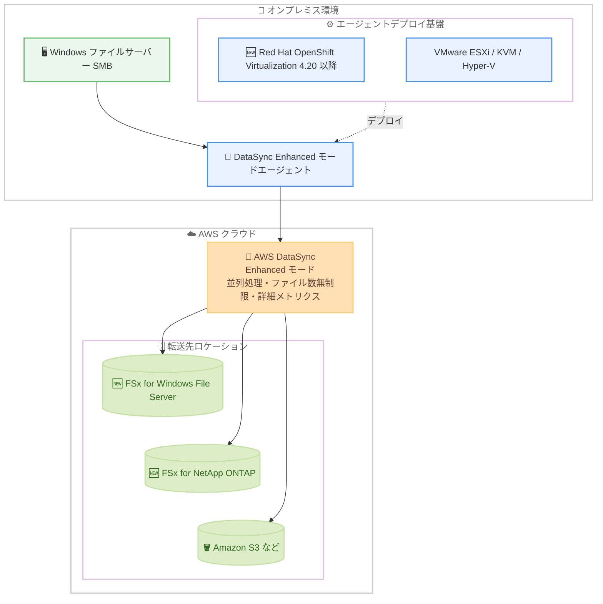

# AWS DataSync - Enhanced モードが FSx for Windows File Server、FSx for NetApp ONTAP、Red Hat OpenShift Virtualization をサポート

**リリース日**: 2026 年 10 月 29 日
**サービス**: AWS DataSync
**機能**: Enhanced モードにおける FSx for Windows File Server / FSx for NetApp ONTAP ロケーション対応および Red Hat OpenShift Virtualization へのエージェントデプロイ対応

📊 [このアップデートのインフォグラフィックを見る](https://takech9203.github.io/aws-news-summary/20261029-datasync-enhanced-fsx-openshift.html)

## 概要

AWS DataSync の Enhanced モードが、Amazon FSx for Windows File Server および Amazon FSx for NetApp ONTAP を転送元または転送先のロケーションとしてサポートしました。これにより、オンプレミスのファイルサーバーから FSx for Windows File Server への移行など、Windows 環境間のデータ移行を Enhanced モードの高いパフォーマンスで実行できるようになります。

さらに、Enhanced モードのエージェントを Red Hat OpenShift Virtualization バージョン 4.20 以降にデプロイできるようになりました。これまでの VMware ESXi、KVM、Microsoft Hyper-V、Amazon EC2 に加えて、新たなデプロイ先の選択肢が追加されたことになります。

今回のアップデートにより、Enhanced モードは Basic モードと同等のロケーションオプションを利用できるようになりました。Enhanced モードはデータを並列処理することで高いパフォーマンスを実現し、ファイル数の制限を撤廃し、詳細なデータ転送メトリクスを提供します。大規模なファイル移行やデータ同期を行うストレージ管理者、移行プロジェクト担当者にとって重要なアップデートです。

**アップデート前の課題**

- FSx for Windows File Server や FSx for NetApp ONTAP を転送元・転送先とするタスクでは Enhanced モードを選択できず、Basic モードを使用する必要があった
- Basic モードはデータの準備・転送・検証を順次実行するため、大規模なデータセットでは転送に時間がかかっていた
- Basic モードではタスク実行あたりのファイル数・オブジェクト数にクォータ制限があり、大規模移行ではデータセットの分割が必要だった
- オンプレミス環境で Red Hat OpenShift Virtualization を利用している場合、Enhanced モードのエージェントをデプロイするために別の仮想化基盤を用意する必要があった

**アップデート後の改善**

- FSx for Windows File Server と FSx for NetApp ONTAP を対象とした転送でも Enhanced モードを選択できるようになり、オンプレミスファイルサーバーから FSx for Windows File Server への移行などを高速に実行可能になった
- Enhanced モードの並列処理 (一覧取得・準備・転送・検証の並列実行) により、ほとんどのワークロードで Basic モードより高いパフォーマンスを実現できるようになった
- 実質無制限の数のファイル・オブジェクトを 1 つのタスク実行で転送できるようになり、データセットの分割が不要になった
- Red Hat OpenShift Virtualization バージョン 4.20 以降に Enhanced モードのエージェントを直接デプロイできるようになった

## アーキテクチャ図



オンプレミスのファイルサーバーから、Red Hat OpenShift Virtualization などにデプロイした Enhanced モードエージェントを経由して、FSx for Windows File Server や FSx for NetApp ONTAP へ高速にデータを転送できます。

## サービスアップデートの詳細

### 主要機能

1. **FSx for Windows File Server / FSx for NetApp ONTAP の Enhanced モード対応**
   - 両ファイルシステムを Enhanced モードタスクの転送元または転送先ロケーションとして指定可能になった
   - オンプレミスのファイルサーバーから FSx for Windows File Server への移行など、Windows 間のデータ移行に対応
   - 今回の追加により、Enhanced モードは Basic モードと同等のロケーションオプションを提供 (S3 on Outposts を除く)

2. **Red Hat OpenShift Virtualization へのエージェントデプロイ対応**
   - Enhanced モードのエージェントを Red Hat OpenShift Virtualization バージョン 4.20 以降にデプロイ可能になった
   - 既存の VMware ESXi、KVM、Microsoft Hyper-V、Amazon EC2 に加わる新しい選択肢
   - OpenShift ベースの仮想化基盤に標準化している企業でも、追加の仮想化環境なしでエージェントを運用可能

3. **Enhanced モードの特長**
   - データの一覧取得・準備・転送・検証を並列実行し、Basic モードより高いパフォーマンスを実現
   - タスク実行あたりのファイル数・オブジェクト数が実質無制限
   - 転送元で検出したオブジェクト数や準備済みオブジェクト数など、Basic モードより詳細な転送メトリクスとカウンターを提供
   - JSON 形式の構造化ログを出力

## 技術仕様

### Enhanced モードと Basic モードの比較

| 項目 | Enhanced モード | Basic モード |
|------|----------------|--------------|
| 処理方式 | 一覧取得・準備・転送・検証を並列実行 | 準備・転送・検証を順次実行 |
| ファイル・オブジェクト数 | 実質無制限 | クォータ制限あり |
| メトリクス | 詳細なカウンターとメトリクスを提供 | Enhanced モードより少ない |
| ログ | 構造化ログ (JSON 形式) | 非構造化ログ |
| 対応ロケーション | S3 on Outposts を除くすべての DataSync 対応ロケーション | すべての DataSync 対応ロケーション |
| データ検証 | 転送されたデータのみ検証 | デフォルトですべてのデータを検証 |

### Enhanced モードエージェントのデプロイ先

| デプロイ先 | 備考 |
|-----------|------|
| Red Hat OpenShift Virtualization | バージョン 4.20 以降 (今回追加) |
| VMware ESXi | 既存サポート |
| KVM | 既存サポート |
| Microsoft Hyper-V | 既存サポート |
| Amazon EC2 | 既存サポート |

## 設定方法

### 前提条件

1. AWS アカウントと DataSync を使用する IAM 権限 (`AWSDataSyncFullAccess` 管理ポリシーを推奨)
2. Enhanced モードタスクの作成には、使用する IAM ロールに `iam:CreateServiceLinkedRole` 権限が必要
3. オンプレミスのロケーションを使用する場合は、Enhanced モード対応の DataSync エージェントをデプロイ済みであること

### 手順

#### ステップ 1: ロケーションの作成

```bash
# 転送元の例: オンプレミス SMB ファイルサーバーのロケーションを作成
aws datasync create-location-smb \
  --server-hostname "fileserver.example.com" \
  --user "transfer-user" \
  --domain "EXAMPLE" \
  --password "password" \
  --subdirectory "/share" \
  --agent-arns "arn:aws:datasync:ap-northeast-1:123456789012:agent/agent-0123456789abcdef0"
```

オンプレミスの SMB ファイルサーバーを DataSync の転送元ロケーションとして登録します。エージェント ARN には Enhanced モード対応エージェントを指定します。

#### ステップ 2: 転送先ロケーションの作成

```bash
# 転送先の例: FSx for Windows File Server のロケーションを作成
aws datasync create-location-fsx-windows \
  --fsx-filesystem-arn "arn:aws:fsx:ap-northeast-1:123456789012:file-system/fs-0123456789abcdef0" \
  --security-group-arns "arn:aws:ec2:ap-northeast-1:123456789012:security-group/sg-0123456789abcdef0" \
  --user "transfer-user" \
  --domain "EXAMPLE" \
  --password "password"
```

FSx for Windows File Server のファイルシステムを転送先ロケーションとして登録します。ファイルシステムへのアクセスを許可するセキュリティグループと認証情報を指定します。

#### ステップ 3: Enhanced モードでタスクを作成

```bash
aws datasync create-task \
  --source-location-arn "arn:aws:datasync:ap-northeast-1:123456789012:location/loc-source" \
  --destination-location-arn "arn:aws:datasync:ap-northeast-1:123456789012:location/loc-dest" \
  --name "windows-migration-task" \
  --task-mode "ENHANCED" \
  --options TransferMode=CHANGED,VerifyMode=ONLY_FILES_TRANSFERRED,LogLevel=TRANSFER
```

`--task-mode "ENHANCED"` を指定して Enhanced モードのタスクを作成します。タスク作成後にタスクモードを変更することはできないため、作成時に適切なモードを選択してください。コンソールの場合は、タスク作成画面の [Task mode] で [Enhanced] を選択します。

## メリット

### ビジネス面

- **移行プロジェクトの短縮**: 並列処理による高いパフォーマンスにより、大規模な Windows ファイルサーバー移行の所要時間を短縮できる
- **既存基盤への投資保護**: Red Hat OpenShift Virtualization を標準基盤とする企業は、エージェント用に別の仮想化環境を用意する必要がない
- **運用の可視性向上**: 詳細な転送メトリクスにより、移行や同期の進捗をステークホルダーに正確に報告できる

### 技術面

- **スケーラビリティ**: ファイル数・オブジェクト数が実質無制限となり、大規模データセットでもタスクの分割設計が不要
- **モード選択の一貫性**: Enhanced モードが Basic モードと同等のロケーションに対応したため、ロケーションの種類を理由に Basic モードへフォールバックする必要がほぼなくなった
- **監視性の向上**: 構造化ログ (JSON 形式) と詳細なカウンターにより、CloudWatch などでの監視・分析が容易

## デメリット・制約事項

### 制限事項

- S3 on Outposts を使用する転送は引き続き Enhanced モードに対応していない (Basic モードが必要)
- Red Hat OpenShift Virtualization へのエージェントデプロイはバージョン 4.20 以降が必要
- タスク作成後にタスクモード (Enhanced / Basic) を変更することはできない

### 考慮すべき点

- Enhanced モードタスクの作成には `iam:CreateServiceLinkedRole` 権限が必要
- Enhanced モードはデフォルトで転送されたデータのみを検証する (Basic モードはデフォルトですべてのデータを検証) ため、検証要件に応じた設定確認が必要
- Enhanced モードと Basic モードでは料金体系が異なる場合があるため、料金ページで事前に確認することを推奨

## ユースケース

### ユースケース 1: オンプレミス Windows ファイルサーバーから FSx for Windows File Server への移行

**シナリオ**: 数千万ファイル規模のオンプレミス Windows ファイルサーバーを FSx for Windows File Server へ移行する。Basic モードのファイル数クォータを超えるため、従来はデータセットの分割が必要だった。

**実装例**:
```
1. オンプレミス環境に Enhanced モード対応エージェントをデプロイ
2. SMB ロケーション (転送元) と FSx for Windows File Server ロケーション (転送先) を作成
3. Enhanced モードでタスクを作成し、TransferMode=CHANGED で増分同期を実行
4. カットオーバー前に最終同期を実行して切り替え
```

**効果**: タスク分割なしで大規模移行を実行でき、並列処理により移行時間を大幅に短縮できる。

### ユースケース 2: OpenShift Virtualization 基盤からのデータ転送

**シナリオ**: 仮想化基盤を Red Hat OpenShift Virtualization に標準化している企業が、オンプレミスの NAS データを AWS へ移行したい。エージェント用に VMware や Hyper-V 環境を別途維持したくない。

**実装例**:
```
1. OpenShift Virtualization バージョン 4.20 以降に Enhanced モードエージェントをデプロイ
2. エージェントを DataSync にアクティベート
3. オンプレミス NFS / SMB ロケーションと AWS 側ロケーションを作成し、Enhanced モードタスクを実行
```

**効果**: 既存の OpenShift 基盤のみでエージェントを運用でき、追加の仮想化環境の構築・維持コストが不要になる。

### ユースケース 3: FSx for NetApp ONTAP への大規模データ同期

**シナリオ**: オンプレミスの NetApp ストレージから FSx for NetApp ONTAP へ継続的にデータを同期し、ハイブリッド構成やディザスタリカバリに活用する。

**実装例**:
```
1. FSx for NetApp ONTAP ロケーションを転送先として作成
2. Enhanced モードタスクを作成し、スケジュール実行を設定
3. 詳細メトリクスと構造化ログを CloudWatch で監視
```

**効果**: 並列処理による高速な同期と詳細なメトリクスにより、RPO の短縮と運用の可視化を両立できる。

## 料金

DataSync の料金は、転送したデータ量に基づく従量課金です。Enhanced モードと Basic モードでは料金体系が異なる場合があるため、最新の料金は [DataSync 料金ページ](https://aws.amazon.com/datasync/pricing/) を参照してください。

FSx for Windows File Server、FSx for NetApp ONTAP のストレージ料金、およびデータ転送に伴うネットワーク料金は別途発生します。

## 利用可能リージョン

本機能は、DataSync Enhanced モードがサポートされているすべての AWS リージョンで利用可能です。

## 関連サービス・機能

- **Amazon FSx for Windows File Server**: Windows ネイティブのフルマネージドファイルストレージ。今回 Enhanced モードのロケーションとして追加
- **Amazon FSx for NetApp ONTAP**: NetApp ONTAP ベースのフルマネージドストレージ。今回 Enhanced モードのロケーションとして追加
- **Red Hat OpenShift Virtualization**: OpenShift 上で仮想マシンを実行する機能。バージョン 4.20 以降で Enhanced モードエージェントのデプロイ先として利用可能
- **Amazon CloudWatch**: Enhanced モードの詳細な転送メトリクスと構造化ログの監視に利用

## 参考リンク

- 📊 [インフォグラフィック](https://takech9203.github.io/aws-news-summary/20261029-datasync-enhanced-fsx-openshift.html)
- [公式発表 (What's New)](https://aws.amazon.com/about-aws/whats-new/2026/10/datasync-enhanced-fsx-openshift/)
- [ドキュメント: AWS DataSync とは](https://docs.aws.amazon.com/datasync/latest/userguide/what-is-datasync.html)
- [ドキュメント: タスクモードの選択](https://docs.aws.amazon.com/datasync/latest/userguide/choosing-task-mode.html)
- [料金ページ](https://aws.amazon.com/datasync/pricing/)

## まとめ

今回のアップデートにより、AWS DataSync Enhanced モードは FSx for Windows File Server と FSx for NetApp ONTAP に対応し、Basic モードと同等のロケーションオプションを実現しました。あわせて Red Hat OpenShift Virtualization へのエージェントデプロイも可能になり、オンプレミス環境の選択肢が広がっています。大規模な Windows ファイルサーバー移行や NetApp ストレージの同期を計画している場合は、ファイル数無制限かつ高性能な Enhanced モードの採用を検討することを推奨します。
