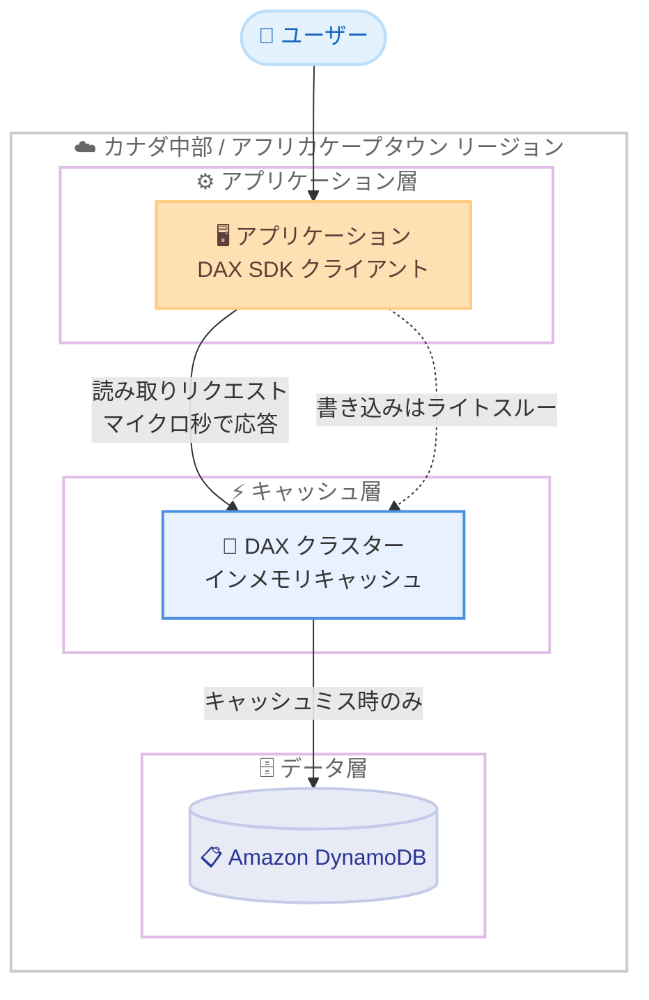

# Amazon DynamoDB Accelerator (DAX) - 追加リージョンでの提供開始

**リリース日**: 2026 年 10 月 29 日
**サービス**: Amazon DynamoDB Accelerator (DAX)
**機能**: カナダ (中部) およびアフリカ (ケープタウン) リージョンでの提供開始

📊 [このアップデートのインフォグラフィックを見る](https://takech9203.github.io/aws-news-summary/20261029-dax-additional-regions.html)

## 概要

Amazon DynamoDB Accelerator (DAX) が、新たにカナダ (中部) リージョンとアフリカ (ケープタウン) リージョンで利用可能になりました。DAX は Amazon DynamoDB 向けのフルマネージド型、高可用性のインメモリキャッシュサービスです。ミリ秒単位のレイテンシーをマイクロ秒単位にまで短縮し、毎秒数百万リクエスト規模でも最大 10 倍のパフォーマンス向上を実現します。

DAX は DynamoDB と API 互換であるため、既存のアプリケーションに最小限のコード変更でキャッシュ層を追加できます。リアルタイム入札、ゲームのリーダーボード、小売の商品カタログなど、読み取りが多いワークロードやバースト性のあるワークロードに適しており、DynamoDB テーブルへの読み取り負荷を軽減します。パッチ適用やフェイルオーバーは自動的に処理され、キャッシュデータはリージョン内に保持されます。

今回のリージョン拡大により、カナダおよびアフリカ南部にユーザー基盤を持つお客様が、データレジデンシー要件を満たしながら、より低いレイテンシーで DAX を活用できるようになります。

**アップデート前の課題**

このアップデート以前に存在していた課題や制限は以下のとおりです。

- カナダ (中部) およびアフリカ (ケープタウン) リージョンでは DAX を利用できなかった
- これらのリージョンの DynamoDB ユーザーがマイクロ秒単位の読み取りレイテンシーを実現するには、ElastiCache などで独自にキャッシュ層を構築し、キャッシュの無効化ロジックなどを自前で実装する必要があった
- キャッシュデータを国内・域内に保持するデータレジデンシー要件がある場合、他リージョンの DAX を利用する選択肢が取れなかった

**アップデート後の改善**

今回のアップデートにより可能になったことは以下のとおりです。

- カナダ (中部) およびアフリカ (ケープタウン) リージョンで DAX クラスターを作成できるようになった
- 両リージョンの DynamoDB ワークロードに対し、最小限のコード変更でマイクロ秒単位の読み取りレイテンシーを実現できるようになった
- キャッシュデータをリージョン内に保持したまま、読み取り負荷の軽減と DynamoDB の読み取りコスト削減が可能になった

## アーキテクチャ図



新たに追加された 2 リージョン内で、アプリケーションは DAX クラスターを経由して DynamoDB にアクセスします。キャッシュヒット時はマイクロ秒単位で応答し、キャッシュミス時のみ DynamoDB に読み取りが発生するため、テーブルへの負荷が軽減されます。

## サービスアップデートの詳細

### 主要機能

1. **新規リージョンでの DAX 提供**
   - カナダ (中部) リージョン (ca-central-1) で利用可能に
   - アフリカ (ケープタウン) リージョン (af-south-1) で利用可能に
   - 既存リージョンと同様のフルマネージド機能 (自動パッチ適用、自動フェイルオーバー) を提供

2. **マイクロ秒単位の読み取りパフォーマンス**
   - DynamoDB のミリ秒単位のレイテンシーをマイクロ秒単位に短縮
   - 毎秒数百万リクエスト規模でも最大 10 倍のパフォーマンス向上
   - 読み取りが多いワークロードやバースト性のあるワークロードに最適

3. **DynamoDB との API 互換性**
   - 既存の DynamoDB API と互換性があり、最小限のコード変更でキャッシュを導入可能
   - DAX SDK クライアントにエンドポイントを切り替えるだけで利用開始できる
   - キャッシュの無効化や整合性管理のロジックを自前で実装する必要がない

## 技術仕様

### DAX の主な特徴

| 項目 | 詳細 |
|------|------|
| サービス形態 | フルマネージド型インメモリキャッシュ |
| 対象サービス | Amazon DynamoDB |
| レイテンシー | マイクロ秒単位 (キャッシュヒット時) |
| パフォーマンス | 最大 10 倍の読み取り性能向上 |
| API 互換性 | DynamoDB API と互換 |
| 運用 | パッチ適用、フェイルオーバーを自動処理 |
| データ保持 | キャッシュデータはリージョン内に保持 |
| 今回の追加リージョン | ca-central-1、af-south-1 |

## 設定方法

### 前提条件

1. カナダ (中部) またはアフリカ (ケープタウン) リージョンの AWS アカウントと DynamoDB テーブル
2. DAX クラスターを配置する VPC とサブネットグループ
3. DAX へのアクセスを許可する IAM ロールとセキュリティグループ

### 手順

#### ステップ 1: サブネットグループの作成

```bash
aws dax create-subnet-group \
  --subnet-group-name my-dax-subnet-group \
  --subnet-ids subnet-xxxxxxxx subnet-yyyyyyyy \
  --region ca-central-1
```

DAX クラスターを配置する VPC サブネットをグループとして登録します。高可用性のため、複数のアベイラビリティーゾーンのサブネットを指定します。

#### ステップ 2: DAX クラスターの作成

```bash
aws dax create-cluster \
  --cluster-name my-dax-cluster \
  --node-type dax.r5.large \
  --replication-factor 3 \
  --iam-role-arn arn:aws:iam::123456789012:role/DAXServiceRole \
  --subnet-group-name my-dax-subnet-group \
  --region ca-central-1
```

新規リージョンに 3 ノード構成の DAX クラスターを作成します。レプリケーションファクターを 3 以上にすることで、プライマリノード障害時の自動フェイルオーバーが可能になります。

#### ステップ 3: アプリケーションのエンドポイント切り替え

```python
import amazondax
import boto3

# DynamoDB クライアントの代わりに DAX クライアントを使用
dax = amazondax.AmazonDaxClient.resource(
    endpoint_url="daxs://my-dax-cluster.xxxxxx.dax-clusters.ca-central-1.amazonaws.com"
)
table = dax.Table("MyTable")
item = table.get_item(Key={"pk": "item-1"})
```

DAX SDK クライアントを使用し、エンドポイントを DAX クラスターに向けるだけで、既存の DynamoDB API 呼び出しがキャッシュ経由になります。アプリケーションロジックの変更は最小限で済みます。

## メリット

### ビジネス面

- **ユーザー体験の向上**: カナダおよびアフリカ南部のエンドユーザーに対し、マイクロ秒単位の応答でアプリケーションの体感速度を改善できる
- **データレジデンシー要件への対応**: キャッシュデータをリージョン内に保持できるため、国内・域内のデータ保持要件を満たしやすい
- **コスト最適化の機会**: 読み取りの多いワークロードでは、DynamoDB の読み取りキャパシティ消費を削減し、総コストを抑えられる可能性がある

### 技術面

- **最小限のコード変更**: DynamoDB API 互換のため、キャッシュ層の導入に伴う改修コストが小さい
- **運用負荷の軽減**: パッチ適用やフェイルオーバーが自動化されており、自前のキャッシュ基盤運用が不要
- **スケーラビリティ**: 毎秒数百万リクエスト規模のワークロードにも対応可能

## デメリット・制約事項

### 制限事項

- DAX は結果整合性のある読み取りのキャッシュに最適化されており、強い整合性のある読み取りはキャッシュされず DynamoDB に直接転送される
- DAX クラスターは VPC 内に配置する必要があり、VPC 外からの直接アクセスには追加のネットワーク設計が必要
- 利用可能なリージョンは引き続き限定されており、全リージョンで利用できるわけではない (最新の対応状況はリージョン別サービス表を参照)

### 考慮すべき点

- 書き込みが多いワークロードや、キャッシュヒット率が低いアクセスパターンでは、DAX の費用対効果が限定的になる場合がある
- キャッシュ TTL の設定により、データの鮮度と性能のバランスを検討する必要がある

## ユースケース

### ユースケース 1: カナダ国内向けリアルタイム入札プラットフォーム

**シナリオ**: カナダ国内の広告配信事業者が、リアルタイム入札 (RTB) システムで数ミリ秒以内の応答を求められている。データはカナダ国内に保持する必要がある。

**実装例**:
```
ca-central-1 に DAX クラスターを作成し、入札候補データを
格納する DynamoDB テーブルの前段キャッシュとして構成。
アプリケーションは DAX SDK 経由で読み取りを実行。
```

**効果**: 読み取りレイテンシーがマイクロ秒単位となり、入札応答時間の要件を満たしつつ、キャッシュデータを含むすべてのデータをカナダ国内に保持できる。

### ユースケース 2: アフリカ地域向けゲームリーダーボード

**シナリオ**: アフリカ南部のユーザーが多いモバイルゲームで、リーダーボードへのアクセスが集中し、DynamoDB の読み取りキャパシティ消費が増大している。

**実装例**:
```
af-south-1 の DynamoDB テーブルの前段に DAX を配置し、
リーダーボード参照クエリをキャッシュから応答。
TTL を短めに設定して順位の鮮度を確保。
```

**効果**: 読み取りの大半がキャッシュで処理され、DynamoDB の読み取りコストを削減しながら、ユーザーへの応答速度も向上する。

### ユースケース 3: 小売事業者の商品カタログ

**シナリオ**: セール期間中に商品カタログへのアクセスがバースト的に増加し、特定の人気商品への読み取りが集中する。

**実装例**:
```
商品カタログテーブルの前段に DAX を配置。
人気商品のアイテムはキャッシュヒット率が高く、
ホットパーティションによるスロットリングを回避。
```

**効果**: バーストトラフィックをキャッシュで吸収し、DynamoDB テーブルのキャパシティを増強することなく安定した応答を維持できる。

## 料金

DAX の料金はノードタイプごとの時間課金 (ノード時間) で、クラスター内のノード数と稼働時間に基づいて請求されます。DAX の利用自体に DynamoDB のリクエスト料金は発生しませんが、キャッシュミス時の DynamoDB への読み取りには通常の DynamoDB 料金が適用されます。リージョンごとの最新の料金は、DynamoDB 料金ページを参照してください。

## 利用可能リージョン

今回のアップデートで、以下のリージョンが追加されました。

- カナダ (中部) リージョン (ca-central-1)
- アフリカ (ケープタウン) リージョン (af-south-1)

DAX が利用可能なリージョンの全リストは、[AWS リージョン別サービス表](https://aws.amazon.com/about-aws/global-infrastructure/regional-product-services/) を参照してください。

## 関連サービス・機能

- **Amazon DynamoDB**: DAX のキャッシュ対象となる NoSQL データベースサービス。DAX は DynamoDB API と互換性を持つ
- **Amazon ElastiCache**: 汎用的なインメモリキャッシュサービス。DynamoDB 専用でないキャッシュ要件や独自のキャッシュ戦略が必要な場合の選択肢
- **AWS SDK (DAX クライアント)**: Java、Python、Node.js、.NET、Go などの言語向けに DAX SDK クライアントが提供され、最小限の変更でキャッシュを導入できる

## 参考リンク

- 📊 [インフォグラフィック](https://takech9203.github.io/aws-news-summary/20261029-dax-additional-regions.html)
- [公式発表 (What's New)](https://aws.amazon.com/about-aws/whats-new/2026/10/dax-additional-regions/)
- [Amazon DynamoDB Accelerator (DAX) 製品ページ](https://aws.amazon.com/dynamodb/dax/)
- [AWS リージョン別サービス表](https://aws.amazon.com/about-aws/global-infrastructure/regional-product-services/)
- [料金ページ](https://aws.amazon.com/dynamodb/pricing/)

## まとめ

DAX のカナダ (中部) およびアフリカ (ケープタウン) リージョンへの拡大により、両地域のお客様はデータレジデンシー要件を満たしながら、DynamoDB ワークロードにマイクロ秒単位の読み取り性能を追加できるようになりました。該当リージョンで読み取りの多い DynamoDB ワークロードを運用している場合は、キャッシュヒット率と費用対効果を評価したうえで、DAX の導入を検討することを推奨します。
