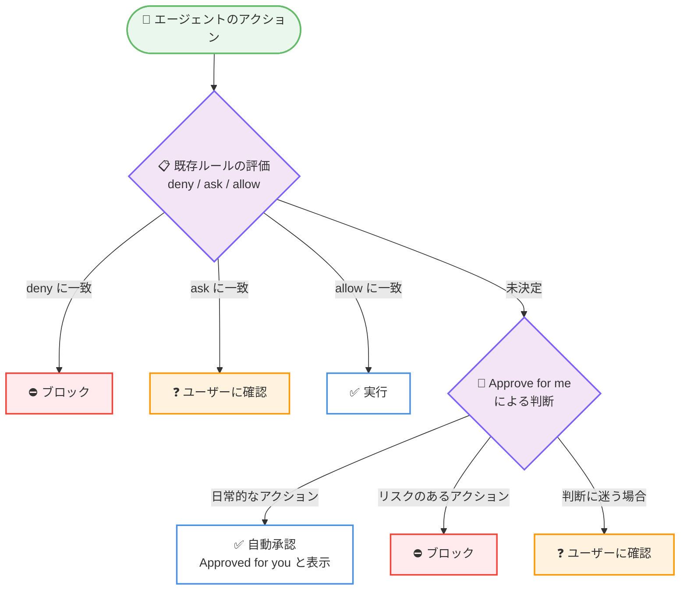

# Kiro - Approve for Me、サブコマンド承認ルール、ACP エンジン設定 (CLI 2.36.0)

**リリース日**: 2026 年 10 月 29 日
**サービス**: Kiro (Kiro CLI)
**機能**: Approve for Me, Subcommand Approval Rules, and an ACP Engine Setting

📊 [このアップデートのインフォグラフィックを見る](https://takech9203.github.io/aws-news-summary/20261029-kiro-changelog-2026-10-29.html)

## 概要

Kiro CLI 2.36.0 がリリースされ、インタラクティブな V3 セッションに「Approve for me」機能が追加されました。この機能を有効にすると、Kiro が日常的なアクションを自動で承認し、リスクのあるアクションをブロックし、判断に迷う場合のみユーザーに確認します。これにより、定型的な承認プロンプトのたびに作業が中断されることがなくなります。既存の deny、ask、allow ルールが常に優先され、Approve for me はルールで未決定のアクションのみを処理します。自動承認された各アクションには「Approved for you」のマークが付きます。

あわせて、シェルコマンドの承認時にサブコマンド単位のルール (例: `git stash *`) を選択できる機能、ACP セッションで使用するエンジンを選択する `acp.agentEngine` 設定、V2 から V3 への移行時にルールの挙動差分を警告する機能なども追加されています。

**アップデート前の課題**

- V3 セッションでは、deny、ask、allow ルールでカバーされないアクションのたびに承認プロンプトが表示され、定型的な操作でも作業が中断されていた
- シェルコマンドの承認ルールは、完全一致のコマンド (例: `git stash pop`) かコマンド全体のワイルドカード (例: `git *`) の 2 択しかなく、中間の粒度でルールを作成できなかった
- `kiro-cli acp` で使用するエンジンのバージョンを設定ファイルで指定できなかった
- V2 から V3 にエージェント設定をアップグレードした際、V2 で許可されていた操作が V3 ルールでブロックされても気付きにくかった

**アップデート後の改善**

- Approve for me を有効にすると、ルールで未決定の日常的なアクションを Kiro が自動承認し、承認待ちによる作業の中断が減少した
- 承認プロンプトのルール選択で、完全一致と `git *` の中間となるサブコマンド単位のルール (例: `git stash *`) を選択できるようになった
- 新しい `acp.agentEngine` 設定で、ACP セッションのエンジンを `v1`、`v2`、`v3` から選択できるようになった
- `kiro-cli agent upgrade` が、V2 で許可されていた操作を V3 ルールが拒否、非表示、または確認対象にする場合に警告を表示するようになった

## アーキテクチャ図



Approve for me 有効時の承認フローです。既存の deny、ask、allow ルールが常に先に評価され、どのルールにも該当しない「未決定」のアクションのみを Approve for me が判断します。

## サービスアップデートの詳細

### 主要機能

1. **Approve for me (V3 インタラクティブセッション)**
   - Kiro が日常的なアクションを自動承認し、リスクのあるアクションをブロックし、判断に迷う場合はユーザーに確認する
   - 既存の deny、ask、allow ルールが常に優先され、Approve for me はルールで未決定のアクションのみを処理する
   - 自動承認された各アクションには「Approved for you」のマークが付き、何が自動承認されたかを確認できる
   - 有効化するには、V3 セッションで `/permissions` を実行し、Policies から「approve for me」を選択する
   - 選択はワークスペース単位で保存される。Kiro がワークスペースの permissions ファイルに approve-for-me ポリシープリセットを追加するため、設定はそのリポジトリに留まり、他のリポジトリには引き継がれない
   - セッションで Approve for me が利用できない場合は、従来どおり Kiro が確認を求める。「ask for approval」を選択すると、ルールでカバーされないすべてのアクションで確認を求める動作に戻せる

2. **サブコマンド単位の承認ルール**
   - V3 セッションで `git stash pop` のようなシェルコマンドの承認を求められた際、ルール選択で完全一致のコマンドと `git *` の中間として `git stash *` を選択できるようになった
   - コマンド全体を許可するよりも細かい粒度で、繰り返し使うサブコマンドだけを許可できる

3. **ACP エンジン設定**
   - 新しい `acp.agentEngine` 設定で、ACP (Agent Client Protocol) セッションで使用するエンジンを `v1`、`v2`、`v3` から選択できる
   - `--agent-engine` フラグは設定値を上書きする
   - どちらも指定しない場合、`kiro-cli acp` は `v2` で動作する

4. **V2 から V3 への移行時の警告**
   - `kiro-cli agent upgrade` は、アップグレード後のルールが V2 で許可されていた操作を拒否、非表示、または確認対象にする場合に警告を表示し、結果テーブルにファイルごとの警告数を表示する
   - V3 セッションでも、V2 で許可されていた操作をルールがブロックするエージェントごとに、セッション中 1 回通知を表示し、V2 に戻す方法を案内する

### その他の改善

- **Git 設定の環境変数も確認対象に**: V2 セッションで、`GIT_CONFIG_GLOBAL` のような環境変数経由で Git 設定を変更するシェルコマンドは、実行前に承認を求めるようになった
- **`/spec` の質問の明確化**: V3 の `/spec` 実行中の要件質問に進捗カウントが表示され、分析完了後に合計数が確定する
- **シェルカードのタイトル改善**: ツールの推論とツール引数を表示する設定の場合、V3 のシェルツールカードはモデルによる説明をタイトルとして使用し、その下にコマンドを表示する
- **Mermaid のタイトルとノート**: Mermaid 図が `title:` と図全体のノートを描画の上部に表示するようになった
- **Kiro ゴーストのアニメーション**: `/fullscreen` で Kiro のロゴゴーストをクリックすると、5 種類のアニメーションを順番に再生できる

### 修正

- 承認プロンプトの V3 ルール行で、長いパスのファイル名が途中で切れずに保持されるようになった
- 非 ASCII 名の利用不可 MCP ツールを含むエージェント設定を、クラッシュせずに読み込めるようになった
- 幅の狭いターミナルで、折り返されたツールコマンドのインデント行が空行にならずにテキストを保持するようになった

## 技術仕様

### Approve for me の動作

| 項目 | 詳細 |
|------|------|
| 対象セッション | インタラクティブな V3 セッション |
| 有効化方法 | `/permissions` → Policies → approve for me を選択 |
| 設定の保存単位 | ワークスペース単位 (ワークスペースの permissions ファイルに approve-for-me ポリシープリセットを追加) |
| 既存ルールとの優先順位 | deny、ask、allow ルールが先に評価され、未決定のアクションのみ Approve for me が判断 |
| 自動承認の表示 | 承認された各アクションに「Approved for you」のマークを表示 |
| 無効化方法 | 「ask for approval」を選択すると、ルールでカバーされないすべてのアクションで確認する動作に戻る |

### ACP エンジン設定

| 項目 | 詳細 |
|------|------|
| 設定キー | `acp.agentEngine` |
| 選択肢 | `v1`、`v2`、`v3` |
| 上書き方法 | `--agent-engine` フラグが設定値より優先 |
| デフォルト | いずれも未指定の場合は `v2` |

## 設定方法

### 前提条件

1. Kiro CLI 2.36.0 以降がインストールされていること
2. インタラクティブな V3 セッションを使用していること (Approve for me の場合)

### 手順

#### ステップ 1: Approve for me を有効化する

```bash
# V3 インタラクティブセッション内で実行
/permissions
```

V3 セッション内で `/permissions` コマンドを実行し、Policies を選択します。ページに「approve for me」が表示されている場合はそれを選択します。この選択はワークスペース単位で保存され、Kiro がワークスペースの permissions ファイルに approve-for-me ポリシープリセットを追加します。

#### ステップ 2: サブコマンド単位の承認ルールを使用する

V3 セッションがシェルコマンド (例: `git stash pop`) の承認を求めた際、ルール選択で完全一致コマンドと `git *` の間に表示される `git stash *` を選択します。これにより、`git stash` 系のサブコマンドのみを許可するルールが作成されます。

#### ステップ 3: ACP エンジンを設定する

```bash
# 設定で ACP セッションのエンジンを指定 (v1 / v2 / v3)
# 例: v3 を使用する場合
kiro-cli acp --agent-engine v3
```

`acp.agentEngine` 設定または `--agent-engine` フラグで、ACP セッションで使用するエンジンを選択します。フラグは設定値を上書きし、どちらも未指定の場合は `v2` で動作します。

## メリット

### ビジネス面

- **開発者の生産性向上**: 定型的な承認プロンプトのたびに作業が止まらなくなり、エージェントとの協働作業のフロー状態を維持できる
- **チーム単位の一貫した運用**: Approve for me の設定はワークスペースの permissions ファイルに保存されるため、リポジトリ単位でポリシーを管理できる
- **移行リスクの低減**: V2 から V3 への移行時に挙動差分の警告が表示されるため、意図しない権限変更に気付きやすくなった

### 技術面

- **既存ルールとの明確な優先順位**: deny、ask、allow ルールが常に先に評価されるため、明示的に定義したポリシーが Approve for me によって上書きされることがない
- **透明性の確保**: 自動承認されたアクションには「Approved for you」のマークが付くため、何が自動承認されたかを後から追跡できる
- **承認ルールの粒度向上**: サブコマンド単位のルール (例: `git stash *`) により、コマンド全体を許可することなく必要な範囲だけを許可できる

## デメリット・制約事項

### 制限事項

- Approve for me はインタラクティブな V3 セッションでのみ利用可能
- セッションによっては Approve for me が利用できない場合があり、その場合は従来どおり確認プロンプトが表示される
- 設定はワークスペース単位で保存されるため、他のリポジトリには引き継がれない (リポジトリごとに有効化が必要)

### 考慮すべき点

- 自動承認の判断は Kiro に委ねられるため、厳密に制御したいアクションは引き続き deny、ask、allow ルールで明示的に定義することが推奨される
- `kiro-cli acp` のデフォルトエンジンは `v2` のため、ACP セッションで V3 の機能を使用する場合は明示的な設定が必要
- V2 セッションでは、`GIT_CONFIG_GLOBAL` などの環境変数経由の Git 設定変更が新たに承認対象となったため、既存の自動化フローで確認プロンプトが増える可能性がある

## ユースケース

### ユースケース 1: 定型作業の多い開発セッションの効率化

**シナリオ**: エージェントにリファクタリングを依頼すると、ファイル読み取りやビルドコマンドなど日常的なアクションのたびに承認を求められ、作業が頻繁に中断される。

**実装例**:
```
# V3 セッション内で
/permissions
# Policies → approve for me を選択
```

**効果**: 日常的なアクションは Kiro が自動承認し、リスクのあるアクションのみブロックまたは確認されるため、承認待ちによる中断が大幅に減る。自動承認されたアクションは「Approved for you」マークで確認できる。

### ユースケース 2: Git サブコマンドの段階的な許可

**シナリオ**: `git stash` 系のコマンドは頻繁に使うため許可したいが、`git push` など影響の大きい操作まで含む `git *` の許可は避けたい。

**実装例**:
```
# git stash pop の承認プロンプトで
# 「git stash *」ルールを選択
```

**効果**: コマンド全体のワイルドカードを許可することなく、繰り返し使うサブコマンドだけを承認対象から除外でき、安全性と効率を両立できる。

### ユースケース 3: ACP クライアントからの V3 エンジン利用

**シナリオ**: ACP 対応エディタから Kiro CLI を利用しており、V3 エンジンの権限モデルを ACP セッションでも使用したい。

**実装例**:
```bash
kiro-cli acp --agent-engine v3
```

**効果**: `acp.agentEngine` 設定または `--agent-engine` フラグにより、ACP セッションでも使用するエンジンのバージョンを明示的に制御できる。

## 利用可能リージョン

グローバル (Kiro はグローバルに提供されるサービスです)

## 関連サービス・機能

- **Kiro CLI V3 エンジン**: Approve for me とサブコマンド承認ルールは V3 セッションの権限システム上に構築されている
- **Kiro IDE**: Kiro CLI と同じエージェント基盤を共有する AI 搭載 IDE
- **ACP (Agent Client Protocol)**: `kiro-cli acp` で ACP 対応クライアントから Kiro のエージェントエンジンを利用できる

## 参考リンク

- 📊 [インフォグラフィック](https://takech9203.github.io/aws-news-summary/20261029-kiro-changelog-2026-10-29.html)
- [Kiro Changelog (CLI 2.36.0)](https://kiro.dev/changelog/cli/2-36)
- [Kiro Changelog](https://kiro.dev/changelog/)
- [ドキュメント: V3 Permissions - Approve for me](https://kiro.dev/docs/cli/v3/permissions/#approve-for-me)
- [ドキュメント: V3 Permissions - Approval rule tiers](https://kiro.dev/docs/cli/v3/permissions/#approval-rule-tiers)
- [ドキュメント: V2 から V3 へのアップグレード - Warning types](https://kiro.dev/docs/cli/v3/upgrade-agent/#warning-types)
- [ドキュメント: Settings - Agent Client Protocol](https://kiro.dev/docs/reference/settings/#agent-client-protocol-acp)

## まとめ

Kiro CLI 2.36.0 の Approve for me は、既存の deny、ask、allow ルールを尊重しつつ、未決定の日常的なアクションを自動承認することで、エージェント協働時の中断を減らす重要なアップデートです。サブコマンド単位の承認ルールや V2 から V3 への移行警告とあわせて、権限管理の粒度と安全性が向上しています。V3 セッションを利用している場合は、`/permissions` から Approve for me を試し、厳密に制御したい操作は明示的なルールで定義することを推奨します。
