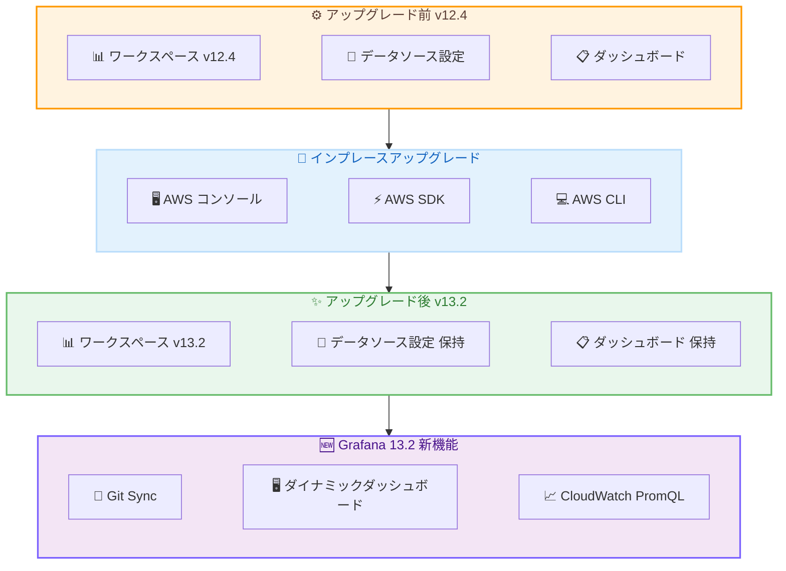

# Amazon Managed Grafana - Grafana バージョン 13.2 へのインプレースアップグレード

**リリース日**: 2026 年 10 月 29 日
**サービス**: Amazon Managed Grafana
**機能**: Grafana バージョン 12.4 から 13.2 へのインプレースアップグレード

📊 [このアップデートのインフォグラフィックを見る](https://takech9203.github.io/aws-news-summary/20261029-managed-grafana-upgrade-version-13-2.html)

## 概要

Amazon Managed Grafana が、既存のワークスペースを Grafana バージョン 12.4 から 13.2 へインプレースアップグレードする機能をサポートした。AWS コンソール、AWS SDK、または AWS CLI から数クリックで、ワークスペースを再作成することなくバージョンアップが可能になる。

2026 年 9 月 30 日にバージョン 13.2 での新規ワークスペース作成がサポートされたが、今回のアップデートにより既存ワークスペースのアップグレードパスが提供された。Grafana 13.2 にはオープンソース Grafana 13.0 から 13.2 までの機能が含まれており、ダッシュボードをコードとして管理する Git Sync、より柔軟なレイアウトとパネルを実現するダイナミックダッシュボード、CloudWatch データソースプラグインにおける PromQL サポートなどを、既存環境の設定を維持したまま利用できるようになる。すでに 12.4 ワークスペースを運用している組織にとって、移行作業なしで最新機能を取り込める重要なアップデートである。

**アップデート前の課題**

- バージョン 12.4 で稼働中のワークスペースを 13.2 にアップグレードする公式パスが存在しなかった
- Git Sync や PromQL サポートなど 13.2 の新機能を利用するには、新規ワークスペースを作成してダッシュボードや設定を手動で移行する必要があった
- 移行作業に伴う設定漏れやダウンタイムのリスクがあった

**アップデート後の改善**

- インプレースアップグレードにより、既存のワークスペースをそのまま 13.2 に更新可能になった
- ダッシュボード、データソース設定、ユーザー権限を維持したまま新機能を利用できる
- AWS コンソール、AWS SDK、AWS CLI のいずれからも数クリック (数コマンド) でアップグレードを実行可能

## アーキテクチャ図



既存の 12.4 ワークスペースをインプレースでアップグレードすることで、設定を保持したまま Grafana 13.2 の新機能を利用可能になる。

## サービスアップデートの詳細

### 主要機能

1. **12.4 から 13.2 へのインプレースアップグレード**
   - ワークスペースを再作成することなく、既存ワークスペースのバージョンを更新可能
   - AWS コンソール、AWS SDK、AWS CLI のいずれからも数クリックで実行可能
   - ダッシュボード、データソース、ユーザー権限などの設定を維持したまま移行できる

2. **Git Sync によるダッシュボードのコード管理**
   - ワークスペースを Git リポジトリに接続し、Dashboards as Code のワークフローを実現
   - ダッシュボードの変更を、バージョン管理を通じて追跡、レビュー、ロールバック可能
   - アップグレード後、既存ワークスペースでも IaC と同様のダッシュボード管理を導入できる

3. **ダイナミックダッシュボード**
   - より柔軟なレイアウトとパネルのシステムを提供
   - スコープ内のデータや変数の条件に応答するレスポンシブなビューを構築可能

4. **CloudWatch データソースプラグインの PromQL サポート**
   - CloudWatch の OTLP (OpenTelemetry Protocol) エンドポイント経由で取り込んだメトリクスを PromQL でクエリ可能
   - 既存の Metric Search および Metrics Insights クエリタイプを補完する選択肢として追加

## 技術仕様

### アップグレードパス

| 項目 | 詳細 |
|------|------|
| アップグレード元バージョン | Grafana 12.4 |
| アップグレード先バージョン | Grafana 13.2 (OSS Grafana 13.0〜13.2 の機能を含む) |
| アップグレード方式 | インプレース (ワークスペース再作成不要) |
| 実行方法 | AWS コンソール / AWS SDK / AWS CLI |
| 設定の保持 | ダッシュボード、データソース、ユーザー権限を保持 |
| 追加料金 | なし |

### バージョン 13 の破壊的変更

Grafana バージョン 13 には、以前のバージョンで使用していた機能が動作しなくなる可能性のある変更が含まれるため、アップグレード前の確認が必要。

| 変更内容 | 影響と対応 |
|----------|-----------|
| レガシー Alertmanager 設定 API の削除・制限 | バージョン 12 で非推奨となったシングルテナント Alertmanager 設定 API が削除または制限される。サポートされるプロビジョニングエンドポイントへの移行が必要 |
| 数値 ID ベースのデータソース API がデフォルト無効化 | 数値 `id` 参照の API が無効化されるため、`uid` を使用する API への更新が必要 |
| AWS IoT TwinMaker アプリプラグインの非サポート | `grafana-iot-twinmaker-app` の SceneViewer パネルが動作しなくなるため、代替のビジュアライゼーションの検討が必要 |

### API 変更履歴

直近 14 日間で Amazon Managed Grafana に関連する API 変更は確認されなかった。インプレースアップグレードは既存の `UpdateWorkspaceConfiguration` API の `grafanaVersion` パラメータで `13.2` を指定することで実行する。

## 設定方法

### 前提条件

1. Amazon Managed Grafana ワークスペースが Grafana バージョン 12.4 で稼働していること
2. ワークスペースの更新権限 (`grafana:UpdateWorkspaceConfiguration` など) を持つ IAM ロールまたはユーザー
3. アップグレード前のダッシュボードおよび設定のバックアップ (推奨)

### 手順

#### ステップ 1: 現在のバージョンを確認

```bash
aws grafana describe-workspace \
  --workspace-id <your-workspace-id> \
  --query 'workspace.grafanaVersion'
```

現在のワークスペースの Grafana バージョンが 12.4 であることを確認する。

#### ステップ 2: インプレースアップグレードの実行

```bash
aws grafana update-workspace-configuration \
  --workspace-id <your-workspace-id> \
  --grafana-version "13.2"
```

ワークスペースの Grafana バージョンを 13.2 に更新する。マネジメントコンソールの場合は、ワークスペースの詳細画面からバージョン更新を実行する。アップグレード中はワークスペースのステータスが `VERSION_UPDATING` に変わる。

#### ステップ 3: アップグレード完了の確認

```bash
aws grafana describe-workspace \
  --workspace-id <your-workspace-id> \
  --query 'workspace.{Status:status,Version:grafanaVersion}'
```

ステータスが `ACTIVE` に戻り、バージョンが `13.2` になっていることを確認する。アップグレード後はダッシュボードの表示とアラートの動作を検証する。

## メリット

### ビジネス面

- **移行コストの削減**: ワークスペースの再作成と手動移行が不要になり、エンジニアリング工数を節約できる
- **ガバナンスの強化**: Git Sync によりダッシュボード変更のレビューと監査が可能になり、既存環境でも変更管理プロセスを導入できる
- **最新機能の早期活用**: アップグレード完了後すぐに Grafana 13.2 の新機能を既存環境で利用できる

### 技術面

- **設定の保持**: ダッシュボード、データソース、ユーザー権限を維持したままバージョンアップできる
- **Dashboards as Code**: Git Sync によりダッシュボードをリポジトリで管理し、CI/CD パイプラインに統合できる
- **PromQL スキルの再利用**: Prometheus に慣れたエンジニアが CloudWatch の OTLP メトリクスにも同じクエリ言語を使用できる

## デメリット・制約事項

### 制限事項

- 今回提供されたアップグレードパスはバージョン 12.4 から 13.2 への更新である (それ以前のバージョンのワークスペースは、まず 12.4 への更新が必要)
- アップグレード後にダウングレードする公式手段は提供されていない
- AWS IoT TwinMaker アプリプラグインはバージョン 13 では動作しない

### 考慮すべき点

- レガシー Alertmanager 設定 API や数値 ID ベースのデータソース API を使用する自動化は、アップグレード前に移行が必要
- 既存ダッシュボードはダイナミックダッシュボードの新スキーマへ移行されるため、本番環境の更新前に非本番ワークスペースでの動作検証を推奨
- カスタムプラグインやサードパーティプラグインの 13.2 互換性を事前に確認すべき

## ユースケース

### ユースケース 1: 既存ワークスペースへの GitOps 導入

**シナリオ**: 12.4 ワークスペースで多数のダッシュボードを運用しているプラットフォームチームが、ダッシュボードの変更管理を強化したい。

**実装例**:
```
1. 非本番ワークスペースを 13.2 にアップグレードして動作検証
2. 本番ワークスペースをインプレースアップグレード
3. Git Sync で GitHub リポジトリに接続し、プルリクエストベースのレビュー運用を開始
```

**効果**: 既存のダッシュボード資産を維持したまま、変更履歴の追跡とロールバックが可能な GitOps 運用へ移行できる。

### ユースケース 2: OpenTelemetry メトリクスの PromQL 分析

**シナリオ**: OpenTelemetry Collector から CloudWatch の OTLP エンドポイントへメトリクスを送信しているチームが、既存の Grafana ワークスペースで PromQL によるクエリを利用したい。

**実装例**:
```
rate(http_server_request_duration_count[5m])
```

**効果**: ワークスペースを再構築することなく、Prometheus で培ったクエリ資産とスキルを CloudWatch メトリクスにも適用できる。

### ユースケース 3: 条件に応答するダッシュボードへの刷新

**シナリオ**: 複数チームが共有するダッシュボードで、チームや環境の変数に応じて表示内容を切り替えたい運用チーム。

**実装例**:
```
1. ワークスペースを 13.2 にアップグレード
2. ダイナミックダッシュボードで変数条件に応答するレイアウトを構成
3. 共通ダッシュボードを集約し、重複ダッシュボードを削減
```

**効果**: データや変数の条件に応答するレスポンシブなビューにより、チームごとに乱立していたダッシュボードを統合し、保守負荷を軽減できる。

## 料金

Amazon Managed Grafana の料金体系はアップグレードによって変更されない。インプレースアップグレード自体に追加費用は発生しない。

### 料金例

| 項目 | 月額料金 (概算) |
|------|-----------------|
| アクティブエディター/管理者 1 ユーザー | $9.00 |
| アクティブビューワー 1 ユーザー | $5.00 |
| アップグレード作業自体 | 追加料金なし |

最新の料金は [料金ページ](https://aws.amazon.com/grafana/pricing/) を参照。

## 利用可能リージョン

Amazon Managed Grafana が一般提供されているすべての AWS リージョンでインプレースアップグレードが利用可能。

## 関連サービス・機能

- **Amazon CloudWatch**: OTLP エンドポイントで取り込んだメトリクスを PromQL でクエリ可能になった主要データソース
- **Amazon Managed Service for Prometheus**: PromQL ベースのメトリクス監視サービス。Grafana との組み合わせでクエリ言語を共通化できる
- **GitHub / GitHub Enterprise**: Git Sync の接続先としてダッシュボードのコード管理を実現
- **AWS IAM Identity Center**: Grafana ワークスペースの認証に使用

## 参考リンク

- 📊 [インフォグラフィック](https://takech9203.github.io/aws-news-summary/20261029-managed-grafana-upgrade-version-13-2.html)
- [公式発表 (What's New)](https://aws.amazon.com/about-aws/whats-new/2026/10/managed-grafana-upgrade-version-13-2/)
- [Grafana バージョン間の差異 (ユーザーガイド)](https://docs.aws.amazon.com/grafana/latest/userguide/version-differences.html#version-diff-v13)
- [ワークスペースバージョンの更新手順](https://docs.aws.amazon.com/grafana/latest/userguide/AMG-workspace-version-update.html)
- [Amazon Managed Grafana 製品ページ](https://aws.amazon.com/grafana/)
- [料金ページ](https://aws.amazon.com/grafana/pricing/)

## まとめ

Amazon Managed Grafana のインプレースアップグレードサポートにより、既存のバージョン 12.4 ワークスペースを再作成なしで 13.2 に移行できるようになった。Git Sync、ダイナミックダッシュボード、CloudWatch の PromQL 対応といった新機能を既存環境で即座に活用できるため、12.4 を運用している組織はアップグレードの計画を推奨する。実行前にバージョン 13 の破壊的変更 (レガシー Alertmanager API、AWS IoT TwinMaker プラグインなど) の影響を非本番環境で検証することが重要である。
