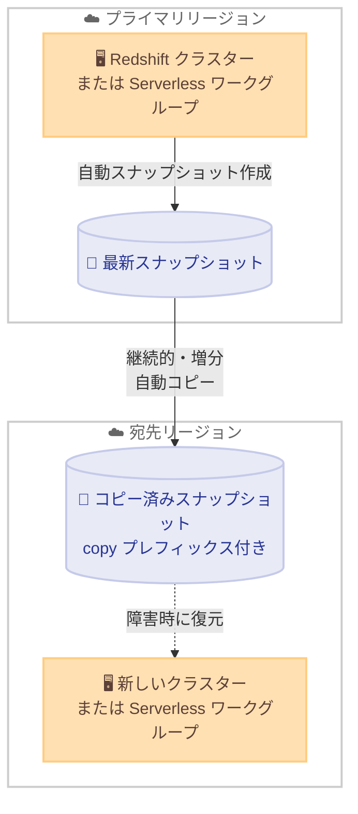

# Amazon Redshift - ハンズオフの自動クロスリージョンバックアップ

**リリース日**: 2026 年 10 月 29 日
**サービス**: Amazon Redshift
**機能**: 自動クロスリージョンスナップショットコピー (Automated Cross-Region Backups)

📊 [このアップデートのインフォグラフィックを見る](https://takech9203.github.io/aws-news-summary/20261029-redshift-automated-cross-region-backups.html)

## 概要

Amazon Redshift が、プロビジョンドクラスターと Serverless ワークグループの両方を対象とした、ハンズオフ (hands-off) の自動クロスリージョンバックアップを発表しました。この機能を有効にすると、最新のスナップショットが手動操作なしで、継続的かつ増分的に指定した宛先リージョンへ自動コピーされます。これにより、事業継続性 (BCP) やディザスタリカバリ (DR) の要件を満たすためのバックアップ運用が大幅に簡素化されます。

本機能の大きな特徴は、ローカルのスナップショットスケジュールから独立して動作する点です。次回のスケジュールされたスナップショット作成を待つことなく、利用可能な最新のスナップショットが常に宛先リージョンへコピーされます。予期しない障害が発生した際にも、クロスリージョンコピーを開始するための手動ステップは不要であり、宛先リージョンに存在するスナップショットから新しいプロビジョンドクラスターまたは Serverless ワークグループを復元するだけで復旧できます。

DR 戦略としてマルチリージョン構成を採用している企業や、規制要件によりリージョン外へのバックアップ保管が求められる金融・公共分野のユーザーにとって、運用負荷を減らしながら復旧目標を確実に満たせる重要なアップデートです。

**アップデート前の課題**

このアップデート以前には、以下の課題がありました。

- 障害発生時にクロスリージョンコピーを開始するための手動ステップが必要になるケースがあった
- スナップショットのコピーがローカルのスナップショットスケジュールに依存しており、次のスケジュールされたスナップショットを待つ必要があった
- 最新のバックアップが宛先リージョンに確実に存在することを保証するために、運用側での監視や管理の手間がかかっていた

**アップデート後の改善**

今回のアップデートにより、以下が可能になりました。

- 最新のスナップショットが手動操作なしで、継続的かつ増分的に宛先リージョンへ自動コピーされるようになった
- ローカルのスナップショットスケジュールから独立して動作するため、次のスケジュールを待たずに最新のバックアップが宛先リージョンに確保されるようになった
- プロビジョンドクラスターと Serverless ワークグループの両方で同じ仕組みが利用できるようになった
- 宛先リージョンでのコピー済み自動スナップショットの保持期間を個別に設定できるようになった

## アーキテクチャ図



機能を有効にすると、プライマリリージョンの最新スナップショットが手動操作なしで継続的かつ増分的に宛先リージョンへコピーされます。障害時には、宛先リージョンのコピー済みスナップショットから新しいプロビジョンドクラスターまたは Serverless ワークグループを復元します。

## サービスアップデートの詳細

### 主要機能

1. **ハンズオフの自動コピー**
   - 機能を有効にするだけで、最新のスナップショットが常に自動で宛先リージョンへコピーされる
   - コピーは継続的かつ増分的に行われ、手動操作は一切不要
   - 予期しない障害時にも、クロスリージョンコピーを開始するための手動ステップが不要

2. **スナップショットスケジュールからの独立**
   - ローカルのスナップショットスケジュールとは独立して動作する
   - 次回のスケジュールされたスナップショットを待たず、利用可能な最新のスナップショットがコピーされる

3. **プロビジョンドと Serverless の両対応**
   - プロビジョンドクラスターと Serverless ワークグループの両方で利用可能
   - 宛先リージョンでは、新しいプロビジョンドクラスターまたは Serverless ワークグループとして復元できる

4. **柔軟な保持期間設定**
   - 宛先リージョンにコピーされた自動スナップショットの保持期間を設定できる
   - ユーザースナップショット (手動スナップショット) は、手動で削除するまで保持される

## 技術仕様

### 機能の詳細

| 項目 | 詳細 |
|------|------|
| 対象 | プロビジョンドクラスター、Serverless ワークグループ |
| コピー方式 | 継続的・増分的な自動コピー |
| コピー対象 | 利用可能な最新のスナップショット |
| 宛先リージョン | クラスターまたはワークグループごとに設定 |
| コピー済みスナップショットの命名 | 宛先リージョンで名前に copy プレフィックスが付与される |
| 自動スナップショットの保持期間 | 宛先リージョンで個別に設定可能 |
| ユーザースナップショットの保持 | 手動で削除するまで保持 |
| 復元方法 | 宛先リージョンで新しいプロビジョンドクラスターまたは Serverless ワークグループへ復元 |

## 設定方法

### 前提条件

1. Amazon Redshift のプロビジョンドクラスターまたは Serverless ワークグループが存在すること
2. バックアップのコピー先とする宛先リージョンを決定していること
3. スナップショット操作に必要な IAM 権限を持っていること

### 手順

#### ステップ 1: 自動クロスリージョンスナップショットコピーの有効化

クラスターまたはワークグループごとに、自動クロスリージョンスナップショットコピー機能を有効にします。Amazon Redshift コンソールの対象クラスターまたはワークグループの設定から有効化できます。

#### ステップ 2: 宛先リージョンと保持期間の設定

コピー先となる宛先リージョンを選択し、宛先リージョンにおけるコピー済み自動スナップショットの保持期間を設定します。ユーザースナップショットは手動で削除するまで保持されます。

#### ステップ 3: コピー済みスナップショットの確認

宛先リージョンで、copy プレフィックスが付与されたスナップショットがコピーされていることを確認します。

```bash
# 宛先リージョンでスナップショットの一覧を確認する例
aws redshift describe-cluster-snapshots --region <宛先リージョン>
```

describe-cluster-snapshots コマンドにより、宛先リージョンに存在するスナップショットの一覧と詳細を確認できます。

#### ステップ 4: 障害時の復元

障害発生時は、宛先リージョンのコピー済みスナップショットから新しいプロビジョンドクラスターまたは Serverless ワークグループを復元します。復元手順の詳細は、[スナップショットからのクラスター復元のドキュメント](https://docs.aws.amazon.com/redshift/latest/mgmt/working-with-snapshot-restore-cluster-from-snapshot.html)を参照してください。

## メリット

### ビジネス面

- **事業継続性の強化**: 最新のバックアップが常に別リージョンに確保されるため、リージョン規模の障害に対する備えが強化される
- **運用コストの削減**: バックアップコピーの監視や手動操作が不要になり、運用チームの負荷が軽減される
- **コンプライアンス対応**: リージョン外へのバックアップ保管を求める規制要件への対応が容易になる

### 技術面

- **手動介入の排除**: 障害時にクロスリージョンコピーを開始する手動ステップが不要で、人的ミスのリスクを低減できる
- **最新データの保護**: スナップショットスケジュールに依存せず、利用可能な最新のスナップショットが常にコピーされる
- **増分コピーによる効率化**: 継続的かつ増分的なコピーにより、効率的にバックアップが転送される

## デメリット・制約事項

### 制限事項

- コピー済みスナップショットには宛先リージョンで copy プレフィックスが付与されるため、スナップショット名に依存する自動化スクリプトは確認が必要
- 復元は宛先リージョンでの新しいプロビジョンドクラスターまたは Serverless ワークグループの作成となる

### 考慮すべき点

- 宛先リージョンでのバックアップストレージ料金とリージョン間のデータ転送料金が発生するため、保持期間の設計がコストに影響する
- ユーザースナップショットは手動で削除するまで保持されるため、不要になったスナップショットの削除運用を検討する必要がある
- 復旧手順 (宛先リージョンでの復元) を事前にテストし、DR 計画に組み込むことが推奨される

## ユースケース

### ユースケース 1: リージョン障害に備えたディザスタリカバリ

**シナリオ**: 基幹データウェアハウスを単一リージョンで運用しており、リージョン規模の障害発生時にもデータを確実に復旧できる体制を整えたい。

**実装例**:
```
1. 本番クラスターで自動クロスリージョンスナップショットコピーを有効化
2. DR 用の宛先リージョンと保持期間を設定
3. 定期的に宛先リージョンでの復元テストを実施
```

**効果**: 最新のスナップショットが常に DR リージョンに存在するため、障害発生時は復元操作のみで復旧でき、復旧時間と手順が大幅に簡素化される。

### ユースケース 2: 規制要件への対応

**シナリオ**: 金融業界の規制により、バックアップデータを地理的に離れた場所に保管することが求められている。

**実装例**:
```
1. コンプライアンス要件を満たす宛先リージョンを選定
2. 自動クロスリージョンスナップショットコピーを有効化
3. 要件に応じた保持期間を宛先リージョンで設定
```

**効果**: 手動運用なしで規制要件を継続的に満たすことができ、監査対応の証跡としても活用できる。

### ユースケース 3: Serverless ワークグループのバックアップ戦略統一

**シナリオ**: プロビジョンドクラスターと Serverless ワークグループが混在する環境で、バックアップ戦略を統一したい。

**実装例**:
```
1. プロビジョンドクラスターと Serverless ワークグループの両方で機能を有効化
2. 共通の宛先リージョンと保持期間ポリシーを適用
3. 宛先リージョンで copy プレフィックス付きスナップショットを一元的に監視
```

**効果**: デプロイ形態によらず同一のクロスリージョンバックアップ体制を構築でき、運用の標準化が進む。

## 料金

自動クロスリージョンバックアップの利用に伴い、宛先リージョンでのバックアップストレージ料金とリージョン間のデータ転送料金が発生します。詳細は [Amazon Redshift の料金ページ](https://aws.amazon.com/redshift/pricing/)の「Backup and storage」および「Data transfer」セクションを参照してください。

## 利用可能リージョン

すべての AWS 商用リージョンおよび AWS GovCloud (US) リージョンで利用可能です。

## 関連サービス・機能

- **Amazon Redshift Serverless**: 本機能はプロビジョンドクラスターだけでなく Serverless ワークグループでも利用可能
- **AWS Backup**: Amazon Redshift のスナップショット管理を一元化するマネージドサービスで、組織全体のデータ保護戦略と組み合わせて利用できる
- **Amazon S3**: Redshift のスナップショットは、Redshift が管理する S3 バケットに暗号化された状態で保存される

## 参考リンク

- 📊 [インフォグラフィック](https://takech9203.github.io/aws-news-summary/20261029-redshift-automated-cross-region-backups.html)
- [公式発表 (What's New)](https://aws.amazon.com/about-aws/whats-new/2026/10/redshift-automated-cross-region-backups/)
- [ドキュメント: Amazon Redshift のスナップショットとバックアップ](https://docs.aws.amazon.com/redshift/latest/mgmt/working-with-snapshots.html)
- [ドキュメント: スナップショットからのクラスター復元](https://docs.aws.amazon.com/redshift/latest/mgmt/working-with-snapshot-restore-cluster-from-snapshot.html)
- [料金ページ](https://aws.amazon.com/redshift/pricing/)

## まとめ

Amazon Redshift の自動クロスリージョンバックアップにより、最新のスナップショットが手動操作なしで継続的かつ増分的に宛先リージョンへコピーされるようになりました。プロビジョンドクラスターと Serverless ワークグループの両方に対応しており、DR 体制の構築と運用が大幅に簡素化されます。マルチリージョンでの事業継続性が求められる環境では、本機能の有効化と宛先リージョンでの復元テストの実施を推奨します。
