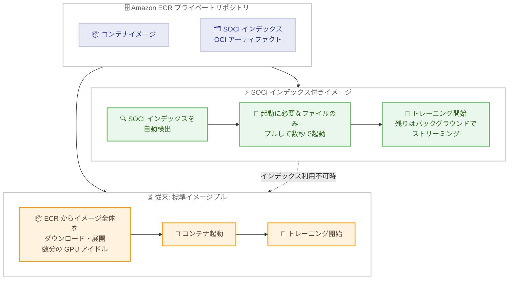

# Amazon SageMaker AI - SOCI インデックス付きイメージによるトレーニングジョブの高速起動

**リリース日**: 2026 年 10 月 29 日
**サービス**: Amazon SageMaker AI
**機能**: SOCI (Seekable OCI) インデックス付きコンテナイメージのサポート

📊 [このアップデートのインフォグラフィックを見る](https://takech9203.github.io/aws-news-summary/20261029-sagemaker-ai-soci-images-training.html)

## 概要

Amazon SageMaker AI が、トレーニングジョブおよびプロセッシングジョブにおいて SOCI (Seekable OCI) インデックス付きコンテナイメージをサポートしました。SOCI インデックス付きイメージを使用すると、トレーニングコンテナを数秒で起動でき、イメージプル中の GPU アイドル時間を最大 90% 削減できます。トレーニングのパフォーマンスへの影響はありません。

SOCI はコンテナイメージを遅延読み込み (lazy loading) するオープンソース技術です。SOCI インデックスはイメージ内の全ファイルの位置を記録したメタデータで、Amazon ECR に OCI 準拠のアーティファクトとして元のイメージに関連付けて保存されます。SageMaker はジョブ実行時にインデックスを自動検出し、コンテナ起動に必要なファイルのみを先にプルし、残りはコードの実行中にバックグラウンドでストリーミングします。

深層学習向けのコンテナイメージは 10 GB を超えることが珍しくなく、従来はジョブ開始のたびに数分単位の課金対象時間が追加されていました。頻繁にジョブを起動するハイパーパラメータチューニングや短時間のプロセッシングジョブ、迅速な実験サイクルを回す ML チームにとって、コスト削減と生産性向上の両面で価値の大きいアップデートです。

**アップデート前の課題**

- ジョブ実行前にコンテナイメージ全体のダウンロードと展開が完了するまで待つ必要があった
- 深層学習イメージは 10 GB を超えることが多く、ジョブ開始のたびに数分の課金対象時間が発生していた
- イメージプル中は GPU がアイドル状態となり、高価なアクセラレータの利用効率が低下していた
- イメージサイズが大きくなるほどダウンロード時間が線形に増加していた (例: 35.4 GB のイメージで 7 分 17 秒)

**アップデート後の改善**

- SOCI インデックス付きイメージにより、イメージサイズによらず数秒 (ベンチマークで約 3〜11 秒) でコンテナを起動できるようになった
- イメージプル中の GPU アイドル時間を最大 90% 削減し、ジョブ全体の完了が 1〜6 分早くなった
- ジョブ定義、エントリポイント、データチャネルの変更は不要で、SageMaker がインデックスを自動検出する
- インデックスが利用できない場合は標準ダウンロードに自動フォールバックするため、既存ジョブを壊すリスクがない

## アーキテクチャ図



従来の標準プルではイメージ全体のダウンロード完了を待つ必要がありましたが、SOCI インデックス付きイメージでは起動に必要なファイルのみを先にプルし、残りをバックグラウンドでストリーミングします。インデックスが利用できない場合は標準ダウンロードに自動フォールバックします。

## サービスアップデートの詳細

### 主要機能

1. **SOCI インデックスによる遅延読み込み**
   - SOCI インデックスはイメージ内の全ファイルをマッピングしたメタデータで、Amazon ECR に OCI 準拠アーティファクトとして保存される
   - 元のイメージのダイジェストや署名は変更されず、イメージの再ビルドは不要
   - コンテナ起動に必要なファイルのみを先にプルし、残りはコードがアクセスした時点でオンデマンドに取得

2. **SageMaker による自動検出とフォールバック**
   - ジョブ定義、エントリポイント、データチャネルの変更は不要
   - ECR プライベートリポジトリのイメージに SOCI インデックスが存在すれば自動的に遅延読み込みを使用
   - インデックスが使用できない場合や遅延読み込みが失敗した場合は、標準ダウンロードに自動フォールバックしてジョブを継続

3. **事前インデックス済み AWS Deep Learning Containers (DLC)**
   - イメージタグを `-soci` サフィックス付きのバリアントに切り替えるだけで利用可能
   - PyTorch Training、TensorFlow Training、vLLM、SGLang 向けに提供 (一部 arm64 バリアントあり)
   - 例: `pytorch-training:2.9-gpu-py312-cu130-ubuntu22.04-sagemaker-v1-soci`

4. **独自イメージへのインデックス追加**
   - オープンソースツール (SOCI snapshotter、Finch または nerdctl) で既存の ECR イメージにインデックスを追加可能
   - CloudFormation テンプレート「ECR SOCI Index Builder」を使用すると、EventBridge ルール経由で ECR プッシュ時に自動インデックス化できる

### パフォーマンスベンチマーク (AWS Blog より)

| 項目 | 標準ダウンロード | SOCI 遅延読み込み |
|------|------------------|-------------------|
| 1.8 GB イメージ | 48 秒 | 約 3〜11 秒 |
| 13.2 GB イメージ (13 種類のインスタンス構成) | 約 3 分 16 秒〜4 分 20 秒 | 6〜8 秒 (約 34 倍高速) |
| 35.4 GB イメージ | 7 分 17 秒 | 約 3〜11 秒 (最大約 46 倍高速) |
| エポック時間 | - | 2 エポック目以降は同等 (初回のみ 3〜16 秒増) |
| ジョブ全体 | - | 1〜6 分早く完了 |

## 技術仕様

### 対応要件

| 項目 | 詳細 |
|------|------|
| 対象ジョブ | SageMaker AI トレーニングジョブ、プロセッシングジョブ |
| 対応レジストリ | Amazon ECR プライベートリポジトリのみ |
| インデックス形式 | OCI アーティファクト (artifactType: `application/vnd.amazon.soci.index` で始まる) |
| コンテナランタイム | containerd ベース (Docker 固有の前提には注意が必要) |
| ジョブ定義の変更 | 不要 (インデックスを自動検出) |
| フォールバック | インデックス利用不可時は標準ダウンロードで継続 |

### API 変更履歴

本アップデートに伴う API の変更はありません。既存の SageMaker AI API、CLI、SDK、コンソールからそのまま利用できます。

## 設定方法

### 前提条件

1. SageMaker AI トレーニングジョブまたはプロセッシングジョブを実行できる IAM ロールと環境
2. Amazon ECR プライベートリポジトリ (独自イメージを使用する場合)
3. 独自イメージにインデックスを追加する場合は、containerd、SOCI snapshotter、Finch または nerdctl をインストールした Linux ホスト

### 手順

#### ステップ 1: 事前インデックス済み DLC を使用する場合

```python
from sagemaker.modules.train import ModelTrainer
from sagemaker.modules.configs import Compute

trainer = ModelTrainer(
    training_image="<account>.dkr.ecr.<region>.amazonaws.com/pytorch-training:2.9-gpu-py312-cu130-ubuntu22.04-sagemaker-v1-soci",
    role="arn:aws:iam::<account>:role/SageMakerExecutionRole",
    compute=Compute(instance_type="ml.g5.12xlarge", instance_count=2),
)
trainer.train()
```

イメージタグを `-soci` サフィックス付きのバリアントに変更するだけで、SageMaker が SOCI インデックスを自動検出して遅延読み込みを行います。その他のジョブ設定の変更は不要です。

#### ステップ 2: 独自イメージに SOCI インデックスを追加する場合

```bash
# 必要なツールをインストール (Amazon Linux の例)
sudo dnf install -y containerd fuse soci-snapshotter runfinch-finch

# 既存イメージを SOCI インデックス付きに変換
sudo nerdctl image convert --soci \
  "$REGISTRY/$REPO:$ORIGINAL_TAG" "$REGISTRY/$REPO:$SOCI_TAG"

# ECR にプッシュ
sudo nerdctl push --platform linux/amd64 "$REGISTRY/$REPO:$SOCI_TAG"
```

containerd と SOCI snapshotter を使用して既存イメージにインデックスを追加し、ECR にプッシュします。イメージの再ビルドは不要で、イメージのダイジェストや署名は維持されます。

#### ステップ 3: インデックスの確認

```bash
aws ecr batch-get-image \
  --repository-name "$REPO" \
  --image-ids imageTag="$SOCI_TAG" \
  --query 'images[].imageManifest'
```

マニフェストに artifactType が `application/vnd.amazon.soci.index` で始まる子マニフェストが含まれていれば、SOCI インデックスが正しく関連付けられています。

## メリット

### ビジネス面

- **コスト削減**: イメージダウンロードは課金対象のジョブ時間でありながらモデルの進捗を生まない時間であり、これを数分から数秒に短縮することでジョブあたりのコストを直接削減できる
- **実験サイクルの高速化**: ジョブ起動の待ち時間が減ることで、ハイパーパラメータチューニングや反復的な実験の回転率が向上する
- **GPU 投資の有効活用**: 高価な GPU インスタンスのアイドル時間を最大 90% 削減し、アクセラレータ利用効率を高められる

### 技術面

- **変更不要の導入**: ジョブ定義、エントリポイント、データチャネルの変更なしで利用でき、SageMaker がインデックスを自動検出する
- **安全なフォールバック**: インデックスが利用できない場合は標準ダウンロードに自動的に切り替わるため、インデックス追加が既存ジョブを壊すことはない
- **イメージサイズに依存しない起動時間**: 標準プルではサイズに比例して増加する起動時間が、遅延読み込みでは約 3〜11 秒でほぼ一定になる

## デメリット・制約事項

### 制限事項

- Amazon ECR プライベートリポジトリのみ対応 (他のレジストリや VPC モードのプライベート Docker レジストリは対象外)
- 約 4 GB 未満の小さなイメージでは効果が限定的
- DLC をベースイメージとして `FROM` でビルドした場合、インデックスは引き継がれないため、最終イメージを再インデックスする必要がある

### 考慮すべき点

- コンテナランタイムは containerd ベースのため、Docker 固有の前提 (Docker CLI の呼び出し、`/var/run/docker.sock`、cgroup パスベースの識別など) を含むスクリプトは確認が必要
- エントリポイントがトレーニング開始前にイメージ内の大部分のファイルを読み込む場合 (スキャンやプリロードなど)、短縮効果は小さくなる (それでも 6 GB のモデルを同梱したケースで 2〜2.5 分の短縮を確認)
- 初回エポックはファイルの初回アクセス時にストリーミングが発生するため、3〜16 秒程度遅くなる場合がある (2 エポック目以降は同等)

## ユースケース

### ユースケース 1: ハイパーパラメータチューニングの高速化

**シナリオ**: 数十〜数百のトレーニングジョブを並列・連続で起動するハイパーパラメータチューニングでは、ジョブごとに発生するイメージダウンロード時間が累積し、全体のコストと所要時間を押し上げている。

**実装例**:
```python
# チューニングジョブで参照するイメージを -soci バリアントに変更するだけ
estimator = PyTorch(
    image_uri="<account>.dkr.ecr.<region>.amazonaws.com/pytorch-training:2.9-gpu-py312-cu130-ubuntu22.04-sagemaker-v1-soci",
    ...
)
```

**効果**: ジョブごとに数分かかっていたイメージプルが数秒になり、チューニング全体の所要時間と課金対象時間を大幅に削減できる。

### ユースケース 2: 短時間プロセッシングジョブのオーバーヘッド削減

**シナリオ**: 実行時間が数分程度の前処理・評価用プロセッシングジョブでは、イメージダウンロード時間が実行時間に占める割合が大きく、オーバーヘッドが支配的になっている。

**実装例**:
```python
processor = Processor(
    image_uri="<account>.dkr.ecr.<region>.amazonaws.com/my-processing-image:v1.0-soci",
    role=role,
    instance_type="ml.m5.xlarge",
    instance_count=1,
)
```

**効果**: 起動オーバーヘッドが数秒に短縮され、短時間ジョブの実効コスト効率が大きく向上する。

### ユースケース 3: CI/CD パイプラインでの自動インデックス化

**シナリオ**: ML プラットフォームチームが独自のトレーニングイメージを頻繁に更新しており、イメージプッシュのたびに手動で SOCI インデックスを作成するのは運用負荷が高い。

**実装例**:
```
CloudFormation テンプレート「ECR SOCI Index Builder」をデプロイ
→ EventBridge ルールが ECR へのイメージプッシュを検知
→ 自動的に SOCI インデックスを生成して ECR に関連付け
```

**効果**: 既存の CI/CD パイプラインを変更することなく、プッシュされるすべてのイメージが自動的に SOCI インデックス付きになり、組織全体でジョブ起動の高速化を享受できる。

## 料金

SOCI インデックス付きイメージの利用に追加料金はありません。SageMaker AI のジョブは課金対象時間にイメージダウンロード時間が含まれるため、ダウンロード時間を数分から数秒に短縮することでジョブあたりのコストが直接削減されます。SOCI インデックス自体は ECR のストレージ容量としてわずかに加算されます。

## 利用可能リージョン

Amazon SageMaker AI が利用可能なすべての AWS リージョンで、SageMaker AI の API、CLI、SDK、コンソールから利用できます。

## 関連サービス・機能

- **Amazon ECR**: SOCI インデックスを OCI アーティファクトとして保存するプライベートレジストリ。本機能は ECR プライベートリポジトリのイメージのみが対象
- **AWS Deep Learning Containers**: PyTorch Training、TensorFlow Training、vLLM、SGLang 向けに `-soci` タグ付きの事前インデックス済みイメージを提供
- **SOCI Snapshotter (オープンソース)**: AWS が公開する遅延読み込み技術。Amazon ECS や AWS Fargate でも同様の高速起動に利用されている
- **Amazon EventBridge**: ECR SOCI Index Builder と組み合わせることで、イメージプッシュ時の自動インデックス化を実現

## 参考リンク

- 📊 [インフォグラフィック](https://takech9203.github.io/aws-news-summary/20261029-sagemaker-ai-soci-images-training.html)
- [公式発表 (What's New)](https://aws.amazon.com/about-aws/whats-new/2026/10/sagemaker-ai-soci-images-training/)
- [AWS Blog: Announcing SOCI-indexed images for faster SageMaker AI jobs](https://aws.amazon.com/blogs/machine-learning/announcing-soci-indexed-images-for-faster-sagemaker-ai-jobs/)
- [ドキュメント: トレーニングジョブでの SOCI インデックス付きイメージ](https://docs.aws.amazon.com/sagemaker/latest/dg/train-soci-indexed-images.html)
- [ドキュメント: プロセッシングジョブでの SOCI インデックス付きイメージ](https://docs.aws.amazon.com/sagemaker/latest/dg/processing-job-soci-indexed-images.html)

## まとめ

Amazon SageMaker AI の SOCI インデックス付きイメージ対応により、10 GB を超える深層学習イメージでも数秒でトレーニングコンテナを起動でき、GPU アイドル時間を最大 90% 削減できるようになりました。ジョブ定義の変更が不要で、インデックスがない場合は標準ダウンロードに自動フォールバックするため、導入リスクはほぼありません。まずは DLC の `-soci` タグへの切り替え、または ECR SOCI Index Builder による自動インデックス化から試すことを推奨します。
