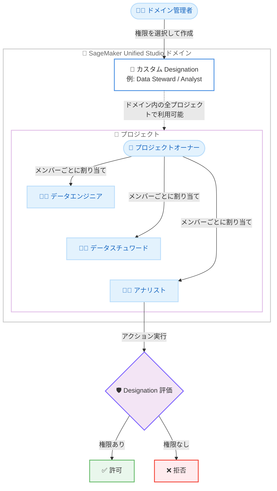

# Amazon SageMaker Unified Studio - カスタム Designation (カスタム権限セット) のサポート

**リリース日**: 2026 年 10 月 29 日
**サービス**: Amazon SageMaker Unified Studio
**機能**: Custom designations (カスタム Designation)

📊 [このアップデートのインフォグラフィックを見る](https://takech9203.github.io/aws-news-summary/20261029-sagemaker-custom-designations.html)

## 概要

Amazon SageMaker Unified Studio が、カスタム Designation (名前付き権限セット) をサポートしました。Designation は、プロジェクトメンバーがプロジェクト内で実行できるアクションを制御する権限セットであり、ドメイン管理者が組織のペルソナ (役割) に合わせて独自に定義できるようになりました。

これまで SageMaker Unified Studio のプロジェクトメンバーに割り当てられるのは Owner と Contributor の 2 つのロールのみで、両者の権限はほぼ同一でした。今回のアップデートにより、管理者は管理ポータルで Catalog、Subscriptions、Connections、Notebooks、Data Agent などのカテゴリから権限を選択してカスタム Designation を作成し、プロジェクトメンバーに割り当てられます。たとえば、サブスクリプションリクエストの承認やアセットの公開が可能な「Data Steward」、データのクエリとノートブックの実行のみに制限された「Analyst」といった役割を定義できます。

Designation はドメインレベルで一度定義すれば、そのドメイン内のすべてのプロジェクトで利用できます。データエンジニア、データスチュワード、アナリスト、自動化パイプラインといった異なるペルソナが、それぞれ差別化されたアクセス権限で 1 つのプロジェクトを共有できるため、権限分離のためだけに別々のプロジェクトを作成する必要がなくなります。

**アップデート前の課題**

このアップデート以前には、以下の課題がありました。

- プロジェクトメンバーに割り当てられるロールは Owner と Contributor の 2 種類のみで、両者の権限はほぼ同一だった
- 職務分掌 (Separation of Duties) を実現するには、ペルソナごとに別々のプロジェクトを作成して権限を分離する必要があった
- 「承認はできるが編集はできない」「閲覧とクエリのみ可能」といった組織独自の細かな役割をプロジェクト単位で表現できなかった

**アップデート後の改善**

今回のアップデートにより、以下が可能になりました。

- 組織のペルソナに合わせた名前付き権限セット (カスタム Designation) をドメインレベルで定義し、ドメイン内の任意のプロジェクトで再利用できるようになった
- 異なる役割のメンバーが差別化された権限で同一プロジェクトを共有できるようになり、権限分離のための追加プロジェクトが不要になった
- メンバーのアクション実行時に割り当てられた Designation が評価され、リクエストが許可または拒否される単一の権限モデルで職務分掌を実現できるようになった

## アーキテクチャ図



ドメイン管理者がドメインレベルでカスタム Designation を定義し、プロジェクトオーナーが各メンバーに割り当てます。メンバーがポータルまたは API からアクションを実行すると、割り当てられた Designation が評価され、許可または拒否が決定されます。

## サービスアップデートの詳細

### 主要機能

1. **カスタム Designation の作成**
   - ドメイン管理者が管理ポータルの [Designations] メニューから名前付き権限セットを作成できる
   - 権限は Catalog、Project、Subscriptions、Connections、Notebooks、Data Agent などのカテゴリから視覚的に選択できる
   - 既存の Designation を複製 (Duplicate) して、選択済みの権限をベースにカスタマイズすることも可能
   - 誤削除を防ぐ削除保護 (Allow delete チェックボックス) を設定できる

2. **ドメインレベルでの一元管理とプロジェクト横断の再利用**
   - Designation はドメインレベルで一度定義すれば、そのドメイン内の任意のプロジェクトで割り当て可能
   - プロジェクトオーナーが各メンバー (IAM ロール、IAM ユーザー、SSO ユーザー、SSO グループ) に 1 つの Designation を割り当てる
   - グループメンバーシップ経由で追加の Designation を継承でき、複数の Designation を持つ場合は権限の和集合が適用される

3. **実行時の権限評価による職務分掌**
   - メンバーがポータルまたは API からアクションを実行すると、割り当てられた Designation が評価され、許可または拒否が決定される
   - 権限定義には Cedar ポリシー言語が使用される
   - IAM と Designation の 2 層で認可が行われ、両方の層で許可された場合のみアクションが成功する (IAM の明示的 Deny は Designation の権限に関わらず優先される)
   - 既存の IAM ポリシーを変更することなく Designation を利用できる

4. **マネージド Designation との併用**
   - 各ドメインには編集・削除できない 2 つのマネージド Designation (Owner、Contributor) が引き続き含まれる
   - マネージド Designation は一般的なプロジェクトロールのベースライン権限セットを提供する

## 技術仕様

### Designation の仕様

| 項目 | 詳細 |
|------|------|
| 定義スコープ | ドメインレベル (ドメイン内の全プロジェクトで利用可能) |
| マネージド Designation | Owner、Contributor の 2 種類 (編集・削除不可) |
| カスタム Designation 数 | デフォルトでドメインあたり 10 個まで (最大 100 個まで引き上げ可能) |
| 名前 | ドメイン内で一意、最大 64 文字 |
| 権限カテゴリ | Catalog、Project、Subscriptions、Connections、Notebooks、Data Agent など |
| ポリシー言語 | Cedar |
| 割り当て対象 | IAM ロール、IAM ユーザー、SSO ユーザー、SSO グループ |
| 認可モデル | IAM と Designation の 2 層評価 (両方の許可が必要) |
| 対応ドメイン | V2 ドメインのみ (V1 ドメインは非対応) |

### CLI での作成例

```bash
aws datazone create-designation \
    --domain-identifier "dzd_example1234" \
    --name "Data Engineer" \
    --delete-protection \
    --description "Can manage data sources and create assets" \
    --policy 'permit(principal, action in [DataZone::Action::"CreateDataSource", DataZone::Action::"UpdateDataSource", DataZone::Action::"CreateAsset"], resource);'
```

Amazon DataZone の `create-designation` コマンドで、Cedar ポリシーにより許可するアクションを指定してカスタム Designation を作成します。削除保護を無効にする場合は `--no-deletion-protection` フラグを使用します。

## 設定方法

### 前提条件

1. ドメインレベルで Administrator designation を保有していること
2. 対象のドメインが V2 ドメインであること (V1 ドメインはカスタム Designation 非対応)
3. 関連アカウント (Associated accounts) から操作する場合、AWS RAM マネージド許可が所定の最小バージョンを満たしていること (例: `AWSRAMPermissionAmazonDataZoneDomainFullAccessWithPortalAccess` v8 以上)

### 手順

#### ステップ 1: カスタム Designation の作成

1. Amazon SageMaker Unified Studio のドメイン管理ポータルにサインインする
2. ナビゲーションペインで [Designations] を選択する
3. [Create designation] を選択する
4. 名前 (ドメイン内で一意、最大 64 文字) と説明を入力する
5. 削除を許可する場合は [Allow delete] を選択する (デフォルトでは削除保護が有効)
6. 視覚的な権限セレクタで、Catalog、Project、Subscriptions、Connections、Notebooks、Data Agent などのカテゴリから含める権限を選択する
7. [Create] を選択する

管理ポータル上で組織のペルソナに対応した権限セットを定義します。既存の Designation のオプションメニューから [Duplicate designation] を選択すると、権限が事前選択された状態から複製作成できます。

#### ステップ 2: プロジェクトメンバーへの割り当て

プロジェクトオーナーが、プロジェクトのメンバー管理画面で各メンバー (IAM ロール、IAM ユーザー、SSO ユーザー、SSO グループ) に作成した Designation を割り当てます。各メンバーには直接割り当てで 1 つの Designation が設定され、グループ経由で追加の Designation を継承した場合は権限の和集合が適用されます。

#### ステップ 3: 動作確認

割り当てたメンバーでポータルにサインインし、許可したアクション (例: アセットの公開、サブスクリプションの承認) が実行でき、許可していないアクションが拒否されることを確認します。

## メリット

### ビジネス面

- **職務分掌の実現**: 承認者と作業者を同一プロジェクト内で権限分離でき、データガバナンスやコンプライアンス要件に対応しやすくなる
- **組織のペルソナに合わせた権限設計**: Data Steward、Analyst など組織の実際の役割に対応した権限セットを定義でき、権限管理の意図が明確になる
- **プロジェクト乱立の抑止**: 権限分離のためだけに別プロジェクトを作成する必要がなくなり、プロジェクト数と管理コストを削減できる

### 技術面

- **IAM ポリシー変更が不要**: 既存の IAM ポリシーを変更することなく、プロジェクトレベルの細粒度アクセス制御を追加できる
- **ドメインレベルでの一元管理**: Designation を一度定義すればドメイン内の全プロジェクトで再利用でき、一貫した権限適用が可能
- **2 層の認可による多層防御**: IAM と Designation の両方で許可された場合のみアクションが成功し、IAM の Deny が常に優先されるため安全性が高い

## デメリット・制約事項

### 制限事項

- カスタム Designation は V2 ドメインのみ対応 (V1 ドメインでは利用不可)
- ドメインの管理プロジェクト (Admin project) ではカスタム Designation の作成・割り当て不可
- カスタム Designation で選択できるのは事前定義された権限セットのみで、対象外の API アクションは追加できない
- Data Agent アクションは必須で、カスタム Designation から除外できない
- DataSource API は IAM のみで認可され、Designation による Cedar 認可は非対応
- カスタム Designation の作成数はデフォルトでドメインあたり 10 個まで (上限緩和で最大 100 個)

### 考慮すべき点

- カスタム Designation のメンバーは Contributor と同じプロジェクト通知を受け取るため、実行できないイベントの通知を受け取ったり、オーナー向け通知を受け取れなかったりする場合がある
- Amazon QuickSight ブループリントを使用するプロジェクトでは、カスタム Designation のメンバーは権限設定に関わらず QuickSight フォルダへの Viewer アクセスのみとなる (Contributor 権限が必要な場合は QuickSight 管理者による個別付与が必要)
- 新しい Query Editor はノートブック基盤のため、ノートブック権限の設定は Querybook にも適用される
- 関連アカウントから操作する場合は AWS RAM マネージド許可のバージョン要件に注意が必要

## ユースケース

### ユースケース 1: データスチュワードによるガバナンス運用

**シナリオ**: データガバナンスチームのスチュワードが、データ自体の編集は行わずに、サブスクリプションリクエストの承認とアセットの公開のみを担当する。

**実装例**:
```
Designation 名: Data Steward
権限: Subscriptions カテゴリの承認権限、Catalog カテゴリの公開権限
割り当て: ガバナンスチームの SSO グループ
```

**効果**: 承認権限と編集権限を分離した職務分掌を単一プロジェクト内で実現し、監査要件に対応できる。

### ユースケース 2: アナリスト向けの閲覧・分析限定アクセス

**シナリオ**: ビジネスアナリストにはデータのクエリとノートブックの実行のみを許可し、接続やカタログの変更は禁止したい。

**実装例**:
```
Designation 名: Analyst
権限: Notebooks カテゴリの実行権限、クエリ実行に必要な権限のみ
割り当て: アナリストの SSO ユーザーまたはグループ
```

**効果**: アナリストが分析に必要な操作のみ実行でき、意図しない設定変更やカタログ汚染を防止できる。

### ユースケース 3: 自動化パイプライン用の最小権限ロール

**シナリオ**: CI/CD やデータパイプラインの自動化で使用する IAM ロールに、パイプライン実行に必要な最小限のプロジェクト権限のみを付与する。

**実装例**:
```bash
aws datazone create-designation \
    --domain-identifier "dzd_example1234" \
    --name "Pipeline Automation" \
    --delete-protection \
    --description "Automated pipeline minimal permissions" \
    --policy 'permit(principal, action in [DataZone::Action::"CreateDataSource", DataZone::Action::"UpdateDataSource"], resource);'
```

**効果**: 人間のユーザーと自動化ロールが同一プロジェクトを共有しつつ、自動化ロールには最小権限の原則を適用できる。

## 料金

カスタム Designation 機能自体に関する追加料金は発表内に記載されていません。SageMaker Unified Studio の利用料金については、Amazon SageMaker の料金ページを参照してください。

## 利用可能リージョン

Amazon SageMaker Unified Studio が利用可能なすべての AWS リージョンで利用できます。対象リージョンの一覧は [サポートされるリージョンのドキュメント](https://docs.aws.amazon.com/sagemaker-unified-studio/latest/adminguide/supported-regions.html) を参照してください。

## 関連サービス・機能

- **Amazon DataZone**: Designation の権限は Amazon DataZone API アクションとして定義され、CLI では `aws datazone create-designation` で作成する
- **AWS IAM**: Designation は IAM と連携した 2 層認可を構成し、IAM が AWS API 境界での呼び出し可否を、Designation がプロジェクト内のアクション可否を評価する
- **AWS IAM Identity Center**: SSO ユーザーおよび SSO グループへの Designation 割り当てに利用される
- **Cedar**: Designation の権限定義に使用されるオープンソースのポリシー言語
- **Amazon QuickSight**: QuickSight ブループリント使用時、カスタム Designation のメンバーには Viewer アクセスが付与される

## 参考リンク

- 📊 [インフォグラフィック](https://takech9203.github.io/aws-news-summary/20261029-sagemaker-custom-designations.html)
- [公式発表 (What's New)](https://aws.amazon.com/about-aws/whats-new/2026/10/sagemaker-custom-designations/)
- [ドキュメント: Designations](https://docs.aws.amazon.com/sagemaker-unified-studio/latest/adminguide/designations.html)
- [ドキュメント: Create designations](https://docs.aws.amazon.com/sagemaker-unified-studio/latest/adminguide/create-designations.html)
- [ドキュメント: サポートされるリージョン](https://docs.aws.amazon.com/sagemaker-unified-studio/latest/adminguide/supported-regions.html)
- [料金ページ](https://aws.amazon.com/sagemaker/pricing/)

## まとめ

Amazon SageMaker Unified Studio のカスタム Designation により、Owner と Contributor の 2 択だった権限モデルから脱却し、組織のペルソナに合わせた細粒度のプロジェクト権限を単一プロジェクト内で実現できるようになりました。複数の役割が 1 つのプロジェクトを共有する環境や、職務分掌が求められるガバナンス要件のある環境では、まず Data Steward や Analyst などの代表的なペルソナのカスタム Designation を定義し、既存プロジェクトへの適用を検討することを推奨します。
