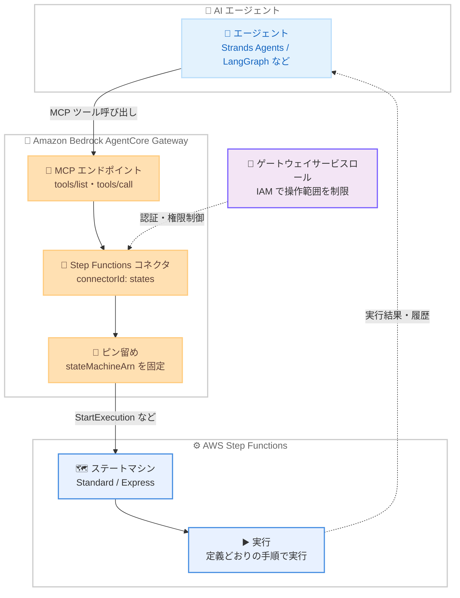

# AWS Step Functions - ワークフローを AI エージェントのツールとして利用可能に

**リリース日**: 2026 年 10 月 29 日
**サービス**: AWS Step Functions / Amazon Bedrock AgentCore Gateway
**機能**: Step Functions ワークフローの AI エージェントツール化 (AgentCore Gateway Step Functions コネクタ)

📊 [このアップデートのインフォグラフィックを見る](https://takech9203.github.io/aws-news-summary/20261029-step-functions-workflows-ai-agent-tools.html)

## 概要

AWS Step Functions のワークフローを、Amazon Bedrock AgentCore Gateway を通じて AI エージェントのツールとして公開できるようになりました。エージェントはワークフローをいつ実行するか、どのような入力を渡すかを判断し、Step Functions は定義されたとおりに各ステップを実行します。既存の Standard および Express ワークフローを変更することなく、そのままツールとして公開できます。

AgentCore Gateway には Step Functions 用の組み込みコネクタ (`connectorId: "states"`) が用意されており、公開する操作を選択してゲートウェイターゲットを作成するだけで、エージェントは Model Context Protocol (MCP) 経由でツールを検出・呼び出しできます。ツールスキーマの生成と Step Functions への認証はゲートウェイが担うため、Lambda 関数や独自の MCP サーバーを実装する必要はありません。

このアップデートは、承認済みの手順を必ず守る必要がある業務プロセス (返金処理、注文処理、オンボーディングなど) を AI エージェントと組み合わせたいユーザーに特に有用です。エージェントが判断し、ワークフローが決められた手順を保証するという役割分担を実現できます。

**アップデート前の課題**

- 以前は AI エージェントから Step Functions ワークフローを呼び出すには、Lambda 関数や独自の MCP サーバーを実装してツール定義を自分で記述する必要があった
- エージェントに AWS API への広い権限を与えると、意図しないステートマシンの実行や手順のスキップを防ぐ仕組みを自前で構築する必要があった
- エージェントの判断に業務プロセスの実行順序を委ねると、ポリシーどおりの手順実行や監査証跡の確保が難しかった

**アップデート後の改善**

- ゲートウェイターゲットを作成するだけで、既存のステートマシンを変更せずに MCP ツールとして公開できるようになった
- `StartExecution` などの操作に対しステートマシン ARN を「ピン留め」でき、エージェントは対象ワークフローを変更・上書きできなくなった (変更を試みるとゲートウェイが拒否)
- エージェントが実行状況の確認 (`DescribeExecution`)、実行履歴の取得 (`GetExecutionHistory`)、実行の停止 (`StopExecution`) も行えるようになり、運用アシスタント用途にも活用できるようになった
- コールバックパターン (`.waitForTaskToken`) と組み合わせて、ワークフロー側からエージェントにタスクを依頼する双方向連携が可能になった

## アーキテクチャ図



AI エージェントは AgentCore Gateway の MCP エンドポイント経由でツールを検出・呼び出し、ゲートウェイがピン留めされたステートマシンに対して Step Functions API を実行します。エージェントは対象ステートマシンを変更できず、実行手順はワークフロー定義が保証します。

## サービスアップデートの詳細

### 主要機能

1. **組み込み Step Functions コネクタによるツール公開**
   - ゲートウェイターゲット作成時に `connectorId: "states"` を指定し、公開する操作を選択するだけでツール化できる
   - ツールスキーマの生成、パラメータ統制、エンドポイント解決、Step Functions への認証はゲートウェイが自動で処理
   - Lambda 関数や独自 MCP サーバーの実装、ツール定義の記述は不要
   - 既存の Standard / Express ステートマシンを変更せずにそのまま公開可能

2. **10 種類の操作をツールとして提供**
   - ステートマシンに対する操作 (ピン留め対象): `StartExecution`、`StartSyncExecution`、`ListExecutions`、`DescribeStateMachine`
   - 実行やタスクトークンに対する操作: `DescribeExecution`、`StopExecution`、`GetExecutionHistory`、`SendTaskSuccess`、`SendTaskFailure`、`SendTaskHeartbeat`
   - ツール名は `<ターゲット名>___<操作名>` の形式でエージェントに公開される

3. **ピン留めによるガバナンス**
   - ピン留め対象の操作ではターゲット作成時に `stateMachineArn` を固定し、エージェントからは見えない (ツールスキーマから除外される)
   - エージェントが `stateMachineArn` を渡そうとするとゲートウェイがリクエストを拒否
   - 1 つの操作につき 1 つのピン留めのため、複数のステートマシンを公開する場合はターゲットを分けて作成する

4. **コールバックパターンによる双方向連携**
   - Standard ワークフローの `.waitForTaskToken` タスクでワークフローを一時停止し、タスクトークンをエージェント側アプリケーションに渡せる
   - エージェントは作業完了後に `SendTaskSuccess` または `SendTaskFailure` でワークフローを再開し、長時間タスクでは `SendTaskHeartbeat` で生存を通知
   - Standard ワークフローは最長 1 年間実行できるため、エージェントのセッション終了後も処理を継続できる

## 技術仕様

### 操作とワークフロータイプの対応

| 操作 | 対応ワークフロー | 備考 |
|------|------------------|------|
| `StartSyncExecution` | Express のみ | Standard では失敗。`StartExecution` + `DescribeExecution` のポーリングで代替 |
| `ListExecutions` | Standard のみ | Express では `StateMachineTypeNotSupported` エラー |
| `DescribeExecution`、`GetExecutionHistory`、`StopExecution` | Standard の実行のみ | Express の実行 ARN では `InvalidArn` エラー |
| `StartExecution`、`DescribeStateMachine`、`SendTaskSuccess`、`SendTaskFailure`、`SendTaskHeartbeat` | 両方 | - |

### ツールの入力スキーマ (コネクタバージョン 1.0.0)

| 操作 | デフォルトフィールド | 追加公開可能なフィールド |
|------|---------------------|--------------------------|
| `StartExecution` | `input` | `name`、`traceHeader` |
| `StartSyncExecution` | `input` | `name`、`traceHeader` |
| `DescribeExecution` | `executionArn` (必須)、`includedData` | なし |
| `StopExecution` | `executionArn` (必須) | `error`、`cause` |
| `GetExecutionHistory` | `executionArn` (必須) | `includeExecutionData`、`maxResults`、`reverseOrder`、`nextToken` |
| `ListExecutions` | `statusFilter` | `maxResults`、`nextToken` |
| `DescribeStateMachine` | `includedData` | なし |
| `SendTaskSuccess` | `taskToken` (必須)、`output` (必須) | なし |
| `SendTaskFailure` | `taskToken` (必須)、`error`、`cause` | なし |
| `SendTaskHeartbeat` | `taskToken` (必須) | なし |

追加フィールドは `parameterOverrides` で `visible: true` を設定することで公開できます。`stateMachineArn` は `parameterOverrides` で公開できず、ピン留めでのみ設定します。

### ゲートウェイサービスロールの IAM ポリシー例

公開するステートマシンと実行のみにスコープした最小権限の例です。

```json
{
  "Version": "2012-10-17",
  "Statement": [
    {
      "Sid": "StateMachineOperations",
      "Effect": "Allow",
      "Action": [
        "states:StartExecution",
        "states:ListExecutions",
        "states:DescribeStateMachine"
      ],
      "Resource": "arn:aws:states:us-east-1:123456789012:stateMachine:AgentHelloWorld"
    },
    {
      "Sid": "ExecutionOperations",
      "Effect": "Allow",
      "Action": [
        "states:DescribeExecution",
        "states:GetExecutionHistory",
        "states:StopExecution"
      ],
      "Resource": "arn:aws:states:us-east-1:123456789012:execution:AgentHelloWorld:*"
    }
  ]
}
```

実行 ARN はステートマシン ARN と異なるリソースタイプのため、ステートメントを分ける必要があります。`SendTaskSuccess`、`SendTaskFailure`、`SendTaskHeartbeat` は IAM のリソースレベル権限に対応していないため `"*"` で許可する必要があり、タスクトークンが唯一の制御手段となります。

## 設定方法

### 前提条件

1. AWS CLI バージョン 2 が設定済みであること
2. IAM ロール、Step Functions ステートマシン、AgentCore ゲートウェイを作成できる権限があること
3. ゲートウェイを呼び出す ID に `bedrock-agentcore:InvokeGateway` 権限があること
4. すべてのリソースを同一リージョンに作成すること (ゲートウェイは自身と同じリージョンの Step Functions エンドポイントを呼び出すため)

### 手順

#### ステップ 1: ゲートウェイの作成

```bash
aws bedrock-agentcore-control create-gateway \
  --name "step-functions-gateway" \
  --protocol-type MCP \
  --authorizer-type AWS_IAM \
  --role-arn "arn:aws:iam::123456789012:role/AgentCoreGatewayToStepFunctions" \
  --region us-east-1
```

MCP プロトコルと IAM 認証を使用するゲートウェイを作成しています。レスポンスに含まれる `gatewayId` と `gatewayUrl` を控え、ステータスが `READY` になるまで待ちます。ロールには前述の Step Functions 権限を付与しておきます。

#### ステップ 2: Step Functions コネクタターゲットの追加

```bash
aws bedrock-agentcore-control create-gateway-target \
  --gateway-identifier "GATEWAY_ID" \
  --name "hello" \
  --target-configuration '{
    "mcp": {
      "connector": {
        "source": { "connectorId": "states" },
        "configurations": [
          {
            "name": "StartExecution",
            "parameterValues": {
              "stateMachineArn": "arn:aws:states:us-east-1:123456789012:stateMachine:AgentHelloWorld"
            }
          },
          { "name": "DescribeExecution" },
          { "name": "GetExecutionHistory" },
          { "name": "StopExecution" }
        ]
      }
    }
  }' \
  --credential-provider-configurations '[{"credentialProviderType": "GATEWAY_IAM_ROLE"}]' \
  --region us-east-1
```

組み込み Step Functions コネクタを使用するターゲットを作成し、`StartExecution` にステートマシン ARN をピン留めしています。`configurations` に列挙した操作のみがツールとして公開されます。ピン留め可能な操作で `parameterValues.stateMachineArn` を省略するとターゲット作成は成功するものの、ツール呼び出しはすべて失敗する点に注意してください。

#### ステップ 3: エージェントからのツール呼び出し

```bash
awscurl --service bedrock-agentcore --region us-east-1 \
  -X POST "GATEWAY_URL" \
  -H "Content-Type: application/json" \
  -d '{
    "jsonrpc": "2.0",
    "id": 1,
    "method": "tools/call",
    "params": {
      "name": "hello___StartExecution",
      "arguments": { "input": "{\"orderId\": \"12345\"}" }
    }
  }'
```

MCP の `tools/call` でピン留めされたステートマシンの実行を開始しています。エージェントが渡すのは `input` のみで、レスポンスには新しい実行の `executionArn` が含まれます。その後 `hello___DescribeExecution` に ARN を渡してステータスを確認し、`includedData` に `ALL_DATA` を指定すると入出力も取得できます。実際の運用では Strands Agents や LangGraph などのエージェントフレームワークからゲートウェイに接続します。

## メリット

### ビジネス面

- **業務プロセスの一貫性保証**: 返金処理などで、適格性チェック、マネージャー承認、入金処理といったステップが必ずポリシーどおりの順序で実行されることを保証できる
- **監査対応の強化**: Standard ワークフローは各ステップを実行履歴に記録するため、AI エージェントが関与する処理でも監査証跡を確保できる
- **開発コストの削減**: Lambda 関数や MCP サーバーの開発・運用が不要になり、既存ワークフロー資産をそのまま AI エージェントから活用できる

### 技術面

- **決定論的な実行とエージェントの柔軟性の両立**: エージェントは「いつ・どの入力で」実行するかを判断し、「どのステップをどの順序で」実行するかはステートマシン定義が決定する
- **多層的なガバナンス**: ピン留めによる対象ステートマシンの固定と、ゲートウェイサービスロールの IAM ポリシーによる実行 ARN 単位の制御を組み合わせられる
- **長時間・非同期処理への対応**: Standard ワークフローは最長 1 年間実行可能で、コールバックパターンによりエージェントセッション終了後も処理を継続できる
- **運用の可視性**: 「昨夜失敗した注文処理はどれで、どのステップで失敗したか」といった問い合わせにエージェントが `ListExecutions` や `GetExecutionHistory` で回答できる

## デメリット・制約事項

### 制限事項

- ピン留めは 1 操作につき 1 つのステートマシンのみ。同じ操作で複数のステートマシンを公開するには、ステートマシンごとにターゲットを作成する必要がある
- `StartSyncExecution` は Express のみ、`ListExecutions`・`DescribeExecution`・`GetExecutionHistory`・`StopExecution` は Standard のみ対応するなど、ワークフロータイプによる操作の制約がある
- コールバックパターン (`.waitForTaskToken`) は Standard ワークフローのみ対応 (Express は非対応)
- ゲートウェイは自身と同じリージョンの Step Functions のみ呼び出せる (クロスリージョン不可)

### 考慮すべき点

- `SendTaskSuccess`、`SendTaskFailure`、`SendTaskHeartbeat` は IAM で特定の実行に制限できないため、有効なタスクトークンを持つエージェントは誰でもタスクを完了できる。タスクトークンはシークレットとして扱い、該当エージェントにのみ渡すこと
- 1 つのゲートウェイのすべてのターゲットはサービスロールを共有する。ワークフローごとに異なる IAM 境界が必要な場合はゲートウェイを分ける
- 実行 ARN ベースの 6 操作はピン留めの対象外のため、ゲートウェイサービスロールの IAM ポリシーを可能な限り狭くスコープすることが重要

## ユースケース

### ユースケース 1: 会話からの業務ワークフロー起動

**シナリオ**: カスタマーサポートエージェントが顧客との会話から返金を判断し、返金ワークフローを起動する。適格性チェック、マネージャー承認、入金の各ステップは必ずポリシーどおりに実行される。

**実装例**:
```json
{
  "method": "tools/call",
  "params": {
    "name": "refund___StartExecution",
    "arguments": { "input": "{\"customerId\": \"C-1001\", \"orderId\": \"O-2345\", \"amount\": 5000}" }
  }
}
```

**効果**: エージェントの柔軟な判断と、承認済みプロセスの確実な実行を両立し、ポリシー逸脱のリスクを排除できる。

### ユースケース 2: 運用アシスタント

**シナリオ**: 運用担当者が「昨夜失敗した注文処理の実行はどれ? どのステップで失敗した?」とエージェントに質問し、エージェントが実行の一覧と失敗箇所を調査して報告する。

**実装例**:
```json
{
  "method": "tools/call",
  "params": {
    "name": "orders___ListExecutions",
    "arguments": { "statusFilter": "FAILED" }
  }
}
```

続けて `GetExecutionHistory` で各実行のイベント履歴を取得し、失敗したステートと `error`・`cause` を特定します。

**効果**: 障害調査の一次切り分けを自然言語で実行でき、運用対応の初動を高速化できる。必要なら `StopExecution` で問題のある実行を停止することも可能。

### ユースケース 3: ヒューマンインザループ / エージェントへのタスク委任

**シナリオ**: Standard ワークフローが `.waitForTaskToken` タスクで一時停止し、Amazon SQS 経由でタスクトークンと作業内容をエージェント側アプリケーションに渡す。エージェントは調査や文書作成などの作業を完了後、結果を返してワークフローを再開させる。

**実装例**:
```json
{
  "method": "tools/call",
  "params": {
    "name": "orders___SendTaskSuccess",
    "arguments": {
      "taskToken": "AQCEAAAAKgAAAAMAAAAA...",
      "output": "{\"approved\": true}"
    }
  }
}
```

**効果**: ワークフロー主導でエージェントに作業を委任でき、長時間の処理やエージェントセッションをまたぐ業務プロセスを実現できる。

## 料金

追加料金はなく、AWS Step Functions と Amazon Bedrock AgentCore Gateway それぞれの標準料金が適用されます。

- Step Functions: Standard ワークフローは状態遷移数、Express ワークフローはリクエスト数と実行時間に基づく課金
- AgentCore Gateway: ツール呼び出しなどに基づく課金

詳細は [Step Functions 料金ページ](https://aws.amazon.com/step-functions/pricing/) および [Amazon Bedrock AgentCore 料金ページ](https://aws.amazon.com/bedrock/agentcore/pricing/) を参照してください。

## 利用可能リージョン

Amazon Bedrock AgentCore Gateway が利用可能なすべての AWS リージョンで利用できます。ゲートウェイは自身と同じリージョンの Step Functions エンドポイントを呼び出します。

## 関連サービス・機能

- **Amazon Bedrock AgentCore Gateway**: 本機能の中核。エージェントとツールを MCP で接続するマネージドゲートウェイで、Lambda、API、Knowledge Bases など他のターゲットタイプも提供
- **Model Context Protocol (MCP)**: エージェントがツールを検出 (`tools/list`)・呼び出し (`tools/call`) するための標準プロトコル
- **Step Functions の AgentCore 統合 (逆方向)**: Step Functions の Task ステートから AgentCore 上のエージェントを呼び出すことも可能で、本機能と組み合わせて双方向のエージェント・ワークフロー連携を構築できる
- **Agent Toolkit for AWS**: Kiro などの AI コーディングアシスタントで Step Functions ワークフローの構築を支援するツールキット

## 参考リンク

- 📊 [インフォグラフィック](https://takech9203.github.io/aws-news-summary/20261029-step-functions-workflows-ai-agent-tools.html)
- [公式発表 (What's New)](https://aws.amazon.com/about-aws/whats-new/2026/10/step-functions-workflows-ai-agent-tools/)
- [チュートリアル: Use your Step Functions workflows as tools for AI agents](https://docs.aws.amazon.com/step-functions/latest/dg/tutorial-agentcore-gateway.html)
- [AWS Step Functions as Connector Target (AgentCore Developer Guide)](https://docs.aws.amazon.com/bedrock-agentcore/latest/devguide/gateway-target-connector-step-functions.html)
- [Agent Toolkit for AWS (GitHub)](https://github.com/aws/agent-toolkit-for-aws)
- [Step Functions 料金ページ](https://aws.amazon.com/step-functions/pricing/)
- [Amazon Bedrock AgentCore 料金ページ](https://aws.amazon.com/bedrock/agentcore/pricing/)

## まとめ

Step Functions ワークフローが AgentCore Gateway 経由で AI エージェントのツールとして公開できるようになり、エージェントの柔軟な判断と決定論的な業務プロセス実行を安全に組み合わせられるようになりました。コードを書かずに既存のステートマシンをそのまま活用でき、ピン留めと IAM による多層的なガバナンスも備えています。AI エージェントに業務プロセスを実行させたい場合は、まずチュートリアルで Standard ワークフローのツール化を試し、サービスロールの最小権限設計とタスクトークンの取り扱いを確認することを推奨します。
