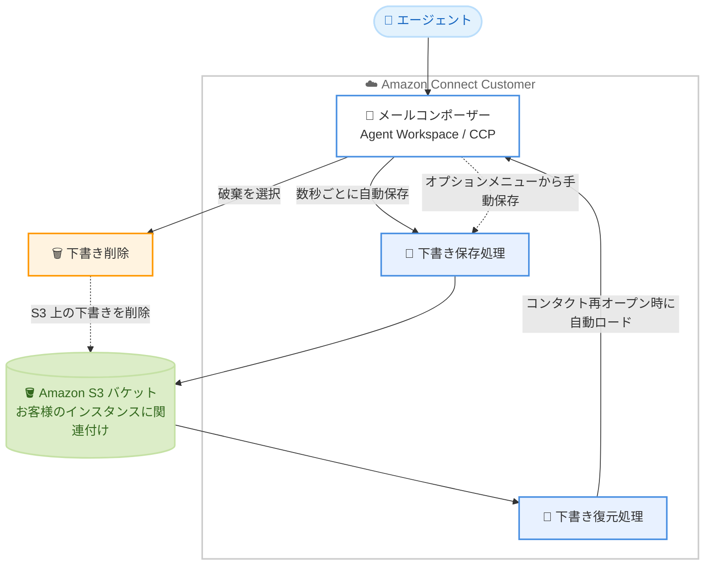

# Amazon Connect Customer - 作成中メールの下書き自動保存

**リリース日**: 2026 年 10 月 30 日
**サービス**: Amazon Connect Customer
**機能**: メール下書きの自動保存 (Email draft auto-save)

📊 [このアップデートのインフォグラフィックを見る](https://takech9203.github.io/aws-news-summary/20261030-amazon-connect-email-draft-save.html)

## 概要

Amazon Connect Customer が、エージェントの作成途中のメールを下書きとして自動保存する機能を発表しました。ネットワーク接続が中断された場合や、ブラウザを誤って閉じたり更新したりした場合でも、エージェントは作業内容を失うことなくメール作成を再開できます。下書きは本文、宛先、件名、添付ファイル参照が保持された状態で復元されます。

本機能は Agent Workspace と Contact Control Panel (CCP) で利用でき、管理者による設定は一切不要で、メールチャネルに対してデフォルトで有効化されます。保存された下書きデータはお客様の Amazon S3 バケットに格納されるため、アクセスして他のアプリケーションとの統合を構築することも可能です。

コンタクトセンターでメールチャネルを運用している組織にとって、エージェントの生産性向上と顧客対応品質の安定化につながるアップデートです。

**アップデート前の課題**

- 以前はメール作成中にブラウザが閉じられたり更新されたりすると、作成途中の内容が失われていた
- 以前はネットワーク接続が中断されると、エージェントはメールを最初から書き直す必要があった
- 以前はサインアウトをまたいで作成途中のメールを引き継ぐ手段がなかった

**アップデート後の改善**

- 今回のアップデートにより、作成中のメールが数秒ごとに自動保存され、作業内容の損失を防止できるようになった
- 今回のアップデートにより、本文・宛先・件名・添付ファイル参照を保持したまま下書きを復元できるようになった
- 今回のアップデートにより、サインアウト後に再サインインしてもセッションをまたいで下書きを復元できるようになった
- 今回のアップデートにより、S3 バケット上の下書きデータを他のアプリケーションとの統合に活用できるようになった

## アーキテクチャ図



エージェントがメールを作成すると、数秒ごとに下書きが自動保存され、お客様の S3 バケットに格納されます。コンタクトを再オープンすると下書きが自動的にコンポーザーへ復元され、破棄を選択すると S3 上の下書きが削除されます。

## サービスアップデートの詳細

### 主要機能

1. **下書きの自動保存**
   - エージェントがメールを作成している間、数秒ごとに下書きが自動保存される
   - オプションメニュー (送信ボタン横の 3 点アイコン) から [Save draft] を選択して任意のタイミングで手動保存も可能
   - 保存後は、コンポーザー下部に最終保存時刻付きの「Draft saved」ステータスが表示される
   - 保存内容は、本文、From / To / CC のメールアドレス、件名、添付ファイルへの参照

2. **下書きの復元**
   - 保存済み下書きのあるメールコンタクトを再オープンすると、下書き内容が自動的にコンポーザーにロードされる
   - サインアウト後に再サインインした場合でも、セッションをまたいで下書きを復元可能
   - 下書きは特定のメールコンタクトに紐付けられ、他のコンタクトで再利用されることはない
   - 下書きにアクセスできるのは、それを作成したエージェントのみ

3. **下書きの破棄と有効期限管理**
   - エージェントが [Discard] を選択すると、S3 バケット上の保存済み下書きメッセージが削除される
   - 下書きコンタクトは、既存のアウトバウンドメールの動作と同じデフォルト 14 日間の有効期限を継承する
   - 有効期限は UpdateContact API で延長可能
   - 有効期限内に送信も破棄もされなかった下書きコンタクトは自動的に失効してクローズされ、S3 上の下書きも削除される

4. **S3 バケットへの格納と外部統合**
   - 下書きメッセージの内容は、Connect Customer インスタンスに関連付けられた Amazon S3 バケットに格納される
   - S3 上の下書きデータにアクセスし、他のアプリケーションとの統合を構築することが可能

## 技術仕様

### 下書き自動保存の仕様

| 項目 | 詳細 |
|------|------|
| 対象チャネル | メールチャネル |
| 対応 UI | Agent Workspace、Contact Control Panel (CCP) |
| 保存タイミング | 数秒ごとの自動保存 + 手動保存 |
| 保存対象 | 本文、From / To / CC アドレス、件名、添付ファイル参照 |
| 保存世代 | コンタクトごとに最新の 1 世代のみ (保存のたびに前の下書きを置き換え) |
| アクセス制御 | 下書きを作成したエージェントのみアクセス可能 |
| 保存先 | インスタンスに関連付けられた Amazon S3 バケット |
| 有効期限 | デフォルト 14 日間 (UpdateContact API で延長可能) |
| 設定 | 管理者による設定は不要 (デフォルトで有効) |

### 保存失敗時の動作

CC アドレスが有効なメールアドレスでない場合など、保存を完了できない場合は「Failed to save draft. Please try again.」というメッセージが表示されます。エージェントが問題を修正すると、次回の保存試行時に下書きが保存されます。

## 設定方法

### 前提条件

1. Amazon Connect Customer インスタンスでメールチャネルを利用していること
2. エージェントが Agent Workspace または CCP を使用していること
3. インスタンスに Amazon S3 バケットが関連付けられていること

### 手順

#### ステップ 1: 管理者側の設定

設定作業は不要です。下書き自動保存はメールチャネルに対してデフォルトで有効化されており、管理者による構成は必要ありません。

#### ステップ 2: エージェントによる利用

エージェントがメールの作成を開始すると、数秒ごとに下書きが自動保存されます。任意のタイミングで保存したい場合は、送信ボタン横のオプションメニュー (3 点アイコン) から [Save draft] を選択します。保存されると「Draft saved」ステータスと最終保存時刻が表示されます。

#### ステップ 3: 下書きの復元・破棄

保存済み下書きのあるメールコンタクトを再オープンすると、下書きが自動的にコンポーザーにロードされます。編集を続けるか、[Discard] を選択して下書きを削除します。

#### ステップ 4: 有効期限の延長 (必要な場合)

```bash
aws connect update-contact \
  --instance-id <インスタンス ID> \
  --contact-id <コンタクト ID> \
  --cli-input-json file://update-contact.json
```

UpdateContact API を使用して、下書きコンタクトのデフォルト 14 日間の有効期限を延長できます。詳細はドキュメントの [UpdateContact API リファレンス](https://docs.aws.amazon.com/connect/latest/APIReference/API_UpdateContact.html) を参照してください。

## メリット

### ビジネス面

- **エージェント生産性の向上**: 接続断やブラウザの誤操作による書き直しが不要になり、対応時間を短縮できる
- **顧客対応品質の安定化**: 丁寧に作成した返信内容が失われないため、顧客への回答品質を維持できる
- **導入コストゼロ**: 設定不要でデフォルト有効のため、追加の導入作業なしで全エージェントが恩恵を受けられる

### 技術面

- **セッションをまたいだ復元**: サインアウト・再サインイン後も下書きが復元され、シフト交代前の作業中断にも対応できる
- **データへのアクセス性**: 下書きが自社の S3 バケットに格納されるため、監査や他アプリケーションとの統合に活用できる
- **自動ライフサイクル管理**: 有効期限切れの下書きは自動的に失効・削除され、不要データが残らない

## デメリット・制約事項

### 制限事項

- Connect Customer Streams API 上に構築したカスタムエージェントアプリケーションでは利用できない (Agent Workspace と CCP のみ対応)
- コンタクトごとに保持される下書きは最新の 1 世代のみで、保存のたびに前の下書きが置き換えられる
- 下書きは特定のメールコンタクトに紐付くため、他のコンタクトへの流用はできない

### 考慮すべき点

- 下書きコンタクトはデフォルト 14 日間で失効するため、長期間保留するケースでは UpdateContact API での有効期限延長を検討する必要がある
- 下書きメッセージの内容が S3 バケットに保存されるため、S3 バケットのアクセス制御や暗号化設定が適切であることを確認する必要がある
- CC アドレスの形式不正などで保存に失敗する場合があるため、エージェントへの操作ガイドに保存失敗時の対処を含めるとよい

## ユースケース

### ユースケース 1: ネットワーク障害からの業務復旧

**シナリオ**: 在宅勤務のエージェントが長文の問い合わせ回答メールを作成中に、自宅のネットワーク接続が一時的に切断された。

**実装例**:
```text
1. エージェントがメールを作成 (数秒ごとに自動保存)
2. ネットワーク切断が発生
3. 接続復旧後、該当のメールコンタクトを再オープン
4. 下書きが自動的にコンポーザーに復元され、続きから作成を再開
```

**効果**: 書き直しが不要になり、顧客への回答遅延と対応時間の増加を防止できる。

### ユースケース 2: シフト交代をまたいだ対応の継続

**シナリオ**: エージェントがシフト終了時刻までにメール回答を完成できず、翌日のシフトで続きを作成したい。

**実装例**:
```text
1. シフト終了前にオプションメニューから [Save draft] で下書きを保存
2. サインアウトしてシフトを終了
3. 翌日サインイン後、同じメールコンタクトを再オープン
4. 下書きが復元され、続きから作成を完了して送信
```

**効果**: セッションをまたいで作業を継続でき、丁寧に作成した回答内容を無駄にしない。

### ユースケース 3: S3 上の下書きデータを活用した外部統合

**シナリオ**: コンタクトセンターの運用チームが、下書きデータを活用して品質管理や社内ツールとの連携を行いたい。

**実装例**:
```text
1. Connect Customer インスタンスに関連付けられた S3 バケットを確認
2. S3 バケット上の下書きメッセージデータへのアクセス権限を設定
3. 下書きデータを読み取り、社内アプリケーションと統合
```

**効果**: 下書きデータを自社管理の S3 バケットから利用でき、独自の業務アプリケーションとの統合を構築できる。

## 料金

公式発表に本機能に関する追加料金の記載はありません。下書きメッセージはお客様の Amazon S3 バケットに格納されるため、S3 の標準的なストレージ・リクエスト料金が適用されます。詳細は [Amazon Connect の料金ページ](https://aws.amazon.com/connect/pricing/) および [Amazon S3 の料金ページ](https://aws.amazon.com/s3/pricing/) を確認してください。

## 利用可能リージョン

以下の 9 リージョンで利用可能です。

- 米国東部 (バージニア北部)
- 米国西部 (オレゴン)
- アジアパシフィック (ソウル)
- アジアパシフィック (シンガポール)
- アジアパシフィック (シドニー)
- アジアパシフィック (東京)
- カナダ (中部)
- 欧州 (フランクフルト)
- 欧州 (ロンドン)

## 関連サービス・機能

- **Amazon Connect Agent Workspace**: 本機能が利用できるエージェント向け統合ワークスペース
- **Contact Control Panel (CCP)**: 本機能が利用できるコンタクト操作用パネル
- **Amazon S3**: 下書きメッセージの格納先となるストレージサービス。外部統合のデータソースとしても利用可能
- **UpdateContact API**: 下書きコンタクトの有効期限を延長するために使用する API

## 参考リンク

- 📊 [インフォグラフィック](https://takech9203.github.io/aws-news-summary/20261030-amazon-connect-email-draft-save.html)
- [公式発表 (What's New)](https://aws.amazon.com/about-aws/whats-new/2026/10/amazon-connect-email-draft-save/)
- [ドキュメント: Email draft auto-save in the agent workspace](https://docs.aws.amazon.com/connect/latest/adminguide/email-drafts.html)
- [UpdateContact API リファレンス](https://docs.aws.amazon.com/connect/latest/APIReference/API_UpdateContact.html)
- [Amazon Connect 製品ページ](https://aws.amazon.com/connect/)
- [料金ページ](https://aws.amazon.com/connect/pricing/)

## まとめ

Amazon Connect Customer のメール下書き自動保存は、設定不要でエージェントの作業損失を防止する実用的なアップデートです。メールチャネルを利用しているコンタクトセンターでは追加作業なしで恩恵を受けられるため、エージェント向けの操作ガイドに下書きの保存・復元・破棄の手順を反映することを推奨します。長期保留が想定されるワークフローでは、UpdateContact API による有効期限延長の運用も検討してください。
