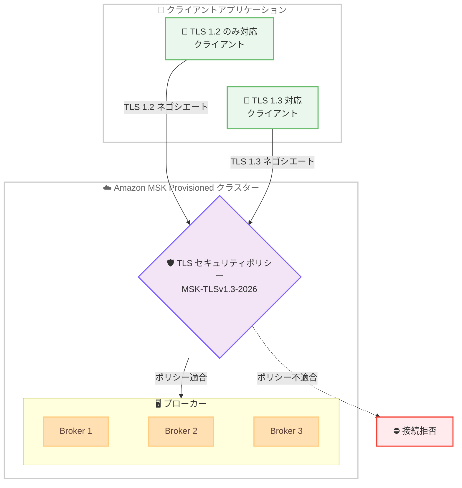

# Amazon MSK - TLS 1.3 によるデータ転送時の暗号化サポート

**リリース日**: 2026 年 10 月 30 日
**サービス**: Amazon Managed Streaming for Apache Kafka (Amazon MSK)
**機能**: TLS セキュリティポリシーによる TLS 1.3 サポート

📊 [このアップデートのインフォグラフィックを見る](https://takech9203.github.io/aws-news-summary/20261030-amazon-msk-tls.html)

## 概要

Amazon MSK が、MSK Provisioned クラスターにおけるデータ転送時の暗号化で TLS 1.3 をサポートしました。クラスターが受け入れる TLS バージョンと暗号スイートは「名前付き TLS セキュリティポリシー」で定義され、ポリシーの条件を満たさない接続は拒否されます。これにより、より高速かつ安全な暗号化プロトコルでストリーミングデータを保護できます。

ポリシーの適用は明示的なオプトイン方式です。既存クラスターはポリシーを適用するまで一切変更されないため、意図しない接続断の心配はありません。TLS 1.2 と TLS 1.3 の両方を受け入れる混在モードのポリシーを使用すれば、各クライアントがサポートする最上位バージョンをネゴシエートできるため、クライアントアプリケーションを段階的に移行してからポリシーを厳格化するという運用が可能です。

また、TLS 1.3 はポスト量子暗号の前提条件の 1 つであり、「今収集して後で復号する」(harvest-now, decrypt-later) 型の攻撃戦略への備えにもなります。コンプライアンスフレームワークやエンタープライズセキュリティ標準で TLS 1.3 が要求されるケースが増えており、金融・医療・公共分野などの規制業界のユーザーにとって特に重要なアップデートです。

**アップデート前の課題**

このアップデート以前には、以下の課題がありました。

- Amazon MSK のデータ転送時の暗号化は TLS 1.2 までしか利用できなかった
- TLS 1.3 を必須とするコンプライアンス要件や社内セキュリティ標準に対応できなかった
- クラスターが受け入れる TLS バージョンや暗号スイートをユーザー側で制御する手段がなかった

**アップデート後の改善**

今回のアップデートにより、以下が可能になりました。

- MSK Provisioned クラスターで TLS 1.3 によるデータ転送時の暗号化が利用可能になった
- 名前付きセキュリティポリシーで、受け入れる TLS バージョンと暗号スイートを明示的に制御できるようになった
- TLS 1.2 / 1.3 混在ポリシーにより、クライアントを段階的に移行してから TLS 1.3 のみに厳格化できるようになった
- ポスト量子暗号への移行に向けた前提条件を満たせるようになった

## アーキテクチャ図



混在モードポリシー MSK-TLSv1.3-2026 では、各接続がクライアントのサポートする最上位の TLS バージョンをネゴシエートし、ポリシーに適合しない接続は拒否されます。ポリシーはクライアントとブローカー間だけでなく、ブローカー間レプリケーションやコントローラーとの通信など、Amazon MSK が管理するすべての暗号化リンクに適用されます。

## サービスアップデートの詳細

### 主要機能

1. **名前付き TLS セキュリティポリシー**
   - クラスターが受け入れる TLS プロトコルバージョンと暗号スイートを定義する
   - ポリシーの条件を満たさない接続は拒否される
   - MSK 設定 (Configuration) のプロパティ `tls.security.policy` として適用し、専用 API は不要
   - ポリシーはクライアントとブローカー間、ブローカー間レプリケーション、ブローカーとコントローラー間 (KRaft モード) または ZooKeeper との通信 (ZooKeeper モード) など、MSK が管理するすべての暗号化リンクに適用される

2. **明示的なオプトイン方式**
   - ポリシーを適用するまで既存クラスターには一切変更が加えられない
   - ポリシー未設定のクラスターは現行の TLS 設定 (MSK-TLS1.2-Default-2026 相当、TLS 1.2 のみ) を維持する

3. **段階的な移行パス**
   - MSK-TLSv1.3-2026 は TLS 1.2 と TLS 1.3 の両方を受け入れる追加型ポリシーで、TLS 1.2 の暗号スイートは削除されない
   - 各接続はクライアントがサポートする最上位バージョンをネゴシエートする
   - クライアントの移行完了後、MSK-TLSv1.3-Only-2026 を適用して TLS 1.3 のみに制限できる

## 技術仕様

### 利用可能な TLS セキュリティポリシー

| ポリシー名 | TLS 1.2 | TLS 1.3 | 説明 |
|------|------|------|------|
| MSK-TLS1.2-Default-2026 | ✓ | - | デフォルト。ポリシー未設定時のすべてのクラスターの動作 |
| MSK-TLSv1.3-2026 | ✓ | ✓ | 追加型。TLS 1.3 を追加し、TLS 1.2 の暗号スイートは削除しない |
| MSK-TLSv1.3-Only-2026 | - | ✓ | TLS 1.3 のみ。TLS 1.3 をネゴシエートできない接続を拒否 |

ポリシー名は大文字と小文字が区別され、完全一致が必要です。

### サポートされる TLS 1.3 暗号スイート

| 暗号スイート | MSK-TLSv1.3-2026 | MSK-TLSv1.3-Only-2026 |
|------|------|------|
| TLS_AES_128_GCM_SHA256 | ✓ | ✓ |
| TLS_AES_256_GCM_SHA384 | ✓ | ✓ |
| TLS_CHACHA20_POLY1305_SHA256 | 非サポート | 非サポート |

TLS_CHACHA20_POLY1305_SHA256 のみを提示するクライアントは TLS 1.3 ハンドシェイクを完了できません。ただし、ほとんどの Apache Kafka クライアントはデフォルトで AES-GCM スイートを提示します。

### 前提条件と制約

| 項目 | 詳細 |
|------|------|
| 対象クラスター | MSK Provisioned のみ (MSK Serverless は対象外) |
| Apache Kafka バージョン | 3.6 以降 |
| ポリシー変更の制約 | 既存クラスターは隣接するポリシーへ 1 段階ずつのみ移行可能 |
| 新規クラスター | MSK-TLSv1.3-Only-2026 を直接選択可能 |
| TLS 1.3 のフォールバック | TLS 1.3 ハンドシェイク失敗時に TLS 1.2 へはフォールバックしない |

### ポリシー設定例

```properties
# server.properties
tls.security.policy=MSK-TLSv1.3-2026
```

## 設定方法

### 前提条件

1. MSK Provisioned クラスターであること (MSK Serverless は非対応)
2. Apache Kafka バージョン 3.6 以降を実行していること
3. クラスターが ACTIVE 状態で、他のクラスター操作が進行中でないこと
4. MSK 設定の作成・更新およびクラスター設定の更新権限があること
5. すべてのクライアント、ツール、中間機器 (ファイアウォール、プロキシ等) が適用するポリシーに対応していること

### 手順

#### ステップ 1: 設定ファイルの作成と MSK 設定の登録

```bash
# server.properties にポリシーを記述
echo "tls.security.policy=MSK-TLSv1.3-2026" > server.properties

# MSK 設定を作成
aws kafka create-configuration \
    --name tls13-additive \
    --kafka-versions "3.6.0" \
    --server-properties fileb://server.properties
```

`tls.security.policy` プロパティを含む MSK 設定を作成しています。新しい設定リビジョンは既存の設定を置き換えるため、既存の設定に含まれる他のプロパティも server.properties に残す必要があります。

#### ステップ 2: クラスターへの設定適用

```bash
aws kafka update-cluster-configuration \
    --cluster-arn <クラスター ARN> \
    --current-version <現在のクラスターバージョン> \
    --configuration-info '{"Arn":"<設定 ARN>","Revision":1}'
```

作成した設定リビジョンをクラスターに適用しています。Amazon MSK はローリング再起動を実行し、各ブローカーが 1 回ずつ再起動します。レプリケーションファクターが 3 以上、`min.insync.replicas` がレプリケーションファクター - 1 以下で、クライアントがリトライする構成であれば、再起動中もクラスターはトラフィックを処理し続けます。AWS CloudFormation の `AWS::MSK::Configuration` リソースの `ServerProperties` やマネジメントコンソールからも設定できます。

#### ステップ 3: 適用されたポリシーの確認

```bash
# クラスターに適用されている設定 ARN とリビジョンを確認
aws kafka describe-cluster --cluster-arn <クラスター ARN>

# 設定リビジョンの内容を確認
aws kafka describe-configuration-revision \
    --arn <設定 ARN> \
    --revision <リビジョン番号>

# TLS 1.3 でのハンドシェイクを検証
openssl s_client -connect <ブローカーエンドポイント>:9094 -tls1_3
```

クラスターの現在の設定を確認し、openssl コマンドで実際の TLS ネゴシエーションを検証しています。`tls.security.policy` が存在しない場合、クラスターはデフォルトポリシー MSK-TLS1.2-Default-2026 を使用しています。

#### ステップ 4: TLS 1.3 のみへの厳格化 (オプション)

クライアントの移行が完了したら、同じ手順で `tls.security.policy=MSK-TLSv1.3-Only-2026` を適用します。MSK-TLS1.2-Default-2026 から MSK-TLSv1.3-Only-2026 へ 1 回で移行することはできず、必ず MSK-TLSv1.3-2026 を経由する必要があります。

## メリット

### ビジネス面

- **コンプライアンス対応**: TLS 1.3 を要求するコンプライアンスフレームワークやエンタープライズセキュリティ標準への準拠が可能になる
- **将来への備え**: TLS 1.3 はポスト量子暗号の前提条件の 1 つであり、harvest-now, decrypt-later 型の攻撃への対策となる
- **追加コストなし**: 追加料金なしで利用でき、MSK Provisioned が利用可能なすべてのリージョンで提供される

### 技術面

- **高速かつ安全な暗号化**: TLS 1.3 はハンドシェイクのラウンドトリップ削減と最新の暗号スイートにより、TLS 1.2 より高速で安全
- **ダウンタイムなしの段階的移行**: 混在モードポリシーと 1 段階ずつのローリング再起動により、クラスターを稼働させたまま安全に移行できる
- **一元的な制御**: ブローカーごとの個別設定ではなく、名前付きポリシーでクラスター全体の TLS 設定を一元管理できる

## デメリット・制約事項

### 制限事項

- MSK Serverless では利用できない (MSK Provisioned のみ)
- Apache Kafka バージョン 3.6 以降が必要
- 既存クラスターのポリシー変更は 1 段階ずつのみ (デフォルトから TLS 1.3 のみへ直接移行は不可)
- TLS_CHACHA20_POLY1305_SHA256 暗号スイートは非サポート
- TLS 1.3 ハンドシェイクに失敗した接続は TLS 1.2 にフォールバックしない

### 考慮すべき点

- MSK-TLSv1.3-Only-2026 では TLS 1.3 非対応のクライアントが接続できなくなるため、事前にすべてのクライアントの対応状況を確認する必要がある
- MSK-TLSv1.3-2026 でも、TLS 1.3 を広告するが実装に不備のあるクライアントはハンドシェイクに失敗する。クライアントの TLS ライブラリが RFC 8446 に準拠しているか確認が必要
- クライアントとブローカーの間にあるファイアウォール、プロキシ、ロードバランサー、トラフィック検査アプライアンスも TLS 1.3 に対応している必要がある
- 本番適用の前に、非本番クラスターで MSK-TLSv1.3-2026 を適用してクライアント接続を確認することが推奨される
- Kafka 管理 API (`kafka-configs.sh`) でブローカーに `ssl.*` 設定を直接適用してはならない。ポリシーと競合する設定はブローカーの起動失敗やレプリケーション喪失を引き起こし、復旧に AWS Support が必要になる場合がある
- ポリシー適用時はローリング再起動が発生するため、高可用性のベストプラクティス (レプリケーションファクター 3 以上など) に従った構成が前提となる

## ユースケース

### ユースケース 1: 規制業界でのコンプライアンス要件への対応

**シナリオ**: 金融機関が社内セキュリティ標準で TLS 1.3 の使用を義務付けられており、Kafka ベースのストリーミング基盤もその対象となった。

**実装例**:
```properties
# フェーズ 1: 混在モードで TLS 1.3 を有効化
tls.security.policy=MSK-TLSv1.3-2026
# フェーズ 2: クライアント移行完了後に TLS 1.3 のみへ厳格化
tls.security.policy=MSK-TLSv1.3-Only-2026
```

**効果**: クラスターを停止することなく段階的に TLS 1.3 への移行を完了し、監査でポリシー名による明確な証跡を示せる。

### ユースケース 2: 多数のクライアントチームを抱える組織での段階的移行

**シナリオ**: 複数の開発チームがそれぞれ異なる言語・バージョンの Kafka クライアントで同一クラスターに接続しており、全チーム同時の TLS 1.3 移行は現実的でない。

**実装例**:
```bash
# 混在モードポリシーを適用し、各チームが自分のペースで移行
aws kafka update-cluster-configuration \
    --cluster-arn <クラスター ARN> \
    --current-version <現在のバージョン> \
    --configuration-info '{"Arn":"<設定 ARN>","Revision":1}'

# 各チームはクライアント側で TLS 1.3 を検証
openssl s_client -connect <ブローカーエンドポイント>:9094 -tls1_3
```

**効果**: TLS 1.2 のみ対応のクライアントも接続を維持したまま、各チームが独立したスケジュールで TLS 1.3 へ移行できる。

### ユースケース 3: ポスト量子暗号への移行準備

**シナリオ**: 長期保存が必要な機密データを扱う組織が、将来の量子コンピュータによる復号リスク (harvest-now, decrypt-later) に備えたロードマップを策定している。

**実装例**:
```properties
# TLS 1.3 のみを受け入れるポリシーを新規クラスターに直接適用
tls.security.policy=MSK-TLSv1.3-Only-2026
```

**効果**: ポスト量子暗号の前提条件である TLS 1.3 への移行を先行して完了し、将来の暗号アルゴリズム移行の基盤を整備できる。

## 料金

追加料金はありません。TLS セキュリティポリシーの適用と TLS 1.3 の利用は、既存の Amazon MSK Provisioned の料金体系の範囲内で利用できます。

## 利用可能リージョン

Amazon MSK Provisioned が提供されているすべての AWS リージョンで利用可能です。

## 関連サービス・機能

- **AWS Certificate Manager (ACM)**: MSK ブローカーは ACM のパブリック証明書を使用しており、Amazon Trust Services を信頼するトラストストアであれば追加設定なしで接続できる
- **AWS Key Management Service (KMS)**: 転送時の暗号化と組み合わせて、保存時の暗号化を KMS キーで透過的に実施できる
- **AWS CloudFormation**: `AWS::MSK::Configuration` リソースの `ServerProperties` で `tls.security.policy` を宣言的に管理できる
- **Application Load Balancer / Amazon CloudFront**: 同様に名前付きセキュリティポリシーで TLS バージョンを制御する方式を採用しており、運用モデルの一貫性がある

## 参考リンク

- 📊 [インフォグラフィック](https://takech9203.github.io/aws-news-summary/20261030-amazon-msk-tls.html)
- [公式発表 (What's New)](https://aws.amazon.com/about-aws/whats-new/2026/10/amazon-msk-tls/)
- [Amazon MSK Security (開発者ガイド)](https://docs.aws.amazon.com/msk/latest/developerguide/security.html)
- [Amazon MSK Encryption (開発者ガイド)](https://docs.aws.amazon.com/msk/latest/developerguide/msk-encryption.html)
- [TLS security policies for Amazon MSK (開発者ガイド)](https://docs.aws.amazon.com/msk/latest/developerguide/msk-tls-security-policies.html)
- [Amazon MSK 料金ページ](https://aws.amazon.com/msk/pricing/)

## まとめ

Amazon MSK の TLS 1.3 サポートは、名前付きセキュリティポリシーによるオプトイン方式で提供され、既存クラスターへの影響なく段階的に導入できる設計が特徴です。コンプライアンス要件への対応とポスト量子暗号への備えの両面で価値があるため、MSK Provisioned を利用中の場合は、まず非本番環境で混在モードポリシー MSK-TLSv1.3-2026 を適用してクライアントの互換性を検証し、計画的な TLS 1.3 移行を開始することを推奨します。
