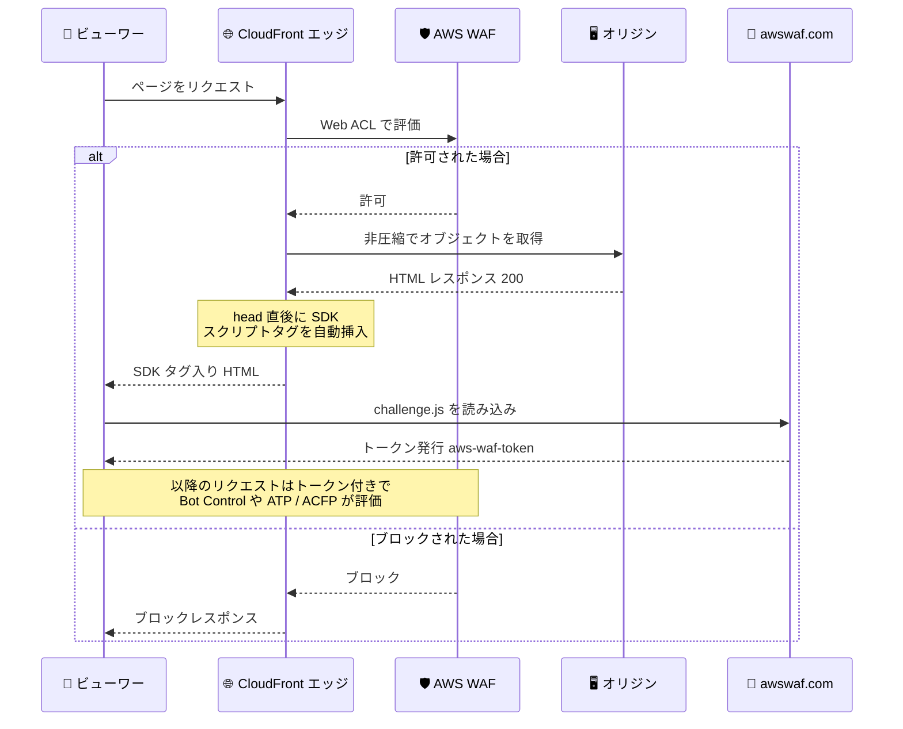

# AWS WAF - Amazon CloudFront ディストリビューション向け自動 SDK 統合

**リリース日**: 2026 年 10 月 30 日
**サービス**: AWS WAF / Amazon CloudFront
**機能**: 自動 SDK 統合 (Automatic SDK integration for Amazon CloudFront distributions)

📊 [このアップデートのインフォグラフィックを見る](https://takech9203.github.io/aws-news-summary/20261030-aws-waf-automatic-sdk-integration-amazon-cloudfront.html)

## 概要

AWS WAF が、Amazon CloudFront ディストリビューション向けの自動 SDK 統合を発表しました。この機能を有効化すると、CloudFront がエッジで HTML レスポンスに AWS WAF JavaScript SDK のスクリプトタグを自動挿入します。アプリケーションコード、ビルドプロセス、デプロイの変更は一切不要です。

AWS WAF JavaScript SDK は、Bot Control マネージドルールグループ (ターゲット検査レベル)、Fraud Control アカウント乗っ取り防止 (ATP)、Fraud Control アカウント作成不正防止 (ACFP) が利用するクライアントサイドシグナルを収集します。これまでこれらの保護機能を最大限活用するには、保護対象のすべてのページにスクリプトタグを手動で追加する必要がありました。

多数のアプリケーションを運用するチームや、自社で管理していないシステムが生成するページを配信するケースで、クライアント側統合の作業負荷と設定漏れのリスクを大幅に削減できるアップデートです。

**アップデート前の課題**

このアップデート以前は、インテリジェント脅威対策のクライアント側統合に手作業が必要でした。

- 保護対象のすべてのアプリケーションのすべてのページに、SDK のスクリプトタグを手動で追加・維持する必要があった
- 多数のアプリケーションを運用する場合、同じ統合作業を繰り返す必要があった
- 自社で管理していないシステムが生成するページでは、スクリプトタグの追加が困難だった
- Web ACL 側で保護を有効化しても、クライアント側統合が漏れると保護が不完全になるリスクがあった

**アップデート後の改善**

今回のアップデートにより、Web ACL の設定のみでクライアント側統合が完了します。

- Web ACL で自動 SDK 統合を有効化するだけで、CloudFront がエッジで HTML にスクリプトタグを自動挿入するようになった
- アプリケーションごとのコード変更、ビルドプロセスやデプロイの変更が不要になった
- マネジメントコンソール、CLI、SDK、CDK、CloudFormation のいずれからも設定できるようになった
- 追加料金なしで利用できる

## アーキテクチャ図



自動 SDK 統合を有効化した CloudFront Web ACL では、AWS WAF が許可した HTML レスポンスの `head` 要素直後に SDK スクリプトタグがエッジで挿入され、ブラウザがトークンを取得してクライアントサイドシグナルを送信する流れになります。

## サービスアップデートの詳細

### 主要機能

1. **エッジでのスクリプトタグ自動挿入**
   - CloudFront が、HTTP 200 かつ `Content-Type: text/html` の非圧縮レスポンスの `head` 要素直後に SDK スクリプトタグを挿入する
   - 挿入されるタグは手動統合と同じもので、Web ACL の統合 URL (`ApplicationIntegrationURL`) を参照し、`defer` 属性付きで読み込まれる
   - 挿入に失敗した場合はオリジンのレスポンスがそのまま返される (フェイルオープン設計のため、レスポンスがブロックされることはない)

2. **対象となるマネージドルールグループ**
   - Bot Control (`AWSManagedRulesBotControlRuleSet`): 検査レベルが targeted の場合のみ対象 (common はクライアントサイドシグナルを使用しないため対象外)
   - Fraud Control アカウント乗っ取り防止 ATP (`AWSManagedRulesATPRuleSet`)
   - Fraud Control アカウント作成不正防止 ACFP (`AWSManagedRulesACFPRuleSet`)
   - ルールグループのアクションを Count にオーバーライドしていても対象となるため、評価段階から SDK を導入できる

3. **柔軟な有効化オプション**
   - コンソールで対象ルールグループを含む新規 CloudFront Web ACL を作成する場合は、デフォルトで有効
   - API や CloudFormation などプログラムで作成する場合は、デフォルトで無効 (明示的に設定が必要)
   - 既存の Web ACL や、リリース前に作成された Web ACL は変更されない (必要なときに自分で有効化する)

## 技術仕様

### 動作条件とスコープ

| 項目 | 詳細 |
|------|------|
| 対象スコープ | CloudFront スコープの Web ACL のみ (リージョナルリソースは対象外) |
| 必要なルールグループ | Bot Control (targeted)、ATP、ACFP のいずれか 1 つ以上 |
| 挿入対象レスポンス | HTTP 200 かつ `text/html` の非圧縮レスポンス |
| 挿入位置 | `head` 開始タグの直後 (レスポンス先頭の数 KB をスキャン) |
| 挿入されないケース | `Cache-Control: no-transform` 付きレスポンス、圧縮済みレスポンス、WAF / CloudFront が生成したレスポンス、UTF-16 / UTF-32 などの非 ASCII 互換エンコーディング |
| 設定方法 | コンソール、CLI、SDK、CDK、CloudFormation |
| 追加料金 | なし |

### API 変更履歴

| 日付 | サービス | 変更内容 |
|------|----------|----------|
| 2026/10/29 | [wafv2](https://awsapichanges.com/archive/changes/76af6f-wafv2.html) | 4 updated api methods - `CreateWebACL` / `UpdateWebACL` などの `AssociationConfig` に `ChallengeJavascriptSdkInjection` 設定が追加 |

### API 設定例

API では、Web ACL の `AssociationConfig` に `ChallengeJavascriptSdkInjection` 設定を `CLOUDFRONT` マップキーで追加します。設定オブジェクトは空です。

```json
"AssociationConfig": {
    "ChallengeJavascriptSdkInjection": {
        "CLOUDFRONT": {}
    }
}
```

無効化する場合は、この設定を含めずに `UpdateWebACL` を実行します (設定を省略した更新リクエストは自動 SDK 統合をオフにします)。

## 設定方法

### 前提条件

1. CloudFront スコープ (Global) の Web ACL を使用していること
2. Web ACL に対象ルールグループ (Bot Control targeted、ATP、ACFP のいずれか) が含まれていること
3. ページの Content Security Policy で `https://*.awswaf.com` を許可していること (CSP を使用している場合)

### 手順

#### ステップ 1: コンソールで有効化

CloudFront Web ACL で対象のマネージドルールグループを追加または編集し、「Automatic SDK integration」セクションで「Enable automatic SDK integration」を選択します。Bot Control の場合は、検査レベルと機械学習を設定するパネルと同じ場所に設定があります。

#### ステップ 2: CLI / API で有効化する場合

```bash
aws wafv2 update-web-acl \
  --scope CLOUDFRONT \
  --region us-east-1 \
  --name my-web-acl \
  --id <web-acl-id> \
  --lock-token <lock-token> \
  --default-action Allow={} \
  --rules file://rules.json \
  --visibility-config SampledRequestsEnabled=true,CloudWatchMetricsEnabled=true,MetricName=my-web-acl \
  --association-config '{"ChallengeJavascriptSdkInjection":{"CLOUDFRONT":{}}}'
```

`UpdateWebACL` の `--association-config` に `ChallengeJavascriptSdkInjection` を指定して、自動 SDK 統合を有効化しています。`UpdateWebACL` は設定全体の置き換えとなるため、既存のルールや設定も含めて指定する必要があります。

#### ステップ 3: 動作確認

有効化後、プライベートブラウジングウィンドウでページを開き、ページソースにスクリプトタグが挿入されていることを確認します。あわせて、ブラウザが `aws-waf-token` Cookie を受け取っていることを確認します。ディストリビューションが HTML をキャッシュしている場合、変更を即時反映するにはキャッシュの無効化 (Invalidation) を実行します。なお、タグが挿入されたかどうかを記録するメトリクスやログフィールドは存在しないため、ブラウザでの確認が必要です。

## メリット

### ビジネス面

- **運用負荷の削減**: 多数のアプリケーションへの SDK 統合作業が不要になり、セキュリティチームが Web ACL の設定だけで保護を展開できる
- **保護漏れリスクの低減**: クライアント側統合の漏れによる保護の不完全さを防ぎ、Bot Control や Fraud Control の検知精度を安定して確保できる
- **追加コストなし**: 自動 SDK 統合自体に追加料金は発生しない

### 技術面

- **コード変更不要**: アプリケーションコード、ビルドプロセス、デプロイを変更せずにクライアント側統合を実現できる
- **安全な導入**: ルールグループを Count モードで評価しながら SDK を先行導入でき、挿入はフェイルオープンでレスポンスをブロックしない
- **手動統合との共存**: SDK は複数回読み込まれても 1 回だけ実行されるため、既に手動統合済みのアプリケーションで有効化しても問題ない

## デメリット・制約事項

### 制限事項

- CloudFront スコープの Web ACL 専用であり、ALB や API Gateway などのリージョナルリソースでは利用できない
- CloudFront Origin Shield を有効にしたオリジン、オリジンリクエスト / オリジンレスポンスイベントに Lambda@Edge を設定したキャッシュビヘイビア、埋め込み POP ではタグが一貫して挿入されない
- キャッシュされない高レートのリクエスト (POST や TTL 0 のビヘイビアなど) では、タグが挿入されないレスポンスが発生する場合がある
- `'strict-dynamic'` と nonce / ハッシュを使う Content Security Policy には対応していない (挿入されたタグに nonce が付与されないため、ブラウザにブロックされる)
- 挿入されるのは SDK スクリプトタグのみで、CAPTCHA JavaScript API やモバイル SDK は対象外
- SDK のリクエストを独自ドメイン経由でプロキシする構成は使用されず、挿入されたタグは awswaf.com を直接参照する

### 考慮すべき点

- 有効化すると、CloudFront は保護対象ディストリビューションのすべてのオブジェクト (HTML 以外も含む) をオリジンから非圧縮で取得するようになる。ビューワーへの圧縮配信を継続するには、キャッシュビヘイビアで圧縮を有効化する
- `Range` / `If-Range` ヘッダーが削除され、常にオブジェクト全体が HTTP 200 で返されるため、動画プレイヤーやダウンロードマネージャーなど部分取得を行うクライアントのデータ転送量が増加する
- 挿入後は `Content-Length` が更新され、`ETag` が弱い検証子に置き換わる。`Content-MD5` などのボディ整合性ヘッダーは再計算されない
- キャッシュ済みの HTML は保存時点の状態で配信されるため、即時反映にはキャッシュ無効化が必要。ブラウザや下流キャッシュに残る古いコピーは無効化できない
- SPA など、アプリケーション自身の API 呼び出しにトークンを付与する必要がある場合は、従来どおり SDK を直接統合する方が確実
- トークン欠落に対してアクションを取るルールを適用する前に、Count モードで結果を確認することが推奨される
- 対象ルールグループを Web ACL から削除する (または Bot Control を common に変更する) 場合は、同じ更新で自動 SDK 統合の設定も削除しないと更新が拒否される

## ユースケース

### ユースケース 1: 多数の Web アプリケーションへの Bot 対策の一括展開

**シナリオ**: 数十の Web サイトを CloudFront で配信している企業が、Bot Control (targeted) を導入したいが、各アプリケーションチームにスクリプトタグの追加を依頼するコストが大きい。

**実装例**:
```json
{
  "Scope": "CLOUDFRONT",
  "Rules": [
    {
      "Name": "BotControl",
      "Statement": {
        "ManagedRuleGroupStatement": {
          "VendorName": "AWS",
          "Name": "AWSManagedRulesBotControlRuleSet",
          "ManagedRuleGroupConfigs": [
            { "AWSManagedRulesBotControlRuleSet": { "InspectionLevel": "TARGETED" } }
          ]
        }
      }
    }
  ],
  "AssociationConfig": {
    "ChallengeJavascriptSdkInjection": { "CLOUDFRONT": {} }
  }
}
```

**効果**: セキュリティチームが Web ACL の設定だけで全サイトにクライアント側統合を展開でき、各アプリケーションチームの作業が不要になる。

### ユースケース 2: 自社管理外システムが生成するページの保護

**シナリオ**: SaaS やレガシーな CMS が生成するページを CloudFront で配信しており、ページテンプレートに手を加えられないため、ATP によるログインページの保護でクライアント側シグナルを活用できていなかった。

**実装例**:
```
1. CloudFront Web ACL に AWSManagedRulesATPRuleSet を追加 (まずは Count モード)
2. コンソールで Enable automatic SDK integration を選択
3. プライベートウィンドウでログインページを開き、タグ挿入と aws-waf-token Cookie を確認
4. Count の結果を確認後、ルールアクションを本番適用
```

**効果**: ページを編集できないシステムでも、クライアントサイドシグナルを使ったアカウント乗っ取り防止を実現できる。

### ユースケース 3: 評価段階からの段階的な導入

**シナリオ**: ACFP の導入を検討中で、誤検知の影響を避けるため、ルールを Count モードで評価しながら SDK によるシグナル収集を先行して開始したい。

**実装例**:
```
1. Web ACL に AWSManagedRulesACFPRuleSet を追加し、アクションを Count にオーバーライド
2. 自動 SDK 統合を有効化 (Count でも対象ルールグループとして認められる)
3. CloudWatch メトリクスとサンプルリクエストでトークン付きリクエストの挙動を分析
4. 問題がなければルールアクションを有効化して本番適用
```

**効果**: 本番トラフィックへの影響を抑えながら、クライアントサイドシグナルを含む完全な評価データに基づいて導入判断ができる。

## 料金

自動 SDK 統合の利用に追加料金はかかりません。

ただし、前提となる機能には通常の料金が適用されます。

| 項目 | 料金 |
|------|------|
| 自動 SDK 統合 | 追加料金なし |
| AWS WAF Web ACL / ルール / リクエスト | 通常の AWS WAF 料金 |
| Bot Control (targeted) / ATP / ACFP | 各マネージドルールグループのサブスクリプション料金と分析対象リクエスト料金 |
| CloudFront | 通常のデータ転送・リクエスト料金 (Range ヘッダー削除や非圧縮オリジン取得により転送量が増える場合がある) |

詳細は [AWS WAF 料金ページ](https://aws.amazon.com/waf/pricing/) を参照してください。

## 利用可能リージョン

CloudFront スコープ (Global) の Web ACL で利用可能です。CloudFront はグローバルサービスのため、CloudFront 用 Web ACL (us-east-1 で管理) を使用するすべてのディストリビューションが対象です。リージョナルリソース用の Web ACL では利用できません。

## 関連サービス・機能

- **AWS WAF Bot Control**: targeted 検査レベルで、SDK が収集するクライアントサイドシグナルを使用して高度なボットを検出する
- **AWS WAF Fraud Control (ATP / ACFP)**: ログインページやアカウント作成ページへの不正アクセス・不正登録を、クライアントサイドシグナルを活用して検出する
- **Amazon CloudFront**: エッジでスクリプトタグの挿入を実行する CDN。キャッシュビヘイビアの圧縮設定やキャッシュ無効化が本機能の運用に関係する
- **AWS WAF JavaScript SDK (インテリジェント脅威 JavaScript API)**: SPA などトークンを自前の API 呼び出しに付与する必要がある場合は、引き続き直接統合を使用する

## 参考リンク

- 📊 [インフォグラフィック](https://takech9203.github.io/aws-news-summary/20261030-aws-waf-automatic-sdk-integration-amazon-cloudfront.html)
- [公式発表 (What's New)](https://aws.amazon.com/about-aws/whats-new/2026/10/aws-waf-automatic-sdk-integration-amazon-cloudfront/)
- [ドキュメント: Automatic SDK integration for CloudFront distributions](https://docs.aws.amazon.com/waf/latest/developerguide/waf-challenge-javascript-sdk-injection.html)
- [ドキュメント: Client application integrations in AWS WAF](https://docs.aws.amazon.com/waf/latest/developerguide/waf-application-integration.html)
- [API リファレンス: AssociationConfig](https://docs.aws.amazon.com/waf/latest/APIReference/API_AssociationConfig.html)
- [料金ページ](https://aws.amazon.com/waf/pricing/)

## まとめ

今回のアップデートにより、CloudFront 配信のアプリケーションでは、コード変更なしに AWS WAF JavaScript SDK のクライアント側統合を展開できるようになりました。Bot Control (targeted) や ATP / ACFP を利用中、または導入を検討中のチームは、まず Count モードと組み合わせて有効化し、タグ挿入と `aws-waf-token` Cookie の動作を確認することを推奨します。非圧縮でのオリジン取得や Range リクエストの扱いなど、配信挙動への影響があるため、「考慮すべき点」を事前に確認したうえで有効化してください。
