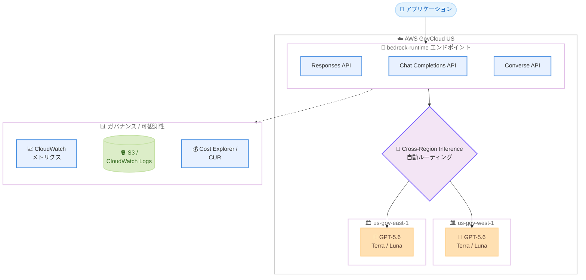

# Amazon Bedrock - AWS GovCloud (US) における OpenAI モデルの API サポート拡大と Cross-Region Inference 対応

**リリース日**: 2026 年 10 月 30 日
**サービス**: Amazon Bedrock
**機能**: AWS GovCloud (US) における OpenAI GPT-5.6 モデルの bedrock-runtime エンドポイント対応 (Responses / Chat Completions / Converse API) と Cross-Region Inference

📊 [このアップデートのインフォグラフィックを見る](https://takech9203.github.io/aws-news-summary/20261030-bedrock-openai-runtime-govcloud.html)

## 概要

Amazon Bedrock が、AWS GovCloud (US) において OpenAI GPT-5.6 モデル (Terra および Luna) を bedrock-runtime エンドポイントでサポートしました。Responses API、Chat Completions API、Converse API の 3 つの API が利用可能になり、あわせて Cross-Region Inference にも対応しました。

Cross-Region Inference は、推論リクエストを 2 つの AWS GovCloud (US) リージョン間で自動的にルーティングする機能です。ユーザーが複数リージョンのキャパシティを個別に管理することなく、より高いスループットと冗長性を確保できます。GovCloud (US) 内でルーティングが完結するため、米国のデータ主権 (US data sovereignty) を維持したままスケールでき、需要急増時にも Bedrock のキャパシティへ幅広くアクセスできます。

また、ネイティブな OpenAI API (Responses API、Chat Completions API) が bedrock-runtime エンドポイント上で動作するため、Bedrock の他のモデルと同じアカウントレベルの統制 (ログ記録、メトリクス、コスト配賦) をそのまま適用できる点も重要なポイントです。政府機関や規制の厳しい業界で生成 AI を活用するユーザーにとって、ガバナンスを維持しながら最新の OpenAI モデルを利用できるアップデートです。

**アップデート前の課題**

このアップデート以前には、以下の課題や制限がありました。

- AWS GovCloud (US) では OpenAI GPT モデルを bedrock-runtime エンドポイントの Responses API、Chat Completions API、Converse API で利用できなかった
- 単一の GovCloud (US) リージョンのキャパシティに依存するため、需要急増時のスループット確保や冗長性の担保が難しかった
- 高可用性を実現するには、ユーザー自身が複数リージョンへのリクエスト振り分けやキャパシティ管理を実装する必要があった

**アップデート後の改善**

今回のアップデートにより、以下が可能になりました。

- GovCloud (US) で OpenAI GPT-5.6 モデル (Terra / Luna) を Responses API、Chat Completions API、Converse API から呼び出せるようになった
- Cross-Region Inference により、2 つの GovCloud (US) リージョン間でリクエストが自動ルーティングされ、より高いスループットと冗長性を追加実装なしで得られるようになった
- bedrock-runtime 上で動作するため、モデル呼び出しログ、CloudWatch メトリクス、Cost Explorer によるコスト配賦など、既存のアカウントレベル統制をそのまま利用できるようになった

## アーキテクチャ図



アプリケーションからのリクエストは bedrock-runtime エンドポイントの 3 つの API のいずれかで受け付けられ、Cross-Region Inference が 2 つの AWS GovCloud (US) リージョン間で自動的にルーティングします。利用状況はログ、メトリクス、コストレポートに統合されます。

## サービスアップデートの詳細

### 主要機能

1. **OpenAI GPT-5.6 モデルの bedrock-runtime エンドポイント対応**
   - AWS GovCloud (US) で OpenAI GPT-5.6 モデル (Terra および Luna) が bedrock-runtime エンドポイントで利用可能になった
   - ネイティブな OpenAI API である Responses API と Chat Completions API に加え、Bedrock 統一 API である Converse API をサポート
   - 既存の Bedrock アプリケーションと同じエンドポイント、同じ運用基盤で OpenAI モデルを利用できる

2. **Cross-Region Inference による自動ルーティング**
   - 推論リクエストを 2 つの AWS GovCloud (US) リージョン間で自動的にルーティング
   - 複数リージョンのキャパシティ管理をユーザー側で行うことなく、より高いスループットを実現
   - リクエストは GovCloud (US) 内で完結するため、米国のデータ主権を維持したままスケール可能
   - 需要急増時にも Bedrock キャパシティへの幅広いアクセスと高いスループットを確保

3. **アカウントレベル統制との統合**
   - 利用状況は Bedrock モデル呼び出しログ (Amazon S3 または Amazon CloudWatch Logs に配信可能) に記録される
   - Amazon CloudWatch メトリクスで呼び出し数、トークン数、レイテンシー、スロットリング、エラーを監視できる
   - AWS Cost Explorer および AWS Cost and Usage Report でモデル別にコストが明細化され、支出をモデル単位で把握できる

## 技術仕様

### 対応 API とモデル

| 項目 | 詳細 |
|------|------|
| 対象モデル | OpenAI GPT-5.6 (Terra / Luna) |
| エンドポイント | bedrock-runtime |
| 対応 API | Responses API、Chat Completions API、Converse API |
| ルーティング | Cross-Region Inference により 2 つの GovCloud (US) リージョン間で自動ルーティング |
| ログ記録 | Bedrock モデル呼び出しログ (S3 / CloudWatch Logs) |
| メトリクス | CloudWatch (呼び出し数、トークン数、レイテンシー、スロットリング、エラー) |
| コスト管理 | Cost Explorer / Cost and Usage Report でモデル別に明細化 |

### API の使い分け

| API | 特徴 |
|------|------|
| Responses API | OpenAI ネイティブの API 形式。OpenAI SDK ベースの既存コードを活かしやすい |
| Chat Completions API | OpenAI ネイティブのチャット形式 API。OpenAI 互換アプリケーションからの移行に適する |
| Converse API | Bedrock の統一 API。モデルプロバイダーに依存しない共通インターフェースでマルチモデル構成に適する |

## 設定方法

### 前提条件

1. AWS GovCloud (US) アカウントを保有していること
2. Amazon Bedrock で対象の OpenAI モデルへのアクセスが有効化されていること
3. 呼び出し元の IAM プリンシパルに bedrock-runtime の呼び出し権限 (例: `bedrock:InvokeModel`) が付与されていること

### 手順

#### ステップ 1: モデルカードの確認

Amazon Bedrock User Guide で GPT-5.6 (Terra および Luna) のモデルカードを確認し、モデル ID や Cross-Region Inference 用の推論プロファイル ID を把握します。公式発表でも、利用開始にあたってモデルカードの確認が案内されています。

#### ステップ 2: Converse API での呼び出し

```bash
aws bedrock-runtime converse \
  --region us-gov-west-1 \
  --model-id <モデルカードに記載の推論プロファイル ID> \
  --messages '[{"role": "user", "content": [{"text": "こんにちは"}]}]'
```

Converse API を使用して GovCloud (US) の bedrock-runtime エンドポイント経由で OpenAI モデルを呼び出します。Cross-Region Inference を利用する場合は、モデル ID として推論プロファイル ID を指定します。具体的な ID はモデルカードで確認してください。

#### ステップ 3: ログとメトリクスの確認

```bash
# CloudWatch メトリクスの確認例 (呼び出し数)
aws cloudwatch list-metrics \
  --region us-gov-west-1 \
  --namespace AWS/Bedrock
```

Bedrock のモデル呼び出しログを有効化している場合、利用状況が S3 または CloudWatch Logs に配信されます。上記コマンドは、CloudWatch に発行されている Bedrock 名前空間のメトリクス一覧を取得し、呼び出し数やトークン数などの監視項目を確認するものです。

## メリット

### ビジネス面

- **データ主権の維持**: リクエストのルーティングが AWS GovCloud (US) 内で完結するため、米国のデータ主権要件を満たしながら最新の OpenAI モデルを活用できる
- **コストの可視化**: Cost Explorer と Cost and Usage Report でモデル別に支出が明細化され、部門やワークロード単位のコスト配賦が容易になる
- **需要急増への対応**: 需要スパイク時にも 2 リージョンのキャパシティを活用でき、サービスレベルを維持しやすい

### 技術面

- **運用負荷の削減**: 複数リージョンへのリクエスト振り分けやキャパシティ管理を自前で実装する必要がなく、Cross-Region Inference が自動でルーティングする
- **既存統制との統合**: モデル呼び出しログ、CloudWatch メトリクスなど、他の Bedrock モデルと共通の運用・監視基盤をそのまま利用できる
- **API の選択肢**: OpenAI ネイティブの Responses / Chat Completions API と Bedrock 統一の Converse API を用途に応じて使い分けられる

## デメリット・制約事項

### 制限事項

- Cross-Region Inference の対象は、OpenAI モデルが提供されている AWS リージョンに限られる
- AWS GovCloud (US) 内の Cross-Region Inference は 2 つの GovCloud (US) リージョン間のルーティングであり、商用リージョンとの間ではルーティングされない
- 対象モデルは OpenAI GPT-5.6 (Terra / Luna) であり、利用前にモデルカードで仕様を確認する必要がある

### 考慮すべき点

- Cross-Region Inference ではリクエストが複数リージョン間でルーティングされるため、コンプライアンス要件上、処理されるリージョンの範囲が GovCloud (US) 内に限定されることを関係者に説明できるようにしておく必要がある
- 推論プロファイル ID の指定方法や利用可能な機能の詳細は、Amazon Bedrock User Guide のモデルカードおよび Cross-Region Inference のドキュメントで確認することを推奨する

## ユースケース

### ユースケース 1: 政府機関向け生成 AI アシスタント

**シナリオ**: 米国政府機関や公共部門向けの SaaS を GovCloud (US) で運用しており、データ主権要件を満たしたまま最新の OpenAI モデルで文書要約や質問応答機能を提供したい。

**実装例**:
```
1. GovCloud (US) で GPT-5.6 のモデルアクセスを有効化
2. Converse API で呼び出すアプリケーションを実装
3. Cross-Region Inference の推論プロファイルを指定して冗長性を確保
```

**効果**: データを GovCloud (US) 内に保ちながら、高いスループットと冗長性を備えた生成 AI 機能を提供できる。

### ユースケース 2: OpenAI 互換アプリケーションの GovCloud 移行

**シナリオ**: 商用環境で OpenAI の Chat Completions API を利用して構築したアプリケーションを、規制要件のために GovCloud (US) へ移行したい。

**実装例**:
```
1. エンドポイントを bedrock-runtime の Chat Completions API に変更
2. 認証を AWS IAM ベースの認証に置き換え
3. モデル ID を GPT-5.6 のモデルカード記載の値に変更
```

**効果**: OpenAI ネイティブ API の形式を維持したまま、アプリケーションロジックの大きな変更なしに GovCloud (US) へ移行できる。

### ユースケース 3: 需要変動の大きいワークロードのスループット確保

**シナリオ**: 月次の報告書作成時期などに推論リクエストが集中するワークロードで、単一リージョンのキャパシティではスロットリングが懸念される。

**実装例**:
```
1. Cross-Region Inference の推論プロファイルを使用して呼び出し
2. CloudWatch メトリクスでスロットリングとレイテンシーを監視
3. モデル呼び出しログを S3 に配信して利用傾向を分析
```

**効果**: 2 つの GovCloud (US) リージョンのキャパシティを自動的に活用し、需要スパイク時にも高いスループットを維持できる。

## 料金

Amazon Bedrock の料金は、処理した入出力トークン数に基づく従量課金です。モデル別の支出は AWS Cost Explorer および AWS Cost and Usage Report で明細化されます。GPT-5.6 (Terra / Luna) の具体的な単価および Cross-Region Inference 利用時の料金の詳細は、Amazon Bedrock の料金ページで確認してください。

## 利用可能リージョン

- OpenAI GPT-5.6 モデル (Terra / Luna) の bedrock-runtime 対応: AWS GovCloud (US) リージョン
- Cross-Region Inference (OpenAI モデル): OpenAI モデルが Amazon Bedrock で提供されているすべての AWS リージョンで利用可能

## 関連サービス・機能

- **Amazon Bedrock Converse API**: モデルプロバイダーに依存しない統一 API。OpenAI モデルを含む複数モデルを共通インターフェースで呼び出せる
- **Amazon CloudWatch**: 呼び出し数、トークン数、レイテンシー、スロットリング、エラーのメトリクス監視に使用
- **Amazon S3 / CloudWatch Logs**: Bedrock モデル呼び出しログの配信先として使用
- **AWS Cost Explorer / AWS Cost and Usage Report**: モデル別のコスト分析と配賦に使用

## 参考リンク

- 📊 [インフォグラフィック](https://takech9203.github.io/aws-news-summary/20261030-bedrock-openai-runtime-govcloud.html)
- [公式発表 (What's New)](https://aws.amazon.com/about-aws/whats-new/2026/10/bedrock-openai-runtime-govcloud/)
- [Amazon Bedrock User Guide](https://docs.aws.amazon.com/bedrock/latest/userguide/)
- [Amazon Bedrock サポートモデル一覧](https://docs.aws.amazon.com/bedrock/latest/userguide/models-supported.html)
- [Cross-Region Inference ドキュメント](https://docs.aws.amazon.com/bedrock/latest/userguide/cross-region-inference.html)
- [料金ページ](https://aws.amazon.com/bedrock/pricing/)

## まとめ

AWS GovCloud (US) で OpenAI GPT-5.6 モデル (Terra / Luna) が bedrock-runtime エンドポイントの Responses、Chat Completions、Converse の 3 つの API で利用可能になり、Cross-Region Inference による 2 リージョン間の自動ルーティングにも対応しました。データ主権要件を維持しながら高スループットかつ冗長な生成 AI 基盤を構築できるため、政府機関や規制業界のワークロードを GovCloud (US) で運用しているユーザーは、モデルカードと Cross-Region Inference のドキュメントを確認のうえ、推論プロファイルを用いた構成への移行を検討することを推奨します。
