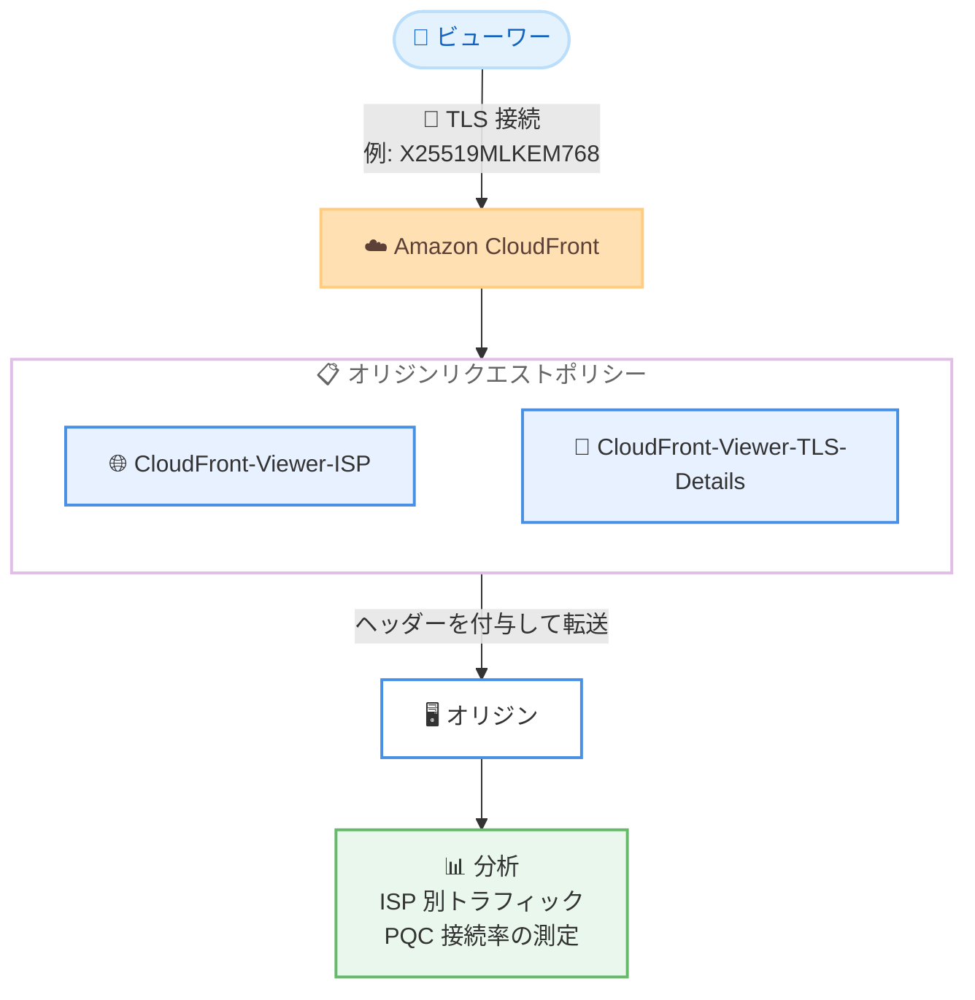

# Amazon CloudFront - ビューワー ISP およびポスト量子 TLS 詳細ヘッダー

**リリース日**: 2026 年 10 月 30 日
**サービス**: Amazon CloudFront
**機能**: CloudFront-Viewer-ISP ヘッダーおよび CloudFront-Viewer-TLS-Details ヘッダー

📊 [このアップデートのインフォグラフィックを見る](https://takech9203.github.io/aws-news-summary/20261030-cloudfront-viewer-isp-post-quantum-visbility.html)

## 概要

Amazon CloudFront は、オリジンに転送できる 2 つの新しいオプションヘッダー、`CloudFront-Viewer-ISP` と `CloudFront-Viewer-TLS-Details` を発表しました。これらのヘッダーをオリジンリクエストポリシーに追加してディストリビューションにアタッチするだけで、追加のコード実装なしにビューワー (エンドユーザー) のネットワーク情報と TLS 接続の暗号詳細をオリジン側で受け取れるようになります。

`CloudFront-Viewer-ISP` ヘッダーにはビューワーのインターネットサービスプロバイダー (ISP) 名が含まれ、ネットワーク単位でのトラフィック分析やパフォーマンス分析、特定プロバイダーからの異常トラフィックの切り分けに活用できます。`CloudFront-Viewer-TLS-Details` ヘッダーには、各ビューワーの TLS 接続で使用された鍵交換、署名スキーム、署名公開鍵タイプなどの暗号詳細が JSON 形式で含まれます。これにより、ポスト量子暗号 (PQC) で接続したビューワーの割合の測定や、PQC 未対応クライアントの特定が可能になります。

ポスト量子暗号への移行を計画しているセキュリティチームや、ネットワーク単位での可観測性を強化したい運用チーム、コンテンツ配信事業者にとって有用なアップデートです。

**アップデート前の課題**

このアップデート以前には、以下の課題がありました。

- 既存の `CloudFront-Viewer-ASN` ヘッダーで AS 番号は取得できたものの、人間が読める ISP 名を得るには AS 番号から ISP 名への変換処理を独自に実装する必要があった
- 既存の `CloudFront-Viewer-TLS` ヘッダーでは TLS バージョン、暗号スイート、ハンドシェイク情報しか取得できず、鍵交換アルゴリズムや署名スキームは確認できなかった
- どの程度のビューワーがポスト量子鍵交換で接続しているかを CloudFront のヘッダーだけで把握する手段がなかった

**アップデート後の改善**

今回のアップデートにより、以下が可能になりました。

- `CloudFront-Viewer-ISP` ヘッダーにより、ビューワーの ISP 名をオリジンで直接受け取り、ネットワーク単位のトラフィック分析や異常トラフィックの切り分けができるようになった
- `CloudFront-Viewer-TLS-Details` ヘッダーにより、鍵交換グループ (例: `X25519MLKEM768`)、署名スキーム、署名公開鍵タイプを含む TLS 接続の詳細を JSON 形式で取得できるようになった
- ポスト量子鍵交換を使用した接続の割合を測定し、PQC 未対応のクライアントを特定できるようになった

## アーキテクチャ図



ビューワーからの TLS 接続情報と ISP 情報を、CloudFront がオリジンリクエストポリシーで指定されたヘッダーとしてオリジンへのリクエストに付与する流れを示しています。

## サービスアップデートの詳細

### 主要機能

1. **CloudFront-Viewer-ISP ヘッダー**
   - ビューワーのインターネットサービスプロバイダー (ISP) 名を含むヘッダー
   - ネットワーク単位でトラフィックとパフォーマンスを分析でき、特定プロバイダーからの異常なトラフィックの切り分けに利用可能
   - オリジンリクエストポリシーでのみ追加可能 (キャッシュポリシーやレガシーキャッシュ設定では追加不可)
   - CloudFront はこのヘッダーの値をパーセントエンコードせず、ISP を判定できない場合はヘッダー自体を付与しない

2. **CloudFront-Viewer-TLS-Details ヘッダー**
   - 既存の `CloudFront-Viewer-TLS` ヘッダーの情報 (TLS バージョン、暗号スイート、ハンドシェイク情報) に加え、鍵交換アルゴリズム、署名スキーム、CloudFront がビューワーに提示した証明書の公開鍵タイプを含む
   - 値は JSON オブジェクト形式で提供され、プログラムでの解析が容易
   - `keyExchange` フィールドにより、接続がポスト量子鍵交換 (例: `X25519MLKEM768`) を使用したかどうかを判定可能

3. **オリジンリクエストポリシーによる簡単な有効化**
   - 新しいヘッダーをオリジンリクエストポリシーに追加し、そのポリシーをディストリビューションのキャッシュビヘイビアにアタッチするだけで利用開始できる
   - オリジン側でのコード実装や外部データベースの参照が不要

## 技術仕様

### CloudFront-Viewer-TLS-Details ヘッダーのフィールド

| フィールド | 説明 | 値の例 |
|------|------|------|
| `tlsVersion` | 接続に使用された SSL/TLS バージョン | `TLSv1.3` |
| `cipherSuite` | 接続に使用された暗号スイート | `TLS_AES_128_GCM_SHA256` |
| `handshakeType` | ハンドシェイク情報 | `fullHandshake`、`sessionResumed`、`connectionReused` |
| `keyExchange` | ネゴシエートされた鍵交換グループ | `x25519`、`secp256r1`、`X25519MLKEM768` |
| `signatureScheme` | CloudFront がビューワーへの認証に使用した署名スキーム | `ecdsa_secp256r1_sha256`、`rsa_pss_rsae_sha256` |
| `signaturePublicKeyType` | CloudFront が提示した証明書の公開鍵のタイプとサイズ | `rsa2048`、`ecdsa_secp256r1`、`mldsa65` |

**ヘッダー値の例 (ポスト量子鍵交換を使用したフルハンドシェイク)**:

```json
{"tlsVersion":"TLSv1.3","cipherSuite":"TLS_AES_128_GCM_SHA256","handshakeType":"fullHandshake","keyExchange":"X25519MLKEM768","signatureScheme":"ecdsa_secp256r1_sha256","signaturePublicKeyType":"ecdsa_secp256r1"}
```

### セッション再開時の挙動

| 条件 | 挙動 |
|------|------|
| TLS 1.2 セッション再開時 | `keyExchange`、`signatureScheme`、`signaturePublicKeyType` は `NONE` になる |
| TLS 1.3 セッション再開時 | TLS 1.3 はセッション再開時に新しい鍵交換を実行するため `keyExchange` には値が入る。`signatureScheme` と `signaturePublicKeyType` は `NONE` になる |
| フィールドの値を判定できない場合 | フィールドは空になる |

### API 変更履歴

今回のアップデートは既存のオリジンリクエストポリシー API で設定するヘッダーの追加であり、直近の AWS API Changes に CloudFront の関連 API 変更は確認されませんでした。

## 設定方法

### 前提条件

1. CloudFront ディストリビューションが作成済みであること
2. オリジンリクエストポリシーを作成・更新できる IAM 権限があること
3. TLS 関連ヘッダーは HTTPS リクエストでのみ値が得られるため、ビューワーとの通信に HTTPS を使用していること

### 手順

#### ステップ 1: オリジンリクエストポリシーを作成

```bash
aws cloudfront create-origin-request-policy \
  --origin-request-policy-config '{
    "Name": "ViewerISPAndTLSDetailsPolicy",
    "Comment": "Forward viewer ISP and TLS details to origin",
    "HeadersConfig": {
      "HeaderBehavior": "allViewerAndWhitelistCloudFront",
      "Headers": {
        "Quantity": 2,
        "Items": [
          "CloudFront-Viewer-ISP",
          "CloudFront-Viewer-TLS-Details"
        ]
      }
    },
    "CookiesConfig": {"CookieBehavior": "all"},
    "QueryStringsConfig": {"QueryStringBehavior": "all"}
  }'
```

ビューワーの全ヘッダーに加えて、CloudFront が生成する `CloudFront-Viewer-ISP` と `CloudFront-Viewer-TLS-Details` の 2 つのヘッダーをオリジンに転送するオリジンリクエストポリシーを作成しています。

#### ステップ 2: ディストリビューションのキャッシュビヘイビアにポリシーをアタッチ

```bash
# 現在のディストリビューション設定を取得
aws cloudfront get-distribution-config --id EDFDVBD6EXAMPLE > dist-config.json

# dist-config.json の DefaultCacheBehavior.OriginRequestPolicyId に
# ステップ 1 で作成したポリシーの ID を設定した後、更新を実行
aws cloudfront update-distribution \
  --id EDFDVBD6EXAMPLE \
  --if-match {ETag の値} \
  --distribution-config file://dist-config-updated.json
```

既存のディストリビューション設定を取得し、キャッシュビヘイビアの `OriginRequestPolicyId` に作成したポリシー ID を指定して、ディストリビューションを更新しています。

#### ステップ 3: オリジン側でヘッダーを確認

オリジンのアクセスログやアプリケーションで受信ヘッダーを記録し、`CloudFront-Viewer-ISP` と `CloudFront-Viewer-TLS-Details` の値を確認します。`CloudFront-Viewer-TLS-Details` は JSON 形式のため、ログ分析基盤でパースして `keyExchange` フィールドを集計すると、ポスト量子鍵交換の利用率を測定できます。

## メリット

### ビジネス面

- **ポスト量子移行の進捗可視化**: PQC 対応クライアントの割合を実データで把握でき、ポスト量子暗号移行計画の意思決定を定量的に行える
- **ユーザー体験の分析強化**: ISP 単位でトラフィックとパフォーマンスを分析でき、特定ネットワークでの品質問題を特定しやすくなる
- **実装コストの削減**: IP アドレスから ISP を特定する外部データベースの導入や、TLS 詳細を取得する独自実装が不要になる

### 技術面

- **コード不要の情報取得**: オリジンリクエストポリシーの設定だけで有効化でき、オリジン側のアプリケーション変更を最小限にできる
- **JSON 形式で解析が容易**: `CloudFront-Viewer-TLS-Details` の値は構造化された JSON のため、ログ分析基盤での集計やアラート設定が容易
- **セキュリティ監視の強化**: 特定 ISP からの異常トラフィックの切り分けや、古い暗号設定を使うクライアントの特定に活用できる

## デメリット・制約事項

### 制限事項

- `CloudFront-Viewer-ISP` と TLS 関連ヘッダーは、オリジンリクエストポリシーでのみ追加でき、キャッシュポリシーには追加できない (キャッシュキーに含められない)
- CloudFront がビューワーの ISP を判定できない場合、`CloudFront-Viewer-ISP` ヘッダーは付与されない
- TLS 関連ヘッダーは HTTPS リクエストでのみ意味を持ち、セッション再開時には一部フィールドが `NONE` になる

### 考慮すべき点

- ISP 名などビューワーのネットワーク情報をオリジンのログに記録する場合、プライバシーポリシーやデータ保護要件との整合性を確認する必要がある
- `CloudFront-Viewer-TLS-Details` は `CloudFront-Viewer-TLS` と重複する情報を含むため、両方を転送する必要があるかを検討する
- オリジンに転送するヘッダーが増えるため、オリジン側でのヘッダーサイズ制限やログ容量への影響を確認する

## ユースケース

### ユースケース 1: ポスト量子暗号移行の進捗測定

**シナリオ**: セキュリティチームがポスト量子暗号への移行を進めており、実際にどの程度のクライアントがポスト量子鍵交換で接続しているかを把握したい。

**実装例**:
```
1. オリジンリクエストポリシーに CloudFront-Viewer-TLS-Details を追加
2. オリジンのアクセスログにヘッダー値を記録
3. ログ分析基盤で keyExchange フィールドを集計
   - X25519MLKEM768 → ポスト量子鍵交換
   - x25519 / secp256r1 → 従来の鍵交換
```

**効果**: PQC 対応クライアントの割合を継続的に測定し、移行計画の進捗をデータに基づいて評価できる。

### ユースケース 2: ISP 単位のパフォーマンス分析と異常検知

**シナリオ**: 動画配信サービスで特定の地域・ネットワークからの視聴品質低下の報告があり、ネットワーク単位で原因を切り分けたい。

**実装例**:
```
1. オリジンリクエストポリシーに CloudFront-Viewer-ISP を追加
2. オリジンでレスポンスタイムやエラー率を ISP 名とともに記録
3. ISP 別にメトリクスを集計し、品質低下や異常トラフィックが
   特定の ISP に偏っていないかを分析
```

**効果**: 特定プロバイダー起因の品質問題や異常なトラフィックを迅速に特定し、対応の優先順位付けができる。

### ユースケース 3: 古い TLS 設定を使用するクライアントの特定

**シナリオ**: TLS ポリシーの引き上げを計画しており、影響を受けるクライアントの規模を事前に把握したい。

**実装例**:
```
1. CloudFront-Viewer-TLS-Details をオリジンに転送
2. tlsVersion、cipherSuite、signatureScheme をログに記録
3. 廃止予定の TLS バージョンや暗号スイートを使用する
   リクエストの割合とクライアント特性を分析
```

**効果**: TLS ポリシー変更による影響範囲を事前に定量化し、ユーザー影響を最小化した移行計画を立てられる。

## 料金

What's New 記事に追加料金に関する記載はありません。CloudFront の標準料金 (データ転送、リクエスト数など) が適用されます。最新の料金情報は料金ページを確認してください。

## 利用可能リージョン

What's New 記事にリージョンに関する個別の記載はありません。CloudFront はグローバルサービスであり、オリジンリクエストポリシーの設定を通じて利用できます。

## 関連サービス・機能

- **CloudFront オリジンリクエストポリシー**: 今回の新ヘッダーを有効化するための設定機構。オリジンに転送するヘッダー、Cookie、クエリ文字列を制御する
- **CloudFront-Viewer-ASN / CloudFront-Viewer-TLS ヘッダー**: 既存のビューワー情報ヘッダー。今回の新ヘッダーはこれらを補完し、ISP 名と暗号の詳細情報を追加で提供する
- **Lambda@Edge / CloudFront Functions**: エッジ関数でもこれらのヘッダーを受け取り、ヘッダー値に基づいた処理 (ルーティングやブロックなど) を実装できる

## 参考リンク

- 📊 [インフォグラフィック](https://takech9203.github.io/aws-news-summary/20261030-cloudfront-viewer-isp-post-quantum-visbility.html)
- [公式発表 (What's New)](https://aws.amazon.com/about-aws/whats-new/2026/10/cloudfront-viewer-isp-post-quantum-visbility/)
- [ドキュメント: Add CloudFront request headers](https://docs.aws.amazon.com/AmazonCloudFront/latest/DeveloperGuide/adding-cloudfront-headers.html)
- [ドキュメント: Control origin requests with a policy](https://docs.aws.amazon.com/AmazonCloudFront/latest/DeveloperGuide/controlling-origin-requests.html)
- [料金ページ](https://aws.amazon.com/cloudfront/pricing/)

## まとめ

CloudFront の新しい `CloudFront-Viewer-ISP` と `CloudFront-Viewer-TLS-Details` ヘッダーにより、追加実装なしでビューワーのネットワーク情報と TLS 暗号詳細をオリジンで取得できるようになりました。特にポスト量子暗号への移行を検討している組織にとって、PQC 接続率を実データで測定できる点は大きな価値があります。まずはオリジンリクエストポリシーに新ヘッダーを追加し、ログ分析基盤での集計から始めることを推奨します。
