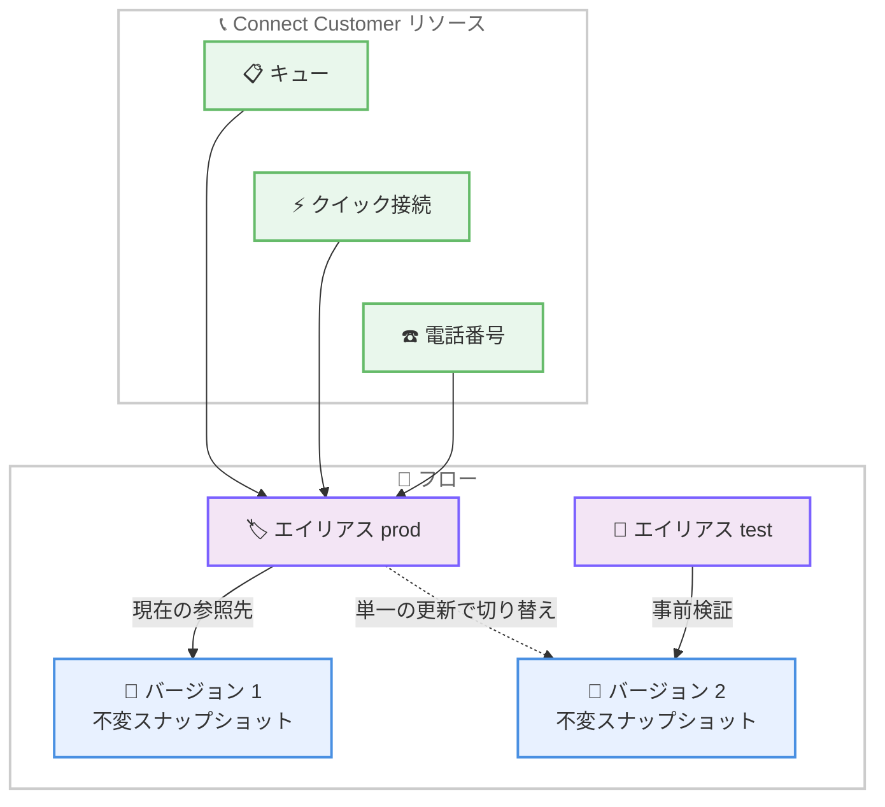

# Amazon Connect Customer - フローのバージョニングとエイリアス

**リリース日**: 2026 年 10 月 30 日
**サービス**: Amazon Connect Customer
**機能**: フローおよびフローモジュールのバージョニングとエイリアス

📊 [このアップデートのインフォグラフィックを見る](https://takech9203.github.io/aws-news-summary/20261030-connect-flows-versioning-aliasing.html)

## 概要

Amazon Connect Customer が、フローおよびフローモジュールのバージョニングとエイリアスをサポートしました。フローの不変 (イミュータブル) なバージョンを作成し、そこに 1 つ以上のわかりやすい名前 (エイリアス) を付与できます。キュー、クイック接続、電話番号などのリソースは、特定のバージョンではなくエイリアスを参照するように設定できるため、新しいバージョンを公開した際にエイリアスの参照先を切り替えるだけで、そのエイリアスを使用するすべてのリソースが自動的に新バージョンを利用するようになります。

この機能により、顧客体験フローの構築・テスト・デプロイが簡素化され、本番トラフィックへの影響を最小限に抑えられます。変更履歴の追跡、既知の正常な状態へのロールバック、参照元のフローを編集することなく本番で稼働するコンテンツを制御することが可能になります。コンタクトセンターのフロー開発者や運用管理者にとって、安全なリリース管理を実現する重要なアップデートです。

なお、Amazon Connect Customer は、企業が優れた顧客体験を提供することを支援するエージェント型 AI ソリューションです。

**アップデート前の課題**

- フローを更新すると公開中の内容がそのまま置き換わるため、本番トラフィックに影響を与えずに新しいフローを検証することが困難だった
- 新しいフローに切り替える際、電話番号やキューなど参照元のリソースを個別に再リンクまたは再公開する必要があった
- 過去の時点のフロー内容を不変なスナップショットとして保持する仕組みがなく、ロールバックや監査のための一貫性を確保しにくかった

**アップデート後の改善**

- フローの不変なバージョンを作成でき、ロールバックや監査のための一貫性と信頼性が確保された
- エイリアスを使用することで、参照元リソースを再公開・再リンクすることなく、単一の更新でライブトラフィックを新バージョンに切り替えられるようになった
- 連番のバージョン番号 (1 から開始) と人間が読めるバージョン説明により、いつ何が変更されたかを容易に追跡できるようになった

## アーキテクチャ図



リソースはエイリアスを参照し、エイリアスが特定の不変バージョンを指します。テスト用エイリアスで新バージョンを検証した後、本番エイリアスの参照先を切り替えるだけで、すべてのリソースが一括で新バージョンに移行します。

## サービスアップデートの詳細

### 主要機能

1. **フローバージョン (不変スナップショット)**
   - バージョンは、フローのある時点の内容を切り取った不変のスナップショット
   - バージョン作成後もフローの編集を継続でき、必要に応じて新しいバージョンを作成可能
   - バージョン番号は Connect Customer が自動的に連番 (1 から開始) で割り当て
   - 人間が読めるバージョン説明を付与でき、変更内容の追跡が容易

2. **フローエイリアス**
   - エイリアスは、フローの特定バージョンへの参照
   - 作成時に一意のエイリアス ID が割り当てられ、エイリアス名も設定可能
   - エイリアスの参照先バージョンを切り替えるだけで、そのエイリアスを使用するすべてのリソースが自動的に新バージョンを利用
   - 各リソースを個別に更新することなく、フローバージョンを切り替え可能

3. **読み取り専用ビューと監査履歴**
   - [Versions] タブや [Aliases] タブの一覧からバージョン・エイリアスを選択すると、デザイナーが読み取り専用モードで開く
   - デザイナーページの [Audit history] ドロップダウンリストで、異なるバージョンやエイリアスを表示・切り替え可能
   - フロー変更履歴ページで、すべてのエイリアスとバージョンに対する変更を追跡可能

4. **バージョン・エイリアス単位のメトリクス**
   - フローバージョンまたはエイリアスを読み取り専用モードで開き、[Show Metrics] を選択してメトリクスを表示可能
   - [Audit history] ドロップダウンリストから対象のバージョンやエイリアスに切り替えてメトリクスを確認することも可能

## 技術仕様

### 修飾 ARN / ID によるバージョン・エイリアスの参照

フローの特定のバージョンまたはエイリアスは、修飾 ARN または ID で参照します。

| 参照形式 | 参照先 |
|------|------|
| `flow-arn-or-id:VersionNumber` | 特定のバージョン |
| `flow-arn-or-id:AliasId` | エイリアス |

### バージョン・エイリアスを参照可能なリソース

フローの参照を必要とする以下のページの設定時に、エイリアスまたはバージョンを任意で参照できます。

| カテゴリ | リソース |
|------|------|
| ルーティング | キュー、クイック接続、電話番号 |
| テスト | テストチャット、テスト管理 |
| コンタクト処理 | タスクテンプレート、E メール、アウトバウンドキャンペーン |
| その他 | ビュー、ルール |

### 参照時の動作

- フロー参照時のエイリアス・バージョンの指定は任意
- エイリアスもバージョンも選択しない場合は、フローの最新の公開済みコンテンツが参照される
- [Transfer to flow] ブロックなどのフロー内ブロックからも、エイリアスまたはバージョンを参照可能

### API 変更履歴

本アップデートの発表時点では、awsapichanges.com においてフローのバージョニング・エイリアスに直接対応する API 変更エントリは確認できませんでした。管理者ガイドに記載されている操作はコンソール (フローデザイナー) ベースの手順です。

## 設定方法

### 前提条件

1. Amazon Connect Customer のインスタンスが利用可能であること
2. フローの作成・公開・編集権限を持つユーザーであること
3. エイリアスを作成する前に、対象フローのバージョンを少なくとも 1 つ作成しておくこと

### 手順

#### ステップ 1: フローのバージョンを作成する

フローを公開する際に、[Create new version] チェックボックスを選択します。これにより、公開と同時にフローの新しいバージョンが作成されます。

すでに公開済みのフローでは [Versions] タブが有効になっており、[Create version] を選択して新しいバージョンを作成することもできます。

#### ステップ 2: フローのエイリアスを作成する

[Aliases] タブに移動し、[Create alias] を選択して新しいエイリアスを作成します。エイリアスの作成時には、必ずいずれかのバージョンと関連付けます。

#### ステップ 3: リソースからエイリアスを参照する

キュー、クイック接続、電話番号などのフロー参照を設定するページで、特定のバージョンではなくエイリアスを選択します。これにより、以降のバージョン切り替えはエイリアスの更新だけで完結します。

#### ステップ 4: 新バージョンへ切り替える

新しいバージョンを作成・検証した後、エイリアスの参照先を新バージョンに更新します。エイリアスを参照しているすべてのリソースが自動的に新バージョンを利用するようになり、各リソースの再公開や再リンクは不要です。

## メリット

### ビジネス面

- **デプロイリスクの低減**: 本番トラフィックを現行バージョンに維持したまま新バージョンを検証でき、顧客体験への影響を最小限に抑えられる
- **運用負荷の軽減**: 多数の電話番号やキューを使用する大規模コンタクトセンターでも、エイリアスの単一更新でフローを一括切り替えでき、作業時間と人的ミスを削減できる
- **監査対応の強化**: 不変バージョンと変更履歴ページにより、いつ誰がどのような変更を行ったかを追跡でき、コンプライアンス要件への対応が容易になる

### 技術面

- **不変スナップショットによる一貫性**: 公開済みバージョンの内容は変更されないため、ロールバックや監査の基準点として信頼できる
- **参照の間接化**: リソースがエイリアスを参照する設計により、フローの実体とリソース設定が疎結合になり、変更の影響範囲を制御しやすい
- **バージョン単位のメトリクス**: バージョンやエイリアスごとにメトリクスを確認でき、新旧バージョンの動作比較やリリース後の監視が容易

## デメリット・制約事項

### 制限事項

- エイリアスを作成するには、事前に対象フローのバージョンを作成しておく必要がある
- バージョンやエイリアスをリンクから開いた場合、デザイナーは読み取り専用モードとなり、その場での編集はできない
- エイリアスもバージョンも指定しない参照は、フローの最新の公開済みコンテンツを参照する動作となるため、意図しない変更の取り込みを避けたい場合はエイリアスまたはバージョンの明示的な指定が必要

### 考慮すべき点

- 本機能は Amazon Connect Customer (エージェント型 AI ソリューション) のフローを対象とした発表であり、適用範囲は Amazon Connect Customer の管理者ガイドに基づいて確認すること
- エイリアスの命名規則 (例: prod、test など) と運用ルールをチームで事前に定義しておくことが望ましい
- バージョンが増加した場合の管理方針 (バージョン説明の記載ルールなど) を整備しておくと、変更追跡がより効果的になる

## ユースケース

### ユースケース 1: 本番影響なしの新フロー検証と一括切り替え

**シナリオ**: 複数の電話番号が同一の問い合わせフローを使用しており、IVR の応答内容を刷新したい。本番トラフィックへの影響なしに検証し、検証完了後に一括で切り替えたい。

**実装例**:
```
1. 現行フローをバージョン 1 として公開し、本番エイリアス prod をバージョン 1 に関連付け
2. すべての電話番号の参照先をエイリアス prod に設定
3. フローを編集してバージョン 2 を作成
4. テスト用エイリアス test をバージョン 2 に関連付け、テストチャットやテスト管理で検証
5. 検証完了後、エイリアス prod の参照先をバージョン 2 に更新
```

**効果**: 本番トラフィックを現行バージョンに維持したまま検証でき、単一の更新ですべての電話番号を新バージョンへ一括移行できる。

### ユースケース 2: 障害発生時の迅速なロールバック

**シナリオ**: 新バージョンのフローをリリースした直後に想定外の動作が発覚し、即座に以前の正常な状態に戻す必要がある。

**実装例**:
```
1. エイリアス prod の参照先を、既知の正常なバージョン (例: バージョン 1) に戻す
2. エイリアスを参照しているすべてのリソースが自動的に旧バージョンへ復帰
3. 変更履歴ページとバージョン単位のメトリクスで影響範囲を確認
```

**効果**: バージョンは不変のスナップショットであるため、確実に以前の状態へ復帰できる。リソースごとの再設定が不要で、復旧時間を大幅に短縮できる。

### ユースケース 3: 変更管理と監査対応

**シナリオ**: 金融機関のコンタクトセンターで、フロー変更の履歴を正確に記録し、監査時に過去の任意の時点のフロー内容を提示する必要がある。

**実装例**:
```
1. フローの変更ごとにバージョンを作成し、バージョン説明に変更内容を記載
2. デザイナーの Audit history ドロップダウンリストで過去バージョンを読み取り専用表示
3. フロー変更履歴ページで、エイリアスとバージョンに対するすべての変更を追跡
```

**効果**: 連番のバージョン番号と説明により変更履歴が明確になり、過去の任意のバージョンを不変の状態で参照できるため、監査対応が容易になる。

## 料金

本アップデートに関する追加料金の記載は、発表文には含まれていません。Amazon Connect Customer の料金の詳細は、公式の料金ページを参照してください。

## 利用可能リージョン

Amazon Connect Customer が提供されているすべての AWS リージョンで利用可能です。

## 関連サービス・機能

- **Amazon Connect Customer フローデザイナー**: バージョンの作成、エイリアスの管理、読み取り専用表示、監査履歴の確認を行うビジュアルエディター
- **キュー・クイック接続・電話番号**: エイリアスまたはバージョンを参照できる主要なルーティングリソース
- **アウトバウンドキャンペーン・タスクテンプレート・E メール・ビュー・ルール**: フロー参照時にエイリアスまたはバージョンを指定できるその他のリソース

## 参考リンク

- 📊 [インフォグラフィック](https://takech9203.github.io/aws-news-summary/20261030-connect-flows-versioning-aliasing.html)
- [公式発表 (What's New)](https://aws.amazon.com/about-aws/whats-new/2026/10/connect-flows-versioning-aliasing/)
- [ドキュメント: Flow versioning and aliasing in Connect Customer](https://docs.aws.amazon.com/connect/latest/adminguide/flows-versions-aliases.html)
- [Amazon Connect Customer 製品ページ](https://aws.amazon.com/products/connect/customer/)

## まとめ

Amazon Connect Customer のフローバージョニングとエイリアスにより、コンタクトセンターのフロー変更を安全かつ効率的に管理できるようになりました。不変バージョンによるロールバック・監査の信頼性と、エイリアスによる単一更新での一括切り替えは、大規模運用において特に大きな価値があります。まずは本番フローのバージョンとエイリアスを整備し、電話番号やキューの参照をエイリアス経由に移行することを推奨します。
