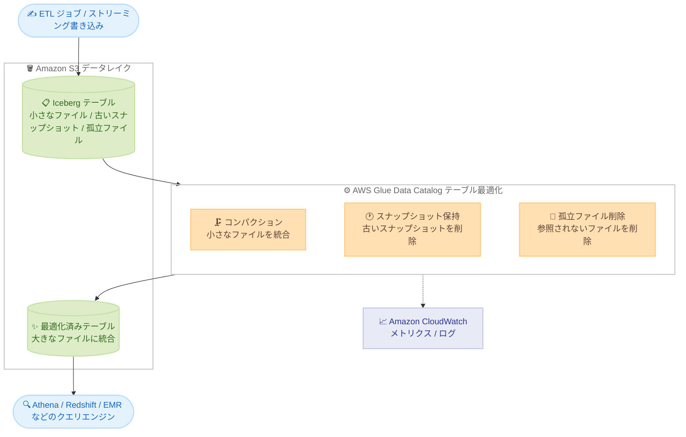

# AWS Glue Data Catalog - Apache Iceberg テーブル最適化が米国西部 (北カリフォルニア) リージョンで利用可能に

**リリース日**: 2026 年 10 月 30 日
**サービス**: AWS Glue (Glue Data Catalog)
**機能**: Apache Iceberg テーブル最適化 (コンパクション、スナップショット保持、孤立ファイル削除) のリージョン拡大

📊 [このアップデートのインフォグラフィックを見る](https://takech9203.github.io/aws-news-summary/20261030-glue-data-catalog-optimizers-us-west-1.html)

## 概要

AWS Glue Data Catalog の Apache Iceberg テーブル自動最適化機能が、米国西部 (北カリフォルニア) リージョン (us-west-1) で利用可能になりました。Apache Iceberg は、データレイク上の大規模テーブルに対して高速なクエリパフォーマンスを提供するオープンテーブルフォーマットです。本機能により、テーブル単位、または Data Catalog 内のすべてのテーブルに対して最適化を有効化できます。

Iceberg テーブルは、データが書き込まれるたびに小さなファイル、スナップショット、参照されないファイルが蓄積され、時間の経過とともにクエリ速度の低下とストレージコストの増加を招きます。本機能はテーブルを継続的に監視し、小さなファイルのコンパクション、保持設定より古いスナップショットの削除、不要になった参照されないファイルの削除をバックグラウンドで自動実行します。

各最適化の実行状況は、AWS Glue コンソール、Amazon CloudWatch のメトリクスとログで監視できます。米国西部 (北カリフォルニア) リージョンでデータレイクを運用するユーザーは、手動のメンテナンスジョブを構築することなく、Iceberg テーブルのパフォーマンスとストレージ効率を維持できるようになります。

**アップデート前の課題**

- 米国西部 (北カリフォルニア) リージョンでは Glue Data Catalog のテーブル最適化機能が利用できず、Iceberg テーブルの小さなファイルの蓄積によるクエリパフォーマンス低下に対処するには、Spark の `rewrite_data_files` などを実行する独自のメンテナンスジョブを構築・運用する必要があった
- 古いスナップショットや孤立ファイルの削除も手動またはスケジュールジョブで実施する必要があり、運用負荷とストレージコストが増大していた
- データ所在地の要件などで us-west-1 を利用するワークロードは、他リージョンと同等の自動最適化の恩恵を受けられなかった

**アップデート後の改善**

- 米国西部 (北カリフォルニア) リージョンでも、コンパクション、スナップショット保持、孤立ファイル削除の 3 種類の最適化を自動実行できるようになった
- テーブル単位の有効化に加え、カタログレベルで Data Catalog 内のすべての Iceberg テーブルに一括で最適化を適用できるようになった
- 最適化の実行結果を AWS Glue コンソール、CloudWatch メトリクス、ログで一元的に監視できるようになった

## アーキテクチャ図



Glue Data Catalog のテーブル最適化が Iceberg テーブルを継続的に監視し、3 種類の最適化をバックグラウンドで自動実行する流れを示しています。実行状況は CloudWatch で監視できます。

## サービスアップデートの詳細

### 主要機能

1. **コンパクション (Compaction)**
   - 小さなデータファイルを統合・再書き込みし、ストレージ使用量を削減してクエリの読み取りパフォーマンスを向上させる
   - デフォルトの binpack 戦略に加え、sort および Z-order 戦略をサポート。sort は指定カラムに基づいてデータを整理しフィルタ操作のクエリを高速化、Z-order は複数カラムを同時にクエリする場合のパフォーマンスを向上させる
   - いずれの戦略もクエリエンジンがスキャンするデータ量を削減し、クエリ処理コストを低減する

2. **スナップショット保持 (Snapshot Retention)**
   - スナップショットは Iceberg テーブルのタイムスタンプ付きバージョンであり、保持期間と保持数を設定できる
   - 設定した保持期間より古いスナップショットと、それに関連する基盤ファイルを自動削除し、ストレージのオーバーヘッドを抑制する

3. **孤立ファイル削除 (Orphan File Deletion)**
   - テーブルのメタデータから参照されなくなったファイル (テーブル削除や ETL ジョブの失敗などで蓄積) を定期的に特定・削除する
   - 不要なファイルを取り除くことでストレージコストを削減する

4. **カタログレベルとテーブルレベルの設定**
   - カタログレベルの最適化設定は、Lake Formation コンソールまたは AWS Glue の `UpdateCatalog` API で構成可能
   - テーブル単位の有効化・無効化は、AWS Glue コンソール、AWS CLI、AWS Glue API で操作可能

## 技術仕様

### 最適化タイプの比較

| 最適化タイプ | 対象 | 効果 |
|------|------|------|
| コンパクション | 小さなデータファイル | 読み取りパフォーマンス向上、スキャン量削減 |
| スナップショット保持 | 古いスナップショットと関連ファイル | ストレージコスト削減、メタデータ管理の簡素化 |
| 孤立ファイル削除 | メタデータから参照されないファイル | ストレージコスト削減 |

### コンパクション戦略

| 戦略 | 説明 |
|------|------|
| binpack | デフォルト戦略。小さなファイルを大きなファイルに統合 |
| sort | 指定カラムでデータをソートし、フィルタクエリを高速化 |
| Z-order | 複数カラムの同時クエリに有効なソート済みデータセットを作成 |

### 設定操作の方法

| 設定レベル | 操作方法 |
|------|------|
| カタログレベル | Lake Formation コンソール、AWS Glue `UpdateCatalog` API |
| テーブルレベル | AWS Glue コンソール、AWS CLI、AWS Glue API |

## 設定方法

### 前提条件

1. Apache Iceberg 形式のテーブルが AWS Glue Data Catalog に登録されていること
2. 最適化ジョブが Amazon S3 のデータの読み書きと Glue Data Catalog へのアクセスを行うための IAM ロールを用意していること
3. 米国西部 (北カリフォルニア) リージョンなど、テーブル最適化がサポートされているリージョンを使用していること

### 手順

#### ステップ 1: テーブル単位でコンパクションを有効化

```bash
aws glue create-table-optimizer \
  --catalog-id <アカウント ID> \
  --database-name <データベース名> \
  --table-name <テーブル名> \
  --type compaction \
  --table-optimizer-configuration '{
    "roleArn": "arn:aws:iam::<アカウント ID>:role/<最適化用ロール>",
    "enabled": true
  }' \
  --region us-west-1
```

指定した Iceberg テーブルに対してコンパクション最適化を作成し、有効化するコマンドです。`roleArn` には S3 と Glue へのアクセス権限を持つ IAM ロールを指定します。

#### ステップ 2: スナップショット保持と孤立ファイル削除を有効化

```bash
aws glue create-table-optimizer \
  --catalog-id <アカウント ID> \
  --database-name <データベース名> \
  --table-name <テーブル名> \
  --type retention \
  --table-optimizer-configuration '{
    "roleArn": "arn:aws:iam::<アカウント ID>:role/<最適化用ロール>",
    "enabled": true,
    "retentionConfiguration": {
      "icebergConfiguration": {
        "snapshotRetentionPeriodInDays": 5,
        "numberOfSnapshotsToRetain": 1,
        "cleanExpiredFiles": true
      }
    }
  }' \
  --region us-west-1
```

スナップショットの保持期間と保持数を指定して、スナップショット保持最適化を作成するコマンドです。孤立ファイル削除は `--type orphan_file_deletion` を指定して同様に作成します。

#### ステップ 3: 最適化の実行状況を確認

```bash
aws glue list-table-optimizer-runs \
  --catalog-id <アカウント ID> \
  --database-name <データベース名> \
  --table-name <テーブル名> \
  --type compaction \
  --region us-west-1
```

最適化の実行履歴を一覧表示するコマンドです。あわせて AWS Glue コンソールや Amazon CloudWatch のメトリクスとログでも実行状況を監視できます。

## メリット

### ビジネス面

- **運用コストの削減**: 独自のメンテナンスジョブの構築・運用が不要になり、データエンジニアの工数を削減できる
- **ストレージコストの削減**: 古いスナップショットや孤立ファイルを自動削除し、S3 のストレージコストを継続的に抑制できる
- **クエリコストの低減**: コンパクションによりスキャンするデータ量が減少し、Athena などのクエリ処理コストを低減できる

### 技術面

- **クエリパフォーマンスの維持**: 小さなファイルの蓄積によるパフォーマンス劣化を自動的に防止できる
- **一括設定**: カタログレベルの設定により、Data Catalog 内のすべての Iceberg テーブルへ最適化を一括適用できる
- **可観測性**: 最適化の実行状況を AWS Glue コンソール、CloudWatch メトリクス、ログで監視できる

## デメリット・制約事項

### 制限事項

- 対象は Apache Iceberg テーブルのみであり、他のテーブルフォーマットには適用されない
- 利用可能なリージョンは限定されている (詳細は利用可能リージョンのセクションを参照)
- 最適化の実行には IAM ロールの設定など事前準備が必要

### 考慮すべき点

- 最適化 (コンパクションなど) の実行には処理量に応じた料金が発生するため、テーブルの書き込み頻度とコストのバランスを考慮する
- スナップショット保持設定により古いスナップショットが削除されると、削除されたスナップショットへのタイムトラベルクエリは実行できなくなる

## ユースケース

### ユースケース 1: ストリーミングデータレイクのパフォーマンス維持

**シナリオ**: us-west-1 のデータレイクに IoT センサーデータを数分間隔で継続的に書き込んでおり、小さなファイルが大量に蓄積して Athena のクエリが徐々に遅くなっている。

**実装例**:
```
対象テーブルでコンパクション最適化を有効化し、
バックグラウンドで小さなファイルを自動統合する
```

**効果**: 手動メンテナンスなしでクエリパフォーマンスを維持し、スキャン量の削減によりクエリコストも低減できる。

### ユースケース 2: ストレージコストの自動削減

**シナリオ**: 日次の ETL ジョブで Iceberg テーブルを更新しており、スナップショットと不要ファイルが蓄積して S3 のストレージコストが増加している。

**実装例**:
```
スナップショット保持最適化で保持期間を 5 日間に設定し、
孤立ファイル削除最適化もあわせて有効化する
```

**効果**: 古いスナップショットと参照されないファイルが自動削除され、ストレージコストを継続的に抑制できる。

### ユースケース 3: カタログ全体への最適化の一括適用

**シナリオ**: 多数の Iceberg テーブルを運用しており、テーブルごとに最適化を設定する作業が負担になっている。

**実装例**:
```
Lake Formation コンソールまたは Glue UpdateCatalog API で
カタログレベルの最適化設定を構成し、
Data Catalog 内のすべての Iceberg テーブルに一括適用する
```

**効果**: 新規作成されるテーブルを含め、カタログ全体で一貫した最適化ポリシーを少ない運用負荷で維持できる。

## 料金

テーブル最適化の実行は AWS Glue の料金体系に基づいて課金されます。コンパクションなどの最適化処理は、処理に使用されたコンピューティングリソース (DPU 時間) に応じた従量課金です。最新の料金詳細は [AWS Glue 料金ページ](https://aws.amazon.com/glue/pricing/) を確認してください。

## 利用可能リージョン

今回のアップデートで米国西部 (北カリフォルニア) が追加され、テーブル最適化機能は以下のリージョンで利用可能です (公式ドキュメントに基づく)。

- アジアパシフィック (東京)
- アジアパシフィック (ソウル)
- アジアパシフィック (ムンバイ)
- アジアパシフィック (シンガポール)
- アジアパシフィック (シドニー)
- アジアパシフィック (ジャカルタ)
- カナダ (中部)
- 欧州 (アイルランド)
- 欧州 (ロンドン)
- 欧州 (フランクフルト)
- 欧州 (ストックホルム)
- 米国東部 (バージニア北部)
- 米国東部 (オハイオ)
- **米国西部 (北カリフォルニア)** ← 今回追加
- 米国西部 (オレゴン)
- 南米 (サンパウロ)

## 関連サービス・機能

- **Amazon S3**: Iceberg テーブルのデータファイルとメタデータの格納先。最適化によりストレージ使用量が削減される
- **Amazon Athena**: Iceberg テーブルへのクエリエンジン。コンパクションによりクエリパフォーマンスが向上する
- **AWS Lake Formation**: カタログレベルの最適化設定の構成に使用。テーブルへのアクセス権限管理も提供
- **Amazon CloudWatch**: 最適化実行のメトリクスとログの監視に使用

## 参考リンク

- 📊 [インフォグラフィック](https://takech9203.github.io/aws-news-summary/20261030-glue-data-catalog-optimizers-us-west-1.html)
- [公式発表 (What's New)](https://aws.amazon.com/about-aws/whats-new/2026/10/glue-data-catalog-optimizers-us-west-1/)
- [ドキュメント: Optimizing Iceberg tables](https://docs.aws.amazon.com/glue/latest/dg/table-optimizers.html)
- [ドキュメント: Supported Regions for table optimizers](https://docs.aws.amazon.com/glue/latest/dg/regions-optimizers.html)
- [AWS Glue 製品ページ](https://aws.amazon.com/glue/)
- [料金ページ](https://aws.amazon.com/glue/pricing/)

## まとめ

Glue Data Catalog の Apache Iceberg テーブル自動最適化が米国西部 (北カリフォルニア) リージョンに拡大し、独自のメンテナンスジョブなしでクエリパフォーマンスの維持とストレージコストの削減が可能になりました。us-west-1 で Iceberg ベースのデータレイクを運用している場合は、対象テーブルまたはカタログ全体で最適化を有効化し、CloudWatch で実行状況を監視することを推奨します。
