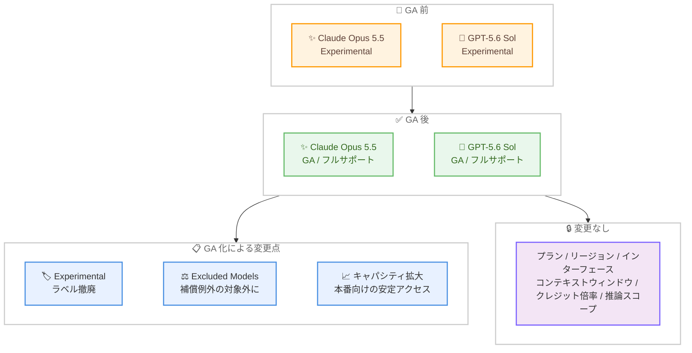

# Kiro - Claude Opus 5.5 と GPT-5.6 Sol が一般提供 (GA) に

**リリース日**: 2026 年 10 月 30 日
**サービス**: Kiro
**機能**: Claude Opus 5.5 および GPT-5.6 Sol の一般提供 (GA) 開始 - Experimental ラベルと Kiro Excluded Models 補償例外の撤廃

📊 [このアップデートのインフォグラフィックを見る](https://takech9203.github.io/aws-news-summary/20261030-kiro-changelog-2026-10-30.html)

## 概要

2026 年 10 月 30 日、Kiro において **Claude Opus 5.5 と GPT-5.6 Sol の 2 モデルが、Kiro フルサポート付きの一般提供 (GA) になりました**。キャパシティの拡大により、本番ワークロード向けのより安定したアクセスが提供されます。

両モデルの現在の対応プラン、リージョン、利用可能なインターフェース、コンテキストウィンドウ、クレジット倍率、推論スコープに変更はありません。GA 化に伴い、両モデルに付与されていた **Experimental ラベルは撤廃**され、**「Kiro Excluded Models」の補償 (indemnity) 例外もこれらのモデルには適用されなくなりました**。これにより、エンタープライズ環境でも契約上の位置付けが通常モデルと同等になります。

最新のモデルリストを読み込むには、IDE または CLI を再起動するか、Crew では `kirocrew restart` を実行、Web ではブラウザを更新します。なお、2026 年 10 月 21 日の発表では Claude Fable 5.1、Claude Sonnet 5.5、GPT-5.6 Terra、GPT-5.6 Luna が GA となった一方で GPT-5.6 Sol は Experimental のままでしたが、今回のアップデートで GPT-5.6 Sol も GA となりました。

**アップデート前の課題**

- Claude Opus 5.5 と GPT-5.6 Sol は Experimental ラベル付きの提供であり、本番ワークロードでの利用には安定性や提供継続性の面で不確実性があった
- Experimental モデルは「Kiro Excluded Models」の補償例外の対象であり、エンタープライズ利用時には法的リスクの評価が必要だった
- Experimental モデルの利用を禁止するポリシーを持つ組織では、最上位クラスの 2 モデルを開発標準として採用できなかった

**アップデート後の改善**

- Claude Opus 5.5 と GPT-5.6 Sol が Kiro フルサポート付きの GA となり、キャパシティ拡大により本番ワークロードでより安定してアクセスできるようになった
- Experimental ラベルと「Kiro Excluded Models」補償例外が撤廃され、エンタープライズでも安心して採用できるようになった
- 対応プラン、リージョン、インターフェース、コンテキストウィンドウ、クレジット倍率、推論スコープは変更されず、既存の利用方法のまま GA の位置付けで利用を継続できる

## アーキテクチャ図



Claude Opus 5.5 と GPT-5.6 Sol の GA 化による変更点と、変更されない項目の全体像を示しています。

## サービスアップデートの詳細

### 主要機能

1. **Claude Opus 5.5 と GPT-5.6 Sol の一般提供 (GA)**
   - 両モデルが Kiro フルサポート付きで一般提供となった
   - キャパシティの拡大により、本番ワークロード向けのより安定したアクセスを提供
   - 2026 年 10 月 21 日の GA 発表 (Fable 5.1、Sonnet 5.5、Terra、Luna) で Experimental のまま残っていた GPT-5.6 Sol も今回 GA となった

2. **Experimental ラベルの撤廃**
   - 両モデルに付与されていた Experimental ラベルは適用されなくなった
   - Experimental モデルの利用を制限している組織でも、ポリシーを維持したまま両モデルを採用可能に

3. **「Kiro Excluded Models」補償例外の撤廃**
   - 「Kiro Excluded Models」の補償 (indemnity) 例外が、これらのモデルには適用されなくなった
   - 契約上の位置付けが通常モデルと同等になり、エンタープライズでのコンプライアンス評価が簡素化される

4. **既存の利用条件は変更なし**
   - 現在の対応プラン、リージョン、利用可能なインターフェース、コンテキストウィンドウ、クレジット倍率、推論スコープはいずれも変更されない
   - 最新のモデルリストを読み込むには、IDE / CLI の再起動、Crew での `kirocrew restart` 実行、Web でのブラウザ更新が必要

## 技術仕様

### GA 化による変更点のサマリー

| 項目 | GA 前 | GA 後 |
|------|-------|-------|
| 提供形態 | Experimental | 一般提供 (GA)、Kiro フルサポート |
| キャパシティ | - | 拡大 (本番ワークロード向けの安定アクセス) |
| Kiro Excluded Models 補償例外 | 適用対象 | 適用対象外 |
| プラン / リージョン / インターフェース | 変更なし | 変更なし |
| コンテキストウィンドウ / クレジット倍率 / 推論スコープ | 変更なし | 変更なし |

### 対象モデルの主な仕様 (過去の発表時点、今回変更なし)

| 項目 | Claude Opus 5.5 | GPT-5.6 Sol |
|------|-----------------|-------------|
| 提供元 | Anthropic | OpenAI |
| コンテキストウィンドウ | 100 万トークン | 272K トークン |
| クレジット倍率 | 2.0 倍 | 2.4 倍 |
| 利用可能インターフェース | IDE、CLI、Crew、Web | IDE、CLI、Web |

上記の仕様は各モデルの提供開始時の発表 (Claude Opus 5.5: 2026 年 9 月 28 日、GPT-5.6 Sol: 2026 年 7 月 13 日) に基づくもので、今回の GA 化では変更されていません。最新のモデル仕様は [Available Models ドキュメント](https://kiro.dev/docs/models/available-models/) を参照してください。

## 設定方法

### 前提条件

1. Kiro IDE、CLI、Crew、Web のいずれかを利用していること
2. 各モデルの対応プランに加入していること (対応プランは変更なし)

### 手順

#### ステップ 1: 最新のモデルリストを読み込む

```bash
# Crew の場合
kirocrew restart
```

IDE または CLI を利用している場合は再起動します。Crew の場合は上記コマンドでエージェントを再起動し、Web の場合はブラウザでページを更新します。これにより最新のモデルリストが読み込まれます。

#### ステップ 2: モデルセレクターで対象モデルを選択する

モデルセレクターから Claude Opus 5.5 または GPT-5.6 Sol を選択します。GA 化に伴い Experimental ラベルは表示されなくなっています。

#### ステップ 3: 本番ワークロードへの採用を検討する

Experimental ラベルと「Kiro Excluded Models」補償例外の撤廃を組織のリスク評価・利用ポリシーに反映し、本番ワークロードでの採用を検討します。モデルの詳細と除外モデルの一覧は [Available Models ドキュメント](https://kiro.dev/docs/models/available-models/) および [Kiro Excluded Models](https://kiro.dev/docs/models/available-models/#kiro-excluded-models) を参照してください。

## メリット

### ビジネス面

- **本番採用の障壁解消**: Experimental ラベルの撤廃により、最上位クラスの 2 モデルを本番ワークロードの開発標準として採用できる
- **法的リスクの低減**: 「Kiro Excluded Models」補償例外の対象外となり、エンタープライズでのコンプライアンス評価が簡素化される
- **移行コストゼロ**: プラン、クレジット倍率、利用方法は変更されないため、既存の利用をそのまま継続しながら GA の位置付けを得られる

### 技術面

- **安定したアクセス**: キャパシティの拡大により、本番ワークロードでのより安定したモデルアクセスが期待できる
- **フルサポート**: 両モデルが Kiro フルサポートとなり、通常モデルと同等の位置付けで利用できる
- **選択肢の拡充**: Anthropic の最上位モデル Claude Opus 5.5 と OpenAI のフラッグシップ GPT-5.6 Sol の両方を GA モデルとして使い分けられる

## デメリット・制約事項

### 制限事項

- 対応プラン、リージョン、インターフェースは従来から変更されないため、これまで利用できなかった環境で新たに利用可能になるわけではない
- クレジット倍率も変更されないため、標準モデルと比較してクレジット消費が大きい点は従来どおり

### 考慮すべき点

- 最新のモデルリストを読み込むには、IDE / CLI の再起動、`kirocrew restart`、またはブラウザの更新が必要
- 組織で Experimental モデルの利用を制限していた場合は、社内ポリシーやリスク評価の更新が必要

## ユースケース

### ユースケース 1: エンタープライズでの最上位モデルの本番採用

**シナリオ**: コンプライアンス上の理由で Experimental モデルの利用を禁止している組織が、最上位クラスのモデルを開発標準として採用したい。

**実装例**:
```text
1. Claude Opus 5.5 / GPT-5.6 Sol の GA 化と補償例外の撤廃を社内のリスク評価に反映
2. 利用ポリシーを更新し、両モデルを許可モデルに追加
3. 開発チームがモデルセレクターから両モデルを選択して利用開始
```

**効果**: Experimental モデル禁止ポリシーを維持したまま、最上位クラスのモデルを本番開発に採用できる。

### ユースケース 2: 複雑なタスクでの安定した本番運用

**シナリオ**: 大規模リファクタリングや複雑なバグ調査などの高難度タスクを、本番ワークロードとして安定的に実行したい。

**実装例**:
```text
1. IDE / CLI を再起動して最新のモデルリストを読み込む
2. 高難度タスクに Claude Opus 5.5 または GPT-5.6 Sol を選択
3. 拡大されたキャパシティのもとで、長時間のエージェントセッションを実行
```

**効果**: キャパシティ拡大により、本番ワークロードでの安定したアクセスと実行が期待できる。

### ユースケース 3: GA モデル間でのタスク別使い分け

**シナリオ**: タスクの特性に応じて、Anthropic と OpenAI の最上位モデルを使い分けたい。

**実装例**:
```text
1. 100 万トークンのコンテキストを活かしたい大規模コードベースの作業には Claude Opus 5.5 を選択
2. その他の高難度マルチステップ作業では GPT-5.6 Sol も含めて比較・選択
3. クレジット倍率 (Opus 5.5: 2.0 倍、Sol: 2.4 倍) を踏まえてコストを管理
```

**効果**: 両モデルとも GA となったため、本番ワークロードで安心して使い分けができる。

## 料金

本アップデートによる料金変更はありません。両モデルのクレジット倍率は従来から変更されず、Claude Opus 5.5 は 2.0 倍、GPT-5.6 Sol は 2.4 倍のまま、既存プランの範囲内で利用できます。最新の料金は [料金ページ](https://kiro.dev/pricing/) を参照してください。

## 利用可能リージョン

グローバル (Kiro はグローバルサービス)。両モデルのホスティングリージョンは従来から変更されていません。

## 関連サービス・機能

- **Kiro IDE / CLI / Crew / Web**: 両モデルを利用できる Kiro の各インターフェース。最新モデルリストの読み込みには再起動または更新が必要
- **Claude Opus 5.5**: Anthropic の最上位モデル。2026 年 9 月 28 日に Kiro で Experimental として提供開始され、今回 GA となった
- **GPT-5.6 Sol**: OpenAI GPT-5.6 のフラッグシップモデル。2026 年 7 月 13 日に Kiro で提供開始され、今回 GA となった
- **Kiro Excluded Models**: 補償例外の対象となるモデルの区分。今回の GA 化により両モデルは対象外となった

## 参考リンク

- 📊 [インフォグラフィック](https://takech9203.github.io/aws-news-summary/20261030-kiro-changelog-2026-10-30.html)
- [Kiro Changelog](https://kiro.dev/changelog/)
- [Changelog: Generally Available: Claude Opus 5.5, GPT-5.6 Sol](https://kiro.dev/changelog/models/gpt-5-6-sol-and-claude-opus-5-5-generally-available/)
- [ドキュメント: Available Models](https://kiro.dev/docs/models/available-models/)
- [ドキュメント: Kiro Excluded Models](https://kiro.dev/docs/models/available-models/#kiro-excluded-models)
- [料金ページ](https://kiro.dev/pricing/)

## まとめ

Claude Opus 5.5 と GPT-5.6 Sol が Kiro フルサポート付きの GA となり、Experimental ラベルと「Kiro Excluded Models」補償例外が撤廃されました。プランやクレジット倍率などの利用条件は変更されないため、既存ユーザーは追加コストなしで GA の位置付けと拡大されたキャパシティの恩恵を受けられます。IDE / CLI の再起動、`kirocrew restart`、またはブラウザの更新で最新のモデルリストを読み込み、本番ワークロードでの両モデルの採用を検討することを推奨します。
