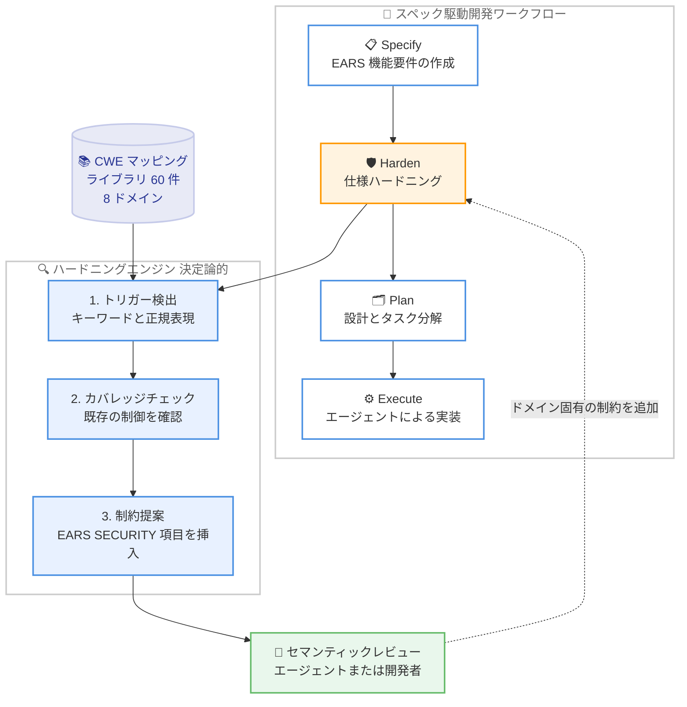

# Kiro - 仕様ハードニング (Specification Hardening) によるセキュリティ要件のシフトレフト

**リリース日**: 2026 年 10 月 30 日
**サービス**: Kiro
**機能**: 仕様ハードニング (Specification Hardening) - セキュリティ要件を仕様に組み込む Kiro Power

📊 [このアップデートのインフォグラフィックを見る](https://takech9203.github.io/aws-news-summary/20261030-kiro-spec-it-safe.html)

## 概要

Kiro は、スペック駆動開発 (SDD: Spec-Driven Development) のワークフローにセキュリティ要件を組み込む「仕様ハードニング (Specification Hardening)」を Kiro Power (プラグイン) として公開しました。SDD では「Specify → Plan → Execute」の流れで AI コーディングエージェントが設計・タスク分解・実装を進めますが、多くの仕様は「ソフトウェアが何をすべきか」という機能要件のみを記述し、「悪用にどう耐えるべきか」というセキュリティ要件に言及していません。機能要件はログインが壊れればすぐ気付くのに対し、セキュリティ要件の欠落はすべての機能チェックを通過したままインジェクションや認可の欠陥を残す可能性があります。

仕様ハードニングは、機能要件の記述が完了した後、プランニングの開始前に 1 つのステップを追加します。EARS 形式の要件を読み取り、その文言が示唆する弱点タイプを検出し、追跡・テスト可能なセキュリティ義務 (セキュリティ制約) を提案します。提案は、CWE (Common Weakness Enumeration) の弱点クラスと再利用可能なセキュリティ義務をマッピングしたキュレーション済みライブラリに基づいており、モデルの推測ではなく既知の弱点を根拠としています。

この機能は、コード生成前の「アップストリームの制御ポイント」であり、ランタイムのセキュリティ境界ではありません。SAST、DAST、依存関係スキャン、人間によるレビューを置き換えるものではなく、セキュリティの意図を仕様の段階で明示的・追跡可能・テスト可能にすることで、一般的な弱点クラスの見落としを減らすことを目的としています。なお、本機能はリサーチプロトタイプとして位置付けられています。

**アップデート前の課題**

仕様ハードニング以前の SDD ワークフローには、以下の課題がありました。

- 仕様にセキュリティ制約が記載されていない場合、コーディングエージェントはセキュリティ上のターゲットを持たず、フレームワークのデフォルト動作に依存するしかなかった
- セキュリティ要件は機能要件と異なり自己実証的ではないため、インジェクションや認証の欠落といった弱点が機能テストを通過したまま残る可能性があった
- セキュリティはコード作成後のレビューで後付けされることが多く、設計が固まった後の修正コストが高かった

**アップデート後の改善**

- 機能要件の作成後、プランニング前に仕様をハードニングし、CWE に基づくセキュリティ制約を EARS 形式で仕様に自動追記できるようになった
- 60 件の CWE マッピング (8 つのセキュリティドメイン) に基づく決定論的なエンジンにより、同じ入力に対して常に同じハードニング結果が得られるようになった
- セキュリティの意図が仕様としてリポジトリに残るため、各義務の根拠をタスク実行後も監査できるようになった
- グリーンフィールド、ブラウンフィールド、レガシーモダナイゼーションの 3 つのプロジェクトタイプで同じハードニングステップを利用できるようになった

## アーキテクチャ図



仕様ハードニングは Kiro の Specify → Plan → Execute フローに 1 つのハードニングステップを挿入し、コード生成前の早期制御ポイントとして機能します。エンジンの 3 段階パイプラインは決定論的で、その後のエージェントによるセマンティックレビューが追加の制約を補完します。

## サービスアップデートの詳細

### 主要機能

1. **CWE-to-spec マッピングライブラリ**
   - 仕様で表現可能な CWE 弱点クラスを、再利用可能なセキュリティ義務にマッピングした決定論的な TypeScript ライブラリおよび CLI
   - 8 つのセキュリティドメイン (インジェクション、認証、認可、データ露出、暗号化、入力検証、セキュリティ設定ミス、ビジネスロジック) にわたる 60 件の CWE マッピングを収録
   - 弱点の選定と検出パターンは、MITRE の CWE、OWASP Top 10:2021、Amazon Q Developer Detector Library (旧 CodeGuru) に主に基づく
   - 各マッピングには OWASP カテゴリと手動で割り当てられた重大度が付与される

2. **3 段階のハードニングパイプライン**
   - **トリガー検出**: 各要件を 60 件の CWE マッピングと照合。部分文字列キーワード (database、upload、session など) と正規表現パターンの 2 つの字句的シグナルを組み合わせてスコアリングし、しきい値 (デフォルト 0.3) を超えた CWE をフラグする
   - **カバレッジチェック**: フラグされた CWE について、仕様がすでに必要なプリミティブ (パラメータ化クエリ、所有権チェック、出力エンコーディングなど) を記述しているかを確認。未カバーのギャップのみが提案対象になる
   - **制約提案**: 不足している制約を EARS 項目として挿入。各行には提案 ID と `[SECURITY: …]` タグが付き、作成者は diff として変更をレビューできる

3. **セマンティックレビューパス**
   - 字句マッチングでは検出できない認可チェックの欠落などを、Kiro Power ではエージェントが、CLI では開発者がレビューして確認する
   - しきい値未満の弱い認可マッチは候補として提示され、確認されたギャップはドメイン固有の制約として追加される
   - レビューで追加された句は `EC` の代わりに `SEM` プレフィックスを使用 (例: `SEM-862-1`)

4. **インクリメンタルな再実行とバージョン管理との統合**
   - エンジンは行の追加のみを行い、要件の変更・分割・並べ替えは行わない。厳密な EARS 形式でない要件は書き換えずに報告する
   - 隠しレビューマーカーがハードニング済みの要件を記録するため、再実行時は新規または変更された要件のみをハードニングし、レビュアーが削除した制約を再提案しない
   - `requirements.md` をその場で編集するため、ハードニングがバージョン管理とコードレビューのフローに自然に組み込まれる

### 対象とする弱点クラスの例

| CWE | 弱点 | トリガー条件 | 必須 EARS 制約の例 |
|------|------|------|------|
| CWE-89 | SQL インジェクション | 外部入力を使用してデータベースにクエリする | すべてのクエリをパラメータ化 / プリペアドステートメントで実行し、文字列連結を禁止 |
| CWE-862 | 認可の欠落 | プリンシパルが所有するリソースを返却または変更する | リクエスト元プリンシパルがリソースを所有するか明示的な許可を持つことを検証 |
| CWE-306 | 認証の欠落 | エンドポイントまたはリソースを公開する | 処理前に有効な認証済みセッションまたは署名付きトークンを要求 |
| CWE-79 | クロスサイトスクリプティング | ユーザー提供コンテンツをブラウザに描画する | すべての出力をコンテキストに応じてエンコードし、多層防御として CSP ヘッダーを追加 |
| CWE-522 | 不十分な資格情報保護 | パスワードを保存または検証する | 強力な適応型関数でパスワードをハッシュ化 (平文や可逆形式は禁止) |
| CWE-434 | 無制限のファイルアップロード | ファイルアップロードを受け付ける | MIME 許可リストに対してマジックバイトを検証し、サイズ上限を設定し、Web ルート外に保存 |
| CWE-639 | IDOR / BOLA | 呼び出し元指定の識別子でオブジェクトを取得する | オブジェクトの所有テナントが認証済み呼び出し元と一致することを返却前に検証 |

表の制約は代表的な言い換えであり、すべてのアーキテクチャを網羅する完全な制御ではありません。

## 技術仕様

### 対象範囲

| 項目 | 詳細 |
|------|------|
| 対象とする弱点 | 要件として表現可能かつ EARS の文言から検出可能な弱点クラス (インジェクション、認証の欠落、脆弱な資格情報保存、未エンコード出力など) |
| 対象外の弱点 | データフローやコードレベルの分析が必要な弱点、字句的に示されない認可ギャップ、ランタイム・インフラ・依存関係に関する弱点 |
| マッピング数 | 60 件の CWE マッピング、8 セキュリティドメイン |
| 検出方式 | 字句マッチング (キーワード + 正規表現)、スコアしきい値 0.3 (デフォルト) |
| 決定論性 | 同一のツールバージョン・マッピング・オプション・入力に対して常に同一の結果 (エージェントのセマンティックレビューは非決定論的) |
| 対象ファイル | `.kiro/specs/*/requirements.md` |
| 提供形態 | Kiro Power および TypeScript ライブラリ / CLI (GitHub の sample-kiro-spec-security-hardening リポジトリ) |

### 提案 ID の構造

挿入される各制約には追跡可能な提案 ID が付与されます。例: `SEC-REQUIREMENTS-REQ-1-EC-89-1-1`

| 要素 | 意味 |
|------|------|
| `SEC` | セキュリティ制約であることを示すプレフィックス |
| `REQUIREMENTS-REQ-1` | `requirements.md` 内の 1 番目の要件 |
| `EC-89-1` | CWE-89 マッピングの 1 番目の EARS 制約テンプレート |
| 末尾の `1` | 1 つのテンプレートが複数の EARS 行に展開される場合の句番号 |
| `SEM` | レビューパスで追加された句は `EC` の代わりに `SEM` を使用 (例: `SEM-862-1`) |

## 設定方法

### 前提条件

1. Kiro IDE がインストールされていること (Kiro Power として使用する場合)
2. Node.js / npm が利用可能であること (CLI として使用する場合)
3. スペック駆動開発ワークフローで EARS 形式の `requirements.md` が作成済みであること

### 手順

#### ステップ 1: Kiro Power のインストール

GitHub の sample-kiro-spec-security-hardening リポジトリから仕様ハードニング Power を Kiro IDE にインストールします。

#### ステップ 2: 仕様のハードニング

機能要件が確定したら、Kiro に「harden my specs」と依頼します。`harden-spec` スキルが以下を実行します。

1. バンドルされたエンジンを検出し、初回使用時にビルド
2. `.kiro/specs/*/requirements.md` に対してエンジンを実行
3. キーワードマッチングでは検出できない認可チェックの欠落についてセマンティックレビューを実施
4. 追加した制約と注意が必要な警告をサマリーとして提示

#### ステップ 3: CLI での実行 (代替手段)

```bash
# cwe-to-spec-mapping-library/ ディレクトリで初回ビルド
npm install

# コンパイル済み CLI を仕様ファイルまたは specs ディレクトリに対して実行 (絶対パスを使用)
# --semantic-candidates フラグで、弱い認可マッチをレビュー用に表示 (ファイルには書き込まない)
```

`npm install` はライブラリを 1 回ビルドします。その後、コンパイル済み CLI を仕様ファイルに向けて実行すると、`requirements.md` がその場で編集されます。`--semantic-candidates` フラグは認可関連の弱いマッチを表示のみ行い、ファイルには書き込みません。

#### ステップ 4: diff のレビュー

エンジンは行の追加のみを行いますが、必ず git diff をレビューします。3 つ以上の要件で提案された句は `## Security Baseline (Cross-Cutting)` セクションに 1 回だけ移動されるヒューリスティックがあるため、diff での確認が推奨されています。開発者は各句に対して判断を下し、必要に応じてドメイン固有の制約を追加・調整します。

## メリット

### ビジネス面

- **セキュリティのシフトレフト**: コードが存在する前の仕様段階でセキュリティ義務を明示することで、後工程での手戻りと修正コストを削減できる
- **監査可能性**: ハードニング済みの仕様がリポジトリに残るため、各セキュリティ義務の根拠をタスク実行後も監査できる
- **アーキテクチャの改善**: セキュリティ要件を早期に明示することで、後付けではなく要件を中心に据えたクリーンな設計につながる

### 技術面

- **決定論的で再現可能**: 同じ入力に対して常に同じハードニング結果が得られるため、提案の根拠がモデルの推測ではなく既知の CWE に基づく
- **追跡・テスト可能な制約**: 各制約に提案 ID と `[SECURITY: …]` タグが付与され、EARS 形式でテスト可能な形で仕様に組み込まれる
- **既存ワークフローとの統合**: `requirements.md` のその場編集と行追加のみの動作により、バージョン管理とコードレビューのプロセスに自然に適合する
- **3 つのプロジェクトタイプに対応**: 新規開発 (グリーンフィールド)、既存コード (ブラウンフィールド)、AWS Transform などで要件を抽出するレガシーモダナイゼーションのいずれでも同じハードニングステップを利用できる

## デメリット・制約事項

### 制限事項

- マッチングは字句的 (lexical) であり意味論的ではないため、文言が明示的に記述していない弱点は見逃す可能性がある
- データフローやコードレベルの分析に依存する弱点、字句的に示されない認可ギャップ、ランタイム・インフラ・依存関係に関する弱点は対象外
- 生成されたコードの検証や脆弱性の不在証明は行わず、SAST、DAST、依存関係スキャン、人間によるレビューの代替にはならない
- カバレッジチェックはファイル全体に対する字句的なチェックであるため、ある要件に記述された制御が別の要件への提案を抑制する場合がある
- CLI は構造化レポート (各制約の CWE、優先度、根拠) を保存しない (プログラマティック API では取得可能)
- リサーチプロトタイプとして位置付けられており、仕様レベルの制御という仮説を検証する段階にある

### 考慮すべき点

- ハードニング後も git diff の確認と開発者による判断が必須であり、ツールはセキュリティ判断を補強するものであって置き換えるものではない
- ブラウンフィールドでは、提案された義務を既存システムの実際の挙動と照合する必要がある。相違がある場合、コードのギャップか適応すべき制約のいずれかが見つかったことになる
- 脅威モデリング、Kiro ステアリングファイルによるセキュアコーディングガイダンス、安全なデフォルトを持つフレームワーク、下流のセキュリティテストと組み合わせて使用することが推奨されている
- 仕様ハードニング後もセキュリティレビューのステップを含めることが強く推奨されている

## ユースケース

### ユースケース 1: 新規開発でのセキュア・バイ・デザイン

**シナリオ**: デジタルヘルススタートアップが、医師が患者名で臨床ノートを検索する患者ポータルを新規開発する。プロダクトマネージャーが書いた機能要件は検索機能のみを記述し、認証やクエリの安全性には言及していない。

**実装例**:
```text
1. EARS 形式で機能要件を作成
2. Kiro に「harden my specs」と依頼
3. エンジンが CWE-89 (SQL インジェクション) と CWE-306 (認証の欠落) を検出し、
   7 つのセキュリティ制約を要件に追記
   - 1.1-1.2: パラメータ化クエリ (CWE-89)
   - 1.3-1.4: 入力検証 (CWE-89)
   - 1.5-1.7: 認証 (CWE-306)
4. レビューパスで 1.8 (データ最小化、CWE-200) と
   1.9 (診療関係に基づく認可、CWE-862) を追加
5. ハードニング済み仕様からエージェントがコードを生成
```

**効果**: 文字列連結による SQL インジェクションや認証チェックの欠落を含むコードが生成されるリスクを、コード作成前に排除できる。しきい値未満だった認可ギャップもセマンティック候補としてレビュアーに提示され、ドメイン固有の制約 (診療関係チェック) として確定できる。

### ユースケース 2: 既存プロジェクトへの要件追加 (ブラウンフィールド)

**シナリオ**: 既存のアプリケーションに新しい要件を追加または変更する際、変更部分のみにセキュリティ制約を適用したい。

**実装例**:
```text
1. 既存の仕様に要件を追加・変更
2. 仕様ハードニングを再実行
3. 隠しレビューマーカーにより、新規または変更された要件のみがハードニングされる
4. 追加された SEC- 制約が機能変更と並ぶレビュー可能な diff として表示される
5. 提案された義務を既存システムの実際の挙動と照合する
```

**効果**: 変更が修正対象の範囲内に収まり、レビュー済みの要件には影響しない。義務と実装の相違を確認することで、コードのギャップまたは適応すべき制約を発見できる。

### ユースケース 3: レガシーシステムのスペック駆動モダナイゼーション

**シナリオ**: レガシーシステムを書き換える際、元のシステムのセキュリティギャップを引き継がずにモダナイズしたい。

**実装例**:
```text
1. AWS Transform などでレガシーシステムから EARS 仕様として要件を抽出
2. 抽出した要件セット全体を仕様ハードニングで一括ハードニング
3. ハードニング済み仕様に基づいて再実装
```

**効果**: モダナイズ後のシステムが、元のギャップを継承する代わりに、明示的にハードニングされた仕様に対して再構築される。

## 料金

仕様ハードニングは Kiro Power およびオープンに公開された GitHub リポジトリ (sample-kiro-spec-security-hardening) として提供されます。Kiro 自体の利用には Kiro の料金プラン (Free / Pro / Pro+ / Pro Max / Power) が適用されます。詳細は [Kiro の料金ページ](https://kiro.dev/pricing/) を参照してください。

## 利用可能リージョン

グローバル (Kiro はグローバルに提供されるサービスです)

## 関連サービス・機能

- **Kiro スペック駆動開発**: 本機能が拡張する Specify → Plan → Execute のコアワークフロー。EARS 形式の要件定義が前提となる
- **Kiro Powers**: 本機能の提供形態であるプラグイン機構。`harden-spec` スキルとしてワークフローに統合される
- **Kiro ステアリングファイル**: エージェントのコンテキストにセキュアコーディングガイダンスを与える補完的な仕組み
- **AWS Transform**: レガシーシステムから EARS 仕様を抽出するモダナイゼーションシナリオで併用できるサービス
- **Amazon Q Developer Detector Library**: CWE マッピングの選定と検出パターンの主要な参照元の 1 つ (旧 CodeGuru)

## 参考リンク

- 📊 [インフォグラフィック](https://takech9203.github.io/aws-news-summary/20261030-kiro-spec-it-safe.html)
- [公式ブログ記事 (Kiro Blog)](https://kiro.dev/blog/spec-it-safe/)
- [Kiro Powers](https://kiro.dev/powers)
- [Kiro ドキュメント](https://kiro.dev/docs)
- [MITRE CWE](https://cwe.mitre.org/)
- [OWASP Top 10:2021](https://owasp.org/Top10/)

## まとめ

仕様ハードニングは、セキュリティ要件を仕様そのものに組み込むことで、AI コーディングエージェントが推測ではなく明示的な義務に対してコードを構築できるようにする、SDD 時代のシフトレフトの新しいアプローチです。60 件の CWE マッピングに基づく決定論的なエンジンとセマンティックレビューの組み合わせにより、一般的な弱点クラスの見落としを仕様段階で削減できます。SDD を採用しているチームは、GitHub のサンプルリポジトリから Kiro Power を導入し、「完了の定義」に仕様セキュリティレビューを追加することを検討してください。ただし本機能はリサーチプロトタイプであり、SAST / DAST / 人間によるレビューなどの下流のセキュリティ対策と組み合わせて利用することが前提となります。
