# Amazon Bedrock - OpenAI Daybreak Red が AWS GovCloud (US-East) で利用可能に

**リリース日**: 2026 年 10 月 30 日
**サービス**: Amazon Bedrock
**機能**: OpenAI Daybreak Red (GPT-5.6 Cyber) の AWS GovCloud (US-East) における提供開始 (対象要件を満たす顧客向け)

📊 [このアップデートのインフォグラフィックを見る](https://takech9203.github.io/aws-news-summary/20261030-openai-daybreak-red-govcloud-east.html)

## 概要

OpenAI のサイバー防御イニシアチブ「Daybreak」に基づくモデル **Daybreak Red** が、対象要件を満たす顧客向けに AWS GovCloud (US-East) の Amazon Bedrock で利用可能になりました。公式発表によると、本モデルは現在、米国東部 (オハイオ) と AWS GovCloud (US-East) で利用できます。

Daybreak Red は、正式名称「Daybreak Red: GPT-5.6 Cyber」として提供される、サイバーセキュリティ向けに専用トレーニングされたモデルです。認可された脆弱性リサーチ、エクスプロイトの再現、緩和策の開発といった高度なタスク向けに設計されており、検証済みのディフェンダーに対しては拒否 (refusal) が少なくなる代わりに、より強力な本人確認、モニタリング、アクセス制御が適用されます。

AWS GovCloud (US) は、米国政府機関や厳格な規制・コンプライアンス要件を持つ組織向けに設計されたリージョンです。今回のアップデートにより、政府機関や公共部門のセキュリティチームも、コンプライアンス要件を満たす環境でフロンティア AI をサイバー防御業務に活用できるようになりました。

**アップデート前の課題**

- Daybreak Red は商用リージョンでのみ提供されており、AWS GovCloud (US) を利用する政府機関や規制の厳しい組織は利用できなかった
- 政府系ワークロードのセキュリティチームは、脆弱性リサーチやエクスプロイト再現などの業務にフロンティア AI を活用する手段が限られていた
- 機密性の高いセキュリティ調査データを GovCloud 環境の外部に出すことは、コンプライアンス上の制約から困難だった

**アップデート後の改善**

- AWS GovCloud (US-East) の Amazon Bedrock 上で Daybreak Red を直接利用できるようになった
- GovCloud 環境内で認可された脆弱性リサーチ、エクスプロイト再現、緩和策開発に AI を活用できるようになった
- 推論データはモデルトレーニングに使用されず、OpenAI とのデータ共有も不要なまま、チップレベルで強制されるゼロオペレーターアクセスのもとで利用できる

## アーキテクチャ図

```mermaid
flowchart TD
    subgraph Enroll["📝 利用資格の取得プロセス"]
        direction LR
        User(["👤 セキュリティチーム"])
        OpenAI{{"🏢 OpenAI<br/>Daybreak アクセス登録"}}
        Team["🤝 AWS アカウントチーム<br/>アクセス有効化"]
        User --> OpenAI --> Team
    end

    subgraph Regions["☁️ 利用可能リージョン"]
        direction LR
        subgraph Ohio["🌎 米国東部 オハイオ"]
            RedC["🔴 Daybreak Red<br/>GPT-5.6 Cyber"]
        end
        subgraph Gov["🏛️ AWS GovCloud US-East"]
            RedG["🔴 Daybreak Red<br/>GPT-5.6 Cyber"]
        end
        Ohio ~~~ Gov
    end

    ZOA["🔒 Amazon Bedrock 次世代推論エンジン<br/>ゼロオペレーターアクセスをチップレベルで強制<br/>推論データはトレーニングに不使用"]

    Team --> Regions
    Regions --- ZOA

    classDef layer fill:none,stroke:#E1BEE7,stroke-width:2px,color:#666666
    classDef region fill:none,stroke:#CCCCCC,stroke-width:2px,color:#666666
    classDef user fill:#E3F2FD,stroke:#BBDEFB,stroke-width:2px,color:#1565C0
    classDef external fill:#F3E5F5,stroke:#7B61FF,stroke-width:2px,color:#333333
    classDef process fill:#FFFFFF,stroke:#4A90E2,stroke-width:2px,color:#333333
    classDef red fill:#FFEBEE,stroke:#F44336,stroke-width:2px,color:#333333
    classDef secure fill:#E9F7EC,stroke:#66BB6A,stroke-width:2px,color:#33691E

    class Enroll,Regions layer
    class Ohio,Gov region
    class User user
    class OpenAI external
    class Team process
    class RedC,RedG red
    class ZOA secure
```



OpenAI への Daybreak アクセス登録と AWS アカウントチーム経由の有効化を経て、米国東部 (オハイオ) または AWS GovCloud (US-East) の Amazon Bedrock 上で Daybreak Red を利用する流れを示しています。いずれのリージョンでも、ゼロオペレーターアクセスが強制された次世代推論エンジン上で推論が実行されます。

## サービスアップデートの詳細

### 主要機能

1. **AWS GovCloud (US-East) での Daybreak Red 提供**
   - 政府機関や規制の厳しい組織が利用する AWS GovCloud (US-East) で、Daybreak Red: GPT-5.6 Cyber が利用可能になった
   - 公式発表によると、利用可能リージョンは米国東部 (オハイオ) と AWS GovCloud (US-East)

2. **認可されたサイバーセキュリティ業務向けの専用モデル**
   - 脆弱性の発見、エクスプロイトのテスト、防御策の構築といったセキュリティチームの業務を支援
   - 認可された脆弱性リサーチ、エクスプロイト再現、緩和策の開発向けに設計
   - 検証済みのディフェンダーに対しては拒否が少なくなる一方、より強力な本人確認、モニタリング、アクセス制御が適用される

3. **データ保護とゼロオペレーターアクセス**
   - Amazon Bedrock の次世代推論エンジン上で動作し、ゼロオペレーターアクセスがチップレベルで強制される
   - 顧客の推論データはモデルのトレーニングに使用されない
   - Daybreak Red のデータを OpenAI と共有する必要がない

## 技術仕様

### モデルと提供形態

| 項目 | 詳細 |
|------|------|
| モデル名 | Daybreak Red: GPT-5.6 Cyber |
| 提供元 | OpenAI (Daybreak サイバー防御イニシアチブ) |
| 主な用途 | 認可された脆弱性リサーチ、エクスプロイト再現、緩和策の開発 |
| 追加の統制 | 強力な本人確認、モニタリング、アクセス制御 |
| 推論基盤 | Amazon Bedrock 次世代推論エンジン (ゼロオペレーターアクセスをチップレベルで強制) |
| データ保護 | 推論データはトレーニングに不使用、OpenAI とのデータ共有は不要 |
| 利用資格 | OpenAI の Daybreak アクセスへの登録と承認が必要 |

## 設定方法

### 前提条件

1. OpenAI の Daybreak アクセスへの登録と承認 (Trusted Access for Cyber プログラム)
2. AWS アカウントおよび Amazon Bedrock へのアクセス権限
3. 米国東部 (オハイオ) または AWS GovCloud (US-East) リージョンの利用 (GovCloud の場合は GovCloud アカウントが必要)

### 手順

#### ステップ 1: OpenAI の Daybreak アクセスに登録する

OpenAI のエンタープライズ向け Trusted Access フォーム (https://openai.com/form/enterprise-trusted-access-for-cyber/) から Daybreak アクセスへの登録を申請します。利用資格については OpenAI または AWS アカウントチームに問い合わせて確認します。

#### ステップ 2: AWS アカウントチームと連携してアクセスを有効化する

OpenAI 側の承認が完了したら、AWS アカウントチームと連携して Amazon Bedrock 上での Daybreak Red へのアクセスを有効化します。

#### ステップ 3: 対象リージョンでモデルへのアクセスを確認する

```bash
# 利用可能な OpenAI モデルの一覧を確認 (AWS GovCloud US-East)
aws bedrock list-foundation-models \
  --region us-gov-east-1 \
  --by-provider openai \
  --query "modelSummaries[].modelId"
```

Amazon Bedrock の `ListFoundationModels` API で、アクセスが付与されたモデルの ID を確認します。アクセス付与後は、通常の Bedrock モデルと同様に IAM ポリシーで利用範囲を制御したうえで推論を実行します。

## メリット

### ビジネス面

- **政府・公共部門での AI 活用**: AWS GovCloud (US) を利用する政府機関や規制の厳しい組織が、コンプライアンス要件を満たす環境でフロンティア AI をサイバー防御業務に活用できる
- **データ主権の確保**: 推論データがモデルトレーニングに使用されず、OpenAI とのデータ共有も不要なため、機密性の高いセキュリティ調査データを扱う組織でも導入しやすい
- **防御力の強化**: 脆弱性の発見、エクスプロイトのテスト、防御策の構築といったセキュリティチームの中核業務を AI で加速できる

### 技術面

- **ゼロオペレーターアクセス**: チップレベルで強制されるゼロオペレーターアクセスにより、推論中のデータに対する高い機密性を確保
- **GovCloud ネイティブな利用**: GovCloud 環境内で完結する形でモデルを利用でき、環境外へのデータ持ち出しを避けられる
- **統制された高度なリサーチ**: 検証済みディフェンダー向けに拒否を減らしつつ、本人確認、モニタリング、アクセス制御で統制を維持

## デメリット・制約事項

### 制限事項

- 利用には OpenAI の Daybreak アクセスへの登録と承認が必要で、すべての顧客が利用できるわけではない
- 利用可能リージョンは米国東部 (オハイオ) と AWS GovCloud (US-East) に限定される
- AWS GovCloud (US) の利用には、GovCloud アカウントの取得など所定の要件を満たす必要がある

### 考慮すべき点

- Daybreak Red の利用には、より強力な本人確認、モニタリング、アクセス制御の受け入れが必要
- What's New ではモデル ID、コンテキストウィンドウ、料金などの詳細仕様は公表されていないため、AWS アカウントチームへの確認が必要
- 攻撃的リサーチ寄りのタスクを扱う場合は、組織内の認可プロセスや法的・倫理的な確認を事前に整備しておく必要がある

## ユースケース

### ユースケース 1: 政府機関における認可済み脆弱性リサーチ

**シナリオ**: 政府機関のセキュリティチームが、管轄システムに対する認可された脆弱性リサーチとエクスプロイト再現検証を GovCloud 環境内で実施したい。

**実装例**:
```
1. OpenAI の Daybreak アクセスを申請・承認
2. AWS GovCloud (US-East) の分離されたアカウントにリサーチ環境を構築
3. Daybreak Red で脆弱性の解析、エクスプロイト再現、緩和策の開発を実施
4. IAM と監査ログで利用者と利用状況を統制
```

**効果**: コンプライアンス要件を満たす環境内で、脆弱性解析から緩和策検討までのサイクルを AI で加速できる。

### ユースケース 2: 公共部門向けシステムの防御策構築

**シナリオ**: 公共部門向けシステムを運用する事業者が、新たに公開された脆弱性への対応として、自社環境への影響分析と防御策の構築を迅速に行いたい。

**実装例**:
```
1. Daybreak Red へのアクセスを GovCloud (US-East) で有効化
2. 脆弱性情報と自社構成情報をもとに影響範囲を分析
3. 緩和策やパッチ適用計画のドラフトを生成し、専門家がレビュー
```

**効果**: 脆弱性公開から防御策展開までのリードタイムを短縮し、政府系ワークロードの保護を強化できる。

### ユースケース 3: 機密データを GovCloud 外に出せない組織でのセキュリティ分析

**シナリオ**: 規制要件により機密データを GovCloud 環境外に持ち出せない組織が、AI によるセキュリティ分析を導入したい。

**実装例**:
```
1. AWS GovCloud (US-East) 内で Daybreak Red を利用
2. 推論データがトレーニングに使用されないこと、OpenAI とのデータ共有が
   不要であることを前提にデータ取り扱いポリシーを整備
3. 環境内で完結する形で分析ワークフローを構築
```

**効果**: データを環境外に出すことなく、規制要件を満たしたまま AI によるセキュリティ分析を実現できる。

## 料金

What's New では Daybreak Red の具体的な料金は公表されていません。Amazon Bedrock の料金体系については料金ページを参照し、Daybreak Red の詳細な料金は AWS アカウントチームに確認してください。

## 利用可能リージョン

- 米国東部 (オハイオ)
- AWS GovCloud (US-East)

リージョン別のモデル対応状況は [Amazon Bedrock のリージョン互換性ドキュメント](https://docs.aws.amazon.com/bedrock/latest/userguide/models-region-compatibility.html)を参照してください。

## 関連サービス・機能

- **Amazon Bedrock**: Daybreak Red の実行基盤。次世代推論エンジンとゼロオペレーターアクセスを提供
- **AWS GovCloud (US)**: 米国政府機関や厳格な規制要件を持つ組織向けに設計された AWS リージョン
- **OpenAI Daybreak Blue**: 防御的ワークフロー向けのモデル (GPT-5.6 Sol ベース)。2026 年 8 月に Daybreak Red とともに Amazon Bedrock で提供開始
- **AWS IAM / AWS CloudTrail**: モデルアクセスの制御と監査ログの記録

## 参考リンク

- 📊 [インフォグラフィック](https://takech9203.github.io/aws-news-summary/20261030-openai-daybreak-red-govcloud-east.html)
- [公式発表 (What's New)](https://aws.amazon.com/about-aws/whats-new/2026/10/openai-daybreak-red-govcloud-east/)
- [AWS Blog: Accelerate cyber defense with OpenAI and AWS](https://aws.amazon.com/blogs/machine-learning/accelerate-cyber-defense-with-openai-and-aws-daybreak-red-daybreak-blue-now-available-to-eligible-customers-on-amazon-bedrock/)
- [ドキュメント: Amazon Bedrock リージョン互換性](https://docs.aws.amazon.com/bedrock/latest/userguide/models-region-compatibility.html)
- [OpenAI Trusted Access for Cyber 登録フォーム](https://openai.com/form/enterprise-trusted-access-for-cyber/)
- [料金ページ: Amazon Bedrock](https://aws.amazon.com/bedrock/pricing/)

## まとめ

OpenAI の Daybreak Red: GPT-5.6 Cyber が AWS GovCloud (US-East) の Amazon Bedrock で利用可能になり、政府機関や規制の厳しい組織もコンプライアンス要件を満たす環境でフロンティア AI をサイバー防御業務に活用できるようになりました。利用には OpenAI の Daybreak アクセスへの登録と承認が必要なため、関心のある組織はまず OpenAI または AWS アカウントチームに利用資格を確認することを推奨します。
