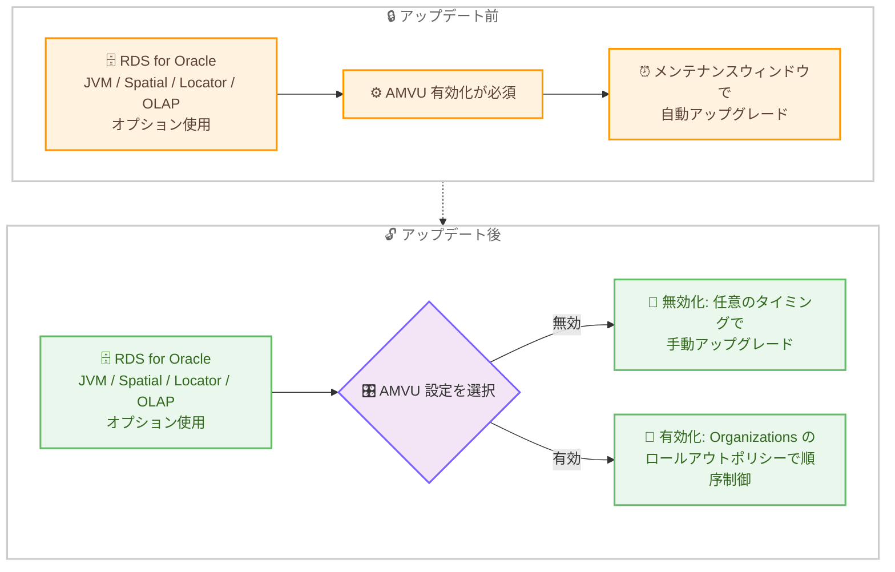

# Amazon RDS for Oracle - JVM、Spatial、Locator、OLAP オプション利用時の自動マイナーバージョンアップグレード必須要件を撤廃

**リリース日**: 2026 年 10 月 30 日
**サービス**: Amazon RDS for Oracle
**機能**: JVM、Spatial、Locator、OLAP オプション利用時の自動マイナーバージョンアップグレード (AMVU) 任意化

📊 [このアップデートのインフォグラフィックを見る](https://takech9203.github.io/aws-news-summary/20261030-oracle-jvm-spatial-locator-olap-options-amvu-optional.html)

## 概要

Amazon RDS for Oracle において、JVM (Java Virtual Machine)、Spatial、Locator、OLAP の各オプションを使用する DB インスタンスで、自動マイナーバージョンアップグレード (Automatic Minor Version Upgrade、以下 AMVU) を有効にすることが必須ではなくなりました。これまでこれらのオプションを有効化した DB インスタンスでは AMVU の有効化が強制されていましたが、今回のアップデートにより、新規および既存の DB インスタンスの両方で AMVU を無効化できるようになりました。

これにより、これらのオプションを利用するお客様は、マイナーバージョンアップグレードをいつ適用するかを自身で決定できるようになります。アプリケーションの検証スケジュールや変更管理プロセスに合わせて、アップグレードのタイミングを柔軟にコントロールしたいお客様にとって重要な改善です。

なお AWS は、AMVU を無効化した場合でも、最新の Oracle セキュリティ修正を適用するために、マイナーバージョンアップグレードを定期的に適用することを推奨しています。また、AMVU を有効のまま運用する場合は、AWS Organizations のアップグレードロールアウトポリシーを使用して、環境ごとのアップグレード順序を制御できます。

**アップデート前の課題**

- JVM、Spatial、Locator、OLAP のいずれかのオプションを使用する DB インスタンスでは、AMVU の有効化が必須だった
- マイナーバージョンアップグレードの適用タイミングを自身で選択できず、メンテナンスウィンドウ中に自動的にアップグレードが適用された
- 厳格な変更管理プロセスを持つ組織では、事前検証が完了する前にアップグレードが適用されるリスクがあった

**アップデート後の改善**

- これらのオプションを使用する新規および既存の DB インスタンスで AMVU を無効化できるようになった
- マイナーバージョンアップグレードの適用タイミングをお客様自身が決定できるようになった
- AMVU を有効のまま運用する場合も、AWS Organizations のアップグレードロールアウトポリシーで環境間のアップグレード順序を制御できる

## アーキテクチャ図



アップデート前は対象オプションの使用時に AMVU が強制されていましたが、アップデート後は AMVU の有効・無効をお客様が選択し、アップグレードのタイミングを柔軟に制御できます。

## サービスアップデートの詳細

### 主要機能

1. **AMVU 必須要件の撤廃**
   - JVM、Spatial、Locator、OLAP オプションを使用する DB インスタンスで AMVU を無効化可能に
   - 新規作成する DB インスタンスと既存の DB インスタンスの両方に適用
   - マイナーバージョンアップグレードの適用タイミングをお客様が決定可能

2. **対象となる Oracle オプション**
   - JVM: データベース内で Java ストアドプロシージャを実行する Oracle Java Virtual Machine
   - Spatial: 空間データの高度な分析機能を提供する Oracle Spatial
   - Locator: 空間データの基本機能を提供する Oracle Locator
   - OLAP: 多次元分析を行う Oracle OLAP

3. **AWS Organizations アップグレードロールアウトポリシーとの連携**
   - AMVU を有効のまま運用する場合、組織全体でアップグレード順序を制御可能
   - first (開発環境など)、second (QA 環境など)、last (本番環境など) の 3 段階の順序を定義
   - 各フェーズ間にベイクタイム (検証期間) が設けられ、問題検出時は後続環境の AMVU を無効化して停止可能
   - AWS Health 通知と Amazon RDS イベント通知でアップグレードの進捗を監視可能

## 技術仕様

### AMVU 設定の選択肢

| 項目 | AMVU 無効化 | AMVU 有効化 + ロールアウトポリシー |
|------|------------|-----------------------------------|
| アップグレードタイミング | お客様が任意に決定 | メンテナンスウィンドウ中に自動適用 |
| 適用順序の制御 | 手動で環境ごとに実施 | first / second / last の順序で自動制御 |
| セキュリティ修正 | 定期的な手動適用を推奨 | 自動的に最新化 |
| 運用負荷 | 高 (計画・実行が必要) | 低 (ポリシーで自動化) |

### アップグレードロールアウトポリシーの動作

| フェーズ | 典型的な用途 | 動作 |
|---------|-------------|------|
| first | 開発・テスト環境 | 新しいマイナーバージョンが対象になると最初にアップグレード対象となる |
| second | QA 環境 (未設定リソースのデフォルト) | first のベイクタイム経過後に対象となる |
| last | 本番環境 | second のベイクタイム経過後に対象となる |

**注意**: アップグレードロールアウトポリシーは、2026 年 1 月以降にリリースされた Oracle Database エンジンバージョンの AMVU をサポートします。

## 設定方法

### 前提条件

1. Amazon RDS for Oracle の DB インスタンスを運用していること
2. JVM、Spatial、Locator、OLAP のいずれかのオプションをオプショングループで使用していること
3. AWS CLI または AWS Management Console へのアクセス権限があること

### 手順

#### ステップ 1: 現在の AMVU 設定を確認する

```bash
aws rds describe-db-instances \
    --db-instance-identifier my-oracle-instance \
    --query "DBInstances[0].AutoMinorVersionUpgrade"
```

対象の DB インスタンスで AMVU が有効になっているかどうかを確認します。`true` の場合は AMVU が有効です。

#### ステップ 2: AMVU を無効化する

```bash
aws rds modify-db-instance \
    --db-instance-identifier my-oracle-instance \
    --no-auto-minor-version-upgrade \
    --apply-immediately
```

DB インスタンスの AMVU を無効化します。`--apply-immediately` を指定すると変更が即時適用されます。今回のアップデートにより、JVM、Spatial、Locator、OLAP オプションを使用するインスタンスでもこの操作が可能になりました。

#### ステップ 3: 任意のタイミングでマイナーバージョンアップグレードを適用する

```bash
aws rds modify-db-instance \
    --db-instance-identifier my-oracle-instance \
    --engine-version 19.0.0.0.ru-2026-07.rur-2026-07.r1 \
    --apply-immediately
```

検証が完了したタイミングで、エンジンバージョンを指定して手動でマイナーバージョンアップグレードを適用します。セキュリティ修正を取り込むため、定期的な適用が推奨されます。

## メリット

### ビジネス面

- **変更管理プロセスとの整合**: 組織の変更管理・リリース承認プロセスに合わせてアップグレードを計画できる
- **ダウンタイムの計画性向上**: 業務影響の少ない時間帯を選んでアップグレードを実施できる
- **リスクの低減**: 事前検証が完了してから本番環境へ適用することで、予期しない互換性問題のリスクを低減できる

### 技術面

- **アップグレードタイミングの完全な制御**: JVM や Spatial などのオプション利用時でも、他のインスタンスと同様にアップグレード戦略を統一できる
- **段階的ロールアウトの自動化**: AMVU を有効にする場合は、Organizations のアップグレードロールアウトポリシーで開発・QA・本番の順に自動展開できる
- **可観測性**: AWS Health 通知と RDS イベント通知により、アップグレードキャンペーンの進捗を追跡できる

## デメリット・制約事項

### 制限事項

- アップグレードロールアウトポリシーは、2026 年 1 月以降にリリースされた Oracle Database エンジンバージョンの AMVU のみをサポートする
- アップグレードロールアウトポリシーの利用には、AWS Organizations の組織に所属し、ポリシーが有効化されている必要がある
- ポリシー未設定のリソースは自動的に second の順序が適用される

### 考慮すべき点

- AMVU を無効化した場合、最新の Oracle セキュリティ修正の適用はお客様の責任となるため、定期的なマイナーバージョンアップグレードの計画が必要
- マイナーバージョンのサポート終了時期を把握し、サポート対象バージョンを維持する運用体制が求められる
- ポリシーやタグの変更が反映されるまでには伝播時間が必要となる

## ユースケース

### ユースケース 1: 厳格な変更管理を行う金融系システム

**シナリオ**: Oracle Spatial を使用する基幹データベースで、すべての変更に事前検証と承認が必須の環境。これまでは AMVU が強制され、検証完了前にアップグレードが適用されるリスクがあった。

**実装例**:
```bash
# 本番インスタンスの AMVU を無効化
aws rds modify-db-instance \
    --db-instance-identifier prod-spatial-db \
    --no-auto-minor-version-upgrade \
    --apply-immediately
```

**効果**: 検証環境でのテスト完了と変更承認を経てから本番環境へアップグレードを適用でき、変更管理プロセスを遵守できる。

### ユースケース 2: Organizations ポリシーによる段階的アップグレード

**シナリオ**: JVM オプションを使用する複数アカウント・複数環境の RDS for Oracle インスタンス群で、AMVU の利便性を維持しつつ、開発環境から本番環境へ段階的にアップグレードを展開したい。

**実装例**:
```bash
# 環境を識別するタグを付与
aws rds add-tags-to-resource \
    --resource-name arn:aws:rds:ap-northeast-1:123456789012:db:dev-jvm-db \
    --tags Key=Environment,Value=Development
```

**効果**: 開発環境 (first) でのアップグレード結果をベイクタイム中に検証し、問題がなければ QA (second)、本番 (last) へと自動的に展開される。問題検出時は後続環境の AMVU を無効化して展開を停止できる。

### ユースケース 3: アプリケーション互換性検証を伴う OLAP 分析基盤

**シナリオ**: Oracle OLAP を使用する分析基盤で、マイナーバージョンアップグレード後に BI ツールとの互換性検証が必要なため、四半期ごとの定期メンテナンスでまとめてアップグレードを実施したい。

**実装例**:
```bash
# 四半期メンテナンス時に手動でアップグレードを適用
aws rds modify-db-instance \
    --db-instance-identifier olap-analytics-db \
    --engine-version <検証済みバージョン> \
    --no-apply-immediately
```

**効果**: 次回メンテナンスウィンドウでアップグレードが適用され、BI ツールの互換性検証サイクルと整合した計画的な運用が可能になる。

## 料金

このアップデートに伴う追加料金はありません。AMVU の有効・無効にかかわらず、Amazon RDS for Oracle の通常の料金体系が適用されます。

## 利用可能リージョン

Amazon RDS for Oracle が利用可能なすべての商用 AWS リージョンおよび AWS GovCloud (US) リージョンで利用できます。

## 関連サービス・機能

- **AWS Organizations**: アップグレードロールアウトポリシーにより、複数アカウントにまたがる AMVU の適用順序を制御
- **AWS Health**: アップグレードキャンペーンの開始前通知やフェーズ間の進捗通知を提供
- **Amazon EventBridge**: RDS イベント通知をサブスクライブし、アップグレードの開始・完了を自動監視

## 参考リンク

- 📊 [インフォグラフィック](https://takech9203.github.io/aws-news-summary/20261030-oracle-jvm-spatial-locator-olap-options-amvu-optional.html)
- [公式発表 (What's New)](https://aws.amazon.com/about-aws/whats-new/2026/10/oracle-jvm-spatial-locator-olap-options-amvu-optional/)
- [ドキュメント: Adding options to Oracle DB instances](https://docs.aws.amazon.com/AmazonRDS/latest/UserGuide/Appendix.Oracle.Options.html)
- [ドキュメント: AWS Organizations upgrade rollout policy for automatic minor version upgrades](https://docs.aws.amazon.com/AmazonRDS/latest/UserGuide/RDS.Maintenance.AMVU.UpgradeRollout.html)
- [Amazon RDS for Oracle 製品ページ](https://aws.amazon.com/rds/oracle/)

## まとめ

JVM、Spatial、Locator、OLAP オプションを使用する Amazon RDS for Oracle インスタンスでも、自動マイナーバージョンアップグレードの有効化が任意となり、アップグレードタイミングを完全に制御できるようになりました。これらのオプションを利用中のお客様は、自社の変更管理プロセスに合わせて AMVU の無効化を検討しつつ、セキュリティ修正の適用漏れを防ぐための定期的なアップグレード計画を整備することを推奨します。AMVU を継続利用する場合は、AWS Organizations のアップグレードロールアウトポリシーによる段階的展開の活用も有効です。
