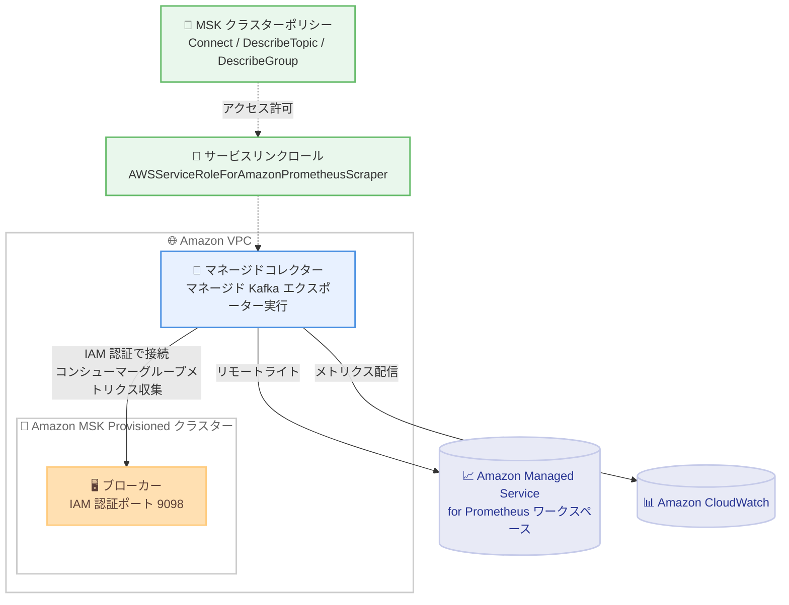

# Amazon Managed Service for Prometheus - マネージドコレクターによる Amazon MSK コンシューマーグループメトリクスの収集

**リリース日**: 2026 年 10 月 30 日
**サービス**: Amazon Managed Service for Prometheus / Amazon CloudWatch
**機能**: Managed Prometheus collectors による Amazon MSK コンシューマーグループメトリクスのサポート

📊 [このアップデートのインフォグラフィックを見る](https://takech9203.github.io/aws-news-summary/20261030-prometheus-collectors-msk-metrics.html)

## 概要

Amazon Managed Service for Prometheus のマネージドコレクター (スクレイパー) が、Amazon MSK クラスターからの Kafka エクスポーターメトリクスとコンシューマーグループラグメトリクスの収集をサポートしました。マネージドコレクターがマネージド Kafka エクスポーターを実行し、コンシューマーラグ、コミット済みオフセット、各コンシューマーグループのメンバー数などのメトリクスを自動的に収集します。収集先には Amazon Managed Service for Prometheus ワークスペースと Amazon CloudWatch の両方を指定できます。

この機能により、ユーザーは Kafka エクスポーターなどの収集エージェントを自前でデプロイ・運用することなく、Kafka ストリームの健全性やコンシューマーのパフォーマンスを監視し、ストリーミングアプリケーションの処理ボトルネックを検出できます。コレクターは IAM 認証でクラスターに接続し、アクセス許可は Amazon MSK クラスターポリシーで付与します。

これらのメトリクスは、マネージドコレクターが Open Monitoring 経由で収集する JMX / Node Exporter メトリクスを補完するものです。なお、コンシューマーグループメトリクスの収集に Open Monitoring は不要です。

**アップデート前の課題**

- コンシューマーラグなどのコンシューマーグループメトリクスを Prometheus 形式で取得するには、Kafka エクスポーター (kafka_exporter など) を EC2 や EKS 上で自前にデプロイ・運用する必要があった
- エクスポーターのパッチ適用、スケーリング、可用性確保などの運用負荷が発生していた
- マネージドコレクターで収集できるのは Open Monitoring 経由の JMX / Node Exporter メトリクスに限られ、コンシューマーグループ単位のラグ監視には追加の仕組みが必要だった

**アップデート後の改善**

- マネージドコレクターがマネージド Kafka エクスポーターを実行するため、エクスポーターのインストールや運用が不要になった
- コンシューマーラグ、コミット済みオフセット、コンシューマーグループメンバー数などのメトリクスを自動収集できるようになった
- 収集先として Amazon Managed Service for Prometheus ワークスペースに加えて Amazon CloudWatch も選択でき、PromQL で分析できるようになった
- `topicFilter` と `consumerGroupFilter` により、収集対象のトピックとコンシューマーグループを正規表現で絞り込めるようになった

## アーキテクチャ図



マネージドコレクターがサービスリンクロールと MSK クラスターポリシーに基づく IAM 認証でクラスターに接続し、コンシューマーグループメトリクスを収集して Amazon Managed Service for Prometheus ワークスペースまたは Amazon CloudWatch に配信する構成です。

## サービスアップデートの詳細

### 主要機能

1. **マネージド Kafka エクスポーターによる自動収集**
   - マネージドコレクターがエクスポーターを実行するため、ユーザー側でのエクスポーターのインストール・運用が不要
   - コンシューマーラグ (`kafka_consumergroup_lag`)、コミット済みオフセット (`kafka_consumergroup_current_offset`)、コンシューマーグループメンバー数 (`kafka_consumergroup_members`) を収集
   - スクレイプ設定に `job_name: kafka-exporter` のジョブを含めることで有効化。スクレイプターゲットの指定は不要で、コレクターが自動的に接続を構成

2. **IAM 認証と MSK クラスターポリシーによるアクセス制御**
   - コレクターはサービスリンクロールを使用し、IAM 認証 (ポート 9098) で MSK ブローカーに接続
   - アクセス許可は MSK クラスターポリシーで `kafka-cluster:Connect`、`kafka-cluster:DescribeTopic`、`kafka-cluster:DescribeGroup` を付与
   - ポリシー追加後は自動的に収集が開始され、スクレイパーの更新は不要

3. **トピックとコンシューマーグループのフィルタリング**
   - `create-scraper` / `update-scraper` の `exporters` フィールドに `kafkaConfiguration` を指定し、`topicFilter` と `consumerGroupFilter` を正規表現 (`^` で始まり `$` で終わる、最大 256 文字) で設定可能
   - フィルターを省略するとすべてのトピック・コンシューマーグループが対象
   - スクレイプ設定の `metric_relabel_configs` で収集するメトリクスをさらに絞り込み可能

4. **2 つの配信先をサポート**
   - Amazon Managed Service for Prometheus ワークスペース (`ampConfiguration`)
   - Amazon CloudWatch (`cloudWatchConfiguration`)。CloudWatch 側では Query Studio から PromQL でクエリ可能

## 技術仕様

### 収集されるコンシューマーグループメトリクス

| メトリクス | 説明 |
|------|------|
| `kafka_consumergroup_lag` | コンシューマーグループのラグ (未処理メッセージ数) |
| `kafka_consumergroup_current_offset` | コミット済みオフセット (コミットがない場合は -1) |
| `kafka_consumergroup_members` | コンシューマーグループのメンバー数 |

付与されるラベルには `clusterArn` (relabel で付与推奨)、`consumergroup`、`topic`、`partition` が含まれます。エクスポーターはトピック・パーティションのオフセットやパーティション数などの追加メトリクスも送信できますが、一部は Open Monitoring や MSK 標準の CloudWatch メトリクスと重複するため、必要なものだけを `metric_relabel_configs` で keep する構成が推奨されています。

### 前提条件となるクラスター要件

| 項目 | 詳細 |
|------|------|
| クラスタータイプ | Amazon MSK Provisioned (Standard ブローカー) |
| Apache Kafka バージョン | 3.6.0 以降 |
| 認証 | IAM アクセスコントロールが有効 (TLS クライアント認証との併用可) |
| ネットワーク | 異なる AZ の 2 つ以上のサブネット、VPC の DNS 有効化、ポート 9098 へのインバウンド許可 |
| アカウント / リージョン | スクレイパーと同一アカウント・同一リージョンのクラスターのみ |

### API 変更履歴

| 日付 | サービス | 変更内容 |
|------|----------|----------|
| 2026/10/30 | [Amazon Prometheus Service](https://awsapichanges.com/archive/changes/c2b1d5-aps.html) | 4 updated api methods - `CreateScraper`、`UpdateScraper`、`DescribeScraper`、`ListScrapers` に `exporters` フィールドの `kafkaConfiguration` (`clusterArn`、`topicFilter`、`consumerGroupFilter`) が追加 |

### MSK クラスターポリシーの例

```json
{
  "Version": "2012-10-17",
  "Statement": [
    {
      "Effect": "Allow",
      "Principal": { "AWS": "<scraper-role-arn>" },
      "Action": "kafka-cluster:Connect",
      "Resource": "arn:aws:kafka:us-west-2:111122223333:cluster/my-cluster/cluster-id"
    },
    {
      "Effect": "Allow",
      "Principal": { "AWS": "<scraper-role-arn>" },
      "Action": "kafka-cluster:DescribeTopic",
      "Resource": "arn:aws:kafka:us-west-2:111122223333:topic/my-cluster/cluster-id/*"
    },
    {
      "Effect": "Allow",
      "Principal": { "AWS": "<scraper-role-arn>" },
      "Action": "kafka-cluster:DescribeGroup",
      "Resource": "arn:aws:kafka:us-west-2:111122223333:group/my-cluster/cluster-id/*"
    }
  ]
}
```

## 設定方法

### 前提条件

1. Apache Kafka 3.6.0 以降の Amazon MSK Provisioned クラスター (Standard ブローカー、IAM 認証有効) がスクレイパーと同一アカウント・リージョンに存在すること
2. クラスターの VPC に異なる AZ の 2 つ以上のサブネットがあり、DNS が有効で、クラスターのセキュリティグループがスクレイパー用セキュリティグループからのポート 9098 の TCP 通信を許可していること
3. 操作するユーザーに `kafka:DescribeClusterV2`、`kafka:GetBootstrapBrokers`、`kafka-cluster:Connect`、`kafka-cluster:DescribeTopic`、`kafka:GetClusterPolicy`、`kafka:PutClusterPolicy` などの権限があること
4. 配信先がワークスペースの場合、スクレイパーと同一リージョンの Amazon Managed Service for Prometheus ワークスペースがあること。AWS CLI は `kafkaConfiguration` をサポートするバージョンであること

### 手順

#### ステップ 1: スクレイプ設定の作成

```yaml
# msk-consumer.yaml
global:
  scrape_interval: 30s
scrape_configs:
  - job_name: kafka-exporter
    relabel_configs:
      - target_label: clusterArn
        replacement: 'arn:aws:kafka:us-west-2:111122223333:cluster/my-cluster/cluster-id'
    metric_relabel_configs:
      - source_labels: [__name__]
        regex: kafka_consumergroup_(current_offset|members|lag)
        action: keep
```

スクレイプ設定を YAML で作成します。ジョブ名は必ず `kafka-exporter` とする必要があり、含まれていない設定は拒否されます。`relabel_configs` で `clusterArn` ラベルを付与してクラスターを識別し、`metric_relabel_configs` でラグ・オフセット・メンバー数の 3 メトリクスのみを残しています。

#### ステップ 2: スクレイパーの作成

```bash
aws amp create-scraper \
  --region us-west-2 \
  --alias msk-consumer-metrics \
  --source '{"vpcConfiguration":{"subnetIds":["subnet-id-1","subnet-id-2"],"securityGroupIds":["sg-id"]}}' \
  --exporters '[{"kafkaConfiguration":{"clusterArn":"arn:aws:kafka:us-west-2:111122223333:cluster/my-cluster/cluster-id","topicFilter":"^orders.*$","consumerGroupFilter":"^payments.*$"}}]' \
  --cli-binary-format base64 \
  --scrape-configuration "configurationBlob=$(base64 < msk-consumer.yaml | tr -d '\n')" \
  --destination '{"ampConfiguration":{"workspaceArn":"arn:aws:aps:us-west-2:111122223333:workspace/workspace-id"}}'
```

`create-scraper` コマンドでスクレイパーを作成します。`exporters` の `kafkaConfiguration` で対象クラスターの ARN と、トピック・コンシューマーグループのフィルターを指定しています。CloudWatch を配信先にする場合は `--destination` に `{"cloudWatchConfiguration":{"datasetArn":"arn:aws:cloudwatch:us-west-2:111122223333:dataset/default"}}` を指定します。作成後、`aws amp describe-scraper` でステータスが `ACTIVE` になるまで待ちます。

#### ステップ 3: クラスターポリシーによるアクセス許可の付与

```bash
# スクレイパーのサービスリンクロール ARN を取得
aws amp describe-scraper \
  --region us-west-2 \
  --scraper-id scraper-id \
  --query scraper.roleArn --output text

# クラスターポリシーを適用
aws kafka put-cluster-policy \
  --region us-west-2 \
  --cluster-arn arn:aws:kafka:us-west-2:111122223333:cluster/my-cluster/cluster-id \
  --policy file://policy.json
```

スクレイパーのサービスリンクロール ARN を確認し、`kafka-cluster:Connect`、`kafka-cluster:DescribeTopic`、`kafka-cluster:DescribeGroup` を許可するクラスターポリシーを適用します。既存のポリシーがある場合は `put-cluster-policy` がポリシー全体を置き換えるため、既存のステートメントとマージして `--current-version` を指定します。ポリシー追加後、収集は自動的に開始されます。

#### ステップ 4: メトリクスの確認

```promql
kafka_consumergroup_lag{clusterArn="arn:aws:kafka:us-west-2:111122223333:cluster/my-cluster/cluster-id"}
```

PromQL でメトリクスの収集を確認します。最初のメトリクスが表示されるまで数分かかる場合があります。メトリクスが表示されない場合は、クラスターポリシー、`consumerGroupFilter` の一致、ポート 9098 への接続性を確認します。

## メリット

### ビジネス面

- **運用コストの削減**: Kafka エクスポーターの自前運用 (デプロイ、パッチ、スケーリング) が不要になり、監視基盤の運用負荷を削減できる
- **ストリーミング処理の品質向上**: コンシューマーラグを継続的に監視することで、処理遅延やボトルネックを早期に検出し、ビジネスへの影響を最小化できる
- **可観測性の統合**: 既存の Prometheus / CloudWatch ベースの監視基盤に Kafka コンシューマーメトリクスを統合でき、ツールの分散を回避できる

### 技術面

- **フルマネージドな収集**: コレクターがメトリクスの検出と収集を自動的に処理し、スクレイプターゲットの指定も不要
- **IAM ベースのセキュアな接続**: サービスリンクロールとクラスターポリシーによるきめ細かなアクセス制御が可能で、認証情報の管理が不要
- **柔軟なフィルタリング**: `topicFilter` / `consumerGroupFilter` と `metric_relabel_configs` の 2 段階で収集対象と取り込みメトリクスを制御でき、取り込みコストを最適化できる
- **JMX / Node Exporter メトリクスとの補完**: 既存の Open Monitoring 連携と同じスクレイパーにジョブを追加でき、ブローカーメトリクスとコンシューマーメトリクスを一元的に収集できる

## デメリット・制約事項

### 制限事項

- Amazon MSK Serverless クラスターは非対応 (クラスターポリシーで `kafka-cluster` アクションを受け付けないため)。Serverless では MSK が CloudWatch に送信する標準メトリクスを使用する
- IAM 認証が有効になっていないクラスターは非対応
- スクレイパーと異なるアカウントまたはリージョンのクラスターは非対応
- Apache Kafka 3.6.0 以降の Provisioned クラスター (Standard ブローカー) のみ対応
- 1 つのスクレイパーに設定できるエクスポーターは 1 つのみ
- フィルターは `^` で始まり `$` で終わる正規表現で、最大 256 文字

### 考慮すべき点

- スクレイプ設定に `job_name: kafka-exporter` のジョブが必須。含まれない設定は拒否される
- スクレイパーが `ACTIVE` でも、クラスターポリシーを付与するまで Kafka メトリクスは収集されない。また、作成・更新リクエストの成功はクラスターへのアクセス可否を保証しない
- クラスターポリシーのプリンシパルにアカウントルートやワイルドカード入りロール ARN は使用できない (ルートは許可されず、ワイルドカードはエラーになる)
- スクレイパーを再作成するとサービスリンクロールの ARN が変わるため、クラスターポリシーの更新が必要
- 収集するメトリクスを増やすほど取り込むシリーズ数が増加し、コストに影響する
- トピックやコンシューマーグループが非常に多いクラスターでは、フィルターを絞り込まないと収集に失敗する場合がある
- 収集を停止するにはクラスターポリシーの削除だけでは不十分で、先にエクスポーターの削除またはスクレイパーの削除が必要

## ユースケース

### ユースケース 1: ストリーミングアプリケーションのコンシューマーラグ監視とアラート

**シナリオ**: EC2 や ECS 上で動作するコンシューマーアプリケーションの処理遅延を検出したい。ラグが増加し続けている場合に通知を受け取り、処理のボトルネックに早期に対応する。

**実装例**:
```promql
# コンシューマーグループごとのラグ合計が 10,000 を超えたらアラート
sum by (consumergroup) (kafka_consumergroup_lag{clusterArn="arn:aws:kafka:..."}) > 10000
```

**効果**: エクスポーターを運用することなくラグベースのアラートを構築でき、メッセージ処理の遅延によるデータ鮮度の劣化を早期に検出できる。

### ユースケース 2: コンシューマーのスケーリング判断

**シナリオ**: コンシューマーグループのメンバー数とラグの関係を可視化し、コンシューマーの増減やパーティション数の見直しを判断する。

**実装例**:
```promql
# メンバー数とパーティションごとのラグを Grafana ダッシュボードで可視化
kafka_consumergroup_members{clusterArn="arn:aws:kafka:..."}
sum by (topic, partition) (kafka_consumergroup_lag{clusterArn="arn:aws:kafka:..."})
```

**効果**: 特定パーティションへのラグの偏りやメンバー数の不足をデータに基づいて把握し、スケーリングやリバランスの判断を客観的に行える。

### ユースケース 3: CloudWatch への直接配信による監視の一元化

**シナリオ**: Prometheus ワークスペースを運用せず、CloudWatch を標準の監視基盤としている組織が、MSK のコンシューマーグループメトリクスも CloudWatch で監視したい。

**実装例**:
```bash
aws amp create-scraper \
  --alias msk-consumer-metrics \
  --source '{"vpcConfiguration":{...}}' \
  --exporters '[{"kafkaConfiguration":{"clusterArn":"arn:aws:kafka:..."}}]' \
  --scrape-configuration "configurationBlob=..." \
  --destination '{"cloudWatchConfiguration":{"datasetArn":"arn:aws:cloudwatch:us-west-2:111122223333:dataset/default"}}'
```

**効果**: CloudWatch Query Studio の PromQL でコンシューマーグループメトリクスを分析でき、既存の CloudWatch アラーム・ダッシュボード運用に統合できる。

## 料金

マネージドコレクターと取り込みメトリクスの料金は、配信先に応じて Amazon Managed Service for Prometheus または Amazon CloudWatch の料金体系に従います。収集するメトリクス (シリーズ数) を増やすほど取り込み量が増加するため、`metric_relabel_configs` やフィルターで必要なメトリクスに絞り込むことがコスト最適化につながります。最新の料金は各サービスの料金ページを参照してください。

## 利用可能リージョン

マネージド Prometheus コレクターが一般提供されているすべての AWS リージョンで利用可能です。詳細は [AWS リージョン別サービス一覧](https://aws.amazon.com/about-aws/global-infrastructure/regional-product-services/) を参照してください。

## 関連サービス・機能

- **Amazon Managed Service for Prometheus**: メトリクスの配信先となるマネージド Prometheus 互換サービス。マネージドコレクター (スクレイパー) 機能の提供元
- **Amazon CloudWatch**: もう 1 つの配信先。Query Studio による PromQL クエリと既存のアラーム・ダッシュボードとの統合が可能
- **Amazon MSK**: 監視対象となるマネージド Apache Kafka サービス。Open Monitoring による JMX / Node Exporter メトリクスや標準の CloudWatch メトリクスも提供
- **Amazon Managed Grafana**: Prometheus ワークスペースのメトリクスを可視化するダッシュボードとして活用可能

## 参考リンク

- 📊 [インフォグラフィック](https://takech9203.github.io/aws-news-summary/20261030-prometheus-collectors-msk-metrics.html)
- [公式発表 (What's New)](https://aws.amazon.com/about-aws/whats-new/2026/10/prometheus-collectors-msk-metrics/)
- [ドキュメント: Collect Amazon MSK consumer-group metrics (Amazon Managed Service for Prometheus)](https://docs.aws.amazon.com/prometheus/latest/userguide/prom-msk-kafka-exporter.html)
- [ドキュメント: Collect Amazon MSK consumer-group metrics in CloudWatch](https://docs.aws.amazon.com/AmazonCloudWatch/latest/monitoring/managed-prometheus-collectors-msk-kafka-exporter.html)
- [ドキュメント: Consumer-group metrics](https://docs.aws.amazon.com/prometheus/latest/userguide/prom-msk-consumer-metrics.html)
- [Amazon Managed Service for Prometheus 料金](https://aws.amazon.com/prometheus/pricing/)
- [Amazon CloudWatch 料金](https://aws.amazon.com/cloudwatch/pricing/)

## まとめ

マネージド Prometheus コレクターが Amazon MSK のコンシューマーグループメトリクスに対応したことで、Kafka エクスポーターの自前運用なしにコンシューマーラグの監視が可能になりました。ストリーミングアプリケーションを MSK で運用しているチームは、既存のスクレイパーへの `kafka-exporter` ジョブの追加とクラスターポリシーの設定だけで導入できるため、まずは重要なコンシューマーグループを対象に試すことを推奨します。Serverless クラスターや IAM 認証が無効なクラスターは対象外である点に注意してください。
