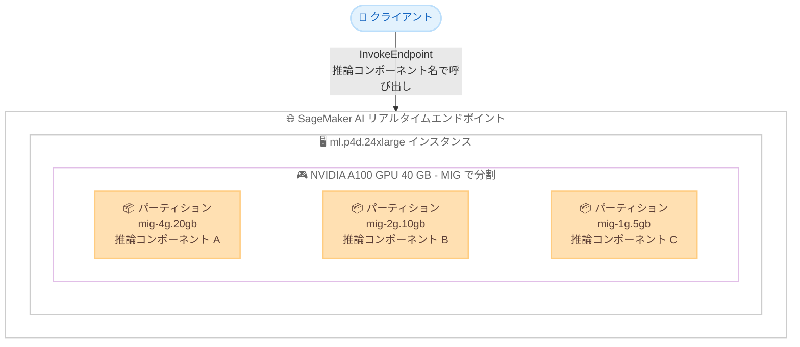

# Amazon SageMaker AI - リアルタイムエンドポイントの GPU パーティショニング

**リリース日**: 2026 年 10 月 30 日
**サービス**: Amazon SageMaker AI
**機能**: リアルタイムエンドポイントにおける GPU パーティショニング (NVIDIA Multi-Instance GPU)

📊 [このアップデートのインフォグラフィックを見る](https://takech9203.github.io/aws-news-summary/20261030-sagemaker-gpu-partitioning.html)

## 概要

Amazon SageMaker AI の推論機能が、リアルタイムエンドポイントでの GPU パーティショニングをサポートしました。NVIDIA Multi-Instance GPU (MIG) テクノロジーを活用し、1 つの物理 GPU を最大 7 つの独立したパーティションに分割できます。各パーティションは専用のコンピュートスライスと GPU メモリを持ち、ハードウェアレベルで分離されます。

これにより、ファインチューニング済みの小規模モデル、埋め込みモデル、リランカー、分類器など、GPU 全体を必要としない複数のモデルを 1 つの GPU 上で同時にホストできるようになります。パーティショニングはエンドポイント作成時に設定し、モデルの呼び出し方法は従来と変わらないため、アプリケーション側の変更は不要です。

**アップデート前の課題**

- 以前は 1 つのモデルに対して GPU 全体を割り当てる必要があり、小規模なモデルでは GPU の能力を使い切れなかった
- インスタンスがホストできるモデル数は GPU 数が上限となり、未使用の GPU キャパシティに対してもコストが発生していた
- 複数モデルを同一 GPU で安全に分離して実行する手段がなく、最新世代の大容量 GPU インスタンスを小規模ワークロードに採用しづらかった

**アップデート後の改善**

- 1 つの GPU を最大 7 つのパーティションに分割し、複数のモデルを同一 GPU 上でホストできるようになった
- 各パーティションがハードウェアで分離されるため、高負荷なモデルが他のモデルのメモリやスループットを奪うことがなくなった
- モデルのサイズに合わせてパーティションを選択でき、GPU 使用率とコスト効率が向上した
- エンドポイント作成時の設定のみで利用でき、推論コンポーネント名による呼び出し方法は変更不要になった

## アーキテクチャ図



1 つの NVIDIA A100 GPU を 3 つの MIG パーティションに分割し、それぞれに異なる推論コンポーネント (モデル) を配置する構成例です。クライアントは従来どおり推論コンポーネント名を指定して InvokeEndpoint を呼び出すだけで、パーティションを意識する必要はありません。

## サービスアップデートの詳細

### 主要機能

1. **GPU パーティションレイアウトの宣言**
   - エンドポイント設定の本番バリアントに `AcceleratorPartitionLayouts` フィールドを指定して、1 つの GPU の分割方法を宣言する
   - 宣言したレイアウトは、バリアント内のすべてのインスタンスのすべての GPU に適用される
   - SageMaker AI はエンドポイントのインスタンス起動時に GPU を分割し、エンドポイントが `InService` になった時点で空のパーティションが利用可能になる

2. **推論コンポーネントのパーティションへの配置**
   - 推論コンポーネントの `ComputeResourceRequirements` に `AcceleratorPartitionType` を指定して、モデルを配置するパーティションタイプを選択する
   - 推論コンポーネントの各コピーが 1 つのパーティションを占有し、`CopyCount` を増やすことで同じタイプの空きパーティションに追加のコピーを配置できる
   - `MinMemoryRequiredInMb` と `NumberOfCpuCoresRequired` はホスト側のメモリと CPU を指定し、GPU メモリはパーティションタイプで決まる

3. **ハードウェアによる分離**
   - 各パーティションは固定のコンピュートスライスと専用の GPU メモリブロックを持つ
   - あるモデルが他のモデルの GPU メモリを読み取ったり、スループットを奪ったりすることはできない
   - なお、同一インスタンス上のモデルはホスト CPU、ホストメモリ、ストレージ、ネットワークを共有する

4. **既存 API との互換性**
   - 新しい API オペレーション、リソースタイプ、IAM アクションは追加されない (既存 API のオプションフィールド追加のみ)
   - 両方のフィールドを省略したエンドポイントは、従来どおりパーティショニングなしで動作する
   - モデルの呼び出しは従来と同じく推論コンポーネント名で行い、リクエストにパーティションは現れない

## 技術仕様

### 対応インスタンスファミリーとパーティションタイプ

| インスタンスファミリー | GPU | 主なパーティションタイプ |
|------|------|------|
| P4d | NVIDIA A100 (40 GB) | `mig-1g.5gb` (GPU あたり 7)、`mig-1g.10gb` (4)、`mig-2g.10gb` (3)、`mig-3g.20gb` (2)、`mig-4g.20gb` (1)、`mig-7g.40gb` (1) |
| P5 | NVIDIA H100 (80 GB) | `mig-1g.10gb` (GPU あたり 7)、`mig-1g.20gb` (4)、`mig-2g.20gb` (3)、`mig-3g.40gb` (2)、`mig-4g.40gb` (1)、`mig-7g.80gb` (1) |
| G7 | NVIDIA RTX PRO 4500 (32 GB) | `mig-1g.16gb` (GPU あたり 2)、`mig-2g.32gb` (1) |
| G7e | NVIDIA RTX PRO 6000 (96 GB) | `mig-1g.24gb` (GPU あたり 4)、`mig-2g.48gb` (2)、`mig-4g.96gb` (1) |

パーティションタイプは「コンピュートスライス数 + GPU メモリ量」を表します。例えば `mig-4g.20gb` は 4 コンピュートスライスと 20 GB の GPU メモリを持つパーティションです。インスタンスあたりのパーティション数は「GPU あたりのパーティション数 x インスタンスの GPU 数」で求められます (例: `ml.p4d.24xlarge` は 8 GPU 構成のため、`mig-1g.5gb` x 3 のレイアウトで 24 パーティション)。

### レイアウトのルール

| 項目 | 詳細 |
|------|------|
| レイアウトのエントリ数 | `AcceleratorPartitionLayouts` には正確に 1 エントリを指定。全 GPU に同じレイアウトが適用される |
| 同一タイプの複数指定 | タイプを繰り返して指定 (例: `["mig-1g.5gb", "mig-1g.5gb", "mig-1g.5gb"]` で GPU あたり 3 パーティション) |
| 容量超過時 | 1 つの GPU に収まらないレイアウトは 400 エラーで拒否される |
| 非対応の NVIDIA プロファイル | `+me`、`+gfx`、`+me.all`、`-me` の各プロファイル参照は非対応 |
| レイアウト変更 | 実行中のエンドポイントのレイアウトは変更不可。異なるレイアウトへの `UpdateEndpoint` は 400 エラー。新しいエンドポイントの作成が必要 |
| P4d の `mig-1g.10gb` | デフォルトイメージより新しい NVIDIA ドライバーが必要。本番バリアントで `InferenceAmiVersion` に `al2023-ami-sagemaker-inference-gpu-4-1` を指定する |

### API 変更履歴

| 日付 | サービス | 変更内容 |
|------|----------|----------|
| 2026/10/30 | [Amazon SageMaker Service](https://awsapichanges.com/archive/changes/c2b1d5-api.sagemaker.html) | 7 updated api methods - `ProductionVariant` に `AcceleratorPartitionLayouts`、`ComputeResourceRequirements` に `AcceleratorPartitionType` が追加され、GPU を MIG パーティションに分割して複数モデルを実行可能に |

## 設定方法

### 前提条件

1. P4d、P5、G7、G7e のいずれかのインスタンスタイプが対象リージョンで利用可能であり、エンドポイント使用量のクォータがあること
2. Amazon ECR からコンテナイメージを取得し、Amazon CloudWatch Logs に書き込める実行ロールがあること
3. 推論コンポーネントを使用するエンドポイント構成であること

### 手順

#### ステップ 1: パーティションレイアウトを宣言したエンドポイント設定を作成

```bash
aws sagemaker create-endpoint-config \
  --region us-west-2 \
  --endpoint-config-name partition-demo-config \
  --execution-role-arn arn:aws:iam::111122223333:role/my-execution-role \
  --production-variants '[
    {
      "VariantName": "AllTraffic",
      "InstanceType": "ml.p4d.24xlarge",
      "InitialInstanceCount": 1,
      "AcceleratorPartitionLayouts": [
        {
          "AcceleratorPartitionTypes": ["mig-4g.20gb", "mig-2g.10gb", "mig-1g.5gb"]
        }
      ]
    }
  ]'
```

本番バリアントに `AcceleratorPartitionLayouts` を設定したエンドポイント設定を作成しています。この例では各 A100 GPU を `mig-4g.20gb`、`mig-2g.10gb`、`mig-1g.5gb` の 3 パーティションに分割し、7 コンピュートスライスをすべて使用します。`ml.p4d.24xlarge` は 8 GPU 構成のため、合計 24 パーティションが作成されます。

#### ステップ 2: エンドポイントを作成し、InService になるまで待機

```bash
aws sagemaker create-endpoint \
  --region us-west-2 \
  --endpoint-name partition-demo \
  --endpoint-config-name partition-demo-config

aws sagemaker wait endpoint-in-service \
  --region us-west-2 \
  --endpoint-name partition-demo
```

エンドポイント設定からエンドポイントを作成し、ステータスが `InService` になるまで待機しています。SageMaker AI はインスタンス起動時に GPU を分割します。`InService` になった時点では、すべてのパーティションは空の状態です。

#### ステップ 3: パーティションタイプを指定して推論コンポーネントを作成

```bash
aws sagemaker create-inference-component \
  --region us-west-2 \
  --inference-component-name demo-ic-4g \
  --endpoint-name partition-demo \
  --variant-name AllTraffic \
  --specification '{
    "Container": {
      "Image": "763104351884.dkr.ecr.us-west-2.amazonaws.com/huggingface-pytorch-inference:1.10.2-transformers4.17.0-gpu-py38-cu113-ubuntu20.04",
      "Environment": {
        "HF_MODEL_ID": "gpt2",
        "HF_TASK": "text-generation"
      }
    },
    "ComputeResourceRequirements": {
      "AcceleratorPartitionType": "mig-4g.20gb",
      "NumberOfAcceleratorDevicesRequired": 1,
      "NumberOfCpuCoresRequired": 1,
      "MinMemoryRequiredInMb": 2048
    }
  }' \
  --runtime-config '{"CopyCount": 1}'
```

`AcceleratorPartitionType` に `mig-4g.20gb` を指定して、モデルをそのタイプのパーティションに配置する推論コンポーネントを作成しています。`NumberOfAcceleratorDevicesRequired` は 1 (1 パーティションを指す) を指定する必要があります。レイアウト内の他のパーティションタイプにもモデルを配置する場合は、名前とパーティションタイプを変えて同じコマンドを繰り返します。モデルの呼び出しは従来どおり `InvokeEndpoint` に推論コンポーネント名を指定して行います。

## メリット

### ビジネス面

- **コスト効率の向上**: GPU 全体を必要としないモデルに対して GPU 丸ごと 1 基を割り当てる必要がなくなり、未使用キャパシティへの支払いを削減できる
- **最新世代ハードウェアの活用**: パーティションによるライトサイジングにより、単体では大容量すぎる最新世代インスタンスを小規模ワークロードでも現実的に採用できる
- **モデル集約による運用効率化**: 多数の小規模モデルを少数のエンドポイントに集約でき、管理対象を削減できる

### 技術面

- **ハードウェアレベルの分離**: 各パーティションが専用のコンピュートスライスと GPU メモリを持つため、ノイジーネイバーの影響を受けない
- **アプリケーション変更不要**: パーティショニングはエンドポイント作成時の設定のみで、呼び出し方法は推論コンポーネント名のままで変わらない
- **柔軟なモデル配置**: エンドポイント背後の GPU の分割方法を自由に設計し、各モデルを適切なサイズのパーティションに割り当てられる

## デメリット・制約事項

### 制限事項

- 対応インスタンスは P4d、P5、G7、G7e に限定される
- 実行中のエンドポイントのパーティションレイアウトは変更できず、レイアウト変更には新しいエンドポイントの作成が必要
- パーティション分割されたエンドポイントと推論コンポーネントは、GPU、CPU、メモリの使用率メトリクスを発行しない (CloudWatch では呼び出しメトリクスとレイテンシーメトリクスを使用)
- レイアウトを宣言したエンドポイントでは、推論コンポーネントの `AcceleratorPartitionType` が必須となる
- NVIDIA のメディアエンジン付きプロファイル (`+me` など) やグラフィックス対応プロファイル (`+gfx`) は利用できない

### 考慮すべき点

- GPU のコンピュートスライスとメモリは分離されるが、ホスト CPU、ホストメモリ、ストレージ、ネットワークは同一インスタンス上のモデル間で共有される
- 推論コンポーネントを配置していなくても、エンドポイントが稼働している間はインスタンス料金が発生する
- P4d で `mig-1g.10gb` を使用する場合は `InferenceAmiVersion` の明示的な指定が必要で、指定しないとエラー原因が報告されないままパーティショニングに失敗する
- 有効なパーティションタイプはインスタンスの GPU によって異なるため、レイアウト設計時に対応表の確認が必要

## ユースケース

### ユースケース 1: ファインチューニング済みモデル群の集約ホスティング

**シナリオ**: 顧客やドメインごとにファインチューニングした複数の小規模 LLM を、それぞれ専用 GPU で稼働させておりコストが課題になっている。

**実装例**:
```
P5 インスタンスで各 H100 を mig-1g.10gb x 7 に分割し、
最大 7 つのファインチューニング済みモデルを 1 GPU に集約。
各モデルを推論コンポーネントとして個別の名前でデプロイ。
```

**効果**: GPU あたりのホストモデル数が最大 7 倍になり、必要なインスタンス数とコストを削減できる。

### ユースケース 2: RAG パイプラインの埋め込みモデルとリランカーの同居

**シナリオ**: RAG アプリケーションで埋め込みモデルとリランカーを使用しているが、どちらも GPU 全体を使い切るほどの規模ではない。

**実装例**:
```
G7e インスタンスで RTX PRO 6000 を mig-1g.24gb x 4 に分割し、
埋め込みモデル、リランカー、分類器をそれぞれ別パーティションに配置。
ハードウェア分離により、検索ピーク時もリランカーの性能が安定。
```

**効果**: 複数の補助モデルを 1 インスタンスに集約しつつ、モデル間の性能干渉を排除できる。

### ユースケース 3: サイズの異なるモデルの混在配置

**シナリオ**: 中規模の生成モデルと小規模の分類モデルを運用しており、モデルサイズに応じてリソースを最適に割り当てたい。

**実装例**:
```
P4d インスタンスで各 A100 を mig-4g.20gb、mig-2g.10gb、
mig-1g.5gb の 3 パーティションに分割。
生成モデルを mig-4g.20gb、中間モデルを mig-2g.10gb、
分類モデルを mig-1g.5gb に配置。
```

**効果**: 各モデルの要件に合ったパーティションサイズを選択でき、7 コンピュートスライスを無駄なく活用できる。

## 料金

GPU パーティショニング自体の追加料金に関する記載はなく、通常の SageMaker AI リアルタイム推論と同様にインスタンスの稼働時間に基づいて課金されます。パーティション分割されたエンドポイントは、推論コンポーネントを配置していなくても稼働中はインスタンス料金が発生する点に注意してください。

1 つの GPU に複数モデルを集約することで、モデルあたりの実効コストを削減できます。詳細は [Amazon SageMaker AI の料金ページ](https://aws.amazon.com/sagemaker/ai/pricing/)を参照してください。

## 利用可能リージョン

- 米国東部 (バージニア北部) `us-east-1`
- 米国東部 (オハイオ) `us-east-2`
- 米国西部 (オレゴン) `us-west-2`
- アジアパシフィック (シンガポール) `ap-southeast-1`
- アジアパシフィック (東京) `ap-northeast-1`
- 欧州 (フランクフルト) `eu-central-1`
- 欧州 (アイルランド) `eu-west-1`

## 関連サービス・機能

- **SageMaker AI 推論コンポーネント**: GPU パーティショニングの前提となる機能。モデルをエンドポイント上の独立したデプロイ単位として管理する
- **NVIDIA Multi-Instance GPU (MIG)**: 本機能の基盤となる GPU 分割テクノロジー。パーティションタイプは NVIDIA の MIG プロファイルに対応する
- **Amazon CloudWatch**: パーティション分割されたエンドポイントの呼び出しメトリクスとレイテンシーメトリクスによる監視に使用する

## 参考リンク

- 📊 [インフォグラフィック](https://takech9203.github.io/aws-news-summary/20261030-sagemaker-gpu-partitioning.html)
- [公式発表 (What's New)](https://aws.amazon.com/about-aws/whats-new/2026/10/sagemaker-gpu-partitioning/)
- [ドキュメント: Using GPU partitions on SageMaker AI real-time endpoints](https://docs.aws.amazon.com/sagemaker/latest/dg/inference-components-accelerator-partitioning.html)
- [ドキュメント: Create an endpoint with GPU partitions](https://docs.aws.amazon.com/sagemaker/latest/dg/inference-components-accelerator-partitioning-create.html)
- [ドキュメント: Deploy models to GPU partitions with inference components](https://docs.aws.amazon.com/sagemaker/latest/dg/inference-components-accelerator-partitioning-deploy.html)
- [NVIDIA Multi-Instance GPU User Guide](https://docs.nvidia.com/datacenter/tesla/mig-user-guide/)
- [Amazon SageMaker AI のデプロイ](https://aws.amazon.com/sagemaker/ai/deploy/)
- [料金ページ](https://aws.amazon.com/sagemaker/ai/pricing/)

## まとめ

SageMaker AI リアルタイムエンドポイントの GPU パーティショニングにより、NVIDIA MIG を利用して 1 つの GPU 上で複数のモデルをハードウェア分離された状態でホストできるようになりました。小規模モデルを多数運用しているワークロードでは、GPU 使用率とコスト効率を大きく改善できる可能性があります。東京リージョンでも利用可能なため、ファインチューニング済みモデルや埋め込みモデルを個別の GPU で運用している場合は、パーティションレイアウトの設計と移行の検討をおすすめします。
