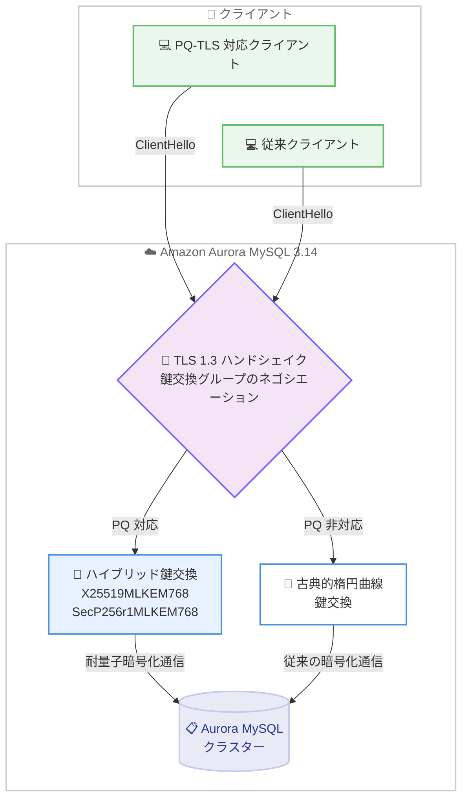

# Amazon Aurora - Aurora MySQL 3.14 (MySQL 8.0.46 互換) の一般提供開始

**リリース日**: 2026 年 11 月 2 日
**サービス**: Amazon Aurora MySQL-Compatible Edition
**機能**: Aurora MySQL バージョン 3.14.0 (MySQL 8.0.46 互換)

📊 [このアップデートのインフォグラフィックを見る](https://takech9203.github.io/aws-news-summary/20261102-amazon-aurora-mysql-314-available.html)

## 概要

Amazon Aurora MySQL-Compatible Edition 3 が MySQL 8.0.46 をサポートする新しいマイナーバージョン 3.14.0 の一般提供を開始しました。本リリースには、MySQL コミュニティ版のバグ修正 (8.0.46 までのすべての修正) に加えて、Aurora 固有のセキュリティ修正、可用性改善、一般的な改善が含まれています。

本リリースの最大の注目点は、転送中データの暗号化に対するポスト量子 TLS (PQ-TLS) 鍵交換のサポートです。TLS 1.3 接続において、従来の楕円曲線グループに加えてハイブリッド鍵交換グループ `X25519MLKEM768` および `SecP256r1MLKEM768` が導入され、将来の量子コンピュータによる脅威 (いわゆる Harvest Now, Decrypt Later 攻撃) に備えた耐量子暗号の選択肢が提供されます。

アップグレードは、自動マイナーバージョンアップグレードによるメンテナンスウィンドウでの適用、インプレースアップグレード、スナップショットからの復元のいずれかで実行できます。多数のクラスターを運用する組織では、AWS Organizations の Upgrade Rollout Policy を使用した段階的なアップグレード展開が推奨されています。

**アップデート前の課題**

- Aurora MySQL のクライアント接続の TLS 鍵交換は古典的な楕円曲線アルゴリズムのみであり、量子コンピュータの実用化を見据えた長期的な機密性の確保に課題があった
- 一時テーブルや全文検索キャッシュのリソース消費をリアルタイムに可視化する専用メトリクスがなく、ストレージやメモリの逼迫を事前に検知しにくかった
- `DELETE` した行の値を取得するには、事前に別途 `SELECT` を実行する必要があった
- マイナーバージョンアップグレード時のライターインスタンスの復帰に一定の時間を要していた

**アップデート後の改善**

- TLS 1.3 のハイブリッド鍵交換により、PQ-TLS 対応クライアントは自動的に耐量子共有秘密をネゴシエートし、非対応クライアントは従来どおり古典的グループで接続を継続できる
- 新しい CloudWatch メトリクス `AuroraTempTableVolumeTotalBytes` と `FTSCacheMemoryUsed` により、一時テーブルボリュームと全文検索キャッシュの使用状況を監視し、アラームを設定できるようになった
- 単一テーブルの `DELETE` 文で `RETURNING` 句がサポートされ、削除した行の値を 1 つのステートメントで取得できるようになった
- バージョン 3.08 以降からのマイナーバージョンアップグレードが高速化され、ライターインスタンスがより早くサービスに復帰するようになった (設定変更やオプトインは不要)

## アーキテクチャ図



TLS 1.3 ハンドシェイク時に、PQ-TLS 対応クライアントは自動的にハイブリッド鍵交換グループをネゴシエートし、非対応クライアントは従来の楕円曲線グループで接続を継続します。アプリケーション側の互換性を損なわずに耐量子暗号へ段階的に移行できます。

## サービスアップデートの詳細

### 主要機能

1. **ポスト量子 TLS (PQ-TLS) 鍵交換のサポート**
   - TLS 1.3 接続向けに、ハイブリッド鍵交換グループ `X25519MLKEM768` と `SecP256r1MLKEM768` を従来の楕円曲線グループに加えて導入
   - PQ 鍵交換対応クライアントは自動的に耐量子共有秘密をネゴシエートし、非対応クライアントは古典的グループを継続使用するため、既存アプリケーションへの影響なし
   - セッションがどのグループをネゴシエートしたかは、新しいステータス変数 `Aurora_ssl_named_group` で確認可能

2. **マイナーバージョンアップグレードの高速化**
   - バージョン 3.08 以降から本リリースへのマイナーバージョンアップグレードが高速化
   - ライターインスタンスがより早くサービスに復帰
   - 設定変更やオプトインは不要で、自動的に適用

3. **新しい CloudWatch メトリクス**
   - `AuroraTempTableVolumeTotalBytes`: ライターインスタンス上の内部および外部 InnoDB 一時テーブルスペースが使用するクラスターボリュームの合計バイト数をレポート。使用量が危険水準に達する前にアラームを設定可能
   - `FTSCacheMemoryUsed`: DB インスタンス上のすべてのテーブルにわたる InnoDB 全文検索 (FTS) キャッシュの合計メモリ使用量を把握可能

4. **DELETE 文の RETURNING 句サポート**
   - 単一テーブルの `DELETE` 文で削除した行の値を直接返却可能になり、別途 `SELECT` クエリが不要に
   - `RETURNING` が予約語になったため、`returning` という名前の識別子はバッククォートで囲む必要がある点に注意

5. **セキュリティ修正**
   - `SQL SECURITY DEFINER` ルーチン内で実行された SQL 文について、Advanced Audit ログが定義者ではなく呼び出し元クライアントのユーザーとホストを記録するよう修正
   - Write Forwarding 使用セッションで `SET ROLE NONE` がロール権限を正しくクリアしない問題を修正
   - 高重大度 2 件、中重大度 30 件、低重大度 2 件の CVE 修正を含む

6. **可用性と一般的な改善**
   - グローバル/ローカル Write Forwarding でクエリのキャンセルやタイムアウト時にリーダーの書き込み転送が停止する問題を修正
   - Aurora Global Database のスイッチオーバー中にリーダーインスタンスが再起動する可能性のある問題を修正
   - Zero Downtime Patching (ZDP) の通信オーバーヘッドを削減し最適化
   - 並列クエリ有効時にハッシュジョインが誤った結果を返す可能性のある問題を修正
   - コミュニティ版 MySQL 8.0.46 で導入された `CREATE TABLE` の行サイズ見積もりの問題 (`ERROR 1118`) について、Aurora MySQL 3.14.0 では 8.0.46 以前の動作を維持

## 技術仕様

### バージョン情報

| 項目 | 詳細 |
|------|------|
| Aurora MySQL バージョン | 3.14.0 |
| 互換 MySQL バージョン | MySQL 8.0.46 (コミュニティ版バグ修正をすべて含む) |
| エンジンリリース日 | 2026 年 10 月 26 日 |
| PQ-TLS 鍵交換グループ | `X25519MLKEM768`、`SecP256r1MLKEM768` (TLS 1.3) |
| 確認用ステータス変数 | `Aurora_ssl_named_group` |
| 新規 CloudWatch メトリクス | `AuroraTempTableVolumeTotalBytes`、`FTSCacheMemoryUsed` |

### PQ-TLS ネゴシエーションの確認

```sql
-- 現在のセッションがネゴシエートした鍵交換グループを確認
SHOW STATUS LIKE 'Aurora_ssl_named_group';
```

PQ-TLS 対応クライアントで接続した場合は `X25519MLKEM768` などのハイブリッドグループが、非対応クライアントの場合は古典的な楕円曲線グループが表示されます。

## 設定方法

### 前提条件

1. Aurora MySQL バージョン 3 (MySQL 8.0 互換) クラスターを運用していること
2. アップグレード方式 (自動マイナーバージョンアップグレード、インプレース、スナップショット復元) を決定していること
3. PQ-TLS を利用する場合は、ハイブリッド鍵交換に対応したクライアントライブラリ (AWS-LC ベースのクライアントなど) を使用すること

### 手順

#### ステップ 1: 対象クラスターの現在のバージョンを確認

```bash
aws rds describe-db-clusters \
  --db-cluster-identifier my-aurora-cluster \
  --query "DBClusters[0].EngineVersion"
```

対象の Aurora MySQL クラスターの現在のエンジンバージョンを取得し、アップグレード元のバージョンを確認します。

#### ステップ 2: インプレースアップグレードの実行

```bash
aws rds modify-db-cluster \
  --db-cluster-identifier my-aurora-cluster \
  --engine-version 8.0.mysql_aurora.3.14.0 \
  --apply-immediately
```

クラスターのエンジンバージョンを 3.14.0 に変更します。`--apply-immediately` を指定すると即時に適用され、省略するとメンテナンスウィンドウで適用されます。バージョン 3.08 以降からのアップグレードでは、高速化されたアップグレード処理が自動的に適用されます。

#### ステップ 3: 自動マイナーバージョンアップグレードの有効化 (推奨)

```bash
aws rds modify-db-instance \
  --db-instance-identifier my-aurora-instance \
  --auto-minor-version-upgrade \
  --apply-immediately
```

自動マイナーバージョンアップグレードを有効化すると、今後のマイナーバージョンはメンテナンスウィンドウ中に自動適用されます。多数のクラスターを大規模に運用する場合は、AWS Organizations の Upgrade Rollout Policy を使用して、組織全体でアップグレードを段階的に展開することが推奨されています。

#### ステップ 4: PQ-TLS 接続の確認

```sql
SHOW STATUS LIKE 'Aurora_ssl_named_group';
```

アップグレード後、PQ-TLS 対応クライアントから接続し、ハイブリッド鍵交換グループがネゴシエートされていることを確認します。

## メリット

### ビジネス面

- **長期的なデータ保護**: 現在傍受された暗号化通信が将来の量子コンピュータで復号される Harvest Now, Decrypt Later 攻撃への対策となり、規制業界や機密データを扱うワークロードの長期的なコンプライアンス要件に対応できる
- **運用コストの削減**: マイナーバージョンアップグレードの高速化と Organizations Upgrade Rollout Policy の活用により、大規模環境でのアップグレード運用の負荷とダウンタイムを削減できる
- **移行リスクの低減**: PQ-TLS は対応クライアントのみが自動的に利用し、非対応クライアントは従来方式で接続を継続するため、アプリケーション改修なしで段階的に導入できる

### 技術面

- **耐量子暗号への対応**: TLS 1.3 のハイブリッド鍵交換 (ML-KEM と古典的楕円曲線の組み合わせ) により、古典暗号と耐量子暗号の両方の強度を確保できる
- **可観測性の向上**: 一時テーブルボリュームと FTS キャッシュの新メトリクスにより、ストレージやメモリの逼迫を事前に検知し、CloudWatch アラームで自動通知できる
- **開発生産性の向上**: `DELETE ... RETURNING` により削除行の値の取得が 1 ステートメントで完結し、アプリケーションのラウンドトリップを削減できる
- **信頼性の向上**: Write Forwarding、Global Database スイッチオーバー、Enhanced Binlog、並列クエリなど多数の安定性修正が含まれる

## デメリット・制約事項

### 制限事項

- PQ-TLS のハイブリッド鍵交換は TLS 1.3 接続が対象であり、クライアント側がハイブリッド鍵交換グループに対応している必要がある
- `RETURNING` 句は単一テーブルの `DELETE` 文のみでサポートされる
- `RETURNING` が予約語になったため、`returning` という名前の識別子を使用している既存スキーマではバッククォートによる修正が必要になる場合がある

### 考慮すべき点

- マイナーバージョンアップグレードの高速化の恩恵を受けられるのは、バージョン 3.08 以降からのアップグレード
- 自動マイナーバージョンアップグレードを有効化すると、メンテナンスウィンドウ中にアップグレードが実行されるため、メンテナンスウィンドウの時間帯を業務影響の少ない時間に設定しておく必要がある
- コミュニティ版 MySQL 8.0.46 との細かな動作差異 (行サイズ見積もりなど) があるため、コミュニティ版との互換性を前提とする場合はリリースノートの確認が必要

## ユースケース

### ユースケース 1: 金融機関における耐量子暗号への移行

**シナリオ**: 長期保存が必要な金融取引データを扱うシステムで、将来の量子コンピュータによる復号リスクに備え、転送中データの暗号化を耐量子暗号へ移行したい。

**実装例**:
```sql
-- PQ-TLS 対応クライアントで接続後、ネゴシエート結果を確認
SHOW STATUS LIKE 'Aurora_ssl_named_group';
-- 結果例: X25519MLKEM768
```

**効果**: アプリケーションの大規模な改修なしに、対応クライアントから順次 PQ-TLS 接続へ移行でき、長期的なデータ機密性の要件を満たせる。

### ユースケース 2: 大規模マルチアカウント環境での計画的なアップグレード展開

**シナリオ**: AWS Organizations 配下の多数のアカウントで数百の Aurora MySQL クラスターを運用しており、検証環境から本番環境へ段階的にマイナーバージョンアップグレードを展開したい。

**実装例**:
```bash
# 自動マイナーバージョンアップグレードを有効化し、
# Organizations の Upgrade Rollout Policy で展開順序を制御
aws rds modify-db-instance \
  --db-instance-identifier my-aurora-instance \
  --auto-minor-version-upgrade
```

**効果**: 検証環境で問題がないことを確認してから本番環境へ展開するフェーズドロールアウトを組織全体で統制でき、アップグレード起因の障害リスクを低減できる。

### ユースケース 3: 一時テーブル使用量の監視によるストレージ逼迫の予防

**シナリオ**: 分析系クエリが多いワークロードで、一時テーブルによるクラスターボリュームの消費が急増し、気付かないうちにストレージコストが増加していた。

**実装例**:
```bash
# 一時テーブルボリューム使用量に CloudWatch アラームを設定
aws cloudwatch put-metric-alarm \
  --alarm-name aurora-temp-table-volume-high \
  --namespace AWS/RDS \
  --metric-name AuroraTempTableVolumeTotalBytes \
  --dimensions Name=DBClusterIdentifier,Value=my-aurora-cluster \
  --statistic Maximum \
  --period 300 \
  --evaluation-periods 3 \
  --threshold 53687091200 \
  --comparison-operator GreaterThanThreshold \
  --alarm-actions arn:aws:sns:ap-northeast-1:123456789012:ops-alerts
```

**効果**: 一時テーブルの使用量が閾値 (例: 50 GB) を超えた時点で通知を受け取り、ストレージを大量消費するクエリを特定して事前に対処できる。

## 料金

Aurora MySQL 3.14.0 へのアップグレード自体に追加料金は発生しません。通常の Amazon Aurora の料金 (インスタンス時間、ストレージ、I/O など) が適用されます。PQ-TLS や新しい CloudWatch メトリクスの利用にも追加のエンジン料金はありませんが、CloudWatch アラームなどの利用には CloudWatch の標準料金が適用されます。

## 利用可能リージョン

Amazon Aurora MySQL が利用可能なすべての AWS リージョンで提供されます。

## 関連サービス・機能

- **AWS Organizations**: Upgrade Rollout Policy により、組織全体でのマイナーバージョンアップグレードの段階的な展開を制御
- **Amazon CloudWatch**: 新メトリクス `AuroraTempTableVolumeTotalBytes` と `FTSCacheMemoryUsed` による監視とアラーム設定
- **Amazon RDS Blue/Green Deployments**: ダウンタイムを最小化したアップグレード方式の選択肢
- **Aurora Global Database**: マルチリージョン構成のクラスターもスイッチオーバー関連の安定性修正の恩恵を受ける

## 参考リンク

- 📊 [インフォグラフィック](https://takech9203.github.io/aws-news-summary/20261102-amazon-aurora-mysql-314-available.html)
- [公式発表 (What's New)](https://aws.amazon.com/about-aws/whats-new/2026/11/amazon-aurora-mysql-314-available/)
- [Aurora MySQL 3.14.0 リリースノート](https://docs.aws.amazon.com/AmazonRDS/latest/AuroraMySQLReleaseNotes/AuroraMySQL.Updates.3140.html)
- [MySQL 8.0 リリースノート](https://dev.mysql.com/doc/relnotes/mysql/8.0/en/)
- [Aurora MySQL DB クラスターのアップグレード](https://docs.aws.amazon.com/AmazonRDS/latest/AuroraUserGuide/AuroraMySQL.Updates.Upgrading.html)
- [Amazon Aurora 料金ページ](https://aws.amazon.com/rds/aurora/pricing/)

## まとめ

Aurora MySQL 3.14.0 は、MySQL 8.0.46 互換のコミュニティ修正に加え、ポスト量子 TLS 鍵交換という将来を見据えたセキュリティ機能を提供する重要なマイナーバージョンです。PQ-TLS は対応クライアントのみが自動的に利用するため移行リスクが低く、長期的なデータ保護が求められるワークロードでは早期の検証が推奨されます。自動マイナーバージョンアップグレードと Organizations Upgrade Rollout Policy を組み合わせ、計画的なアップグレードを進めることを推奨します。
