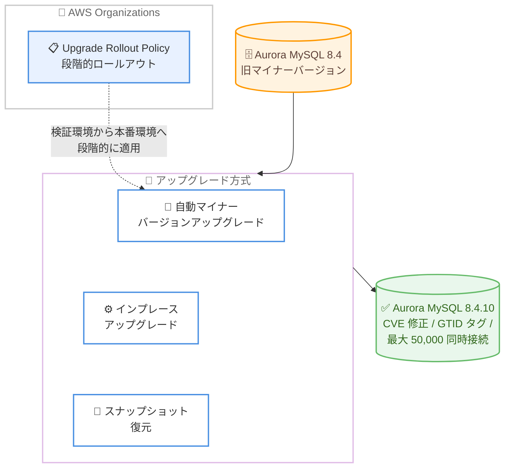

# Amazon Aurora - Aurora MySQL 8.4.10 の一般提供開始

**リリース日**: 2026 年 11 月 2 日
**サービス**: Amazon Aurora (MySQL 互換エディション)
**機能**: MySQL 8.4.10 対応マイナーバージョンの一般提供

📊 [このアップデートのインフォグラフィックを見る](https://takech9203.github.io/aws-news-summary/20261102-amazon-aurora-mysql-8410-available.html)

## 概要

Amazon Aurora MySQL 互換エディション 8.4 が、MySQL 8.4.10 をサポートするマイナーバージョンの一般提供を開始しました。このリリースには、以前の MySQL バージョンで報告された CVE (共通脆弱性識別子) に対するセキュリティ修正、バグ修正、パフォーマンス改善、および MySQL コミュニティによる新機能が含まれています。

今回のリリースでは、GTID (グローバルトランザクション識別子) タグのサポートが追加され、ユーザー定義のタグを GTID に付与することで、バイナリログレプリケーションにおいて関連するトランザクションを識別・グループ化できるようになりました。また、DB インスタンスあたり最大 50,000 の同時接続がサポートされ、接続数の多いアプリケーションを別途コネクションプーリング層を追加することなくスケールできます。

Aurora MySQL を利用するすべてのユーザーが対象であり、特にセキュリティ要件の厳しい環境や、大量の同時接続を必要とするワークロードを運用するユーザーにとって重要なアップデートです。

**アップデート前の課題**

- 以前の MySQL バージョンで報告された CVE に対する修正を適用するには、新しいマイナーバージョンのリリースを待つ必要があった
- バイナリログレプリケーションにおいて、関連するトランザクションをグループ化して識別する標準的な仕組みがなかった
- 接続数の多いアプリケーションでは、DB インスタンスの同時接続数上限に対応するため、コネクションプーリング層の追加が必要になるケースがあった

**アップデート後の改善**

- MySQL 8.4.10 ベースのセキュリティ修正、バグ修正、パフォーマンス改善を取り込んだマイナーバージョンへアップグレードできるようになった
- GTID タグにより、ユーザー定義のタグでトランザクションを識別・グループ化し、バイナリログレプリケーションの管理性が向上した
- DB インスタンスあたり最大 50,000 の同時接続がサポートされ、コネクションプーリング層を追加せずに接続数をスケールできるようになった

## アーキテクチャ図



Aurora MySQL 8.4.10 へのアップグレード経路を示しています。自動マイナーバージョンアップグレード、インプレースアップグレード、スナップショット復元の 3 つの方式が利用でき、大規模環境では AWS Organizations の Upgrade Rollout Policy と組み合わせて段階的に展開できます。

## サービスアップデートの詳細

### 主要機能

1. **MySQL 8.4.10 ベースのセキュリティ修正と改善**
   - 以前の MySQL バージョンで報告された CVE に対するセキュリティ修正を含む
   - MySQL コミュニティによるバグ修正とパフォーマンス改善を取り込み
   - AWS はセキュリティ修正を適用するため、新しいマイナーバージョンへのアップグレードを推奨

2. **GTID タグのサポート**
   - グローバルトランザクション識別子 (GTID) にユーザー定義のタグを付与可能
   - バイナリログレプリケーションにおいて、関連するトランザクションを識別・グループ化できる
   - レプリケーショントポロジーにおけるトランザクション管理の柔軟性が向上

3. **最大 50,000 同時接続のサポート**
   - DB インスタンスあたり最大 50,000 の同時接続をサポート
   - 接続数の多いアプリケーションを、別途コネクションプーリング層を追加することなくスケール可能
   - 接続集約型のワークロードにおけるアーキテクチャを簡素化

4. **段階的なアップグレード管理**
   - メンテナンスウィンドウ中に自動マイナーバージョンアップグレードで適用可能
   - AWS Organizations の Upgrade Rollout Policy と組み合わせることで、優先度の低い環境から重要な環境へと段階的にアップグレードを展開可能

## 技術仕様

### アップデート内容の整理

| 項目 | 詳細 |
|------|------|
| 対象エンジン | Aurora MySQL 互換エディション 8.4 |
| ベースバージョン | MySQL 8.4.10 (コミュニティ版) |
| セキュリティ | 以前の MySQL バージョンで報告された CVE への修正を含む |
| 新機能 1 | GTID タグ (バイナリログレプリケーションでのトランザクショングループ化) |
| 新機能 2 | DB インスタンスあたり最大 50,000 同時接続 |
| アップグレード方式 | 自動マイナーバージョンアップグレード、インプレース、スナップショット復元 |
| 大規模展開 | AWS Organizations Upgrade Rollout Policy による段階的ロールアウトに対応 |

### GTID タグの概要

GTID タグを使用すると、GTID の形式にユーザー定義のタグを含めることができます。これにより、特定の用途のトランザクション群をレプリケーション全体で追跡しやすくなります。

```text
# タグなしの GTID 形式
source_id:transaction_id

# タグ付きの GTID 形式
source_id:tag:transaction_id
```

## 設定方法

### 前提条件

1. Aurora MySQL 互換エディション 8.4 系のクラスターを運用していること
2. アップグレード前に検証環境での動作確認を実施すること
3. 自動マイナーバージョンアップグレードを利用する場合は、メンテナンスウィンドウの設定を確認すること

### 手順

#### ステップ 1: 現在のエンジンバージョンを確認する

```bash
aws rds describe-db-clusters \
  --db-cluster-identifier my-aurora-cluster \
  --query "DBClusters[0].EngineVersion"
```

対象の Aurora MySQL クラスターの現在のエンジンバージョンを取得し、アップグレードの要否を確認します。

#### ステップ 2: 利用可能なアップグレード先を確認する

```bash
aws rds describe-db-engine-versions \
  --engine aurora-mysql \
  --engine-version <現在のバージョン> \
  --query "DBEngineVersions[0].ValidUpgradeTarget[].EngineVersion"
```

現在のバージョンからアップグレード可能なターゲットバージョンの一覧を表示し、MySQL 8.4.10 対応バージョンが含まれていることを確認します。

#### ステップ 3: インプレースアップグレードを実行する

```bash
aws rds modify-db-cluster \
  --db-cluster-identifier my-aurora-cluster \
  --engine-version <8.4.10 対応バージョン> \
  --apply-immediately
```

クラスターのエンジンバージョンを変更してインプレースアップグレードを実行します。`--apply-immediately` を指定すると即時適用され、指定しない場合は次回のメンテナンスウィンドウで適用されます。

#### ステップ 4: 自動マイナーバージョンアップグレードを有効化する

```bash
aws rds modify-db-instance \
  --db-instance-identifier my-aurora-instance \
  --auto-minor-version-upgrade \
  --apply-immediately
```

自動マイナーバージョンアップグレードを有効にすると、メンテナンスウィンドウ中に新しいマイナーバージョンが自動的に適用されます。大規模環境では AWS Organizations の Upgrade Rollout Policy と組み合わせることで、検証環境から本番環境へと段階的に展開できます。

## メリット

### ビジネス面

- **セキュリティリスクの低減**: CVE への修正を適用することで、既知の脆弱性に起因するセキュリティリスクを低減できる
- **運用コストの削減**: 最大 50,000 同時接続のサポートにより、コネクションプーリング層の構築・運用コストを削減できる可能性がある
- **計画的なアップグレード**: Upgrade Rollout Policy により、組織全体で段階的かつ統制のとれたアップグレードを実施できる

### 技術面

- **レプリケーション管理の向上**: GTID タグにより、バイナリログレプリケーションでのトランザクションの識別・グループ化が容易になる
- **接続スケーラビリティの向上**: DB インスタンスあたりの同時接続数が最大 50,000 まで拡張され、接続集約型ワークロードに対応しやすくなる
- **コミュニティ改善の取り込み**: MySQL 8.4.10 のバグ修正、パフォーマンス改善、新機能を利用できる

## デメリット・制約事項

### 制限事項

- Aurora MySQL 互換エディション 8.4 系が対象であり、旧メジャーバージョンを利用している場合は先にメジャーバージョンアップグレードが必要
- 最大同時接続数は DB インスタンスのクラスやパラメータ設定に依存するため、実際の上限は環境ごとに確認が必要

### 考慮すべき点

- アップグレード前に、アプリケーションの互換性を検証環境で確認することが推奨される
- インプレースアップグレード中は一時的なダウンタイムが発生する可能性があるため、メンテナンスウィンドウや適用タイミングの計画が必要
- 自動マイナーバージョンアップグレードを有効にする場合は、意図しないタイミングでの適用を避けるためメンテナンスウィンドウの設定を見直すこと

## ユースケース

### ユースケース 1: セキュリティコンプライアンス対応

**シナリオ**: 金融機関など、既知の CVE への対応期限が定められている環境で、Aurora MySQL クラスターのセキュリティパッチ適用を計画的に実施したい。

**実装例**:
```bash
# 自動マイナーバージョンアップグレードを有効化し、
# メンテナンスウィンドウで計画的に適用
aws rds modify-db-instance \
  --db-instance-identifier prod-aurora-instance \
  --auto-minor-version-upgrade \
  --preferred-maintenance-window sun:17:00-sun:18:00
```

**効果**: CVE 修正を含むマイナーバージョンがメンテナンスウィンドウ中に自動適用され、セキュリティコンプライアンス要件を継続的に満たせる。

### ユースケース 2: 大量同時接続を伴う Web アプリケーション

**シナリオ**: ピーク時に数万の同時接続が発生する大規模 Web アプリケーションで、コネクションプーリング層の追加なしに接続数をスケールしたい。

**実装例**:
```bash
# クラスターパラメータグループで max_connections を確認・調整
aws rds describe-db-cluster-parameters \
  --db-cluster-parameter-group-name my-aurora-params \
  --query "Parameters[?ParameterName=='max_connections']"
```

**効果**: DB インスタンスあたり最大 50,000 の同時接続により、追加のプーリング層なしで接続集約型ワークロードに対応でき、アーキテクチャが簡素化される。

### ユースケース 3: 組織全体での段階的アップグレード

**シナリオ**: 多数の AWS アカウントで Aurora MySQL クラスターを運用しており、検証環境で問題がないことを確認してから本番環境へアップグレードを展開したい。

**実装例**:
```text
1. AWS Organizations で Upgrade Rollout Policy を設定
2. 検証用 OU のクラスターに先行してマイナーバージョンを適用
3. 問題がないことを確認後、本番用 OU へ段階的に展開
```

**効果**: 優先度の低い環境から重要な環境へと段階的にアップグレードを展開でき、本番環境への影響リスクを最小化できる。

## 料金

マイナーバージョンのアップグレード自体に追加料金は発生しません。Aurora MySQL の利用料金は、インスタンスタイプ、ストレージ、I/O などの通常の料金体系に基づきます。詳細は料金ページを参照してください。

## 利用可能リージョン

Aurora MySQL が利用可能なすべての AWS リージョンで提供されています。

## 関連サービス・機能

- **Amazon RDS**: Aurora と同様にマネージド MySQL を提供するサービスで、マイナーバージョン管理の考え方が共通する
- **AWS Organizations (Upgrade Rollout Policy)**: 組織全体でのマイナーバージョンアップグレードの段階的ロールアウトを制御できる
- **Amazon RDS Proxy**: 接続管理をさらに強化したい場合のマネージドコネクションプーリングサービス
- **Aurora Global Database**: 複数リージョンにまたがる災害対策や低レイテンシ読み取りを実現する機能

## 参考リンク

- 📊 [インフォグラフィック](https://takech9203.github.io/aws-news-summary/20261102-amazon-aurora-mysql-8410-available.html)
- [公式発表 (What's New)](https://aws.amazon.com/about-aws/whats-new/2026/11/amazon-aurora-mysql-8410-available/)
- [Aurora MySQL 8.4 リリースノート](https://docs.aws.amazon.com/AmazonRDS/latest/AuroraMySQLReleaseNotes/AuroraMySQL.Updates.84Updates.html)
- [MySQL 8.4.10 リリースノート (MySQL 公式)](https://dev.mysql.com/doc/relnotes/mysql/8.4/en/)
- [Aurora MySQL のアップグレード手順](https://docs.aws.amazon.com/AmazonRDS/latest/AuroraUserGuide/AuroraMySQL.Updates.Upgrading.html)
- [Amazon Aurora 料金ページ](https://aws.amazon.com/rds/aurora/pricing/)

## まとめ

Aurora MySQL 8.4.10 は、CVE 修正を含むセキュリティ強化に加えて、GTID タグと最大 50,000 同時接続という実用的な機能強化を含むマイナーバージョンです。セキュリティ修正の適用のため、検証環境での互換性確認を行ったうえで、自動マイナーバージョンアップグレードや Upgrade Rollout Policy を活用した計画的なアップグレードを推奨します。
