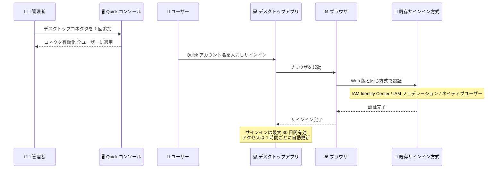

# Amazon Quick - デスクトップアプリで組織の既存サインイン方式を利用可能に

**リリース日**: 2026 年 11 月 2 日
**サービス**: Amazon Quick
**機能**: デスクトップアプリケーションでの組織既存サインイン方式の利用

📊 [このアップデートのインフォグラフィックを見る](https://takech9203.github.io/aws-news-summary/20261102-amazon-quick-desktop-organization-sign-in.html)

## 概要

Amazon Quick のデスクトップアプリケーションが、組織が Web 版の Amazon Quick で既に使用しているサインイン方式をそのまま利用できるようになりました。Web 版の Quick にサインインできるユーザーであれば、追加の設定なしでデスクトップアプリケーションにもサインインできます。

これまでデスクトップアプリケーションのエンタープライズサインインを構成するには、ID プロバイダーへの OIDC アプリケーション登録やデスクトップ拡張機能の設定が必要でした。今回のアップデートにより、管理者は Amazon Quick コンソールで「デスクトップコネクタ」を 1 回追加するだけで、アカウント内の全ユーザーのデスクトップアクセスを有効化できます。IAM Identity Center、IAM フェデレーション、Quick ネイティブユーザーのいずれのアカウントタイプでも動作します。

**アップデート前の課題**

デスクトップアプリケーションのサインイン設定には、Web 版とは別の構成作業が必要でした。

- ID プロバイダーに OIDC アプリケーションを登録し、クライアント ID を作成する必要があった
- デスクトップ拡張機能によるアクセス設定を別途追加する必要があった
- Web 版とデスクトップ版で認証設定を二重管理する運用負荷があった

**アップデート後の改善**

デスクトップのサインインが Web 版の既存認証構成に統合されました。

- 管理者は Quick コンソールでデスクトップコネクタを 1 回追加するだけで有効化できる
- OIDC アプリケーション登録やクライアント ID の作成が不要になった
- ユーザーはアカウント名を入力してサインインを選択し、ブラウザで認証を完了するだけで利用できる
- デスクトップのサインインを ID プロバイダーで個別に管理したい場合は、従来どおり専用の ID プロバイダー構成 (Microsoft Entra ID、Google Workspace、Okta、Ping Identity) も選択できる

## アーキテクチャ図



管理者がデスクトップコネクタを 1 回追加すると、ユーザーは Web 版と同じサインイン方式でブラウザ経由の認証を完了するだけでデスクトップアプリを利用できます。

## サービスアップデートの詳細

### 主要機能

1. **Web 版サインイン方式の自動利用**
   - Web 版の Quick にサインインできるユーザーは、そのままデスクトップアプリケーションにもサインインできる
   - デフォルトでは ID プロバイダーへの OIDC アプリケーション登録、クライアント ID の作成、拡張機能アクセスの追加は不要
   - IAM Identity Center、IAM フェデレーション、Quick マネージドユーザー (ネイティブユーザー) のすべてのアカウントタイプで動作

2. **デスクトップコネクタによる一括有効化**
   - 管理者が Quick コンソールの [Inbound connectors] からデスクトップコネクタを 1 回追加するだけで有効化できる
   - コネクタを追加すると、アカウント内の全ユーザーのデスクトップアクセスが即座に有効になる
   - 段階的な展開を行う場合は、カスタム権限プロファイルで Quick desktop 機能を制限してからコネクタを追加する

3. **シンプルなユーザーサインインフロー**
   - ユーザーは Quick のアカウント名を入力し、サインインを選択し、ブラウザで認証を完了するだけで利用できる
   - サインインにはブラウザでのアクティブな Quick Web セッションが必要で、ない場合はブラウザが Web 版へのサインインを促す
   - サインインはアクティビティに関係なく最大 30 日間持続し、その間アクセスは 1 時間ごとにバックグラウンドで自動更新される

4. **専用 ID プロバイダー構成の継続提供**
   - デスクトップのサインインを ID プロバイダーで個別に管理したい組織向けに、専用 ID プロバイダー構成 (高度な設定) も引き続き利用できる
   - Microsoft Entra ID、Google Workspace、Okta、Ping Identity をサポート
   - 専用構成を使用する場合は ID プロバイダー側のセッション制限も適用される

## 技術仕様

### サインイン方式の比較

| 項目 | 既存サインイン方式の利用 (新機能) | 専用 ID プロバイダー構成 (高度な設定) |
|------|----------------------------------|--------------------------------------|
| OIDC アプリケーション登録 | 不要 | 必要 |
| 管理者の設定作業 | コネクタを 1 回追加 | ID プロバイダー側の構成が必要 |
| 対応アカウントタイプ | IAM Identity Center、IAM フェデレーション、ネイティブユーザー | 同左 |
| 対応 ID プロバイダー | Web 版で構成済みの方式をそのまま利用 | Microsoft Entra ID、Google Workspace、Okta、Ping Identity |
| セッション制限 | 最大 30 日間、アクセスは 1 時間ごとに自動更新 | 加えて ID プロバイダー側の制限も適用 |

### 前提条件と要件

| 項目 | 詳細 |
|------|------|
| 対象エディション | Enterprise Edition (Free / Plus アカウントは対象外) |
| デスクトップアプリのバージョン | 1.1.4053 以降 |
| ホームリージョン | Amazon Quick のサポート対象リージョンであること |
| ネットワーク | 制限付きネットワーク環境では Quick と ID プロバイダーの必須ドメインへの到達性が必要 |

## 設定方法

### 前提条件

1. アクティブな Amazon Quick サブスクリプションを持つ AWS アカウント (ホームリージョンがサポート対象リージョンであること)
2. Amazon Quick アカウントへの管理者アクセス
3. デスクトップアプリケーションのバージョン 1.1.4053 以降
4. 制限付きネットワーク環境の場合、必須ドメインの許可リストへの追加

### 手順

#### ステップ 1: デスクトップコネクタの追加

1. 管理者として Amazon Quick コンソールにサインインする
2. プロファイルアイコンから [Manage account] を選択する
3. ナビゲーションペインで [Inbound connectors] を選択し、[Quick Desktop] タブを選択する
4. [Add desktop connector] を選択する
5. ID 設定で [Use Quick's existing configured sign-in method] を選択し、[Confirm] を選択する
6. コネクタカードに名前 [Quick Desktop]、タイプ [Quick desktop]、ステータス [Enabled] が表示されることを確認する

コネクタの追加により、アカウント内の全ユーザーのデスクトップアクセスが即座に有効になります。段階展開したい場合は、先にカスタム権限プロファイルで対象外ユーザーの Quick desktop 機能を制限してからコネクタを追加します。

#### ステップ 2: ユーザーのサインイン

1. デスクトップアプリケーションで Quick のアカウント名を入力する
2. [Sign In] を選択する
3. ブラウザで認証を完了する

ブラウザでアクティブな Quick Web セッションがない場合は、先に Web 版へのサインインが求められます。

#### ステップ 3: デスクトップ拡張機能からの移行 (既存設定がある場合)

1. すべてのデバイスでデスクトップアプリケーションをバージョン 1.1.4053 以降に更新する
2. デスクトップコネクタを追加する
3. 全ユーザーの移行完了後、Quick コンソールの [Extensions] ページでデスクトップ拡張機能を削除する

既存の拡張機能による設定は引き続き動作し、廃止予定日は設定されていないため、任意のタイミングで移行できます。ただし、全ユーザーの移行前に拡張機能を削除すると、未移行ユーザーがアクセスを失う点に注意が必要です。

## メリット

### ビジネス面

- **導入までの時間短縮**: OIDC アプリケーション登録などの ID プロバイダー側の作業が不要になり、デスクトップアプリの組織展開を迅速に開始できる
- **運用負荷の削減**: Web 版とデスクトップ版の認証設定を一元化でき、二重管理によるミスや工数を削減できる
- **ユーザー体験の統一**: ユーザーは Web 版と同じ方法でサインインでき、問い合わせやサポートコストを低減できる

### 技術面

- **設定の簡素化**: 管理者はコンソールでコネクタを 1 回追加するだけで、アカウント全体のデスクトップアクセスを有効化できる
- **柔軟な展開制御**: カスタム権限プロファイルと組み合わせて、段階的なロールアウトを実現できる
- **選択肢の維持**: デスクトップのサインインを個別管理したい場合は、専用 ID プロバイダー構成 (Entra ID、Google Workspace、Okta、Ping Identity) を引き続き選択できる

## デメリット・制約事項

### 制限事項

- Enterprise Edition のみが対象で、Free / Plus アカウントには適用されない
- デスクトップアプリケーションのバージョン 1.1.4053 以降が必要
- Amazon Quick のフル機能セット (エージェント機能) をサポートするリージョンでのみ利用可能
- サインインにはブラウザでのアクティブな Quick Web セッションが必要

### 考慮すべき点

- デスクトップコネクタを追加すると全ユーザーのアクセスが即座に有効になるため、段階展開する場合は事前にカスタム権限プロファイルで制限する必要がある
- 拡張機能からの移行時は、全ユーザーがバージョン 1.1.4053 以降へ更新するまで既存の拡張機能を削除しない
- `DisableAutoUpdates` ポリシーを使用している場合、自動更新が行われないため、コネクタ追加前に全デバイスへ新バージョンを配布する必要がある
- サインインは最大 30 日間持続するため、組織のセッションポリシーとの整合性を確認する

## ユースケース

### ユースケース 1: IAM Identity Center 利用組織でのデスクトップアプリ展開

**シナリオ**: IAM Identity Center で Quick の Web 版を利用中の企業が、デスクトップアプリを全社展開したい。

**実装例**:
```text
1. Quick コンソールでデスクトップコネクタを追加
   (Use Quick's existing configured sign-in method を選択)
2. MDM または管理配布でデスクトップアプリ 1.1.4053 以降を配布
3. ユーザーはアカウント名を入力し、ブラウザで IAM Identity Center 認証を完了
```

**効果**: ID プロバイダー側の追加設定なしで、既存の認証基盤をそのまま利用してデスクトップアプリを短期間で展開できる。

### ユースケース 2: カスタム権限プロファイルを使った段階的ロールアウト

**シナリオ**: 全社一斉ではなく、まず情報システム部門などの一部ユーザーのみでデスクトップアプリを検証したい。

**実装例**:
```text
1. カスタム権限プロファイルで対象外ユーザーの
   Quick desktop 機能を制限
2. デスクトップコネクタを追加 (パイロットユーザーのみ利用可能)
3. 検証完了後、権限プロファイルを更新して対象ユーザーを拡大
```

**効果**: 全ユーザーへの即時有効化を避け、リスクを抑えた段階的な展開ができる。

### ユースケース 3: デスクトップ拡張機能からデスクトップコネクタへの移行

**シナリオ**: 以前にデスクトップ拡張機能でエンタープライズサインインを構成済みの組織が、管理を簡素化するためコネクタ方式へ移行したい。

**実装例**:
```text
1. 全デバイスのアプリをバージョン 1.1.4053 以降に更新
2. デスクトップコネクタを追加
3. 全ユーザーの移行確認後、Extensions ページで
   デスクトップ拡張機能を削除
```

**効果**: OIDC アプリケーションやクライアント ID の管理が不要になり、認証構成の保守負荷を削減できる。

## 料金

このアップデート自体に追加料金はありません。Amazon Quick on desktop を含むプランと料金の詳細は [Amazon Quick の料金ページ](https://aws.amazon.com/quick/pricing/) を参照してください。デスクトップのエンタープライズサインインは Enterprise Edition が対象です。

## 利用可能リージョン

Amazon Quick のフル機能セットをサポートするすべての AWS リージョンで利用できます。Amazon Quick on desktop はエージェント機能をサポートするリージョンでのみ利用可能なため、[Supported AWS Regions for Amazon Quick](https://docs.aws.amazon.com/quick/latest/userguide/regions.html#regions-qs) の Agentic Features 列で対象リージョンを確認してください。

## 関連サービス・機能

- **AWS IAM Identity Center**: 組織の ID 基盤として Quick の Web 版・デスクトップ版の両方のサインインに利用できる
- **IAM フェデレーション**: 既存の IAM ベースのフェデレーション構成をデスクトップサインインにもそのまま利用できる
- **Amazon Quick カスタム権限プロファイル**: Quick desktop 機能の利用可否をユーザーやロール単位で制御し、段階的な展開を実現する

## 参考リンク

- 📊 [インフォグラフィック](https://takech9203.github.io/aws-news-summary/20261102-amazon-quick-desktop-organization-sign-in.html)
- [公式発表 (What's New)](https://aws.amazon.com/about-aws/whats-new/2026/11/amazon-quick-desktop-organization-sign-in/)
- [ドキュメント: Amazon Quick on desktop](https://docs.aws.amazon.com/quick/latest/userguide/amazon-quick-desktop.html)
- [ドキュメント: Setting up Amazon Quick on desktop for enterprise deployments](https://docs.aws.amazon.com/quick/latest/userguide/desktop-enterprise-setup.html)
- [ドキュメント: Supported AWS Regions for Amazon Quick](https://docs.aws.amazon.com/quick/latest/userguide/regions.html#regions-qs)
- [料金ページ](https://aws.amazon.com/quick/pricing/)

## まとめ

Amazon Quick デスクトップアプリケーションが Web 版と同じサインイン方式を利用できるようになり、OIDC アプリケーション登録などの個別設定が不要になりました。管理者はコンソールでデスクトップコネクタを 1 回追加するだけで全ユーザーのアクセスを有効化できるため、Enterprise Edition を利用中の組織はデスクトップアプリの展開を検討する良い機会です。段階展開が必要な場合は、カスタム権限プロファイルによる制御を事前に設定することを推奨します。
