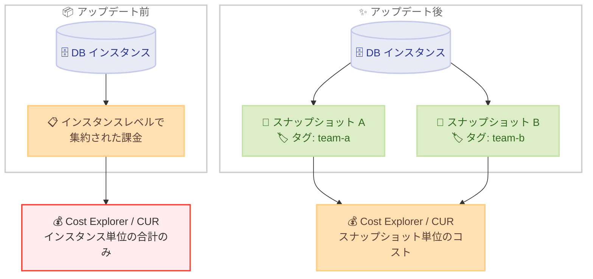

# Amazon RDS - スナップショット単位の課金可視化 (Per Snapshot Billing)

**リリース日**: 2026 年 11 月 2 日
**サービス**: Amazon RDS (Relational Database Service)
**機能**: Per Snapshot Billing (スナップショット単位の課金可視化)

📊 [このアップデートのインフォグラフィックを見る](https://takech9203.github.io/aws-news-summary/20261102-amazon-rds-per-snapshot-billing.html)

## 概要

Amazon RDS がスナップショット単位の課金可視化 (Per Snapshot Billing) をサポートしました。これにより、個々のスナップショットごとのコストを把握できるようになります。

これまで、RDS スナップショットの課金は Cost and Usage Report (CUR) や Cost Explorer において DB インスタンスレベルで集約されて表示されており、どのスナップショットがどれだけのコストを発生させているかを個別に把握することができませんでした。今回のアップデートにより、スナップショットにコスト配分タグを適用することで、各スナップショットの正確なコストを確認できるようになります。

本機能はすべての RDS スナップショットに対してデフォルトで有効化されており、追加料金なしで利用できます。バックアップコストの可視化や予算管理を強化したいすべての RDS ユーザーにとって有用なアップデートです。

**アップデート前の課題**

このアップデート以前は、スナップショットのコスト分析に以下の制約がありました。

- スナップショットの課金額は DB インスタンスレベルで集約されており、個々のスナップショットのコストを特定できなかった
- 長期間保持している手動スナップショットのうち、どれがコストの主要因かを判断するのが困難だった
- チームやプロジェクト単位でスナップショットコストを配分 (チャージバック) することができなかった

**アップデート後の改善**

今回のアップデートにより、以下が可能になりました。

- スナップショットにコスト配分タグを付与することで、スナップショット単位の正確なコストを CUR や Cost Explorer で確認できるようになった
- 不要なスナップショットや高コストのスナップショットを特定し、削除や保持ポリシーの見直しによるコスト最適化が容易になった
- タグに基づくチームやプロジェクト単位でのコスト配分が可能になった

## アーキテクチャ図



アップデート前はスナップショットのコストが DB インスタンスレベルで集約されていましたが、アップデート後はコスト配分タグを利用してスナップショット単位でコストを可視化できます。

## サービスアップデートの詳細

### 主要機能

1. **スナップショット単位のコスト可視化**
   - 個々の RDS スナップショットごとの正確なコストを確認可能
   - Cost and Usage Report (CUR) および Cost Explorer でスナップショット単位の分析が可能
   - バックアップ支出の内訳を詳細に把握できる

2. **コスト配分タグによる分析**
   - スナップショットにコスト配分タグを適用することで、タグ単位でコストをグルーピング
   - チーム、プロジェクト、環境などの単位でのコスト配分 (チャージバック / ショーバック) に活用可能

3. **デフォルトで有効**
   - すべての RDS スナップショットに対してデフォルトで有効化
   - ユーザー側での有効化作業や設定変更は不要
   - 追加料金なし

## 技術仕様

### 機能概要

| 項目 | 詳細 |
|------|------|
| 対象サービス | Amazon RDS (全データベースエンジン) |
| 対象リソース | RDS スナップショット |
| 可視化ツール | Cost and Usage Report (CUR)、Cost Explorer |
| 粒度 | スナップショット単位 (コスト配分タグ利用時) |
| 有効化 | デフォルトで有効 (設定不要) |
| 追加料金 | なし |

## 設定方法

### 前提条件

1. Amazon RDS の DB インスタンスとスナップショットが存在すること
2. コスト配分タグを AWS Billing and Cost Management でアクティブ化する権限があること
3. Cost Explorer または CUR が利用可能であること

### 手順

#### ステップ 1: スナップショットにタグを付与する

```bash
aws rds add-tags-to-resource \
  --resource-name arn:aws:rds:ap-northeast-1:123456789012:snapshot:my-snapshot \
  --tags Key=Team,Value=team-a Key=Project,Value=project-x
```

対象のスナップショットの ARN を指定し、コスト分析に使用するタグ (例: Team、Project) を付与します。

#### ステップ 2: コスト配分タグをアクティブ化する

```bash
aws ce update-cost-allocation-tags-status \
  --cost-allocation-tags-status TagKey=Team,Status=Active TagKey=Project,Status=Active
```

Billing and Cost Management でタグキーをコスト配分タグとしてアクティブ化します。アクティブ化後、CUR や Cost Explorer でタグ別のコスト集計が可能になります。

#### ステップ 3: Cost Explorer でスナップショットコストを確認する

Cost Explorer を開き、サービスで「Amazon Relational Database Service」をフィルタリングし、アクティブ化したタグキー (例: Team) でグルーピングすることで、スナップショット単位のコストを確認できます。CUR を利用している場合は、リソース ID およびタグ列を使用してスナップショットごとのコストを分析できます。

## メリット

### ビジネス面

- **コストの透明性向上**: バックアップ支出の内訳をスナップショット単位で把握でき、予算管理が容易になる
- **チャージバックの実現**: タグに基づいてチームやプロジェクト単位でバックアップコストを配分できる
- **コスト最適化の促進**: 高コストのスナップショットを特定し、保持ポリシーの見直しや不要スナップショットの削除につなげられる

### 技術面

- **設定不要で利用可能**: デフォルトで有効化されているため、既存環境への導入作業が不要
- **既存ツールとの統合**: CUR や Cost Explorer といった既存のコスト管理ツールでそのまま分析できる
- **全エンジン対応**: MySQL、PostgreSQL、MariaDB、Oracle、SQL Server など、すべての RDS エンジンで利用可能

## デメリット・制約事項

### 制限事項

- スナップショット単位のコストを確認するには、スナップショットへのコスト配分タグの適用が必要
- コスト配分タグはアクティブ化した時点以降のコストデータにのみ反映される

### 考慮すべき点

- 既存の多数のスナップショットにタグを付与する場合、タグ付けの運用ルールや自動化 (例: AWS Backup、Lambda によるタグ自動付与) の整備が望ましい
- コスト配分の精度を高めるには、組織全体で一貫したタグ戦略を策定することが重要

## ユースケース

### ユースケース 1: 長期保持スナップショットのコスト最適化

**シナリオ**: 複数年にわたり手動スナップショットを蓄積しており、バックアップコストが増加している。どのスナップショットがコストの主要因かを特定したい。

**実装例**:
```bash
# スナップショット一覧を取得し、作成日時を確認
aws rds describe-db-snapshots \
  --snapshot-type manual \
  --query "DBSnapshots[*].[DBSnapshotIdentifier,SnapshotCreateTime,AllocatedStorage]" \
  --output table
```

**効果**: スナップショット単位のコストを可視化することで、高コストかつ古いスナップショットを特定し、削除やライフサイクル管理によってバックアップコストを削減できる。

### ユースケース 2: チーム単位のコスト配分

**シナリオ**: 複数チームが共有する AWS アカウントで RDS を運用しており、各チームのバックアップコストを正確に配分したい。

**実装例**:
```bash
# チーム単位のタグをスナップショットに付与
aws rds add-tags-to-resource \
  --resource-name arn:aws:rds:ap-northeast-1:123456789012:snapshot:team-a-snapshot \
  --tags Key=CostCenter,Value=team-a
```

**効果**: Cost Explorer で CostCenter タグによるグルーピングを行うことで、チームごとのスナップショットコストを正確に把握し、チャージバックを実現できる。

### ユースケース 3: 環境別のバックアップ予算管理

**シナリオ**: 本番環境と開発環境のスナップショットコストを分離して管理し、開発環境のバックアップ費用に予算アラートを設定したい。

**実装例**:
```bash
# 環境タグに基づく AWS Budgets の予算を作成
aws budgets create-budget \
  --account-id 123456789012 \
  --budget file://budget.json \
  --notifications-with-subscribers file://notifications.json
```

**効果**: 環境別のタグでスナップショットコストをフィルタリングした予算を設定することで、想定外のバックアップコスト増加を早期に検知できる。

## 料金

本機能の利用に追加料金はかかりません。スナップショットのストレージ料金自体は、従来どおり Amazon RDS のバックアップストレージ料金に基づいて課金されます。

## 利用可能リージョン

すべての AWS 商用リージョンおよび AWS GovCloud (US) リージョンで利用可能です。すべての Amazon RDS データベースエンジンに対応しています。

## 関連サービス・機能

- **AWS Cost Explorer**: タグ別・サービス別のコスト分析を行うツール。スナップショット単位のコスト可視化に使用
- **AWS Cost and Usage Report (CUR)**: 最も詳細な課金データを提供するレポート。リソース ID 単位での分析が可能
- **コスト配分タグ**: リソースに付与したタグをコスト分析に利用する仕組み。本機能の中核となる要素
- **AWS Backup**: バックアップの一元管理サービス。タグの自動付与と組み合わせることで運用を効率化可能

## 参考リンク

- 📊 [インフォグラフィック](https://takech9203.github.io/aws-news-summary/20261102-amazon-rds-per-snapshot-billing.html)
- [公式発表 (What's New)](https://aws.amazon.com/about-aws/whats-new/2026/11/amazon-rds-per-snapshot-billing/)
- [ドキュメント: Working with Automated Backups](https://docs.aws.amazon.com/AmazonRDS/latest/UserGuide/USER_WorkingWithAutomatedBackups.html)
- [料金ページ: Amazon RDS の料金](https://aws.amazon.com/rds/pricing/)

## まとめ

Amazon RDS のスナップショット単位の課金可視化により、これまで DB インスタンスレベルで集約されていたスナップショットコストを個別に把握できるようになりました。デフォルトで有効化されており追加料金も不要なため、まずはスナップショットへのコスト配分タグの付与とアクティブ化を行い、Cost Explorer や CUR でバックアップコストの内訳を確認することを推奨します。
