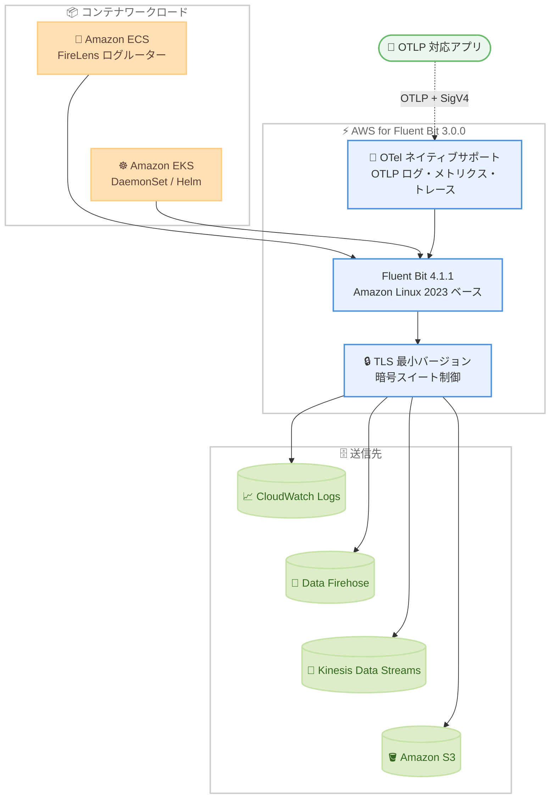

# AWS for Fluent Bit - バージョン 3.0.0 リリース (Fluent Bit 4.1.1 ベース)

**リリース日**: 2026 年 11 月 2 日
**サービス**: AWS for Fluent Bit (Amazon ECS / Amazon EKS)
**機能**: AWS for Fluent Bit 3.0.0 (Fluent Bit 4.1.1 および Amazon Linux 2023 ベース)

📊 [このアップデートのインフォグラフィックを見る](https://takech9203.github.io/aws-news-summary/20261102-aws-fluent-bit-3-0-0-based-4-1-1.html)

## 概要

AWS for Fluent Bit のバージョン 3.0.0 が発表されました。本バージョンは Fluent Bit 4.1.1 と Amazon Linux 2023 をベースとしており、Amazon ECS や Amazon EKS を利用するお客様のコンテナロギングが、より高性能かつ高機能になります。

AWS for Fluent Bit は、Amazon ECS および Amazon EKS のコンテナログを収集・処理し、Amazon CloudWatch Logs、Amazon Data Firehose、Amazon Kinesis Data Streams、Amazon S3 などの宛先へアプリケーションコードを変更することなくルーティングできるログルーターイメージです。3.0.0 では、OpenTelemetry (OTel) のネイティブサポート、JSON パースの高速化によるパフォーマンス向上、TLS 最小バージョンと暗号スイートの制御によるセキュリティ強化が提供されます。

コンテナワークロードの可観測性基盤を運用するプラットフォームチームや SRE にとって、最新の Fluent Bit 機能とセキュリティ強化を取り込める重要なメジャーアップデートです。

**アップデート前の課題**

従来の AWS for Fluent Bit 2.x 系には、以下のような課題がありました。

- 以前のバージョンは古い Fluent Bit をベースとしており、上流の最新機能やパフォーマンス改善を利用できなかった
- OTLP 形式のログ・メトリクス・トレースを扱うには、OpenTelemetry Collector などの別コンポーネントを併用する必要があった
- 出力時の TLS 最小バージョンや暗号スイートを細かく制御できず、組織の TLS ポリシーを強制しにくかった

**アップデート後の改善**

今回のアップデートにより、以下が可能になりました。

- Fluent Bit 4.1.1 へのアップグレードにより、最新機能と大幅なパフォーマンス改善を利用可能になった
- OpenTelemetry のネイティブサポートにより、OTLP のログ・メトリクス・トレースを AWS SigV4 認証付きで取り込み・転送できるようになった
- JSON パースが高速化され、vCPU あたりでより多くのログを低レイテンシで処理できるようになった
- TLS 最小バージョンと暗号スイートの制御により、出力に対して組織の TLS ポリシーを強制できるようになった
- ベースイメージが Amazon Linux 2023 となり、セキュリティ態勢が強化された

## アーキテクチャ図



Amazon ECS / Amazon EKS のコンテナログと OTLP テレメトリーを AWS for Fluent Bit 3.0.0 が収集・処理し、TLS ポリシーを適用した上で各 AWS サービスへルーティングする流れを示しています。

## サービスアップデートの詳細

### 主要機能

1. **Fluent Bit 4.1.1 へのアップグレード**
   - AWS for Fluent Bit 3.0.0 は Fluent Bit バージョン 4.1.1 をベースに構築
   - 上流の最新機能と改善をそのまま利用可能
   - ベースイメージも Amazon Linux 2023 にアップグレードされ、セキュリティが強化

2. **OpenTelemetry (OTel) ネイティブサポート**
   - OTLP 形式のログ・メトリクス・トレースの取り込みと転送をネイティブにサポート
   - AWS SigV4 認証に対応し、AWS サービスへの安全な送信が可能
   - 別途 Collector を立てずに OTel テレメトリーパイプラインを構成可能

3. **パフォーマンス改善**
   - JSON パースの高速化により、vCPU あたりでより多くのログを処理可能
   - レイテンシも低減され、大規模なログ処理の効率が向上

4. **セキュリティ強化 (TLS 制御)**
   - TLS 最小バージョンの指定と暗号スイート (cipher) の制御が可能
   - AWS for Fluent Bit からの出力に組織の TLS ポリシーを強制し、プロトコル面の防御態勢を強化

## 技術仕様

### バージョン構成

| 項目 | 詳細 |
|------|------|
| AWS for Fluent Bit バージョン | 3.0.0 |
| ベースとなる Fluent Bit バージョン | 4.1.1 |
| ベースイメージ | Amazon Linux 2023 |
| 対応コンテナ基盤 | Amazon ECS (FireLens)、Amazon EKS |
| 主な送信先 | Amazon CloudWatch Logs、Amazon Data Firehose、Amazon Kinesis Data Streams、Amazon S3 |
| イメージ提供元 | Amazon ECR Public Gallery、Amazon ECR リポジトリ |

### イメージの指定例

```json
{
  "containerDefinitions": [
    {
      "name": "log_router",
      "image": "public.ecr.aws/aws-observability/aws-for-fluent-bit:3.0.0",
      "essential": true,
      "firelensConfiguration": {
        "type": "fluentbit"
      }
    }
  ]
}
```

## 設定方法

### 前提条件

1. Amazon ECS または Amazon EKS でコンテナワークロードを運用していること
2. ECS の場合は FireLens を使用したタスク定義、EKS の場合は Helm または DaemonSet で Fluent Bit をデプロイしていること
3. 送信先サービス (CloudWatch Logs など) への書き込み権限を持つ IAM ロールが設定されていること

### 手順

#### ステップ 1: 新しいイメージタグの確認

```bash
# Amazon ECR Public Gallery から 3.0.0 イメージを取得
docker pull public.ecr.aws/aws-observability/aws-for-fluent-bit:3.0.0
```

Amazon ECR Public Gallery で公開されている AWS for Fluent Bit 3.0.0 のイメージを取得し、利用可能であることを確認します。

#### ステップ 2: Amazon ECS でのアップグレード

```bash
# タスク定義を更新して新しいリビジョンを登録
aws ecs register-task-definition --cli-input-json file://task-definition.json

# サービスを新しいタスク定義で更新
aws ecs update-service \
  --cluster my-cluster \
  --service my-service \
  --task-definition my-task-def
```

タスク定義内の FireLens ログルーターコンテナのイメージを 3.0.0 タグに更新し、新しいリビジョンを登録してサービスを更新します。

#### ステップ 3: Amazon EKS でのアップグレード

```bash
# Helm リリースを更新する場合
helm upgrade aws-for-fluent-bit eks/aws-for-fluent-bit \
  --namespace kube-system \
  --set image.tag=3.0.0

# DaemonSet のイメージを直接更新する場合
kubectl set image daemonset/fluent-bit \
  fluent-bit=public.ecr.aws/aws-observability/aws-for-fluent-bit:3.0.0 \
  -n kube-system
```

EKS では Helm リリースの更新、または DaemonSet のイメージを 3.0.0 に設定することでアップグレードします。

## メリット

### ビジネス面

- **運用コストの削減**: JSON パースの高速化により vCPU あたりの処理量が増加し、同じログ量をより少ないリソースで処理可能
- **コンプライアンス対応の強化**: TLS 最小バージョンと暗号スイートの制御により、組織のセキュリティポリシーへの準拠が容易
- **可観測性スタックの簡素化**: OTel ネイティブサポートにより、追加コンポーネントなしで OTLP テレメトリーを扱える

### 技術面

- **最新機能へのアクセス**: Fluent Bit 4.1.1 ベースとなり、上流の最新機能と改善を利用可能
- **OTLP の取り込み・転送**: ログ・メトリクス・トレースを AWS SigV4 認証付きで送信でき、AWS サービスとの統合が容易
- **セキュアなベースイメージ**: Amazon Linux 2023 ベースとなり、セキュリティ態勢が向上

## デメリット・制約事項

### 制限事項

- メジャーバージョンアップ (2.x から 3.0.0) のため、既存の設定やプラグインの互換性確認が必要
- ベースイメージが Amazon Linux 2023 に変更されており、カスタムイメージをビルドしている場合は再検証が必要

### 考慮すべき点

- 本番環境への適用前に、ステージング環境でログルーティング設定 (パーサー、フィルター、出力) の動作確認を行うことを推奨
- Fluent Bit 本体のメジャーバージョンが上がっているため、Fluent Bit 4.x 系の変更点 (設定記法や挙動の変更) を公式リリースノートで確認することを推奨

## ユースケース

### ユースケース 1: ECS FireLens によるログルーターの性能改善

**シナリオ**: 大量のアプリケーションログを FireLens 経由で CloudWatch Logs に送信しており、ログルーターの CPU 使用率が高い

**実装例**:
```json
{
  "name": "log_router",
  "image": "public.ecr.aws/aws-observability/aws-for-fluent-bit:3.0.0",
  "firelensConfiguration": { "type": "fluentbit" }
}
```

**効果**: JSON パースの高速化により、vCPU あたりの処理ログ量が増加し、レイテンシも低減。タスクのリソース割り当てを最適化できる

### ユースケース 2: OTLP テレメトリーの統合パイプライン

**シナリオ**: OpenTelemetry SDK で計装したアプリケーションのログ・メトリクス・トレースを、専用の Collector を追加せずに AWS へ送信したい

**実装例**:
```ini
[INPUT]
    Name   opentelemetry
    Listen 0.0.0.0
    Port   4318
```

**効果**: AWS for Fluent Bit が OTLP の取り込みと転送をネイティブにサポートし、SigV4 認証で AWS サービスへ安全に送信できるため、可観測性スタックのコンポーネント数を削減できる

### ユースケース 3: TLS ポリシーの強制によるセキュリティ統制

**シナリオ**: 社内のセキュリティ基準で TLS 1.2 以上と特定の暗号スイートの使用が義務付けられている

**実装例**:
```ini
[OUTPUT]
    Name                 cloudwatch_logs
    Match                *
    region               ap-northeast-1
    log_group_name       my-app-logs
    tls                  On
    tls.min_version      TLSv1.2
```

**効果**: 出力に対して TLS 最小バージョンと暗号スイートを強制でき、監査要件やセキュリティ基準への準拠を構成レベルで担保できる

## 料金

AWS for Fluent Bit 自体は無料で利用できるコンテナイメージです。追加料金は発生しません。

ログの送信先となる Amazon CloudWatch Logs、Amazon Data Firehose、Amazon Kinesis Data Streams、Amazon S3 などの各サービスの利用料金が、取り込み量・保存量に応じて発生します。

## 利用可能リージョン

AWS for Fluent Bit のイメージは Amazon ECR Public Gallery および Amazon ECR リポジトリから取得でき、Amazon ECS / Amazon EKS が利用可能なリージョンで使用できます。

## 関連サービス・機能

- **Amazon ECS (FireLens)**: タスク定義のログルーターコンテナとして AWS for Fluent Bit を使用し、アプリケーションログを柔軟にルーティング
- **Amazon EKS**: DaemonSet または Helm チャートで AWS for Fluent Bit をデプロイし、クラスター全体のログを収集
- **Amazon CloudWatch Logs / Amazon Data Firehose / Amazon Kinesis Data Streams / Amazon S3**: AWS for Fluent Bit の主要なログ送信先
- **OpenTelemetry**: OTLP 形式のログ・メトリクス・トレースをネイティブに取り込み・転送可能

## 参考リンク

- 📊 [インフォグラフィック](https://takech9203.github.io/aws-news-summary/20261102-aws-fluent-bit-3-0-0-based-4-1-1.html)
- [公式発表 (What's New)](https://aws.amazon.com/about-aws/whats-new/2025/10/aws-fluent-bit-3-0-0-based-4-1-1)
- [GitHub: aws/aws-for-fluent-bit](https://github.com/aws/aws-for-fluent-bit)
- [Amazon ECR Public Gallery: aws-for-fluent-bit](https://gallery.ecr.aws/aws-observability/aws-for-fluent-bit)
- [ドキュメント: Amazon ECS FireLens](https://docs.aws.amazon.com/AmazonECS/latest/developerguide/using_firelens.html)

## まとめ

AWS for Fluent Bit 3.0.0 は、Fluent Bit 4.1.1 と Amazon Linux 2023 をベースとしたメジャーアップデートであり、OTel ネイティブサポート、パフォーマンス改善、TLS 制御によるセキュリティ強化が含まれます。Amazon ECS / Amazon EKS でコンテナロギングを運用している場合は、ステージング環境で互換性を検証した上で、3.0.0 タグへのアップグレードを計画することを推奨します。
