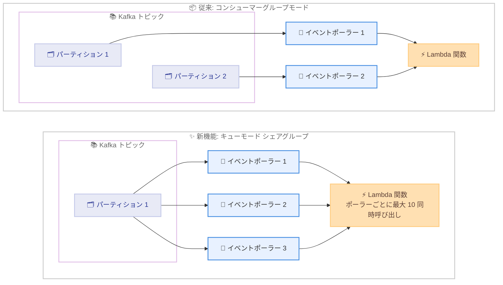

# AWS Lambda - セルフマネージド Kafka イベントソースにおける Queues for Apache Kafka サポート

**リリース日**: 2026 年 11 月 2 日
**サービス**: AWS Lambda
**機能**: セルフマネージド Apache Kafka イベントソースマッピング (ESM) のキュー消費モード (Queue Consumption Mode)

📊 [このアップデートのインフォグラフィックを見る](https://takech9203.github.io/aws-news-summary/20261102-aws-lambda-queue-kafka-esm.html)

## 概要

AWS Lambda がセルフマネージド Apache Kafka イベントソースマッピング (ESM) において、Queues for Apache Kafka (KIP-932 シェアグループ) をサポートしました。シェアグループは Apache Kafka 4.2 で一般提供された機能で、お客様自身が運用する Kafka クラスターや Confluent Cloud などのマネージドサービスで利用できます。

このアップデートにより、複数のイベントポーラーが同一パーティションから同時にメッセージを消費できるようになり、各イベントポーラーは最大 10 の同時 Lambda 呼び出しをサポートします。並列度がトピックのパーティション数から切り離されるため、プロデューサー、トピック設定、関数コードを変更することなく、トラフィックスパイク時のスループット向上と処理の回復力向上を実現できます。

画像・動画エンコーディング、不正検知、通知配信、テレメトリ取り込みなど、各イベントを独立した作業単位として扱い、厳密な順序性よりも処理速度を重視するイベント駆動型 Kafka ワークロードに適した機能です。なお、キューモードはパーティション内の順序性を保証しないため、順序性を必要としないワークロードを対象としています。

**アップデート前の課題**

このアップデート以前は、Kafka ESM の並列度に以下の制約がありました。

- Kafka ESM は Kafka コンシューマーグループプロトコルを使用しており、各パーティションはコンシューマーグループ内の 1 つのコンシューマーにのみ割り当てられるため、並列度の上限がパーティション数に制限されていた
- より高い並列度が必要な場合、トピックを過剰にパーティション分割する (オーバーパーティショニング) 必要があった
- あるいはトラフィックを Amazon SQS などの別のキューイングシステムへ移す必要があり、運用するインフラストラクチャの追加とプロデューサーコードの維持が必要だった
- 同一パーティション内で処理が遅い、または失敗したイベントが、後続イベントの処理をブロックしていた

**アップデート後の改善**

今回のアップデートにより、以下が可能になりました。

- 複数のイベントポーラーが同一パーティションから同時に消費できるようになり、並列度がパーティション数から切り離された
- 各イベントポーラーが最大 10 の同時呼び出しをサポートし、トラフィックスパイク時のスループットが向上した
- 処理が遅い、または失敗したイベントが同一パーティション内の他のイベントの処理を妨げなくなり、処理の回復力が向上した
- プロデューサー、トピック設定、関数コードの変更が不要で、ESM の設定変更のみで移行できるようになった

## アーキテクチャ図



従来のコンシューマーグループモードでは 1 パーティションに 1 イベントポーラーが割り当てられ並列度がパーティション数に制限されていましたが、キューモードでは複数のイベントポーラーが同一パーティションから同時に消費でき、並列度がパーティション数から切り離されます。

## サービスアップデートの詳細

### 主要機能

1. **キュー消費モード (Queue Consumption Mode)**
   - Apache Kafka 4.2 で一般提供された KIP-932 シェアグループを基盤とした新しい消費モード
   - ESM 作成時に `ConsumptionMode` を `Queue` に設定することで有効化
   - AWS マネジメントコンソール、Lambda API、AWS CLI、AWS CloudFormation、AWS SAM、AWS CDK から設定可能

2. **パーティション数に依存しない並列スケーリング**
   - 複数のイベントポーラーが同一パーティションから同時に消費可能
   - 各イベントポーラーは最大 10 の同時 Lambda 呼び出しをサポート
   - パーティション数を増やすことなく処理スループットを拡張可能

3. **処理の回復力向上**
   - 処理が遅い、または失敗したイベントが同一パーティション内の他のイベントをブロックしない
   - 各イベントを独立した作業単位として処理

4. **既存環境への非侵襲的な導入**
   - プロデューサー、トピック設定、関数コードの変更が不要
   - セルフマネージドクラスターのほか、Confluent Cloud などのマネージドサービスにも対応

## 技術仕様

### コンシューマーグループモードとキューモードの比較

| 項目 | コンシューマーグループモード | キューモード |
|------|------------------------------|--------------|
| 基盤プロトコル | Kafka コンシューマーグループ | Kafka シェアグループ (KIP-932) |
| パーティションあたりのポーラー数 | 1 | 複数 |
| ポーラーあたりの同時呼び出し | 1 | 最大 10 |
| 並列度の上限 | パーティション数に依存 | パーティション数から独立 |
| パーティション内の順序保証 | あり | なし |
| 必要な Kafka バージョン | 制限なし | シェアグループ有効なクラスター (Apache Kafka 4.2 以降など) |
| 適したワークロード | 順序性が必要な処理 | 順序性不要で処理速度を重視する処理 |

### API変更履歴

| 日付 | サービス | 変更内容 |
|------|----------|----------|
| 2026/10/30 | [AWS Lambda](https://awsapichanges.com/archive/changes/c2b1d5-lambda.html) | 5 updated api methods - `SelfManagedKafkaEventSourceConfig` に `ConsumptionMode` パラメータが追加され、セルフマネージド Kafka トピックをキューとして消費する設定が可能に |

## 設定方法

### 前提条件

1. シェアグループが有効な Kafka クラスター (Apache Kafka 4.2 以降、または Confluent Cloud などの対応マネージドサービス)
2. Kafka クラスターへのネットワーク接続と認証情報 (AWS Secrets Manager に保存)
3. イベントを処理する Lambda 関数

### 手順

#### ステップ1: Kafka クラスターでシェアグループを有効化

Apache Kafka 4.2 以降のクラスターでシェアグループ機能が有効になっていることを確認します。マネージドサービスを利用している場合は、プロバイダーのドキュメントに従って設定します。

#### ステップ2: ConsumptionMode を Queue に設定して ESM を作成

```bash
aws lambda create-event-source-mapping \
  --function-name my-kafka-processor \
  --topics my-topic \
  --self-managed-event-source '{"Endpoints":{"KAFKA_BOOTSTRAP_SERVERS":["broker1.example.com:9092","broker2.example.com:9092"]}}' \
  --self-managed-kafka-event-source-config '{"ConsumptionMode":"Queue"}' \
  --source-access-configurations '[{"Type":"SASL_SCRAM_512_AUTH","URI":"arn:aws:secretsmanager:ap-northeast-1:123456789012:secret:kafka-credentials"}]'
```

セルフマネージド Kafka クラスターをイベントソースとする ESM を作成しています。`--self-managed-kafka-event-source-config` で `ConsumptionMode` を `Queue` に設定することで、シェアグループベースのキュー消費モードが有効になります。

#### ステップ3: 動作確認

```bash
aws lambda get-event-source-mapping --uuid <ESM の UUID>
```

作成した ESM の設定内容とステータスを確認しています。`State` が `Enabled` になり、`SelfManagedKafkaEventSourceConfig` の `ConsumptionMode` が `Queue` と表示されることを確認します。

## メリット

### ビジネス面

- **インフラストラクチャコストの削減**: 並列度向上のためのオーバーパーティショニングや、別のキューイングシステムの運用が不要になる
- **トラフィックスパイクへの対応力向上**: パーティション数を変更せずにスループットを拡張でき、需要変動に迅速に対応できる
- **移行コストの最小化**: プロデューサー、トピック設定、関数コードの変更が不要なため、既存システムへの影響を最小限に抑えて導入できる

### 技術面

- **並列度とパーティション数の分離**: 複数のイベントポーラーが同一パーティションから同時に消費でき、ポーラーごとに最大 10 の同時呼び出しが可能
- **処理の回復力向上**: 遅延または失敗したイベントが同一パーティション内の他のイベントの処理をブロックしない
- **標準仕様への準拠**: Apache Kafka 4.2 で一般提供された KIP-932 シェアグループという標準機能を基盤としており、特定ベンダーへのロックインがない

## デメリット・制約事項

### 制限事項

- キューモードはパーティション内のメッセージ順序を保証しないため、厳密な順序性が必要なワークロードには適さない
- シェアグループが有効な Kafka クラスター (Apache Kafka 4.2 以降など) が必要であり、古いバージョンのクラスターでは利用できない
- 本アップデートの対象はセルフマネージド Kafka ESM であり、発表時点で Amazon MSK ESM は対象として言及されていない

### 考慮すべき点

- 順序性が必要なワークロードとそうでないワークロードを見極め、トピックごとに適切な消費モードを選択する必要がある
- 同時呼び出し数が増加するため、Lambda の同時実行数クォータやダウンストリームシステムの処理能力を考慮する必要がある
- プロビジョンドモードを設定している場合は Event Poller Unit (EPU) の課金が発生するため、コストへの影響を確認する

## ユースケース

### ユースケース1: 画像・動画エンコーディングパイプライン

**シナリオ**: メディア配信サービスで、アップロードされた動画のエンコーディングジョブを Kafka トピック経由で Lambda に連携している。各ジョブは独立しており順序性は不要だが、アップロードが集中する時間帯にパーティション数がボトルネックとなり処理が遅延している。

**実装例**:
```bash
aws lambda create-event-source-mapping \
  --function-name video-encoder \
  --topics encoding-jobs \
  --self-managed-event-source '{"Endpoints":{"KAFKA_BOOTSTRAP_SERVERS":["broker.example.com:9092"]}}' \
  --self-managed-kafka-event-source-config '{"ConsumptionMode":"Queue"}'
```

**効果**: パーティション数を増やすことなく複数のイベントポーラーが並列にジョブを消費し、ピーク時のエンコーディング遅延を削減できる。

### ユースケース2: リアルタイム不正検知

**シナリオ**: 決済プラットフォームで、取引イベントを Kafka 経由で不正検知の Lambda 関数に送信している。一部の複雑な取引の分析に時間がかかると、同一パーティションの後続取引の検知が遅延してしまう。

**実装例**:
```
ESM の ConsumptionMode を Queue に設定し、各取引イベントを
独立した作業単位として処理する。
処理が遅いイベントがあっても他のイベントの検知は並行して進行する。
```

**効果**: 分析に時間のかかる取引が他の取引の検知をブロックしなくなり、不正検知全体のレイテンシーと回復力が改善する。

### ユースケース3: 別キューイングシステムからの統合

**シナリオ**: 高い並列度を得るために、Kafka のトラフィックの一部を別のキューイングシステムへ転送して Lambda で処理しており、転送用のインフラストラクチャとプロデューサーコードの維持が負担になっている。

**実装例**:
```
1. 転送先キュー向けの ESM と同等の処理を行う Lambda 関数を確認
2. Kafka トピックに対して ConsumptionMode を Queue にした ESM を作成
3. 動作確認後、転送用インフラストラクチャとプロデューサーの転送コードを廃止
```

**効果**: Kafka から直接高並列処理が可能になり、転送用インフラストラクチャの運用コストとプロデューサーコードの保守負担を削減できる。

## 料金

標準の Lambda 料金が適用されます。キューモード自体の追加料金はありません。

セルフマネージド Kafka ESM で[プロビジョンドモード](https://docs.aws.amazon.com/lambda/latest/dg/kafka-scaling-modes.html#kafka-provisioned-mode)を設定している場合は、Event Poller Unit (EPU) の使用量に対する課金も発生します。

詳細は [AWS Lambda 料金ページ](https://aws.amazon.com/lambda/pricing/)を参照してください。

## 利用可能リージョン

セルフマネージド Kafka ESM が利用可能なすべての AWS 商用リージョンで利用できます。

## 関連サービス・機能

- **Amazon MSK**: AWS のマネージド Kafka サービス。本アップデートはセルフマネージド Kafka ESM が対象であり、MSK ESM は発表時点で対象として言及されていない
- **Amazon SQS**: AWS のマネージドキューイングサービス。従来は高並列処理のために Kafka から SQS へトラフィックを移すケースがあったが、本機能により Kafka のまま高並列処理が可能になる
- **AWS Secrets Manager**: Kafka クラスターへの認証情報の保存に使用
- **AWS CloudFormation / AWS SAM / AWS CDK**: ESM の `ConsumptionMode` 設定を IaC で管理可能

## 参考リンク

- 📊 [インフォグラフィック](https://takech9203.github.io/aws-news-summary/20261102-aws-lambda-queue-kafka-esm.html)
- [公式発表 (What's New)](https://aws.amazon.com/about-aws/whats-new/2026/11/aws-lambda-queue-kafka-esm/)
- [AWS Blog: Introducing queue consumption mode for Apache Kafka in AWS Lambda](https://aws.amazon.com/blogs/compute/introducing-queue-consumption-mode-for-apache-kafka-in-aws-lambda/)
- [ドキュメント: Using queues with Kafka event source mappings](https://docs.aws.amazon.com/lambda/latest/dg/polling-kafka-queue.html)
- [ドキュメント: Lambda とセルフマネージド Apache Kafka の使用](https://docs.aws.amazon.com/lambda/latest/dg/with-kafka.html)
- [KIP-932: Queues for Kafka](https://cwiki.apache.org/confluence/spaces/KAFKA/pages/255070434/KIP-932+Queues+for+Kafka)
- [AWS Lambda 料金ページ](https://aws.amazon.com/lambda/pricing/)

## まとめ

Lambda のセルフマネージド Kafka ESM がシェアグループベースのキュー消費モードをサポートしたことで、並列度がパーティション数から切り離され、プロデューサーや関数コードを変更せずにスループットと処理の回復力を向上できるようになりました。順序性を必要としない Kafka ワークロードでオーバーパーティショニングや別キューイングシステムへの転送を行っている場合は、Apache Kafka 4.2 以降への移行と `ConsumptionMode` を `Queue` に設定した ESM の導入を検討することを推奨します。
