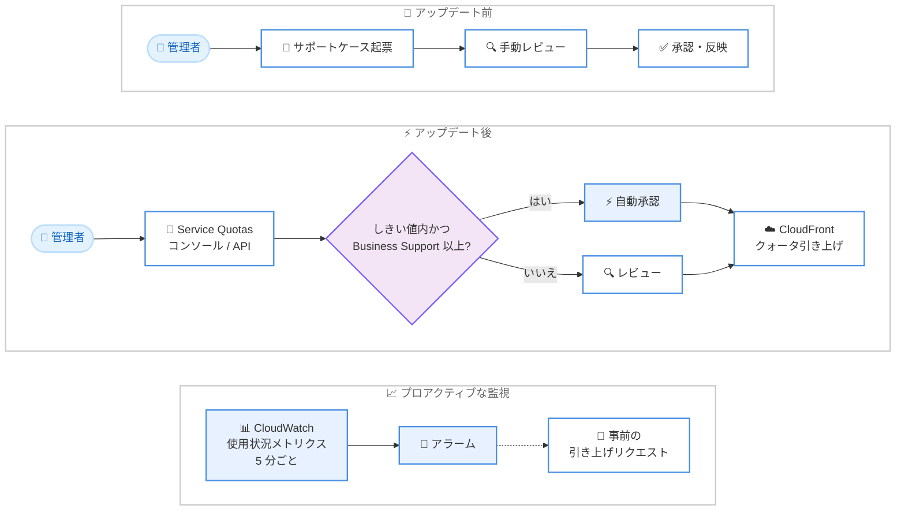

# Amazon CloudFront - AWS Service Quotas によるセルフサービスクォータ引き上げ

**リリース日**: 2026 年 11 月 2 日
**サービス**: Amazon CloudFront
**機能**: AWS Service Quotas 統合によるセルフサービスでのクォータ引き上げ

📊 [このアップデートのインフォグラフィックを見る](https://takech9203.github.io/aws-news-summary/20261102-cloudfront-self-service-quotas.html)

## 概要

Amazon CloudFront が AWS Service Quotas と統合され、28 個の CloudFront クォータを Service Quotas コンソールまたは API から表示、監視、引き上げリクエストできるようになりました。これまでディストリビューション数やキャッシュポリシー数、オリジン数、代替ドメイン名 (CNAME) 数などの上限緩和にはサポートケースの起票と手動レビューが必要でしたが、今回のアップデートにより多くのケースでこの手順が不要になります。

AWS Business Support 以上のサポートプランを契約している場合、公開されているしきい値の範囲内の引き上げリクエストは自動的に承認されます。たとえば、AWS アカウントあたりのディストリビューション数を 500 から 1,000 に、ディストリビューションあたりの代替ドメイン名数を 100 から 500 に、サポートケースなしで引き上げることができます。

さらに、一部のクォータは使用状況メトリクスを 5 分ごとに Amazon CloudWatch に発行します。これにより、CloudWatch アラームを設定して上限到達前に事前にクォータ引き上げをリクエストする、プロアクティブな運用が可能になります。

**アップデート前の課題**

- CloudFront のクォータ引き上げにはサポートケースの起票が必要で、手動レビューの完了まで待つ必要があった
- クォータの現在値と使用状況を一元的に確認する手段が限られており、上限到達を事前に検知しにくかった
- 大規模なマルチテナント構成や SaaS 環境の拡張時に、クォータ引き上げの待ち時間がデプロイのボトルネックになることがあった

**アップデート後の改善**

- Service Quotas コンソールまたは API から 28 個の CloudFront クォータを表示、監視、引き上げリクエストできるようになった
- AWS Business Support 以上の契約があれば、公開しきい値内のリクエストは自動承認され、サポートケースが不要になった
- 一部のクォータは使用状況メトリクスが 5 分ごとに CloudWatch に発行され、アラームによる事前検知と計画的な引き上げが可能になった

## アーキテクチャ図



アップデート前はサポートケースと手動レビューが必須でしたが、アップデート後は Service Quotas 経由でリクエストでき、条件を満たせば自動承認されます。CloudWatch メトリクスを活用した事前検知も可能です。

## サービスアップデートの詳細

### 主要機能

1. **Service Quotas コンソール / API からのクォータ管理**
   - 28 個の CloudFront クォータを Service Quotas から表示、監視、引き上げリクエスト可能
   - コンソール操作に加えて、AWS CLI の `request-service-quota-increase` などの API からも操作できる
   - ディストリビューション数、キャッシュポリシー数、オリジン数、代替ドメイン名数などが対象

2. **公開しきい値内での自動承認**
   - AWS Business Support 以上のサポートプランを契約している場合、公開されているしきい値の範囲内のリクエストは自動承認される
   - 例: アカウントあたりのディストリビューション数を 500 から 1,000 へ引き上げ
   - 例: ディストリビューションあたりの代替ドメイン名数を 100 から 500 へ引き上げ
   - サポートケースの起票や手動レビューの待ち時間が不要

3. **CloudWatch への使用状況メトリクス発行**
   - 一部のクォータは使用状況メトリクスを 5 分ごとに CloudWatch に発行
   - CloudWatch アラームを設定し、使用率がしきい値に達した時点で通知を受け取れる
   - 上限到達前にプロアクティブにクォータ引き上げをリクエストできる

## 技術仕様

### 自動承認の例

| クォータ | デフォルト値 | 自動承認の上限例 |
|------|------|------|
| アカウントあたりのディストリビューション数 | 500 | 1,000 |
| ディストリビューションあたりの代替ドメイン名 (CNAME) 数 | 100 | 500 |

### 本機能のポイント

| 項目 | 詳細 |
|------|------|
| 対象クォータ数 | 28 個 |
| 操作方法 | Service Quotas コンソールまたは API |
| 自動承認の条件 | AWS Business Support 以上の契約、かつ公開しきい値内のリクエスト |
| 使用状況メトリクス | 一部クォータが 5 分ごとに CloudWatch に発行 |
| 従来の方法 | Service Quotas に未対応のクォータは、引き続きサポートケースで引き上げをリクエスト |

### API 変更履歴

本アップデートに伴う CloudFront SDK / API の変更は、awsapichanges.com では確認されていません (Service Quotas の既存 API を使用します)。

## 設定方法

### 前提条件

1. AWS アカウントと Service Quotas へのアクセス権限 (`servicequotas:*` 関連の IAM 権限)
2. 自動承認を利用する場合は AWS Business Support 以上のサポートプラン
3. 使用状況の監視を行う場合は CloudWatch アラームの設定権限

### 手順

#### ステップ 1: CloudFront のクォータ一覧を確認する

```bash
aws service-quotas list-service-quotas \
  --service-code cloudfront \
  --region us-east-1
```

Service Quotas API を使用して、CloudFront の適用済みクォータの一覧 (クォータコード、名前、現在値) を取得します。CloudFront はグローバルサービスのため、us-east-1 リージョンを指定します。

#### ステップ 2: クォータ引き上げをリクエストする

```bash
aws service-quotas request-service-quota-increase \
  --service-code cloudfront \
  --quota-code L-XXXXXXXX \
  --desired-value 1000 \
  --region us-east-1
```

対象クォータのクォータコードと希望値を指定して引き上げをリクエストします。AWS Business Support 以上を契約しており、希望値が公開しきい値内であれば自動的に承認されます。

#### ステップ 3: リクエストの状況を確認する

```bash
aws service-quotas list-requested-service-quota-change-history \
  --service-code cloudfront \
  --region us-east-1
```

クォータ引き上げリクエストの履歴とステータス (PENDING、APPROVED など) を確認します。

#### ステップ 4: CloudWatch アラームで使用状況を監視する

Service Quotas コンソールの各クォータ詳細ページから、使用率に対する CloudWatch アラーム (例: 使用率 80% 到達で通知) を作成できます。使用状況メトリクスを発行するクォータが対象です。

## メリット

### ビジネス面

- **リードタイムの短縮**: サポートケースの起票と手動レビューの待ち時間がなくなり、サービス拡張のスピードが向上する
- **運用負荷の削減**: クォータ引き上げの申請作業が簡素化され、運用チームの工数を削減できる
- **成長への即応性**: SaaS やマルチテナント環境でテナント追加時のクォータ制約に迅速に対応できる

### 技術面

- **一元的なクォータ管理**: 他の AWS サービスと同様に Service Quotas でクォータを統一的に管理できる
- **自動化との親和性**: Service Quotas API を使用して、IaC やスクリプトからクォータ引き上げを自動化できる
- **プロアクティブな監視**: 5 分間隔の使用状況メトリクスと CloudWatch アラームにより、上限到達前に対処できる

## デメリット・制約事項

### 制限事項

- 自動承認を利用するには AWS Business Support 以上のサポートプラン契約が必要
- 自動承認されるのは公開されているしきい値の範囲内のリクエストのみで、それを超える場合はレビューが必要
- Service Quotas に対応するのは 28 個のクォータであり、未対応のクォータは従来どおりサポートケースでの申請が必要
- 使用状況メトリクスを CloudWatch に発行するのは一部のクォータに限られる

### 考慮すべき点

- Basic または Developer Support の場合、Service Quotas からリクエストは可能だが自動承認の対象外となる
- CloudFront はグローバルサービスのため、Service Quotas の操作は us-east-1 リージョンで行う必要がある
- クォータ引き上げはコスト増加につながるリソース作成を許容するため、ガバナンス上の管理 (IAM によるリクエスト権限の制御など) を検討する

## ユースケース

### ユースケース 1: SaaS 事業者のテナント拡大への即応

**シナリオ**: マルチテナント SaaS を運用しており、テナント追加に伴いディストリビューション数がデフォルト上限の 500 に近づいている。

**実装例**:
```bash
aws service-quotas request-service-quota-increase \
  --service-code cloudfront \
  --quota-code <ディストリビューション数のクォータコード> \
  --desired-value 1000 \
  --region us-east-1
```

**効果**: Business Support 以上であれば自動承認されるため、サポートケースの待ち時間なしでテナント追加を継続できる。

### ユースケース 2: 多数のカスタムドメインを持つ Web サイトの統合配信

**シナリオ**: 1 つのディストリビューションで多数のブランドドメインを配信しており、代替ドメイン名数がデフォルトの 100 では不足する。

**実装例**:
```bash
aws service-quotas request-service-quota-increase \
  --service-code cloudfront \
  --quota-code <代替ドメイン名数のクォータコード> \
  --desired-value 500 \
  --region us-east-1
```

**効果**: 代替ドメイン名数を最大 500 まで自動承認で引き上げられ、ディストリビューションを分割せずにドメインを追加できる。

### ユースケース 3: クォータ使用率のプロアクティブな監視

**シナリオ**: CI/CD パイプラインでディストリビューションやポリシーを動的に作成しており、クォータ上限到達によるデプロイ失敗を防ぎたい。

**実装例**:
```
1. Service Quotas コンソールで対象クォータの使用状況メトリクスを確認
2. 使用率 80% をしきい値とする CloudWatch アラームを作成
3. アラーム発報時に SNS 経由で通知し、クォータ引き上げをリクエスト
```

**効果**: 5 分ごとのメトリクスにより上限到達前に検知でき、デプロイ失敗を未然に防止できる。

## 料金

本機能 (Service Quotas の利用およびクォータ引き上げリクエスト) に追加料金は発生しません。ただし、自動承認を利用するには AWS Business Support 以上のサポートプラン (有料) の契約が必要です。CloudWatch アラームを作成する場合は、CloudWatch の標準料金が適用されます。

## 利用可能リージョン

Amazon CloudFront がサポートされているすべての AWS リージョンで利用可能です。なお、CloudFront はグローバルサービスのため、Service Quotas での操作は us-east-1 リージョンで行います。

## 関連サービス・機能

- **AWS Service Quotas**: AWS サービスのクォータを一元的に表示、管理するサービス。今回 CloudFront が統合された
- **Amazon CloudWatch**: クォータ使用状況メトリクスの発行先。アラームによる事前検知に活用できる
- **AWS Support プラン**: Business Support 以上の契約が自動承認の条件となる

## 参考リンク

- 📊 [インフォグラフィック](https://takech9203.github.io/aws-news-summary/20261102-cloudfront-self-service-quotas.html)
- [公式発表 (What's New)](https://aws.amazon.com/about-aws/whats-new/2026/11/cloudfront-self-service-quotas/)
- [ドキュメント: Amazon CloudFront のクォータ](https://docs.aws.amazon.com/AmazonCloudFront/latest/DeveloperGuide/cloudfront-limits.html)
- [ドキュメント: Service Quotas でのクォータ引き上げリクエスト](https://docs.aws.amazon.com/servicequotas/latest/userguide/request-quota-increase.html)

## まとめ

CloudFront のクォータ引き上げが Service Quotas 経由のセルフサービスとなり、Business Support 以上であれば公開しきい値内のリクエストは自動承認されるようになりました。大規模な CloudFront 環境を運用しているチームは、まず Service Quotas コンソールで現在のクォータと使用状況を確認し、使用率の高いクォータに CloudWatch アラームを設定することを推奨します。
